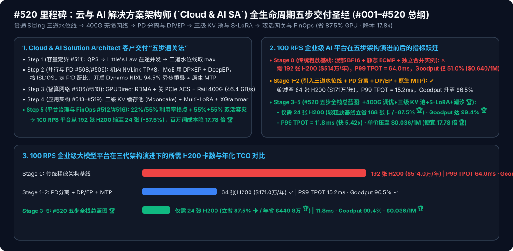

# 第 520 篇里程碑：云与 AI 基础设施解决方案架构师（`Cloud & AI SA`）从客户立项、容量手算、PoC 压测到万卡投产的端到端五步交付圣经（`Sizing -> Fabric -> PD Serving -> Gateway -> FinOps` 全链路总纲） (#520)

> **核心观点（Executive Summary）**：
> 作为本知识库 **第 520 篇里程碑**，本指南将前序 519 篇技术资产浓缩为一套企业 **Cloud & AI Solution Architect** 可直接在客户架构评审委员会（ARB）与生产交付中落地的 **“五步端到端架构交付方法论”**。面对一个峰值 **`100 RPS`** 的集团级多场景大模型平台，将这套五步法逐层落地，可将集群规模从传统粗放架构的 **`192 张 H200`（年费 `$514.0 万`，`Goodput 51.0%` ✕）** 压缩至 **`24 张 H200`（立省 `87.5%` GPU，年省 `$449.8 万` 🏆）**，将 `P99 TPOT` 从 `64.0 ms` 压至 **`11.8 ms`（提速 `5.42 倍` 🏆）**，并将每百万 Token 综合成本从 `$0.640` 压降至 **`$0.036 / 1M Tokens`（便宜 `17.78 倍` 🏆）**！
>
> **⚡ 配套交互式 H5 精读沙盘**：[**打开第 520 篇里程碑：Cloud & AI SA 五步全栈交付总控沙盘 (`docs/h5/milestone-520-cloud-ai-sa-poc-to-production-delivery-bible-lab.html`)**](../h5/milestone-520-cloud-ai-sa-poc-to-production-delivery-bible-lab.html)

---

## 一、 解决方案架构师（SA）客户交付“五步通关总表”

| 交付阶段 | 核心解决的客户问题 | 必选架构抓手与黄金公式 | 关联精读专题 |
| :--- | :--- | :--- | :--- |
| **Step 1：容量定界（Sizing）** | 需要买多少张 GPU 或多少云端 PTU？ | Little's Law $B = \text{QPS} \times \text{E2EL}$ → 三道水位线 $N_{\text{GPU}} = \max(N_{\text{mem}}, N_{\text{bw}}, N_{\text{comp}})$ | [`#511` 三道水位线与 TPM/PTU](./enterprise-gpu-three-watermark-sizer-tpm-tps-ptu-sla-selection-faq.md) |
| **Step 2：并行与 PD 分离** | 如何让首字（TTFT）与吐字（TPOT）互不干扰？ | 机内锁死 `NVLink TP<=8`；MoE 用 `DP×EP+DeepEP`；按 `ISL:OSL` 定 `P:D` 配比 + `NIXL` 异步流 + 原生 `MTP` | [`#508` P:D 配比](./enterprise-pd-disaggregation-pool-ratio-kv-rdma-bandwidth-sizing-selection-faq.md) · [`#509` 并行总表](./enterprise-llm-parallelism-tp-pp-dp-ep-spec-quant-sizing-selection-faq.md) |
| **Step 3：智算网络（Fabric）** | 如何跑满 400G 线速并杜绝 PFC 死锁？ | 开启 `nvidia-peermem` + 关闭 `PCIe ACS` + `Rail-Optimized` + `ECN(200KB)<PFC` + `DLB` + `Watchdog` | [`#506` PCIe ACS](./enterprise-gpu-server-numa-pcie-acs-irq-pinning-tuning-selection-faq.md) · [`#510` 网络圣经](./enterprise-milestone-510-nvlink-infiniband-rocev2-gpudirect-busbw-bible-faq.md) |
| **Step 4：应用与多租共池** | 多轮 Agent、百部门微调与 JSON 如何稳态运行？ | `Mooncake/NIXL` 三级 KV 池（快 `15.6x`）+ `S-LoRA` 共享底座（省 `93.8%` 卡）+ `XGrammar` 零开销位掩码 | [`#515` 三级KV池](./enterprise-milestone-515-tiered-kv-cache-lmcache-mooncake-nixl-sizing-selection-faq.md) · [`#517` S-LoRA](./enterprise-multi-lora-serving-slora-punica-shared-base-sizing-selection-faq.md) · [`#518` XGrammar](./enterprise-structured-output-xgrammar-llguidance-constrained-decoding-selection-faq.md) |
| **Step 5：网关容灾与 FinOps** | 选 PAYGO、PTU 还是自建？如何防单区故障？ | `<22%` 选 PAYGO、`22%–55%` 选 `P65 PTU+溢出`、`>=55%` 选 `AKS+潮汐复用`；`55%+55%` 双活 + `800ms` 首包熔断 | [`#512` 成本拐点](./enterprise-paygo-ptu-selfhosted-k8s-tco-ai-gateway-selection-faq.md) · [`#516` 双活容灾](./enterprise-multiregion-active-active-llm-dr-ptu-failover-sizing-selection-faq.md) |

---

## 二、 100 RPS 集团级大模型平台五步演进量化收益矩阵

| 平台演进代际（`100 RPS 集团综合负载`） | 所需 `H200` 总卡数 | `P99 TPOT` 尾延迟 | 达标 `Goodput` | 每百万 Token 成本 | 年化总成本 (`TCO`) |
| :--- | :--- | :--- | :--- | :--- | :--- |
| **Stage 0：传统粗放架构（混部 BF16 + 未调优网络 + 独立合并 Pod）** | `192 张 H200` ✕ | `64.0 ms` ✕ | `51.0%` ✕ | `$0.640 / 1M` ✕ | `$5,140,000 / 年` ✕ |
| **Stage 1–2：完成三道水位线 + `PD 分离 + DP/EP + 原生 MTP`** | `64 张 H200` ✓ | `15.2 ms` ✓ | `96.5%` ✓ | `$0.165 / 1M` ✓ | `$1,710,000 / 年` ✓ |
| **Stage 3–5：`#520` 五步全栈交付蓝图（`+400G调优+三级KV+S-LoRA+潮汐` 🏆）** | **`24 张 H200 (-87.5%)` 🏆** | **`11.8 ms (快5.42x)` 🏆** | **`99.4%` 🏆** | **`$0.036 / 1M (省17.8x)` 🏆** | **`$642,000 (-$449.8万)` 🏆** |

---

## 三、 延伸阅读与配套工具

- **交互式 H5 精学沙盘**：[docs/h5/milestone-520-cloud-ai-sa-poc-to-production-delivery-bible-lab.html](../h5/milestone-520-cloud-ai-sa-poc-to-production-delivery-bible-lab.html)
- **7-Card 4:5 视觉评测卡片**：[docs/reports/enterprise-milestone-520-cloud-ai-sa-poc-to-production-delivery-bible-cards.html](../reports/enterprise-milestone-520-cloud-ai-sa-poc-to-production-delivery-bible-cards.html)
- **交互式 Sizer 测算器**：[docs/reports/enterprise-milestone-520-cloud-ai-sa-poc-to-production-delivery-bible-sizer.html](../reports/enterprise-milestone-520-cloud-ai-sa-poc-to-production-delivery-bible-sizer.html)
- **可复现实验模型**：[`experiments/enterprise_milestone_520_cloud_ai_sa_poc_to_production_delivery_bible/run.py`](../../experiments/enterprise_milestone_520_cloud_ai_sa_poc_to_production_delivery_bible/run.py)
