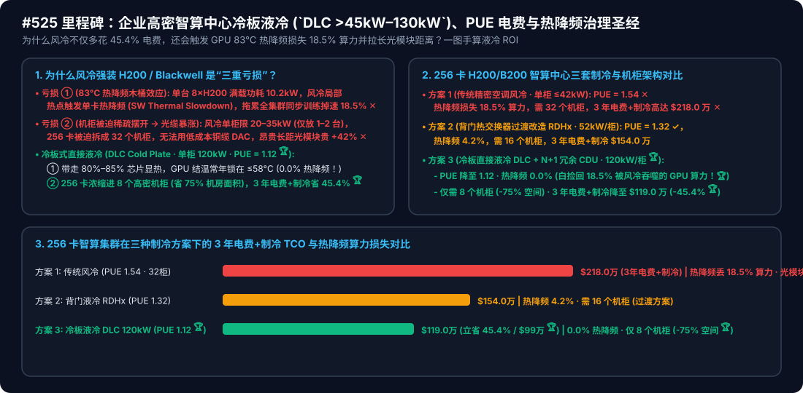

# Milestone #525: Enterprise AI Datacenter Direct-to-Chip Liquid Cooling (`DLC >45kW–130kW/Rack`), `PUE` & Thermal Throttling Bible (#525)

> **Executive Summary**:
> Deploying high-density `H200 / Blackwell B200` servers (`10.2–14.5 kW/node`) into legacy air-cooled racks (`<=42 kW/rack`) causes **`PUE = 1.54`**, triggers **`18.5%` cluster-wide throughput loss from single-GPU `83°C` thermal throttling ✕**, and forces a `256-GPU` cluster across **`32` spread-out racks** (`+42%` optical cabling cost ✕). **Milestone #525** establishes the **Direct-to-Chip Cold-Plate Liquid Cooling (`DLC + N+1 Redundant CDU`, `120 kW/rack`)** standard:
> 1. **Lowers Facility `PUE` from `1.54` to `1.12` 🏆** and eliminates thermal throttling (**`0.0%` loss, recovering `18.5%` effective GPU compute 🏆**);
> 2. **Compresses `256 GPUs` from `32` Racks into `8` Racks (`-75.0%` footprint)**, enabling short-reach DAC/LPO links and cutting 3-year power & cooling TCO by **`45.4%` (`$1.19M` vs. `$2.18M`, saving `$990,000` 🏆)**!
>
> **⚡ Interactive H5 Study Lab**: [**Open Milestone #525 DLC Liquid Cooling, PUE & Thermal Sizer (`docs/h5/milestone-525-dlc-liquid-cooling-pue-thermal-throttling-lab.html`)**](../h5/milestone-525-dlc-liquid-cooling-pue-thermal-throttling-lab.html)

---

## 1. Quantitative Decision Matrix (`256-GPU H200/B200 Cluster`)

| Cooling & Rack Architecture (`256 GPUs`) | Rack Power Density | Facility `PUE` | Thermal Throttle Loss | Racks Required | 3-Year Power/Cooling TCO |
| :--- | :--- | :--- | :--- | :--- | :--- |
| **Anti-Pattern: Legacy Air Cooling (`<=42 kW/rack`)** | `42 kW` ✕ | `1.54` ✕ | `18.5%` ✕ | `32 racks` ✕ | `$2,180,000` ✕ |
| **Transitional: Rear-Door Heat Exchanger (`RDHx`)** | `52 kW` | `1.32` ✓ | `4.2%` ⚠️ | `16 racks` | `$1,540,000` |
| **Optimal: Direct-to-Chip Cold-Plate `DLC` (`120 kW/rack` 🏆)** | **`120 kW` 🏆** | **`1.12` 🏆** | **`0.0%` 🏆** | **`8 racks (-75%)` 🏆** | **`$1,190,000 (-45.4%)` 🏆** |

---

## 2. Companion Links

- **Interactive H5 Study Lab**: [docs/h5/milestone-525-dlc-liquid-cooling-pue-thermal-throttling-lab.html](../h5/milestone-525-dlc-liquid-cooling-pue-thermal-throttling-lab.html)
- **7-Card 4:5 Visual Report**: [docs/reports/enterprise-milestone-525-dlc-liquid-cooling-pue-thermal-throttling-bible-cards.html](../reports/enterprise-milestone-525-dlc-liquid-cooling-pue-thermal-throttling-bible-cards.html)
- **HTML Sizer**: [docs/reports/enterprise-milestone-525-dlc-liquid-cooling-pue-thermal-throttling-bible-sizer.html](../reports/enterprise-milestone-525-dlc-liquid-cooling-pue-thermal-throttling-bible-sizer.html)
- **Reproducible Model**: [`experiments/enterprise_milestone_525_dlc_liquid_cooling_pue_thermal_throttling_bible/run.py`](../../experiments/enterprise_milestone_525_dlc_liquid_cooling_pue_thermal_throttling_bible/run.py)
