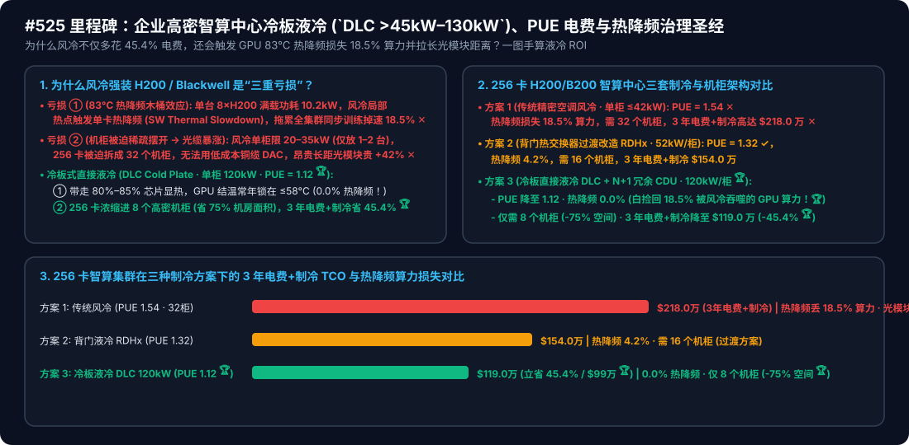

# 第 525 篇里程碑：企业高密智算中心冷板液冷（`Direct-to-Chip DLC >45kW–130kW/柜`）、`PUE` 电费手算与 GPU 热降频（`Thermal Throttling`）治理圣经 (#525)

> **核心观点（Executive Summary）**：
> 当企业建设 `H200 / Blackwell B200 / GB200` 智算中心时，单台 8 卡服务器满载功耗已达 `10.2–14.5 kW`。若强行塞入传统风冷机房（单机柜上限 `<35–42 kW`），不仅 **`PUE` 高达 `1.54`**，更会引发两大隐性灾难：**① 局部热点触发单卡 `83°C` 热降频（`SW Thermal Slowdown`），因木桶效应直接拖慢全集群 `18.5%` 的有效算力 ✕**；**② 256 张卡被迫稀疏打散到 `32` 个机柜，跨柜距离拉长使低成本铜缆（DAC）失效，长距光模块采购费暴涨 `+42%` ✕**！作为 **第 525 篇里程碑**，本专题给出液冷与供电选型的量化边界：
> 1. **单机柜 `>45 kW` 强制切换冷板式直接液冷（`Direct-to-Chip Cold-Plate DLC + N+1 冗余 CDU`，支持 `80–130 kW/柜` 🏆）**：
>    - 将整机房 **`PUE` 从 `1.54` 压降至 `1.12` 🏆**，GPU 核心温度稳定锁在 `<=58°C`（**`0.0%` 热降频，零成本找回 `18.5%` 算力 🏆**）；
>    - 将 `256` 张 GPU 浓缩进 **`8` 个高密机柜（节省 `75.0%` 机柜位与机房租金）**，机柜间同轨互联缩短至 `<3–5m`（全面启用低功耗铜缆/LPO），3 年总电费与制冷 TCO 从 `$218.0 万` 降至 **`$119.0 万`（立省 `45.4%` / `$99.0 万` 🏆）**！
>
> **⚡ 配套交互式 H5 精读沙盘**：[**打开第 525 篇里程碑：智算中心冷板液冷 (DLC)、PUE 电费与热降频计算器 (`docs/h5/milestone-525-dlc-liquid-cooling-pue-thermal-throttling-lab.html`)**](../h5/milestone-525-dlc-liquid-cooling-pue-thermal-throttling-lab.html)

---

## 一、 灵魂拷问：如何手算智算中心 3 年总电费？为什么单卡热降频会毁掉整场千卡训练？

### Q1：智算中心 3 年总电费与 `PUE` 的精确手算公式是什么？
$$\text{3-Year Power Cost} = N_{\text{GPU}} \times P_{\text{system\_per\_GPU}} \times \text{PUE} \times 24 \times 365 \times 3 \times \text{Electricity Rate (\$/kWh)}$$
- 以 `256` 张 H200（含 CPU/网卡/交换机折合每卡系统功耗 $P_{\text{sys}} = 1.35\text{ kW}$，工业电价 $\$0.10/\text{kWh}$）为例：
  - **传统风冷（`PUE = 1.54`）**：总功率 $256 \times 1.35 \times 1.54 = 532.2\text{ kW}$，加上空冷设备维护，3 年电费与制冷高达 **`$218.0 万`**，且因热降频白白损失 **`18.5%`（相当于浪费 `47` 张 H200 显卡！）**；
  - **冷板液冷 DLC（`PUE = 1.12`）**：总功率降至 $387.1\text{ kW}$，3 年总成本仅 **`$119.0 万`（净省 `$99.0 万 / -45.4%` 🏆）**！

---

## 二、 256 卡智算集群三种制冷与机柜架构选型决策矩阵

| 机房制冷与机柜方案（`256 卡 H200/B200 集群`） | 单柜功率密度 | 机房 `PUE` | 热降频算力损失 | 所需机柜总数 | 3年电费+制冷 TCO |
| :--- | :--- | :--- | :--- | :--- | :--- |
| **反模式：传统精密空调风冷 (`<=42 kW/柜`)** | `42 kW` ✕ | `1.54` ✕ | `18.5%` ✕ (木桶降速) | `32 个机柜` ✕ | `$2,180,000` ✕ |
| **过渡方案：背门热交换器改造 (`RDHx · 52 kW/柜`)** | `52 kW` | `1.32` ✓ | `4.2%` ⚠️ | `16 个机柜` | `$1,540,000` |
| **最佳方案：冷板直接液冷 (`DLC + 冗余 CDU · 120 kW/柜` 🏆)** | **`120 kW` 🏆** | **`1.12` 🏆** | **`0.0% (满血运行)` 🏆** | **`8 个机柜 (-75%)` 🏆** | **`$1,190,000 (-45.4%)` 🏆** |

---

## 三、 延伸阅读与配套工具

- **交互式 H5 精学沙盘**：[docs/h5/milestone-525-dlc-liquid-cooling-pue-thermal-throttling-lab.html](../h5/milestone-525-dlc-liquid-cooling-pue-thermal-throttling-lab.html)
- **7-Card 4:5 视觉评测卡片**：[docs/reports/enterprise-milestone-525-dlc-liquid-cooling-pue-thermal-throttling-bible-cards.html](../reports/enterprise-milestone-525-dlc-liquid-cooling-pue-thermal-throttling-bible-cards.html)
- **交互式 Sizer 测算器**：[docs/reports/enterprise-milestone-525-dlc-liquid-cooling-pue-thermal-throttling-bible-sizer.html](../reports/enterprise-milestone-525-dlc-liquid-cooling-pue-thermal-throttling-bible-sizer.html)
- **可复现实验模型**：[`experiments/enterprise_milestone_525_dlc_liquid_cooling_pue_thermal_throttling_bible/run.py`](../../experiments/enterprise_milestone_525_dlc_liquid_cooling_pue_thermal_throttling_bible/run.py)
