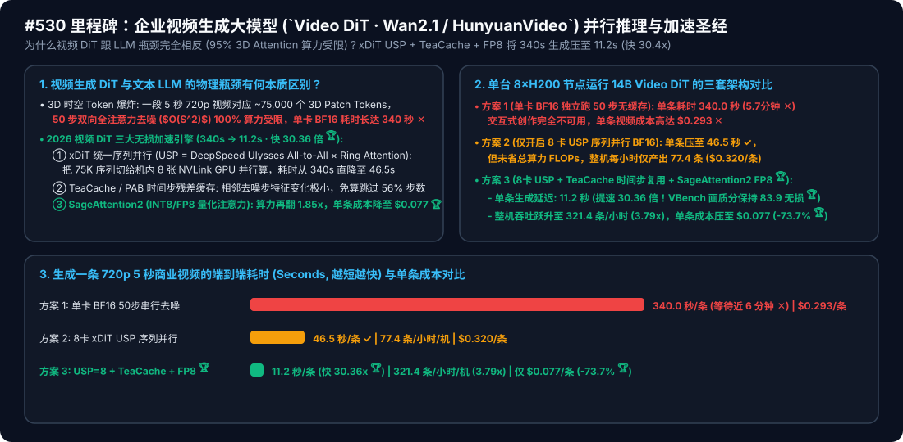

# Milestone #530: Enterprise Video DiT Serving (`Wan2.1-14B / HunyuanVideo`) Selection Bible — `xDiT Unified Sequence Parallelism (USP=8) + TeaCache + SageAttention2 FP8` (#530)

> **Executive Summary**:
> Unlike memory-bandwidth-bound LLM decoding, **Video Diffusion Transformers (`Video DiT`, e.g., `Wan2.1-14B / HunyuanVideo`)** process **`~75,000` 3D spatiotemporal patch tokens** across `50` bidirectional full-attention denoising steps—making them **95%+ compute-bound**. Running a 720p 5s video on a single BF16 GPU takes **`340.0 seconds (5.7 minutes)` ✕**. **Milestone #530** combines **`xDiT Unified Sequence Parallelism (USP = Ulysses × Ring)` + `TeaCache` Timestep Residual Caching + `SageAttention2 FP8` 🏆**:
> 1. **30.36x Faster Video Generation (`340.0s -> 11.2s` 🏆)** while preserving lossless visual quality (`VBench = 83.9` vs. `84.2`);
> 2. **3.79x Higher Node Throughput (`321.4` vs. `84.7 clips/hr/node`)** and **`-73.7%` lower cost per clip (`$0.077` vs. `$0.293` 🏆)**!
>
> **⚡ Interactive H5 Study Lab**: [**Open Milestone #530 Video DiT Serving (USP + TeaCache + FP8) Sizer (`docs/h5/milestone-530-video-dit-serving-usp-teacache-fp8-lab.html`)**](../h5/milestone-530-video-dit-serving-usp-teacache-fp8-lab.html)

---

## 1. Quantitative Decision Matrix (`8×H200 Node · 720p 5s Video DiT`)

| Video DiT Serving Stack | Clip Latency | `VBench` Score | Clips / Hr / 8-GPU Node | Cost per Video Clip |
| :--- | :--- | :--- | :--- | :--- |
| **Anti-Pattern: Single-GPU `BF16` 50-Step** | `340.0 s` ✕ | `84.2` | `84.7 clips/hr` | `$0.293 / clip` ✕ |
| **Baseline: 8-GPU `xDiT USP=8` (`BF16`)** | `46.5 s` ✓ | `84.2` | `77.4 clips/hr` | `$0.320 / clip` |
| **Optimal: `USP=8 + TeaCache + SageAttention2 FP8` 🏆** | **`11.2 s (30.4x)` 🏆** | **`83.9` 🏆** | **`321.4 clips/hr (3.79x)` 🏆** | **`$0.077 / clip (-73.7%)` 🏆** |

---

## 2. Companion Links

- **Interactive H5 Study Lab**: [docs/h5/milestone-530-video-dit-serving-usp-teacache-fp8-lab.html](../h5/milestone-530-video-dit-serving-usp-teacache-fp8-lab.html)
- **7-Card 4:5 Visual Report**: [docs/reports/enterprise-milestone-530-video-dit-serving-usp-teacache-fp8-sizing-bible-cards.html](../reports/enterprise-milestone-530-video-dit-serving-usp-teacache-fp8-sizing-bible-cards.html)
- **HTML Sizer**: [docs/reports/enterprise-milestone-530-video-dit-serving-usp-teacache-fp8-sizing-bible-sizer.html](../reports/enterprise-milestone-530-video-dit-serving-usp-teacache-fp8-sizing-bible-sizer.html)
- **Reproducible Model**: [`experiments/enterprise_milestone_530_video_dit_serving_usp_teacache_fp8_sizing_bible/run.py`](../../experiments/enterprise_milestone_530_video_dit_serving_usp_teacache_fp8_sizing_bible/run.py)
