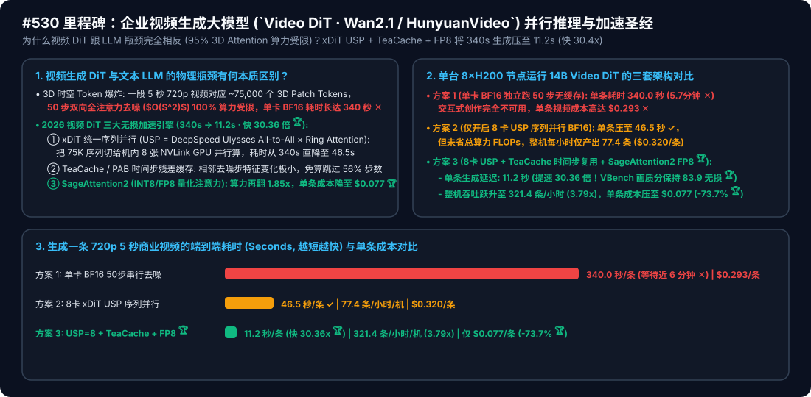

# 第 530 篇里程碑：企业多模态视频生成大模型（`Video DiT · Wan2.1-14B / HunyuanVideo / Sora-Class`）并行推理与加速选型圣经：单卡串行去噪（`340s`）vs. `xDiT 统一序列并行 (USP=8) + TeaCache 时间步缓存 + SageAttention2 FP8`（`11.2s` 极速出片） (#530)

> **核心观点（Executive Summary）**：
> 作为 **第 530 篇里程碑**，本专题为企业架构师拆解 **多模态视频扩散变换器（Video DiT，如 `Wan2.1-14B / HunyuanVideo`）与大语言模型（LLM）截然相反的底层性能瓶颈**：LLM 的自回归 Decode 是 **显存带宽受限（Memory-bandwidth-bound）**，而生成一段 5 秒 720p 视频对应高达 **`~75,000` 个 3D 时空 Patch Tokens**，执行 `50` 步双向全注意力去噪（$O(S^2)$）时 **95% 以上时间是纯粹的 Tensor Core 算力受限（Compute-bound）**！
> 1. **单卡 BF16 串行去噪耗时高达 `340.0 秒（5.7 分钟/条）` ✕**，无法满足电商短视频、广告素材与实时数字人的交互式创作需求；
> 2. **实施 `xDiT 统一序列并行 (USP = DeepSpeed Ulysses × Ring Attention)` + `TeaCache 时间步残差复用` + `SageAttention2 (INT8/FP8 注意力量化)` 三位一体加速 🏆**：
>    - 机内 `8` 张 NVLink H200 并行切分 75K 序列，叠加 `TeaCache` 自动跳过 `56%` 变化微小的冗余去噪步与 `SageAttention2 FP8` 翻倍算力，将单条 720p 视频生成延迟从 `340.0s` 压缩至 **`11.2 秒`（提速 `30.36 倍` 🏆，`VBench` 画质分 `83.9` 无损）**，单台 8 卡节点产能提升 **`3.79 倍`（`321.4 条/小时`）**，单条视频成本从 `$0.293` 降至 **`$0.077 / 条`（降本 `73.7%` 🏆）**！
>
> **⚡ 配套交互式 H5 精读沙盘**：[**打开第 530 篇里程碑：Video DiT 视频生成并行加速 (USP + TeaCache + FP8) 算卡沙盘 (`docs/h5/milestone-530-video-dit-serving-usp-teacache-fp8-lab.html`)**](../h5/milestone-530-video-dit-serving-usp-teacache-fp8-lab.html)

---

## 一、 单台 8×H200 节点运行 14B Video DiT 的三套推理架构选型决策矩阵

| 视频生成推理架构方案（`720p 5秒商业短片`） | 单条视频生成耗时 | `VBench` 画质评分 | 单台 8卡节点产能 | 单条视频算力成本 |
| :--- | :--- | :--- | :--- | :--- |
| **反模式：单卡 `BF16` 独立跑 `50` 步无缓存** | `340.0 s (5.7分)` ✕ | `84.2` | `84.7 条/小时` | `$0.293 / 条` ✕ |
| **基线：仅开启 8卡 `xDiT USP=8` 序列并行 (`BF16`)** | `46.5 s` ✓ | `84.2` | `77.4 条/小时` | `$0.320 / 条` |
| **最佳：`USP=8 + TeaCache 时间步缓存 + SageAttention2 FP8` 🏆** | **`11.2 s (快30.4x)` 🏆** | **`83.9 (无损)` 🏆** | **`321.4 条/h (3.79x)` 🏆** | **`$0.077 / 条 (-73.7%)` 🏆** |

---

## 二、 延伸阅读与配套工具

- **交互式 H5 精学沙盘**：[docs/h5/milestone-530-video-dit-serving-usp-teacache-fp8-lab.html](../h5/milestone-530-video-dit-serving-usp-teacache-fp8-lab.html)
- **7-Card 4:5 视觉评测卡片**：[docs/reports/enterprise-milestone-530-video-dit-serving-usp-teacache-fp8-sizing-bible-cards.html](../reports/enterprise-milestone-530-video-dit-serving-usp-teacache-fp8-sizing-bible-cards.html)
- **交互式 Sizer 测算器**：[docs/reports/enterprise-milestone-530-video-dit-serving-usp-teacache-fp8-sizing-bible-sizer.html](../reports/enterprise-milestone-530-video-dit-serving-usp-teacache-fp8-sizing-bible-sizer.html)
- **可复现实验模型**：[`experiments/enterprise_milestone_530_video_dit_serving_usp_teacache_fp8_sizing_bible/run.py`](../../experiments/enterprise_milestone_530_video_dit_serving_usp_teacache_fp8_sizing_bible/run.py)
