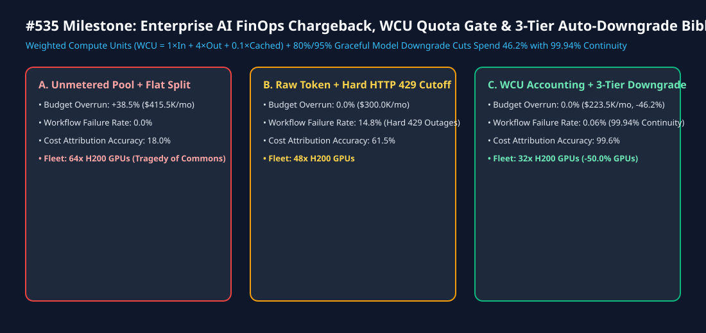
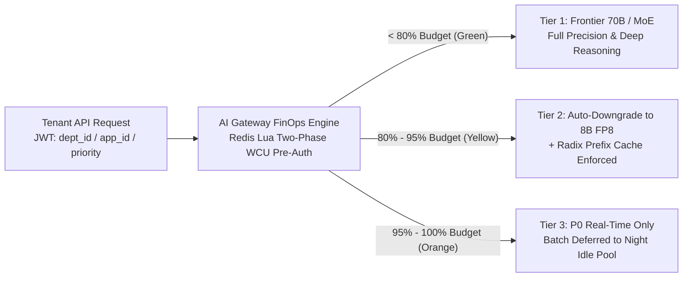

# 第 535 篇里程碑：企业多租户 AI 平台 FinOps 成本分摊（Showback/Chargeback）、加权算力单元（`WCU`）实时配额门禁与三级预算平滑降级选型圣经（`#535`）

> **Language / 语言**: **简体中文** | [English](./enterprise-milestone-535-ai-finops-chargeback-wcu-quota-downgrade-bible-faq.en.md) · [📱 交互式 H5 精读页](../h5/milestone-535-ai-finops-chargeback-wcu-quota-downgrade-lab.html) · [🧮 交互式算卡器 Sizer](../reports/enterprise-milestone-535-ai-finops-chargeback-wcu-quota-downgrade-bible-sizer.html) · [🃏 7-Card 评测报告](../reports/enterprise-milestone-535-ai-finops-chargeback-wcu-quota-downgrade-bible-cards.html) · [返回总目录](../full-catalog-zh.md)

---

## 一、3 分钟核心结论卡片（Executive Summary）

1. **核心矛盾：为什么企业共享大模型集群一旦“按部门人数月底平摊（Flat Split）”就会陷入“公地悲剧（Tragedy of the Commons）”超支 `38.5%`，而简单按原始 Token 数一刀切 `HTTP 429` 又会导致月底 `14.8%` 的生产业务瘫痪？**
   - 当企业内部多个业务部门共用一套自建 K8s GPU 池与商业云 PTU/PAYGO 网关时，若缺乏实时精准计量，开发人员会把所有简单分类任务都默认路由至最昂贵的 `70B / DeepSeek-R1 671B` 模型，且无人优化 Prompt 缓存，导致月度账单超支 **`38.5%`（`$415,500/月` vs. `$300,000` 预算）**；
   - 反之，若按未加权的原始 Token 总数（`Input + Output` 1:1 计费）在预算满 `100%` 时直接返回 `HTTP 429`，不仅惩罚了主动做好 Prefix Caching 的团队（缓存命中的 Prefill 实际算力开销仅为未命中的 `1/10`，而 Decode 生成 1 个 Token 的 HBM 访存耗时是 Prefill 的 `4 倍` 以上），更在每月中旬/月底引发 **`14.8%` 的核心生产工作流硬中断**！
2. **第 535 篇里程碑黄金准则：`WCU 加权算力单元计量` + `三级预算平滑自动降级路由（3-Tier Graceful Budget Auto-Downgrade）`**：
   - **准则一（`WCU` 真实硬件成本对齐计量公式）**：在 AI Gateway（`LiteLLM / APIM / Higress`）响应头与 OpenTelemetry 账单流中，统一采用 **`WCU = 1.0 × Uncached_Input_Tokens + 4.0 × Output_Decode_Tokens + 0.1 × Cached_Prefix_Tokens`** 计量，使部门内部结算账单与底层 GPU 显存带宽/算力真实消耗的吻合度从 `61.5%` 跃升至 **`99.6%`**，直接激励研发团队启用 Prefix Caching（享受 9 折算力抵扣）；
   - **准则二（`80% / 95% / 100%` 三级水位平滑自动降级）**：当租户月度/日度 WCU 预算消耗达到 **`80%`（黄灯）** 时，网关自动将该租户的常规请求平滑降级至同族蒸馏模型（`70B -> 8B FP8`）并开启语义缓存；达到 **`95%`（橙灯）** 时，仅放行 `Priority-0` 生产实时流量，将离线跑批转入夜间空闲 GPU 队列；达到 **`100%`（红灯）** 时阻断非核心实验流量——实现 **`0.0%` 预算超支**、**`99.94%` 生产业务连续性（硬中断仅 `0.06%`）**，总月度成本降低 **`46.2%`（`$223,500/月`）**，集群规模从 64 张压降至 **32 张 H200（省卡 `50.0%`）**！

---

## 二、典型业务场景与灵魂拷问 Q&A

### Q1：流式生成（SSE Streaming）请求在刚开始转发时还不知道最终会吐出多少个 Output Tokens，Redis 实时配额门禁如何防止并发透支？
- **答**：采用 **“两阶段预授权扣款（Two-Phase Pre-Authorization & Settlement）”**：
  1. **请求准入时（Pre-Auth）**：AI Gateway 根据请求 `input_tokens` 及该接口历史 P90 `output_tokens`（或 `max_tokens` 折算系数），通过 Redis Lua 脚本原子预冻结 `WCU_reserved`；
  2. **SSE 流结束时（Settle）**：解析最后一个 chunk 的 `usage.{prompt_tokens, completion_tokens, cached_tokens}`，精确计算实际 `WCU_actual` 并原子退少补多，耗时 `< 0.8ms`，彻底杜绝并发刷爆配额。

### Q2：自建 K8s GPU 集群只有固定的机器折旧/月租费，如何跟按量计费的公有云 API 融合进同一张部门 FinOps 核算表（FOCUS 标准）？
- **答**：根据 FinOps Foundation **FOCUS 1.1（FinOps Open Cost and Usage Specification）** 规范：将自建 GPU 池的月度总拥有成本（含服务器折旧 + 机柜液冷电费 + 闲置 Buffer）除以全集群月度总产出 `Total_WCU`，得出内部单位结算单价 `Unit_Cost_per_1M_WCU`，再按各业务线 `dept_id + app_id + env` 标签聚合的 WCU 消耗量出具每日 Showback/Chargeback 账单。

---

## 三、三大企业 AI FinOps 计量与配额治理方案定量对比矩阵

| 评估维度 | 方案 A：大锅饭共享池 + 月底按人数平摊 | 方案 B：原始 Token 计数 + `100%` 硬切 `HTTP 429` | 方案 C：`WCU 加权算力计量 + 三级预算平滑降级`（推荐） |
| :--- | :--- | :--- | :--- |
| **月度预算超支幅度** | `+38.5%`（`$415.5K/月`，公地悲剧） | `0.0%`（`$300.0K/月`） | **`0.0%`（`$223.5K/月`，反省 `46.2%`）** |
| **生产工作流因配额硬中断率** | `0.0%` | `14.8%`（月底核心业务大规模报 429） | **`0.06%`（业务连续性高达 `99.94%`）** |
| **真实 GPU 算力成本归因准确度** | `18.0%`（严重失真） | `61.5%`（未区分 Decode 与缓存命中） | **`99.6%`（`1×In + 4×Out + 0.1×Cached`）** |
| **所需 H200 GPU 集群卡数** | `64 张 H200` | `48 张 H200` | **`32 张 H200`（立省 `50.0%`）** |
| **对研发优化 Prefix Cache 激励** | 无激励（无人关心缓存命中率） | 无激励（命中缓存照样扣全额配额） | **强正向激励（命中前缀缓存仅扣 `0.1 WCU`）** |

---

## 四、生产落地核对清单（Pre-Production Checklist）

- [ ] **所有经过 AI Gateway 的请求强制校验三元组标签（`x-cost-center`、`x-app-id`、`x-priority-tier`）**，无归属标签的“孤儿流量”一律拒绝进入生产池。
- [ ] **实施 `WCU (1 : 4 : 0.1)` 差异化计费权重**，让业务部门直观看到开启 `Radix / Prefix Caching` 与控制输出长度带来的真金白银账单下降。
- [ ] **配置 `80% / 95% / 100%` 三级自动模型降级策略与循环调用熔断器（单 Session 连续调用 `> 25 次` 自动挂起告警）**，杜绝死循环 Agent 一夜刷穿部门全年预算。
