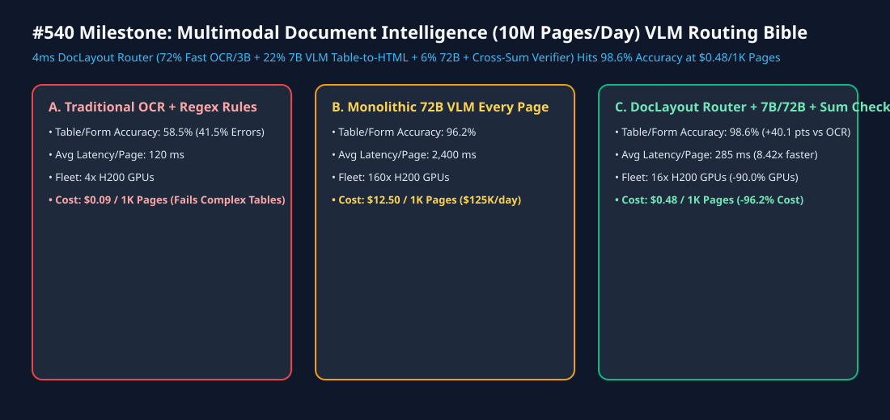

# Milestone `#540`: Enterprise Multimodal Document Intelligence (`10M Pages/Day`) Architecture Bible — `Traditional OCR` vs. `Monolithic 72B VLM` vs. `4ms Layout Router + 7B VLM Table-to-HTML + Cross-Sum Verifier`

> **Language / 语言**: [简体中文](./enterprise-milestone-540-multimodal-document-intelligence-vlm-routing-bible-faq.md) | **English** · [📱 Interactive H5 Study Lab](../h5/milestone-540-multimodal-document-intelligence-vlm-routing-lab.html) · [🧮 Interactive Sizer](../reports/enterprise-milestone-540-multimodal-document-intelligence-vlm-routing-bible-sizer.html) · [🃏 7-Card Deck](../reports/enterprise-milestone-540-multimodal-document-intelligence-vlm-routing-bible-cards.html) · [Back to Catalog](../full-catalog-en.md)

---

## 1. Executive Summary (3-Minute Read)

1. **Why Traditional `OCR + Regex` Fails on `41.5%` of Complex Tables While Monolithic `72B VLM` Costs `$12.50 / 1K Pages` (`160 GPUs`)**:
   - Traditional OCR pipelines lose structural alignment on borderless tables, multi-row merged headers, and overlapping stamps (`58.5%` accuracy).
   - Routing all `10M pages/day` through a monolithic `72B VLM` achieves `96.2%` accuracy but requires **160 H200 GPUs** and **`$125,000/day` (`$12.50 / 1K pages`)** at `2,400ms/page`.
2. **The Milestone `#540` Golden Architecture (`4ms DocLayout-YOLO Router + 72% Fast OCR/3B + 22% 7B VLM HTML Table + Deterministic Cross-Sum Verifier -> 6% 72B VLM`)**:
   - Routes `72%` simple text pages to fast OCR/native PDF + 3B extractor, `22%` complex tables to cropped `7B VLM FP8` generating `HTML (rowspan/colspan)`, and runs a **deterministic row/column accounting sum verifier** that escalates only the `6%` handwritten/sum-mismatched crops at `3x` zoom to `72B VLM` — achieving **`98.6%` end-to-end accuracy**, **`285ms/page` (`8.42x` faster)**, on **16x H200 GPUs (`-90.0%` GPUs)** at **`$0.48 / 1K pages` (`-96.2%` cost)**!

---

## 2. Quantitative Architecture Decision Matrix (`10M Pages/Day`)

| Metric | Scheme A: Traditional `OCR + Regex` | Scheme B: Monolithic `72B VLM` Every Page | Scheme C: `4ms Layout Router + 7B VLM + Cross-Sum Verifier` |
| :--- | :--- | :--- | :--- |
| **Table & Field Accuracy** | `58.5%` | `96.2%` | **`98.6%` (`+40.1 pts` vs. OCR; beats raw 72B)** |
| **Average Latency per Page** | `120 ms` | `2,400 ms` | **`285 ms` (`8.42x` faster)** |
| **Required H200 GPUs** | `4 GPUs` | `160 GPUs` | **`16 GPUs` (`-90.0%` GPUs)** |
| **Cost per 1K Pages (`$/1K`)** | `$0.09` | `$12.50` (`$125K/day`) | **`$0.48` (`$4.8K/day`, `-96.2%` cost)** |
