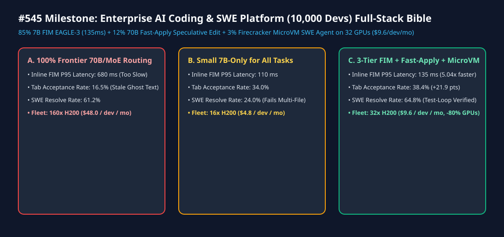

# Milestone `#545`: Enterprise AI Coding & Autonomous SWE Platform (`10,000 Developers`) Bible — `All-Frontier 70B` vs. `7B-Only` vs. `3-Tier 135ms 7B FIM + 70B Fast-Apply + Firecracker MicroVM SWE Agent`

> **Language / 语言**: [简体中文](./enterprise-milestone-545-ai-coding-platform-fim-fastapply-microvm-bible-faq.md) | **English** · [📱 Interactive H5 Study Lab](../h5/milestone-545-ai-coding-platform-fim-fastapply-microvm-lab.html) · [🧮 Interactive Sizer](../reports/enterprise-milestone-545-ai-coding-platform-fim-fastapply-microvm-bible-sizer.html) · [🃏 7-Card Deck](../reports/enterprise-milestone-545-ai-coding-platform-fim-fastapply-microvm-bible-cards.html) · [Back to Catalog](../full-catalog-en.md)

---

## 1. Executive Summary (3-Minute Read)

1. **Why Routing 100% of IDE Keystrokes to a `70B/MoE` Frontier Model Burns 160 GPUs (`$48/dev/mo`) and Drops Tab Acceptance Rate to `16.5%`**:
   - Developers abandon inline ghost-text completions when P95 latency exceeds `200–250ms`. Routing every keystroke to a `70B` model incurs **`680ms` P95 latency**, causing stale suggestions (`16.5%` Tab acceptance rate) while consuming **160 H200 GPUs**.
   - Conversely, a **`7B-Only`** deployment achieves `110ms` FIM latency but resolves only **`24.0%`** of multi-file SWE tasks.
2. **The Milestone `#545` 3-Tier AI Coding & Autonomous SWE Architecture (`85% 7B FIM EAGLE-3 + 12% 70B Fast-Apply Speculative Edit + 3% Firecracker MicroVM SWE Agent`)**:
   - **Tier 1 (`85%` Keystroke Traffic -> `7B/14B FIM FP8 + AST Debounce + EAGLE-3`)**: Delivers **`135ms` P95 inline latency (`5.04x` faster)** and boosts Tab acceptance rate to **`38.4%` (`+21.9 pts`)**.
   - **Tier 2 (`12%` Interactive Multi-File Edit -> `70B/MoE + Prompt Lookup / Fast-Apply Speculative Decoding`)**: Uses unchanged lines in the original source file as free speculative draft tokens (`320 tok/s`).
   - **Tier 3 (`3%` Async Issue-to-PR -> `Firecracker MicroVM Test Sandbox + 3-Round Self-Repair`)**: Achieves **`64.8%` SWE resolve rate** while serving all **10,000 developers on just 32x H200 GPUs (`-80.0%` GPUs, `$9.60/dev/mo`)**!

---

## 2. Quantitative Architecture Decision Matrix (`10,000 Developers`)

| Metric | Scheme A: 100% Frontier `70B/MoE` Routing | Scheme B: Small `7B-Only` All Tasks | Scheme C: `3-Tier FIM + Fast-Apply + MicroVM SWE` |
| :--- | :--- | :--- | :--- |
| **Inline FIM P95 Latency** | `680 ms` | `110 ms` | **`135 ms` (`5.04x` faster vs. 70B)** |
| **Inline Tab Acceptance Rate** | `16.5%` | `34.0%` | **`38.4%` (`+21.9 pts` vs. 70B)** |
| **Multi-File SWE Resolve Rate** | `61.2%` | `24.0%` | **`64.8%` (Test-Loop Verified)** |
| **Required H200 GPUs (`10K Devs`)** | `160 GPUs` | `16 GPUs` | **`32 GPUs` (`-80.0%` vs. 70B)** |
| **Monthly Infra Cost per Dev** | `$48.0 / dev / mo` | `$4.8 / dev / mo` | **`$9.6 / dev / mo` (`-80.0%` cost)** |
