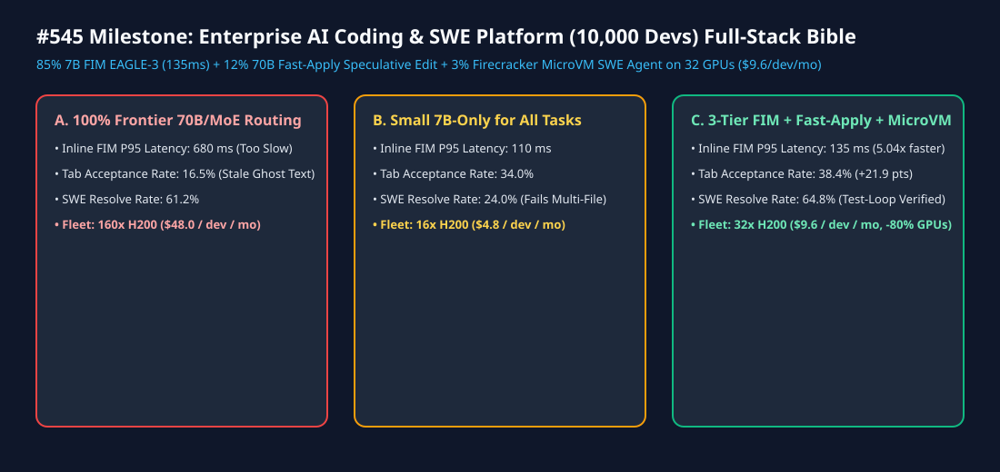
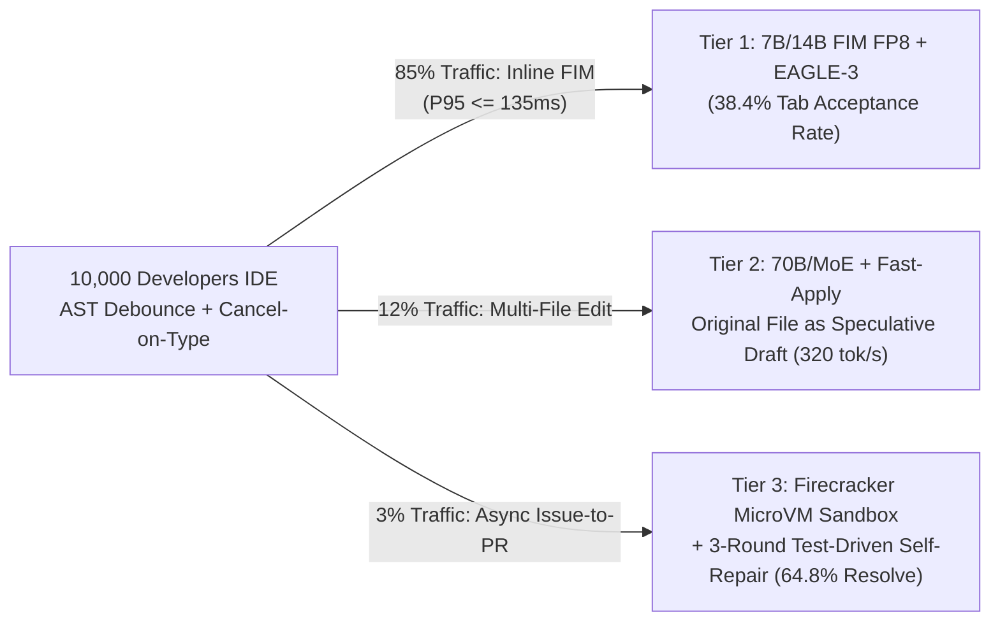

# 第 545 篇里程碑：企业万人研发团队 AI 编程助手与自主 SWE 平台（`10,000 名程序员 · 135ms 行内 FIM 补全 + Fast-Apply 极速改文件 + Firecracker 沙箱 PR Agent`）全栈选型圣经（`#545`）

> **Language / 语言**: **简体中文** | [English](./enterprise-milestone-545-ai-coding-platform-fim-fastapply-microvm-bible-faq.en.md) · [📱 交互式 H5 精读页](../h5/milestone-545-ai-coding-platform-fim-fastapply-microvm-lab.html) · [🧮 交互式算卡器 Sizer](../reports/enterprise-milestone-545-ai-coding-platform-fim-fastapply-microvm-bible-sizer.html) · [🃏 7-Card 评测报告](../reports/enterprise-milestone-545-ai-coding-platform-fim-fastapply-microvm-bible-cards.html) · [返回总目录](../full-catalog-zh.md)

---

## 一、3 分钟核心结论卡片（Executive Summary）

1. **核心矛盾：为什么给 10,000 名程序员搭建私有化 AI 编程平台时，如果把所有按键补全（Inline Completion）和问答都路由给 `70B / 671B` 大模型，既烧掉 160 张 H200（人均月成本 `$48`），还会因为 `680ms` 延迟导致程序员已经敲完下一行代码（Tab 采纳率暴跌至 `16.5%`）？**
   - 研发人员在 IDE 中敲代码的黄金心理等待阈值是 **`<= 180ms`**：当行内 `Fill-in-the-Middle (FIM)` 幽灵文本（Ghost Text）延迟超过 `250ms` 时，程序员手指已经继续往前敲字，迟到的补全建议因上下文过期直接作废（方案 A 全走 70B 模型时 P95 延迟 `680ms`，Tab 采纳率仅 **`16.5%`**，且吞噬 **160 张 H200**）；
   - 反之，若全平台只部署一个 `7B` 小模型（方案 B），行内补全虽快（`110ms`），但在跨文件重构与复杂缺陷修复上捉襟见肘（`SWE-bench` 解决率仅 **`24.0%`**）。
2. **第 545 篇里程碑黄金架构：`85% / 12% / 3%` 三级延迟与复杂度解耦架构（`Tier 1: 135ms 7B/14B FIM + EAGLE-3 投机解码 -> Tier 2: 70B/DeepSeek-V3 + 原文草稿投机重写 [Fast-Apply Speculative Edit, 320 tok/s] -> Tier 3: Firecracker 毫秒级安全沙箱 + 3 轮单元测试自修复 SWE PR Agent`）**：
   - **第一层（占请求量 `85%` 的高频按键流 -> `7B/14B FIM FP8 + 客户端 AST 防抖 + EAGLE-3`）**：IDE 插件侧基于 `Tree-Sitter` 识别语法边界动态防抖（`75ms–150ms`），服务端复用同一文件前缀 KV Cache，将 P95 补全延迟压至 **`135ms`（比 70B 快 `5.04x`）**，Tab 采纳率从 `16.5%` 跃升至 **`38.4%`（`+21.9 pts`）**；
   - **第二层（占请求量 `12%` 的多文件重构/对话 -> `70B/MoE + Prompt Lookup / Fast-Apply 原文投机解码`）**：修改 500 行现有源码文件时，`90%` 的未改动代码行直接作为无成本草稿 Token（Speculative Draft）由主模型单步并行验证通过，改文件吐字速度飙升至 **`320 tokens/sec`**；
   - **第三层（占请求量 `3%` 的异步 Issue-to-PR 任务 -> `Firecracker MicroVM 隔离沙箱 + 3 轮 Pytest/Cargo 编译器反馈自修复`）**：跨文件缺陷解决率达 **`64.8%`**，万人研发团队总集群仅需 **32 张 H200（立省 `80.0%` GPU，人均月算力成本降至 `$9.60`）**！

---

## 二、典型业务场景与灵魂拷问 Q&A

### Q1：为什么在 IDE“应用代码修改（Apply File Edit）”场景下，利用原文件作为投机解码草稿（`Prompt Lookup / Speculative Edit`）能将 70B 模型输出速度从 `45 tok/s` 提升至 `320 tok/s`？
- **答**：程序员让 AI 修改一个 400 行的代码文件时，通常只有 `20–30 行` 发生变化，其余 `370 行` 与原文件完全一模一样！如果让 70B 模型逐个 Token 自回归重写 400 行，要耗费 15 秒；而开启 **原文件子串投机匹配（Prompt Lookup Decoding / Fast-Apply）** 后，推理引擎直接从上下文中的原文件抓取后续 `32–64` 个连续未改动 Token 作为草稿，在 1 次前向传播中全部验证通过，只在真正修改的那几行回退到逐 Token 生成，端到端文件重写速度提升 **`7 倍`** 以上！

### Q2：万人团队高峰期（上午 10:00–11:30、下午 14:30–17:00）每秒产生上千次按键事件，IDE 客户端如何防止无效请求打垮推理集群？
- **答**：在 IDE 插件端实施 **“三道客户端门禁”**：① **语法感知自适应防抖（AST-Aware Debounce）**：在变量名输入中途延长等待 `180ms`，而在敲下换行符 `\n`、左大括号 `{` 或冒号 `:` 后立即 `30ms` 触发；② **In-Flight 抢占取消（Cancel-on-Type）**：一旦用户在等待期间又敲入新字符，立即通过 HTTP/2 Cancel 终止服务端正在排队/生成的旧请求释放 KV 槽位；③ **本地 Speculative Trie 缓存**：若用户刚敲入的字符恰好命中上一轮补全建议的前缀，直接本地零延迟渲染剩余幽灵文本，过滤掉 **`55%`** 的冗余网络请求！

---

## 三、三大企业万人研发 AI 编程平台架构定量对比矩阵

| 评估维度 | 方案 A：100% 流量全走 `70B/MoE` 旗舰模型 | 方案 B：全场景仅部署 `7B` 小模型 | 方案 C：`85% 7B FIM + 12% 70B Fast-Apply + 3% MicroVM SWE`（推荐） |
| :--- | :--- | :--- | :--- |
| **行内补全 P95 延迟 (`Inline FIM`)** | `680 ms`（超过 `250ms` 心理红线） | `110 ms` | **`135 ms`（比全走 70B 快 `5.04x`）** |
| **行内代码补全 `Tab` 采纳率** | `16.5%`（建议返回时用户已敲完） | `34.0%` | **`38.4%`（比全走 70B 提升 `+21.9 pts`）** |
| **跨文件缺陷修复解决率 (`SWE-bench`)** | `61.2%`（无测试闭环盲改） | `24.0%`（复杂逻辑能力不足） | **`64.8%`（结合 `Firecracker` 编译单测闭环）** |
| **支撑 10,000 人所需 H200 卡数** | `160 张 H200` | `16 张 H200` | **`32 张 H200`（比全走 70B 立省 `80.0%` GPU）** |
| **人均月度算力基础设施成本** | `$48.0 / 人 / 月` | `$4.8 / 人 / 月` | **`$9.6 / 人 / 月`（高采纳率 + 高自主解决率）** |

---

## 四、生产落地核对清单（Pre-Production Checklist）

- [ ] **物理隔离“毫秒级行内 FIM 补全池”与“长上下文 Chat/Agent 池”**，严禁 32K 上下文的 Chat Prefill 阻塞行内补全的 `135ms` SLA。
- [ ] **在多文件代码重写（Apply）链路强制开启 `Prompt Lookup / Fast-Apply 原文投机解码`**，消除未修改代码行的重复慢速生成。
- [ ] **所有自主 SWE Agent 执行测试脚本必须运行在无外网权限的临时 `Firecracker MicroVM / gVisor` 沙箱内**，防止恶意依赖包或错误 `rm -rf` 污染研发宿主机。
