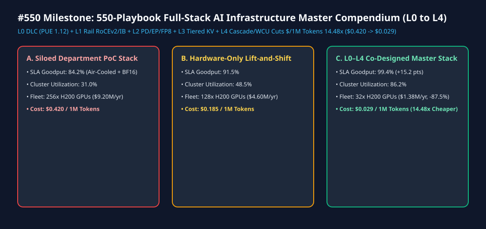

# Milestone `#550`: Cloud & AI Solution Architect `L0–L4` Full-Stack Co-Design Master Compendium & Capacity Sizing Bible (`#550`)

> **Language / 语言**: [简体中文](./enterprise-milestone-550-fullstack-ai-infra-master-compendium-sizing-faq.md) | **English** · [📱 Interactive H5 Study Lab](../h5/milestone-550-fullstack-ai-infra-master-compendium-lab.html) · [🧮 Interactive Sizer](../reports/enterprise-milestone-550-fullstack-ai-infra-master-compendium-sizing-sizer.html) · [🃏 7-Card Deck](../reports/enterprise-milestone-550-fullstack-ai-infra-master-compendium-sizing-cards.html) · [Back to Catalog](../full-catalog-en.md)

---

## 1. Executive Summary (3-Minute Read)

1. **The 5-Layer Multiplicative Efficiency Law (`L0 DLC -> L1 NVLink/RoCEv2 -> L2 PD/EP/FP8 -> L3 Tiered KV -> L4 Cascade/WCU/OBO`)**:
   - Siloed department-by-department PoC stacks (`Air-Cooled + BF16 + Monolithic 70B`) suffer **`31.0%` average utilization**, **`84.2%` SLA goodput**, and cost **`$0.420 / 1M tokens`** across **256 H200 GPUs (`$9.20M/yr`)**.
   - Hardware-only lift-and-shift reduces fleet size to `128 GPUs` (`$0.185 / 1M tokens`), leaving over half of potential efficiency gains on the table.
   - Co-designing all 5 layers (`L0` 120kW DLC `PUE 1.12`, `L1` Rail-Optimized RoCEv2/IB `GPUDirect RDMA`, `L2` PD Disaggregation + `Block-FP8` + `EAGLE-3` + `XGrammar`, `L3` 3-Tier `Radix KV` + deterministic `Python/MILP` solvers, and `L4` `85%/15%` Complexity Cascade + `WCU` FinOps + `OBO/OPA` Zero-Trust) achieves **`99.4%` SLA goodput**, **`86.2%` utilization**, and **`$0.029 / 1M tokens` (`14.48x` cheaper)** on just **32x H200 GPUs (`-87.5%` GPUs, saving `$7.82M/yr`)**!

---

## 2. Quantitative Architecture Decision Matrix

| Metric | Scheme A: Siloed Department PoC Stack | Scheme B: Hardware-Only Lift-and-Shift | Scheme C: `L0–L4` Co-Designed Master Stack (`#550`) |
| :--- | :--- | :--- | :--- |
| **SLA Goodput (`%`)** | `84.2%` | `91.5%` | **`99.4%` (`+15.2 pts`)** |
| **24x7 Cluster Utilization** | `31.0%` | `48.5%` | **`86.2%` (Online + Off-Peak Batch/Eval)** |
| **Cost per 1M Tokens (`$/1M`)** | `$0.420` | `$0.185` | **`$0.029` (`14.48x` cheaper)** |
| **Required H200 GPU Fleet** | `256 GPUs` | `128 GPUs` | **`32 GPUs` (`-87.5%` GPUs)** |
| **Annual Infrastructure TCO** | `$9,200,000 / yr` | `$4,600,000 / yr` | **`$1,380,000 / yr` (`-$7.82M/yr` savings)** |
