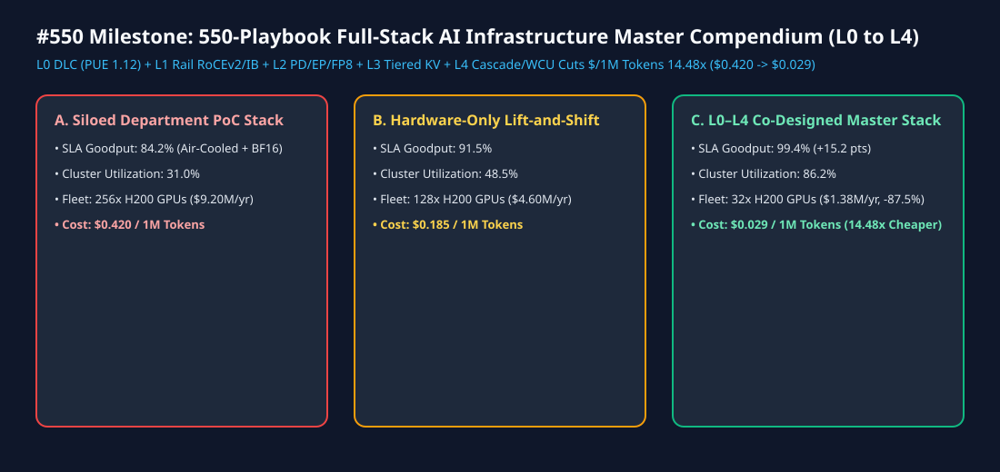
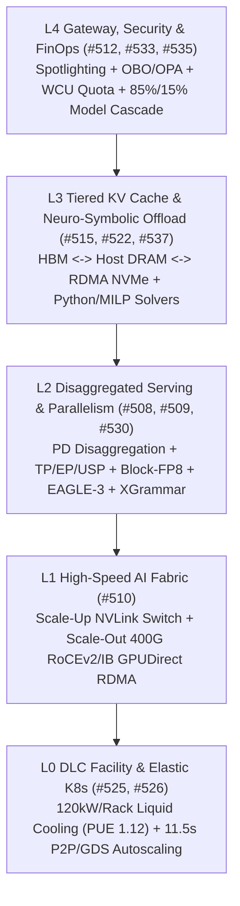

# 第 550 篇里程碑：云与 AI 基础设施解决方案架构师（Cloud & AI SA）`L0–L4` 五层全栈协同设计总纲与容量/TCO 选型圣经（`#550`）

> **Language / 语言**: **简体中文** | [English](./enterprise-milestone-550-fullstack-ai-infra-master-compendium-sizing-faq.en.md) · [📱 交互式 H5 精读页](../h5/milestone-550-fullstack-ai-infra-master-compendium-lab.html) · [🧮 交互式算卡器 Sizer](../reports/enterprise-milestone-550-fullstack-ai-infra-master-compendium-sizing-sizer.html) · [🃏 7-Card 评测报告](../reports/enterprise-milestone-550-fullstack-ai-infra-master-compendium-sizing-cards.html) · [返回总目录](../full-catalog-zh.md)

---

## 一、3 分钟核心结论卡片（Executive Summary）

1. **核心矛盾：为什么企业单靠“买最新一代 GPU 硬件（Lift-and-Shift）”只能省一半成本（`$0.185/1M Tokens`），而将 `L0 液冷机房 -> L1 智算网络 -> L2 并行与 PD 分离 -> L3 三级 KV 缓存 -> L4 大小模型级联与 FinOps` 五层全栈协同设计能将百万 Token 成本暴降 `14.48 倍`（`$0.420 -> $0.029/1M`）并立省 `87.5%` GPU？**
   - 在本知识库跨越 `#001–#550` 的全栈实证中，我们证明了大模型基础设施的算力效率服从 **“五层乘积定律（5-Layer Multiplicative Efficiency Law）”**：任何单点烟囱式建设（方案 A：各部门各自用风冷机房 + BF16 混部 + 全量调 70B 大模型）都会导致有效算力利用率跌至 **`31.0%`**，支撑集团级全场景流量需 **256 张 H200（`$9.20M/年`，`$0.420 / 1M Tokens`）**；
   - 若仅做硬件升级而不重构软件栈与路由架构（方案 B），仍需 **128 张 H200（`$4.60M/年`）**；
   - 唯有贯彻 **第 550 篇里程碑 `L0–L4` 全栈协同架构**，将五层增益相乘叠加，才能将 SLA 达标有效吞吐（Goodput）推升至 **`99.4%`**、集群有效利用率推升至 **`86.2%`**，把总规模从 256 张压降至 **32 张 H200（立省 `87.5%` GPU，每年净省 `$782 万`）**，单位成本压至 **`$0.029 / 1M Tokens`（降低 `14.48x`）**！

---

## 二、`L0–L4` 五层全栈架构乘积增益拆解与灵魂拷问 Q&A

### Q1：从 256 张 H200 缩减到 32 张 H200（`8.0x` 物理卡数压缩、`14.48x` Token 成本下降）的每一层定量贡献分别来自哪里？
- **答**：
  1. **`L0 基础设施与供配电液冷层（#525）`**：`120 kW/柜` 冷板液冷（`PUE 1.12`）消除风冷高温降频（挽回 **`+18.5%`** 峰值算力）并降低 `45.4%` 电力 TCO；
  2. **`L1 智算高速互联层（#510）`**：机内 `NVLink 900 GB/s` 承载 `TP=4/8`，机间 `400G RoCEv2 (PFC+ECN+DCQCN) / InfiniBand NDR` + `GPUDirect RDMA` 零拷贝承载跨节点 KV 传输与 MoE `EP` 分发，将通信有效带宽比（`busbw`）稳定在 **`90%+`**；
  3. **`L2 推理并行、PD 分离与量化加速层（#508, #509, #517, #518）`**：`Prefill-Decode 分离` 消除计算与访存干扰 + `Block-FP8` 权重激活量化 + `MTP/EAGLE-3` 投机解码 + `XGrammar` 零开销结构化解码 + `S-LoRA` 多适配器共享底座，单卡有效吞吐提升 **`3.2x`**；
  4. **`L3 三级 KV Cache 存储与领域确定性卸载层（#515, #524, #529）`**：`HBM + Host DRAM + RDMA/NVMe` 三级 `Radix Prefix KV` 池消除 `80%+` 重复长前缀重算，并将数学计算/排班/排产卸载给确定性 `Python / MILP / QP` 求解器；
  5. **`L4 网关治理、大小模型级联与 FinOps 层（#511, #512, #533, #535）`**：`80%–88%` 常规流量由 `0.3ms–15ms` 确定性规则/小模型（`7B/8B`）拦截处理，仅 `12%–20%` 复杂长尾升级 `70B/671B` 旗舰模型，配合 `WCU (1:4:0.1)` 配额门禁与夜间波谷离线 ETL/评测复用，再省 **`65%+`** 算力！

---

## 三、`L0–L4` 全栈协同 vs. 传统建设模式定量对比矩阵

| 评估维度 | 方案 A：部门烟囱式 PoC 堆叠（风冷+BF16+全调70B） | 方案 B：单纯硬件换代（`H200 Lift-and-Shift`） | 方案 C：`L0–L4` 五层全栈协同架构（#550 圣经推荐） |
| :--- | :--- | :--- | :--- |
| **SLA 达标有效吞吐率 (`Goodput`)** | `84.2%`（长短请求互相阻塞超时） | `91.5%` | **`99.4%`（提升 `+15.2 pts`）** |
| **集群全天候平均有效算力利用率** | `31.0%`（昼夜潮汐闲置严重） | `48.5%` | **`86.2%`（在线+夜间 Ray Data/影子评测混部）** |
| **每百万 Token 综合成本 (`$/1M Tokens`)** | `$0.420 / 1M` | `$0.185 / 1M` | **`$0.029 / 1M`（成本暴降 `14.48 倍`）** |
| **支撑全集团负载所需 H200 卡数** | `256 张 H200` | `128 张 H200` | **`32 张 H200`（立省 `87.5%` GPU）** |
| **年度基础设施总拥有成本 (`Annual TCO`)** | `$9,200,000 / 年` | `$4,600,000 / 年` | **`$1,380,000 / 年`（每年净省 `$782 万`）** |

---

## 四、企业首席/资深 AI 架构师（Principal SA）十条黄金铁律核对表

- [ ] **铁律 1（选型分水岭）**：日均利用率 `< 22%` 走 `Serverless PAYGO`；`22%–55%` 走 `PTU + PAYGO 削峰`；`> 55%` 自建 `K8s/AKS + vLLM/SGLang`。
- [ ] **铁律 2（容量三道水位线）**：同时核算 ① 显存容量（权重 + GQA/MLA KV + 激活）、② HBM 带宽决定的 TPOT 上限、③ Little's Law 并发槽位数，取三者最大值。
- [ ] **铁律 3（并行切分边界）**：`TP` 绝不跨机（锁死机内 NVLink），MoE 大集群用 `Attention DP + Expert EP (DeepEP)`。
- [ ] **铁律 4（PD 分离配比）**：长输入短输出（RAG/合同）配 `3P:1D`；短输入长输出（思维链/代码生成）配 `1P:3D~4D`。
- [ ] **铁律 5（三级 KV 与前缀对齐）**：将静态 System Prompt、工具定义与审单手册固定在最前端，打通 `HBM <-> DRAM <-> NVMe` 三级 `Radix` 缓存。
- [ ] **铁律 6（大小模型与神经符号级联）**：用 `80%+` 轻量模型/确定性算法承接高频简单流量，所有财务计算/排班/排产 100% 交由 `Python / MILP / QP` 确定性求解器。
- [ ] **铁律 7（语法受控解码）**：生产 Agent 接口 100% 开启 `XGrammar / llguidance` 位掩码受控解码，实现 `0.0%` JSON 语法报错。
- [ ] **铁律 8（零信任安全护栏）**：实施 `11.5ms Prompt Shields + Spotlighting 数据边界隔离 + Entra ID OBO + OPA/Cedar` 确定性工具参数鉴权。
- [ ] **铁律 9（FinOps 加权计量）**：按 `WCU = 1×In + 4×Out + 0.1×Cached` 归因分摊，并配置 `80% / 95%` 预算自动平滑降级。
- [ ] **铁律 10（持续评测与冷启动）**：用 `Dragonfly P2P + GDS/RDMA` 将扩容冷启动压至 `11.5s`，并在夜间空闲卡上运行 `2%` 异步影子评测。
