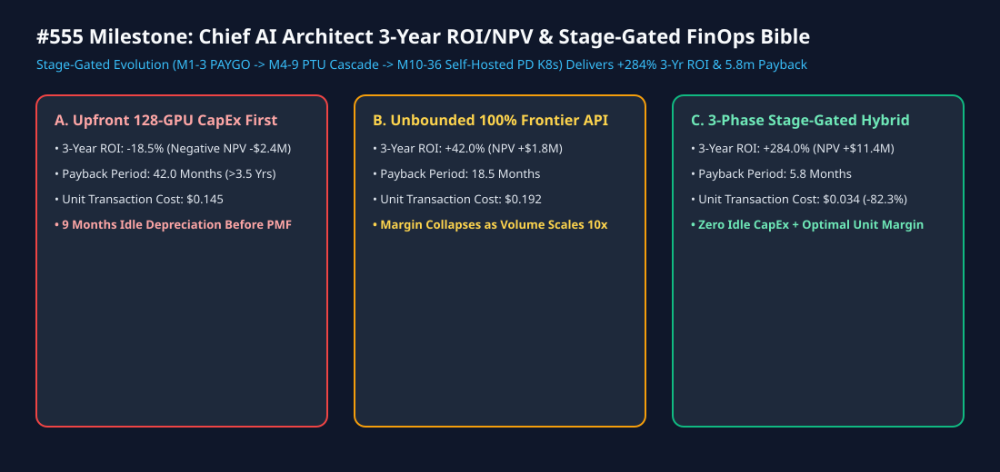

# Milestone `#555`: Enterprise Chief AI Architect (`CAIO / Principal Cloud & AI SA`) 3-Year ROI/NPV Financial Model & Stage-Gated FinOps Bible

> **Language / 语言**: [简体中文](./enterprise-milestone-555-caio-roi-npv-stage-gated-finops-bible-faq.md) | **English** · [📱 Interactive H5 Study Lab](../h5/milestone-555-caio-roi-npv-stage-gated-finops-lab.html) · [🧮 Interactive Sizer](../reports/enterprise-milestone-555-caio-roi-npv-stage-gated-finops-bible-sizer.html) · [🃏 7-Card Deck](../reports/enterprise-milestone-555-caio-roi-npv-stage-gated-finops-bible-cards.html) · [Back to Catalog](../full-catalog-en.md)

---

## 1. Executive Summary (3-Minute Read)

1. **Why Upfront 128-GPU CapEx Pitches Yield `-18.5%` 3-Year ROI (`-$2.4M` NPV) While Unbounded Frontier API Sprawl Erodes Unit Gross Margins**:
   - Buying 128 GPUs upfront before product-market fit incurs 9 months of `<12%` utilization and heavy hardware depreciation (`42.0-month` payback, `-$2.4M` NPV).
   - Staying 100% on unoptimized frontier APIs keeps unit transaction cost high (`$0.192 / transaction`), eroding gross margins as volume scales 10x.
2. **The Milestone `#555` 3-Phase Stage-Gated Infrastructure Evolution Model**:
   - **Phase 1 (Months 1–3, `<22%` Util)**: `100% Serverless PAYGO` ($0 CapEx) to validate business workflow value and harvest golden evaluation + distillation logs.
   - **Phase 2 (Months 4–9, `22%–55%` Util)**: Deploy **AI Gateway Complexity Cascade (`85%` distilled `8B` + `15%` reserved `PTU` + `PAYGO` burst)**.
   - **Phase 3 (Months 10–36, `>=55%` Util)**: Migrate proven baseload onto **Self-Hosted `K8s/AKS` PD-Disaggregated `FP8` + 3-Tier `Radix KV` pools** — delivering **`+284.0%` 3-Year ROI (`+$11.4M` NPV)**, a **`5.8-month` payback period**, and **`$0.034` unit transaction cost (`-82.3%`)**!

---

## 2. Quantitative Architecture Decision Matrix

| Metric | Scheme A: Upfront 128-GPU CapEx First | Scheme B: Unbounded `100%` Frontier API | Scheme C: `3-Phase Stage-Gated Hybrid Evolution` |
| :--- | :--- | :--- | :--- |
| **3-Year ROI (`%`)** | `-18.5%` | `+42.0%` | **`+284.0%`** |
| **3-Year Net Present Value (`NPV`)** | `-$2.40M` | `+$1.80M` | **`+$11.40M` (`+$13.8M` vs. CapEx-First)** |
| **Payback Period (`Months`)** | `42.0 months` | `18.5 months` | **`5.8 months`** |
| **Blended Unit Transaction Cost** | `$0.145` | `$0.192` | **`$0.034` (`-82.3%` vs. API Sprawl)** |
