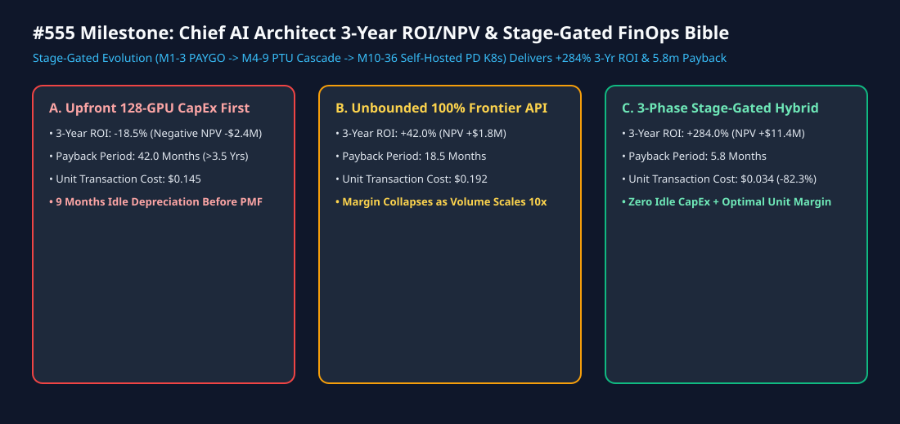

# 第 555 篇里程碑：企业首席 AI 架构师（`CAIO / Principal Cloud & AI SA`）董事会立项商业论证、三年 `ROI / NPV` 财务模型与三阶段演进圣经（`#555`）

> **Language / 语言**: **简体中文** | [English](./enterprise-milestone-555-caio-roi-npv-stage-gated-finops-bible-faq.en.md) · [📱 交互式 H5 精读页](../h5/milestone-555-caio-roi-npv-stage-gated-finops-lab.html) · [🧮 交互式算卡器 Sizer](../reports/enterprise-milestone-555-caio-roi-npv-stage-gated-finops-bible-sizer.html) · [🃏 7-Card 评测报告](../reports/enterprise-milestone-555-caio-roi-npv-stage-gated-finops-bible-cards.html) · [返回总目录](../full-catalog-zh.md)

---

## 一、3 分钟核心结论卡片（Executive Summary）

1. **核心矛盾：为什么在向 CEO / CFO 汇报企业大模型平台立项时，“先砸 `$400 万` 买 128 张 GPU 建算力中心再找业务场景（CapEx-First）”会导致三年净现值（`NPV`）亏损 `-$240 万`（`ROI -18.5%`），而“永远 100% 调商业旗舰 API 不建自有能力（Unbounded API Sprawl）”又会在业务放量 10 倍后吞噬毛利？**
   - **误区一（重资产前置折旧陷阱）**：在业务场景尚未通过黄金评测集验证与用户采纳率爬坡前，一次性采购 128 张 GPU 自建机房，前 9 个月平均利用率不足 `12%`，光硬件折旧与机房电费就吃掉数百万美元，回本周期长达 **42 个月（3.5 年）**；
   - **误区二（纯旗舰 API 规模化反噬）**：全部流量长期无脑调用最高单价商业旗舰 API，单笔业务交易推理成本高达 **`$0.192`**，当月活请求量突破亿级时，API 账单增速远超业务降本增效收益。
2. **第 555 篇里程碑董事会立项黄金范式：“三阶段水位门禁演进模型（3-Phase Stage-Gated Infrastructure Evolution）”**：
   - **第一阶段（第 1–3 个月 · 价值验证期 ` utilization < 22%`）**：**零硬件 CapEx**，100% 采用云端 `Serverless PAYGO` 旗舰 API 快速跑通业务闭环，同步沉淀 **500+ 条黄金评测集与线上真实 Prompt-Response 蒸馏样本**；
   - **第二阶段（第 4–9 个月 · 级联降本拐点 `22% <= utilization < 55%`）**：用第一阶段沉淀的真实数据蒸馏微调 `7B/8B` 垂直小模型，上线 **AI Gateway 大小模型级联（`85%` 流量走 `8B` + `15%` 走商业 `PTU` 预留吞吐 + `PAYGO` 削峰）**，单笔交易成本立降 `65%`；
   - **第三阶段（第 10–36 个月 · 稳态自建收获期 `utilization >= 55%`）**：仅对已证明高 ROI、日均基荷水位超过 `55%` 的核心负载，迁入 **自建/云托管 `K8s/AKS + PD 分离 + Block-FP8 + 三级 Radix KV` 专属池**——实现 **三年净现值 `NPV +$1,140 万`（`ROI +284.0%`）**、投资回收期缩短至 **`5.8 个月`**，单笔业务交易成本压至 **`$0.034`（降低 `82.3%`）**！

---

## 二、三大企业 AI 平台投资立项与演进路线定量对比矩阵

| 评估维度 | 方案 A：前置重资产采购 128 卡（`CapEx-First`） | 方案 B：三年全量调商业旗舰 API（`API Sprawl`） | 方案 C：`M1-3 PAYGO -> M4-9 PTU 级联 -> M10-36 自建 PD 池`（推荐） |
| :--- | :--- | :--- | :--- |
| **3 年投资回报率 (`3-Year ROI`)** | `-18.5%`（前期闲置折旧严重） | `+42.0%` | **`+284.0%`（零前期闲置 + 后期极致单位成本）** |
| **3 年净现值 (`NPV @ 10% 折现率`)** | `-$2.40M`（净亏损） | `+$1.80M` | **`+$11.40M`（比前置买卡多创利 `+$13.8M`）** |
| **现金流投资回收期 (`Payback Period`)** | `42.0 个月` | `18.5 个月` | **`5.8 个月`** |
| **稳态单笔业务交易 AI 成本** | `$0.145 / 笔` | `$0.192 / 笔` | **`$0.034 / 笔`（比纯旗舰 API 降低 `82.3%`）** |

---

## 三、向 CEO / CFO 汇报立项的四条董事会签核铁律

- [ ] **禁止以“每秒浮点运算 TFLOPS”或“参数量多少千亿”作为立项 KPI**，必须折算为 **“单笔业务交易成本（Cost per Resolved Ticket / Claim / PR）”** 与 **“人工替代/增收净现值（NPV）”**。
- [ ] **严格执行 `22%` 与 `55%` 两道容量水位晋级门禁**：未达 `22%` 持续利用率绝不签长期 `PTU` 合约；未达 `55%` 持续基荷水位且未完成 `8B` 蒸馏级联前，绝不批复大额专用 GPU 采购 CapEx。
