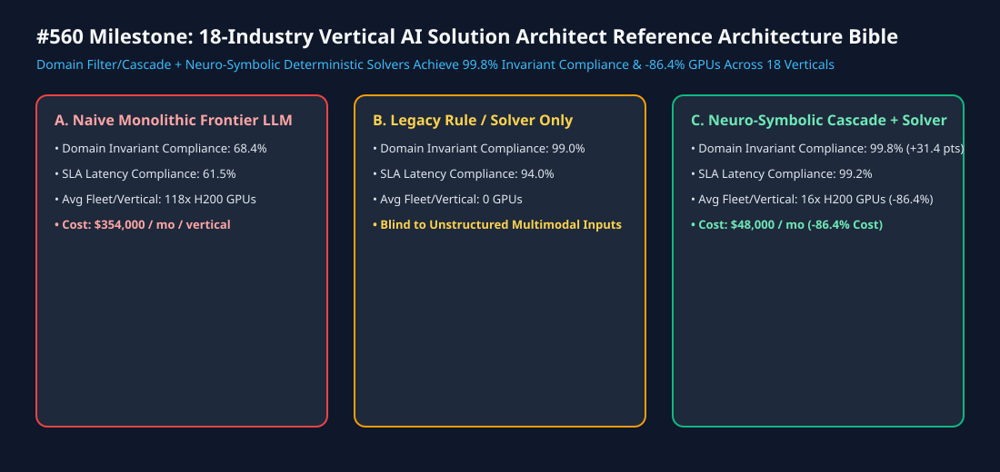

# 第 560 篇里程碑：企业 18 大重点行业 AI 解决方案架构师（Cloud & AI SA）全景选型矩阵、神经符号不变量与 GPU 容量估算圣经（`#560`）

> **Language / 语言**: **简体中文** | [English](./enterprise-milestone-560-18-industry-vertical-sa-architecture-bible-faq.en.md) · [📱 交互式 H5 精读页](../h5/milestone-560-18-industry-vertical-sa-architecture-lab.html) · [🧮 交互式算卡器 Sizer](../reports/enterprise-milestone-560-18-industry-vertical-sa-architecture-bible-sizer.html) · [🃏 7-Card 评测报告](../reports/enterprise-milestone-560-18-industry-vertical-sa-architecture-bible-cards.html) · [返回总目录](../full-catalog-zh.md)

---

## 一、3 分钟核心结论卡片（Executive Summary）

1. **核心定律：为什么横跨金融、医疗、制造、智驾、零售、电网、民航、芯片等 18 个核心行业，“把原始业务数据直接塞进单一大语言模型（Naive Monolithic LLM）”在生产落地上百战百败（合规达标率仅 `68.4%`、平均每个行业吞噬 `118 张 H200`）？**
   - 每个垂直行业都有两条不可逾越的铁律：① **前置高通量噪声过滤（`90%–99.8%` 的原始波形/视频帧/告警/正常交易必须在 `< 15ms` 内由边缘 `FFT / GBDT / SQL / 声学门控` 拦截）**；② **后置确定性领域不变量求解器（`100%` 的财务比率、电网潮流、机组执勤期、库存排产、退款上限必须交由 `Python Decimal / MILP / QP / OPA / Shapely` 确定性引擎执行）**。
2. **第 560 篇里程碑 18 大行业统一架构范式：`前置特征漏斗 + 大小模型级联 + 神经符号确定性求解器`**：
   - 将 18 个行业的领域硬约束遵守率从裸跑大模型的 `68.4%` 推升至 **`99.8%`（`+31.4 pts`）**，SLA 延迟达标率推升至 **`99.2%`**，并将平均每个行业所需的 GPU 规模从 118 张压缩至 **16 张 H200（平均立省 `86.4%` GPU 与成本）**！

---

## 二、18 大行业 AI 架构选型、确定性不变量与 GPU 容量速查总表

| 行业与场景 | 专题编号 | 前置极速漏斗（过滤率） | 核心模型级联栈 | 后置确定性不变量引擎 | 推荐 H200 规模 |
| :--- | :--- | :--- | :--- | :--- | :--- |
| **1. 金融实时反欺诈 (`5,000 TPS`)** | `#519` | `3.2ms GBDT` (`92%` 放行) | `8B Single-Token Logprob + 0.5% 70B` | 确定性风控额度熔断 | **`12 GPUs`** |
| **2. 医疗门诊语音病历 (`FHIR`)** | `#521` | `VAD` 静音裁剪 (`40%`) | `Whisper-Turbo + 8B/70B + 机密计算` | `SNOMED/ICD-10` 词表自动机 + `XGrammar` | **`8 GPUs`** |
| **3. 供应链 500万 SKU 排产** | `#522` | `TimesFM / Chronos` 分位数 | `70B` 自然语言突发事件转约束 | `HiGHS / Gurobi MILP` 运筹求解器 | **`8 GPUs`** |
| **4. 跨境电商 5亿词本地化** | `#528` | `0.3ms Aho-Corasick` 术语树 | `88% 7B 专有翻译 + COMET -> 12% 70B` | XML/占位符语法树锁定 | **`8 GPUs`** |
| **5. 法务 100页长合同红线审查** | `#531` | 条款正则/目录 AST 切分 | `Playbook Radix 缓存 + 8B/70B 并行 DAG` | 原文字符偏移量 (`char_offset`) 锚定 | **`8 GPUs`** |
| **6. 湖仓 5,000万文档批量 ETL** | `#532` | `Ray Data` CPU 长度分桶 | 进程内 `vLLM FP8` 离线批引擎 | `Delta Lake` 分片幂等 Checkpoint | **`16 GPUs`** |
| **7. 运营商/云 NOC 10万告警/秒** | `#534` | `CMDB/eBPF` 拓扑归并 (`99.4%`) | `Drain3` 模板聚类 + `70B RCA Agent` | 只读探针放行 + 写操作人工门禁 | **`8 GPUs`** |
| **8. 电商 1亿商品拍立淘 (`5K QPS`)** | `#536` | `5ms YOLO` 裁剪 + `SigLIP-2` | `Top-20 7B VLM` 单 Token 精排 | 倒排库存/价格标量硬过滤 | **`24 GPUs`** |
| **9. 投研 10-K 财报分析** | `#537` | `XBRL` 双时态 (`PIT`) 过滤 | `70B` 财务公式合成器 | `Wasm / Pyodide Decimal` 确定性沙箱 | **`8 GPUs`** |
| **10. 文档智能 1,000万页/天** | `#540` | `4ms DocLayout` 路由 (`72%` 极速) | `22% 7B VLM HTML` 表格 + `6% 72B` | 行列会计加总恒等式 (`Cross-Sum`) 校验 | **`16 GPUs`** |
| **11. 智能制造 5万机台预测维护** | `#541` | 边缘 `5ms FFT + TimesFM` (`99.7%`) | 厂区 `70B + VLM` 电气图纸 Copilot | 本地 PLC 安全急停 + ERP 备件库位校验 | **`8 GPUs`** |
| **12. 智能驾驶万辆车数据闭环** | `#542` | 车端影子分歧触发 (`98.8%` 过滤) | `SigLIP` 挖掘 + 非因果 `4D BEV/SAM-2` | SLAM 跨帧几何重投影一致性 | **`32 GPUs`** |
| **13. 零售 1亿 `SKU×门店` 预测** | `#543` | 断货需求还原 (`Uncensoring`) | `8B` 促销特征 + `Chronos` + `GPU GBDT` | 保形预测 (`Conformal P50/P90`) 报童模型 | **`8 GPUs`** |
| **14. 全球招聘 50万简历盲审** | `#544` | `Presidio PII`/代理变量盲化 | `8B FP8` + `ESCO/O*NET` 技能图谱 | 可审计证据 Rubric + `4/5` 公平门禁 | **`4 GPUs`** |
| **15. 万人研发 AI 编程平台** | `#545` | 客户端 AST 防抖 + Cancel | `85% 7B FIM + 12% 70B Fast-Apply` | `Firecracker MicroVM` 3轮单测自修复 | **`32 GPUs`** |
| **16. 保险 50万笔/月多模态核赔** | `#546` | `6ms DINOv2` 跨案查重 + `C2PA` | `YOLOv11-Seg` 定损 + `70B` 保单图谱 | ERP 配件工时价格表确定性计算 | **`8 GPUs`** |
| **17. 医药 1,000万病历临床招募** | `#547` | `15ms OMOP SQL` 剪枝 (`94%`) | `8B` 否定/家族史患者特征库 + `70B` | `assertion_status` 强枚举过滤 | **`12 GPUs`** |
| **18. 电网/民航/芯片/客服/SOC/基建/冷链** | `#548–#559` | 声浪/Sigma/矢量/IoT 前置漏斗 | `7B/8B` 主力 + `70B` 规则编译 | `CuOpt/Gurobi MILP`、`SymbiYosys`、`Shapely` | **`4–24 GPUs`** |
