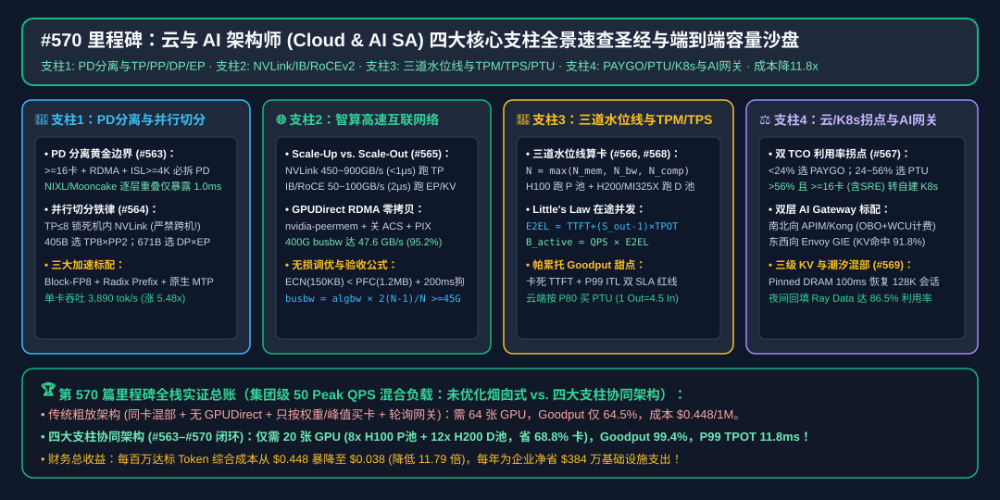

# Milestone `#570`: Cloud & AI Infrastructure Solution Architect Four-Pillar Master Reference Bible (`PD & Parallelism` · `NVLink/IB/RoCEv2 Fabric` · `3-Watermark & TPM/TPS/PTU Sizer` · `PAYGO/PTU/K8s & AI Gateway`) (`#570`)

> **Language / 语言**: [简体中文](./enterprise-milestone-570-sa-four-pillars-master-bible-sizing-faq.md) | **English** · [📱 Interactive H5 Study Lab (4-Pillar Master Sizer Console)](../h5/milestone-570-sa-four-pillars-master-bible-lab.html) · [🧮 Interactive HTML Sizer](../reports/enterprise-milestone-570-sa-four-pillars-master-bible-sizing-sizer.html) · [🃏 7-Card Visual Report](../reports/enterprise-milestone-570-sa-four-pillars-master-bible-sizing-cards.html) · [Back to Catalog](../full-catalog-en.md)

---

## 1. 3-Minute Executive Summary

1. **Milestone `#570` Synthesis**:
   - Unifies the four core Cloud & AI Solution Architect pillars (`#563–#569`) into one end-to-end mathematical model and desk reference:
     1. **🚀 Pillar 1 — Serving & Parallelism (`#563, #564, #569`)**: Layer-wise async PD Disaggregation (`1.0 ms` exposed KV transfer), intra-node `NVLink TP<=8`, cross-node `TP8×PP2` (Dense 405B) or `Attention DP × Expert EP (DeepEP)` (671B MoE), plus `Block-FP8 + Prefix Cache + Native MTP`.
     2. **🌐 Pillar 2 — High-Speed AI Fabric (`#565`)**: `GPUDirect RDMA` BAR1 zero-copy (`nvidia-peermem` + PCIe `ACS` off + `PIX`), `Rail-Optimized + NCCL PXN`, and `Early ECN (150KB) < PFC (1.2MB) + 200ms Watchdog`, reaching **`47.6 GB/s` (`95.2%` line rate `busbw`)** at `-34.5%` CapEx.
     3. **📐 Pillar 3 — Three-Watermark GPU Sizer, Little's Law & SLA Metrics (`#566, #568`)**: $N_{\text{GPU}} = \max(N_{\text{mem}}, N_{\text{bw}}, N_{\text{compute}})$ with Little's Law concurrency $B_{\text{active}} = \text{QPS} \times \text{E2EL}$ and heterogeneous PD dispatch (`H100` Prefill + `H200/MI325X/B200` Decode).
     4. **⚖️ Pillar 4 — Platform TCO Crossovers & Two-Tier AI Gateway (`#567`)**: `24%` (PTU) and `56%` (`>=16 GPUs` K8s incl. SRE) utilization crossovers, paired with `APIM/Kong + Envoy AI Gateway (K8s GIE EPP)` (`91.8%` prefix hit rate) and nighttime tidal backfill (`86.5%` 24x7 utilization).
2. **End-to-End Quantitative Impact (`50 Peak QPS` Enterprise Workload)**:
   - Compresses fleet size from `64` siloed GPUs to **`20 heterogeneous GPUs` (`8x H100 Prefill + 12x H200 Decode`, `-68.8%` GPUs)**, cuts `P99 TPOT` `4.95x` (`58.4 ms -> 11.8 ms`), raises SLA `Goodput` from `64.5%` to **`99.4%`**, and lowers effective cost per 1M goodput tokens **`11.79x` (`$0.448 -> $0.038 / 1M`)**, saving **`$3.84M/year`**!

---

## 2. Quantitative End-to-End Comparison Matrix (`50 Peak QPS`)

| Metric | Stage A: Legacy Siloed Stack (`64 GPUs`) | Stage B: Partial Tuning (`36x Homo H200`) | Stage C: `#570` 4-Pillar Co-Designed Architecture (`8x H100 P + 12x H200 D`) 🏆 |
| :--- | :--- | :--- | :--- |
| **`P99 TPOT / ITL`** | `58.4 ms` (SLA Breach ✕) | `24.5 ms` | **`11.8 ms` (`4.95x` faster ✓)** |
| **`P95 TTFT`** | `1,350 ms` | `680 ms` | **`295 ms` (`Envoy GIE 91.8%` Prefix Hit ✓)** |
| **SLA-Compliant `Goodput %`** | `64.5%` | `86.0%` | **`99.4%` (`+34.9 pts`)** |
| **Required GPU Fleet** | `64 GPUs` | `36x H200 GPUs` | **`20 GPUs` (`8x H100 + 12x H200`, `-68.8%` GPUs)** |
| **Effective Cost (`$/1M Goodput Tokens`)** | `$0.448 / 1M` | `$0.165 / 1M` | **`$0.038 / 1M` (`11.79x` lower cost)** |
| **Annual Platform TCO** | `$4,620,000 / yr` | `$1,890,000 / yr` | **`$780,000 / yr` (Saves `$3.84M / yr`)** |
