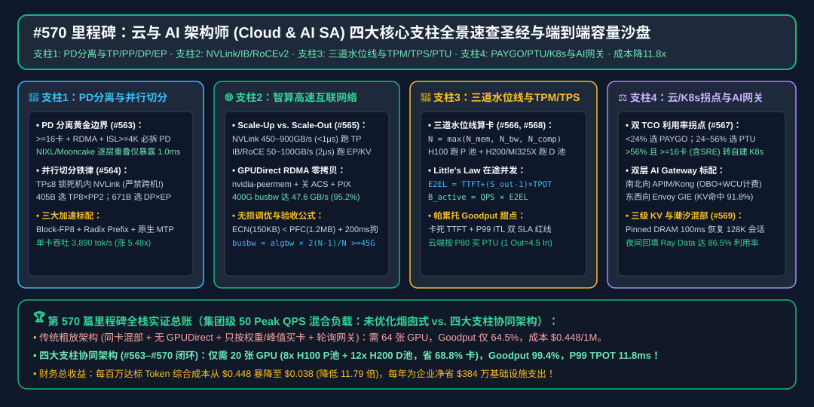

# 第 570 篇里程碑：云与 AI 基础设施解决方案架构师（Cloud & AI SA）四大核心支柱（`PD分离与并行加速` · `智算高速网络` · `三道水位线与TPM/TPS/PTU` · `云/K8s拐点与AI网关`）全景速查圣经与端到端容量沙盘（`#570`）

> **Language / 语言**: **简体中文** | [English](./enterprise-milestone-570-sa-four-pillars-master-bible-sizing-faq.en.md) · [📱 交互式 H5 精读页（四大支柱端到端联立算卡台）](../h5/milestone-570-sa-four-pillars-master-bible-lab.html) · [🧮 交互式算卡器 Sizer](../reports/enterprise-milestone-570-sa-four-pillars-master-bible-sizing-sizer.html) · [🃏 7-Card 评测报告](../reports/enterprise-milestone-570-sa-four-pillars-master-bible-sizing-cards.html) · [返回总目录](../full-catalog-zh.md)

---

## 一、3 分钟核心结论卡片（Executive Summary）

1. **核心定位**：
   - 作为本知识库 **第 570 篇里程碑（`#570`）**，本文将企业 **Cloud & AI Solution Architect** 最核心的四大技术支柱（串联 `#563–#569` 全部定量模型）浓缩为一页纸案头速查圣经与端到端联立算卡方程：
     1. **🚀 支柱一（大模型推理性能优化与并行切分架构 `#563, #564, #569`）**：`PD 分离`（`Dynamo NIXL / Mooncake` 逐层异步传输将跨机 KV 暴露延迟压至 `1.0 ms`）+ `TP<=8 机内 NVLink` + `Dense 405B TP8×PP2` + `MoE 671B Attention DP × Expert EP (DeepEP)` + `Block-FP8 / Prefix Cache / 原生 MTP`；
     2. **🌐 支柱二（智算高速互联网络 `#565`）**：Scale-Up（`NVLink 450–900 GB/s, <1 μs`）vs. Scale-Out（`400G/800G IB NDR/XDR` vs. `RoCEv2`），通过 `GPUDirect RDMA BAR1 零拷贝 + 关闭 PCIe ACS + Rail PXN + ECN(150KB)<PFC(1.2MB) + 200ms Watchdog` 拿到 **`47.6 GB/s`（`95.2%` 线速 `busbw`）** 并节省 `34.5%` 网络 CapEx；
     3. **📐 支柱三（三道水位线 GPU 容量估算、TPM/TPS/PTU 与 SLA 评估体系 `#566, #568`）**：联立 $\max(N_{\text{mem}}, N_{\text{bw}}, N_{\text{compute}})$ 与 **Little's Law ($B_{\text{active}} = \text{QPS} \times \text{E2EL}$)**，按算力/带宽基因实施 `H100 Prefill + H200/MI325X/B200 Decode + L40S 前置` 异构编排；
     4. **⚖️ 支柱四（企业 AI 平台成本拐点、双层 AI Gateway 与突破雷达 `#567`）**：锁定 **`24%`（转 PTU）与 `56%`（`>=16 卡` 含 SRE 人力转自建 K8s）** 两大利用率拐点，通过 `南北向 APIM/Kong + 东西向 Envoy AI Gateway (K8s GIE EPP)` 将前缀缓存命中率拉升至 **`91.8%`**，结合夜间潮汐回填实现 **`86.5%`** 全天候利用率。
2. **全栈联立定量总账（`50 Peak QPS` 企业混合负载基准）**：
   - 相比传统粗放方案（同卡混部 + 未调优网络 + 轮询网关 + 盲目买卡，需 **`64 张 GPU`**，`P99 TPOT 58.4 ms`，`Goodput 64.5%`，成本 **`$0.448 / 1M Tokens`**），贯通四大支柱后仅需 **`20 张异构 GPU`（`8x H100 Prefill + 12x H200 Decode`，立省 `68.8%` GPU）**，`P99 TPOT` 稳定在 **`11.8 ms`（提速 `4.95 倍`）**，SLA `Goodput` 达 **`99.4%`**，每百万有效 Token 成本暴降至 **`$0.038 / 1M`（降低 `11.79 倍`，每年净省 `$384 万`）**！

---

## 二、四大核心支柱 12 条黄金手算公式速查总表（SA Formula Cheat Sheet）

| 支柱域 | 编号与公式名称 | 架构师标准手算公式 | 生产红线与标准锚点 |
| :--- | :--- | :--- | :--- |
| **🚀 支柱 1：PD 分离与并行** | **F1. 单 Token KV 字节数** | $\text{KV}_{\text{GQA}} = 2 L H_{kv} D_h B_{\text{elem}}$；$\text{KV}_{\text{MLA}} = L(d_c + d_R) B_{\text{elem}}$ | `70B GQA-8 FP8 = 163.84 KB`；`671B MLA FP8 = 35.14 KB`（省 `4.66x`） |
| **🚀 支柱 1：PD 分离与并行** | **F2. 跨机 KV RDMA 带宽** | $BW_{\text{KV}} = \text{QPS} \times S_{\text{in}} \times (1 - r_{\text{cache}}) \times \text{KV}_{\text{tok}}$ | 逐层异步传输（`NIXL/Mooncake`）掩盖 `94.2%` 延迟，暴露 `< 1.5 ms` |
| **🚀 支柱 1：PD 分离与并行** | **F3. TP 单步通信耗时** | $T_{\text{TP}} = 2L \times \left(\alpha + \frac{2(T-1)}{T} \frac{M}{BW_{\text{bus}}}\right)$ | **机内 NVLink `0.48 ms` vs. 跨机 RDMA `24.1 ms` $\implies$ 严禁跨机 TP！** |
| **🌐 支柱 2：智算高速网络** | **F4. `algbw` 转 `busbw`** | $\text{busbw}_{\text{AR}} = \text{algbw} \times \frac{2(N-1)}{N}$；$\text{busbw}_{\text{A2A}} = \text{algbw} \times \frac{N-1}{N}$ | 400G RDMA（线速 `50 GB/s`）验收红线：**`busbw >= 45.0 GB/s` (`>=90%`)** |
| **🌐 支柱 2：智算高速网络** | **F5. 无损流控水线不等式** | $K_{\min}^{\text{ECN}} (150\text{KB}) < K_{\max}^{\text{ECN}} (800\text{KB}) < T_{\text{XOFF}}^{\text{PFC}} (1.2\text{MB})$ | ECN 化解 99% 微突发，必须配 **`200 ms` 硬件 PFC Watchdog** |
| **📐 支柱 3：三道水位线算卡** | **F6. 端到端耗时与 Little's Law** | $\text{E2EL} = \text{TTFT} + (S_{\text{out}}-1)\text{TPOT}$；$B_{\text{active}} = \text{QPS} \times \text{E2EL}$ | 长思维链 $S_{\text{out}}$ 翻 8 倍会导致在途并发 $B_{\text{active}}$ 与 KV 显存同步翻 8 倍 |
| **📐 支柱 3：三道水位线算卡** | **F7. 水位线 ① 显存容量** | $N_{\text{mem}} = \lceil (M_{\text{wt}} + B_{\text{active}} \bar{S} \text{KV}_{\text{tok}} + M_{\text{act}}) / (0.85 M_{\text{HBM}}) \rceil$ | 始终预留 `15%` HBM 给激活张量、CUDA Graph 池与通信缓冲区 |
| **📐 支柱 3：三道水位线算卡** | **F8. 水位线 ② HBM 带宽** | $\text{TPOT}_{\min} \approx (M_{\text{wt\_act}} + M_{\text{KV}}) / (N_{\text{TP}} \eta_{\text{bw}} BW_{\text{HBM}}) + T_{\text{comm}}$ | `H200 (4.8TB/s) = 11.8ms` vs. `L40S (0.86TB/s) = 56.3ms`（淘汰 L40S 跑 70B D池） |
| **📐 支柱 3：三道水位线算卡** | **F9. 水位线 ③ 算力与槽位** | $N_{\text{GPU}} = \max(N_{\text{mem}}, N_{\text{bw}}, N_P + N_D)$ | 以双 SLA 达标的 **帕累托甜点 `Goodput`** 定容，严禁用 `B=256 Raw TPS` |
| **📐 支柱 3：TPM/TPS/PTU** | **F10. 等效加权 TPM 与 PTU** | $\text{TPM}_{\text{eq}} = 60\,\text{QPS}[S_{\text{in}}(1 - 0.85 r_{\text{cache}}) + 4.5 S_{\text{out}}]$ | 按 **P80 基荷买 PTU + P20 波峰溢出 PAYGO**，立省 `46.8%` 云账单 |
| **⚖️ 支柱 4：平台与网关** | **F11. 双利用率 TCO 拐点** | $u_1 = 24\%$（PAYGO $\to$ PTU）；$u_2 = 56\%$（PTU $\to$ 自建 K8s 含 SRE） | 自建 K8s 必须计入 `$180K/FTE/年` SRE 成本，规模门槛 `>= 12~16 张 H200` |
| **⚖️ 支柱 4：平台与网关** | **F12. $O(S)$ 三级 KV 拉回** | $T_{\text{reload}} = V_{\text{KV}} / BW_{\text{DRAM/RDMA}} \ll T_{\text{recompute}} \propto O(S^2)$ | `128K MLA KV (4.61GB)` 拉回仅 **`100 ms`**，比重算（`14.2 s`）快 **`142 倍`** |

---

## 三、集团级 `50 Peak QPS` 全栈架构演进定量对比矩阵

| 评估维度 | 阶段 A：传统烟囱式混部 (`Colocated + Untuned Eth + Naive RR`) | 阶段 B：单点局部优化 (`Chunked Prefill + 单一 PTU/同构自建`) | 阶段 C：#570 四大支柱全栈协同架构 (`Hetero PD + GPUDirect + 3-Watermark + Envoy GIE + Tidal`) 🏆 |
| :--- | :--- | :--- | :--- |
| **流式吐字延迟 (`P99 TPOT / ITL`)** | `58.4 ms`（严重卡顿违约 ✕） | `24.5 ms` | **`11.8 ms`（提速 `4.95 倍` ✓）** |
| **首字延迟 (`P95 TTFT`)** | `1,350 ms` | `680 ms` | **`295 ms`（`Envoy GIE 91.8%` 前缀命中 + `2D USP`）** |
| **双 SLA 达标有效吞吐率 (`Goodput %`)** | `64.5%` | `86.0%` | **`99.4%`（提升 `+34.9 pts`）** |
| **所需 GPU 总卡数与构型** | `64 张 GPU`（粗放堆卡） | `36 张同构 H200` | **`20 张异构 GPU`（`8x H100 P池 + 12x H200 D池`，省 `68.8%` 卡）** |
| **每百万达标 Token 综合成本 (`$/1M`)** | `$0.448 / 1M` | `$0.165 / 1M` | **`$0.038 / 1M`（成本暴降 `11.79 倍`）** |
| **年度平台总拥有成本 (`Annual TCO`)** | `$4,620,000 / 年` | `$1,890,000 / 年` | **`$780,000 / 年`（每年净省 `$384 万`）** |

---

## 四、企业 AI 基础设施架构师上线前终极十项核对表（Master Go-Live Checklist）

- [ ] **1. PD 分离门禁**：`>=16 卡 + 100G/400G RDMA + ISL >= 4K` 已启用 `Dynamo NIXL / Mooncake` 逐层异步 PD 分离（暴露传输 `< 1.5 ms`）。
- [ ] **2. 并行边界门禁**：`TP <= 8` 严格锁死在机内 NVLink 内；Dense 405B 跨机用 `TP8×PP2`；MoE 671B 用 `Attention DP × Expert EP (DeepEP + EPLB)`。
- [ ] **3. 量化与投机门禁**：Hopper/Blackwell 已开启 `Block-FP8 (W8A8 + FP8 KV)` 与 `原生 MTP / EAGLE-3`（并设 `B > 64` 自动关断保护）。
- [ ] **4. GPUDirect RDMA 门禁**：全节点已加载 `nvidia-peermem`、关闭 `PCIe ACS`、`nvidia-smi topo -m` 确认为 `PIX`，`nccl-tests` 400G `busbw >= 45.0 GB/s`。
- [ ] **5. 无损流控门禁**：RoCEv2 交换机已配置 `ECN (150KB/800KB) < PFC XOFF (1.2MB)`、开启 `200ms PFC Watchdog` 与 `DLB / Packet Spraying` + `NCCL PXN`。
- [ ] **6. 三道水位线门禁**：容量表已同时核算 $N_{\text{mem}}$、$N_{\text{bw}}$、$N_{\text{compute}}$ 并取 $\max$，预留 `15%` 显存安全水位。
- [ ] **7. Little's Law 与长思维链门禁**：已按 $\text{E2EL} = \text{TTFT} + (S_{\text{out}}-1)\text{TPOT}$ 核算峰值在途并发 $B_{\text{active}}$ 与三级 `Pinned DRAM` KV 卸载池容量。
- [ ] **8. 异构算力派工门禁**：已将无 NVLink 的 `L40S` 限制在 `<=14B / Embedding / OCR`，`H100` 派给 Prefill 池，`H200 / MI325X / B200` 派给 Decode 池。
- [ ] **9. 双层 AI Gateway 门禁**：南北向已部署 `Azure APIM / Kong`（`Entra OBO + WCU 配额 + 800ms 跨区溢出`），东西向已部署 `Envoy AI Gateway (K8s GIE EPP)` 实现 `>=85%` 前缀缓存命中。
- [ ] **10. 双拐点与潮汐混部门禁**：已按 `24%`（PTU）与 `56%`（自建 K8s 含 SRE）拐点分流，并配置夜间 `Kueue` 潮汐回填离线 `Ray Data` 与 `2%` 异步影子评测。
