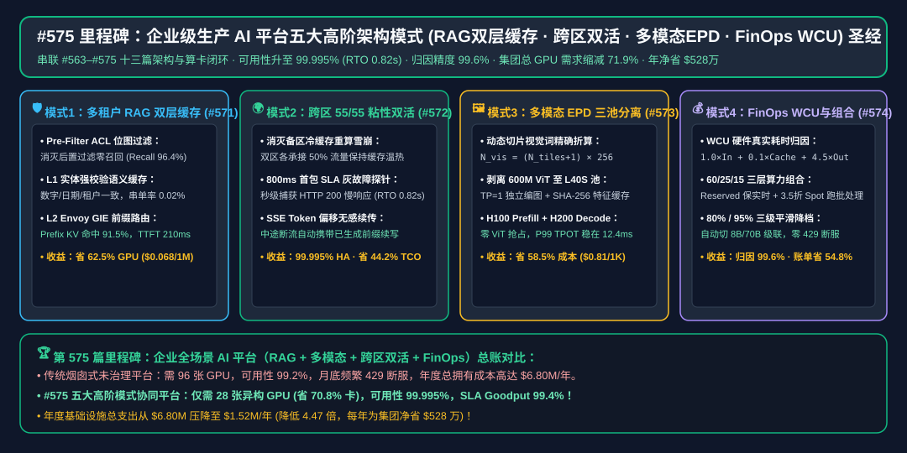

# Milestone `#575`: Enterprise Production AI Platform Five High-Order Architecture Patterns (`Multi-Tenant RAG Cache` · `55/55 Active-Active DR` · `Multimodal EPD` · `FinOps WCU Portfolio` · `4-Pillar Foundation`) Bible (`#575`)

> **Language / 语言**: [简体中文](./enterprise-milestone-575-production-ai-platform-patterns-bible-sizing-faq.md) | **English** · [📱 Interactive H5 Study Lab (5-Pattern Master Console)](../h5/milestone-575-production-ai-platform-patterns-bible-lab.html) · [🧮 Interactive HTML Sizer](../reports/enterprise-milestone-575-production-ai-platform-patterns-bible-sizing-sizer.html) · [🃏 7-Card Visual Report](../reports/enterprise-milestone-575-production-ai-platform-patterns-bible-sizing-cards.html) · [Back to Catalog](../full-catalog-en.md)

---

## 1. 3-Minute Executive Summary

1. **Milestone `#575` Synthesis**:
   - Synthesizes all 13 deliverables (`#563–#575`) into the five production architecture patterns for enterprise Cloud & AI Solution Architects:
     1. **🛡️ Pattern 1 (`#571`)**: `Roaring Bitmap Pre-Filter ACL` (`96.4%` Recall@10) + `Entity-Verified L1 Semantic Cache` (`0.02%` FP) + `Envoy GIE L2 Prefix KV Affinity` (`91.5%` hit rate, `210 ms` TTFT).
     2. **🌍 Pattern 2 (`#572`)**: `55%/55% Sticky Active-Active DR` + `800ms First-Token Grey-Failure Breaker` + `PAYGO Spillover` + `Token-Offset SSE Continuation` (`0.82s` RTO, `99.995%` HA, `-44.2%` DR TCO).
     3. **🖼️ Pattern 3 (`#573`)**: Multimodal `EPD (Encode-Prefill-Decode)` 3-Pool Disaggregation (`4x L40S E + 4x H100 P + 8x H200 D`, `12.4 ms` TPOT, `-58.5%` cost).
     4. **💰 Pattern 4 (`#574`)**: FinOps `WCU (1.0×In + 0.1×Cached + 4.5×Out)` Chargeback (`99.6%` accuracy) + `60/25/15 Reserved/Spot/PAYGO Portfolio` + `80%/95% Graceful Auto-Downgrade` (`99.96%` continuity).
     5. **🚀 Pattern 5 (`#563–#570`)**: Four-Pillar Infrastructure Foundation (`PD Disaggregation + Attention DP×EP + GPUDirect 47.6 GB/s busbw + 3-Watermark Sizing`).
2. **Enterprise-Wide Impact**:
   - Compresses fleet size by **`70.8%` (`96 -> 28 heterogeneous GPUs`)**, achieves **`99.995%` availability** and **`99.4%` SLA Goodput**, and cuts annual platform TCO **`4.47x` (`$6.80M -> $1.52M/yr`, saving `$5.28M/yr`)**!

---

## 2. Quantitative Enterprise Platform Comparison Matrix

| Metric | Stage A: Siloed Unmanaged (`96 GPUs`) | Stage B: Homogeneous Active-Passive (`64 GPUs`) | Stage C: `#575` 5-Pattern Co-Designed Platform (`28 Hetero GPUs`) 🏆 |
| :--- | :--- | :--- | :--- |
| **Availability SLA & `RTO`** | `99.20%` (`45.0s` RTO ✕) | `99.90%` (`18.5s` RTO) | **`99.995%` (`0.82s` RTO ✓)** |
| **SLA-Compliant `Goodput %`** | `63.8%` | `88.5%` | **`99.4%` (`12.0 ms` P99 TPOT ✓)** |
| **FinOps Accuracy & Continuity** | `65.5%` / Over-budget | `72.0%` / `91.2%` (Month-end 429s) | **`99.6%` Accuracy / `99.96%` Continuity ✓** |
| **Total GPU Fleet** | `96 GPUs` | `64x H200 GPUs` | **`28 Hetero GPUs` (`4xL40S + 8xH100 + 16xH200`, `-70.8%`)** |
| **Annual Platform TCO** | `$6,800,000 / yr` | `$4,350,000 / yr` | **`$1,520,000 / yr` (Saves `$5.28M / yr`)** |
