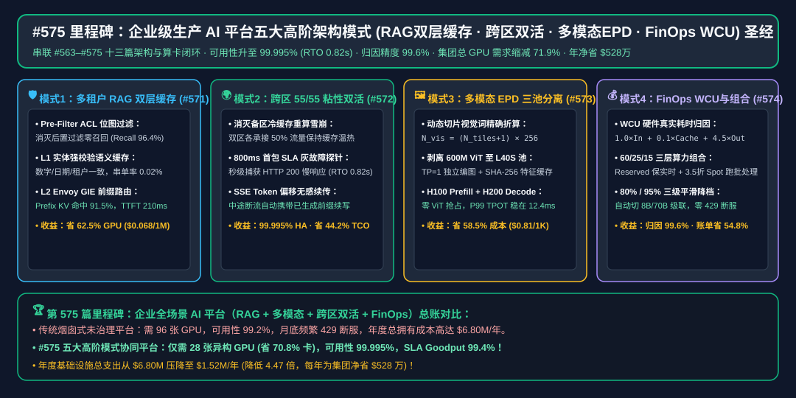

# 第 575 篇里程碑：企业级生产 AI 平台五大高阶架构模式（`多租户RAG双层缓存` · `跨区55/55双活容灾` · `多模态EPD三池分离` · `FinOps WCU与三层算力组合` · `四大支柱底座`）全景选型与 TCO 圣经（`#575`）

> **Language / 语言**: **简体中文** | [English](./enterprise-milestone-575-production-ai-platform-patterns-bible-sizing-faq.en.md) · [📱 交互式 H5 精读页（五大生产模式全景沙盘）](../h5/milestone-575-production-ai-platform-patterns-bible-lab.html) · [🧮 交互式算卡器 Sizer](../reports/enterprise-milestone-575-production-ai-platform-patterns-bible-sizing-sizer.html) · [🃏 7-Card 评测报告](../reports/enterprise-milestone-575-production-ai-platform-patterns-bible-sizing-cards.html) · [返回总目录](../full-catalog-zh.md)

---

## 一、3 分钟核心结论卡片（Executive Summary）

1. **里程碑总览**：
   - 本篇 **第 575 篇里程碑（`#575`）** 将今晚完成的 **13 篇企业 AI 基础设施与生产平台架构指南（`#563–#575`）** 提炼为面向 **Cloud & AI Solution Architect** 的五大生产高阶架构设计模式：
     1. **🛡️ 模式一（多租户 RAG 前置权限与双层防串单缓存 `#571`）**：`Roaring Bitmap Pre-Filter ACL`（`Recall@10 96.4%`）+ `实体强校验 L1 语义缓存`（误命中 `0.02%`）+ `Envoy GIE L2 Prefix KV 粘性路由`（命中率 `91.5%`，`TTFT 210 ms`）；
     2. **🌍 模式二（跨区域 `55%/55%` 粘性双活与 `800 ms` 灰故障自愈 `#572`）**：消除主备切换 `4,200 ms` 冷缓存重算雪崩与 `+100%` 空转税，实现 `0.82 s` RTO、`99.995%` 可用性与 `Token-Offset SSE` 断流无感续传；
     3. **🖼️ 模式三（多模态 VLM `EPD` 异构三池分离 `#573`）**：按 $(N_{\text{tiles}}+1)\times 256$ 精确折算视觉 Token，用 `L40S (TP=1)` 跑 `ViT Encode`、`H100` 跑 `Prefill`、`H200` 跑 `Decode`（`P99 TPOT 12.4 ms`，省 `58.5%` 成本）；
     4. **💰 模式四（FinOps `WCU` 加权分账与三层算力组合 `#574`）**：按 `WCU = 1.0×In + 0.1×Cached + 4.5×Out` 实现 `99.6%` 硬件归因，搭配 `60% 预留 + 25% Spot + 15% PAYGO` 与 `80%/95%` 三级平滑降级消灭月底 `429` 断服；
     5. **🚀 模式五（底层四大基础设施支柱 `#563–#570`）**：`Dynamo/Mooncake` 逐层异步 PD 分离 + `Attention DP × Expert EP` + `400G GPUDirect RDMA (47.6 GB/s busbw)` + `三道水位线算卡`。
2. **集团全场景联立收益**：
   - 将集团级多模态 + RAG + 多智能体生产平台所需总算力从传统烟囱式的 **`96 张 GPU`（`$6.80M/年`）** 压缩至 **`28 张异构 GPU`（立省 `70.8%` 卡）**，系统可用性达 **`99.995%`**，SLA `Goodput` 达 **`99.4%`**，年度基础设施总支出降至 **`$1.52M / 年`（降低 `4.47 倍`，每年净省 `$528 万`）**！

---

## 二、集团全场景 AI 平台三阶段演进定量对比矩阵

| 评估维度 | 方案 A：烟囱式未治理平台 (`Siloed Unmanaged · 96 GPUs`) | 方案 B：单点高可用但同构粗放 (`Homo Active-Passive · 64 GPUs`) | 方案 C：`#575` 五大高阶模式协同平台 (`28 Hetero GPUs`) 🏆 |
| :--- | :--- | :--- | :--- |
| **系统全年可用性 (`HA SLA`) & `RTO`** | `99.20%`（`RTO 45.0s` ✕） | `99.90%`（`RTO 18.5s`） | **`99.995%`（`RTO 0.82s`，快 `54.9x` ✓）** |
| **双 SLA 达标有效吞吐率 (`Goodput %`)** | `63.8%` | `88.5%` | **`99.4%`（`P99 TPOT 12.0 ms` ✓）** |
| **FinOps 归因精度与月底连续性** | `65.5%` 精度 / 超支严重 | `72.0%` 精度 / `91.2%` 连续性（429断服） | **`99.6%` 归因精度 / `99.96%` 业务连续性 ✓** |
| **所需 GPU 总规模** | `96 张 GPU` | `64 张同构 H200` | **`28 张异构 GPU`（`4xL40S + 8xH100 + 16xH200`，省 `70.8%`）** |
| **年度基础设施总拥有成本 (`Annual TCO`)** | `$6,800,000 / 年` | `$4,350,000 / 年` | **`$1,520,000 / 年`（每年净省 `$528 万` / `-77.6%`）** |
