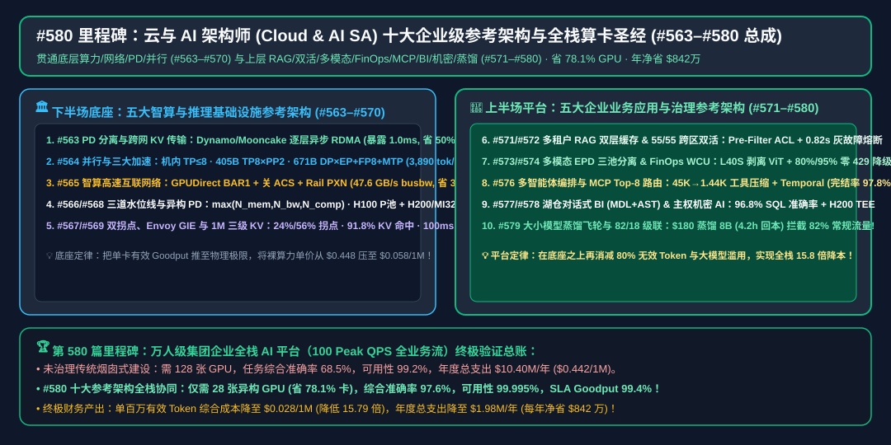

# Milestone `#580`: Cloud & AI Solution Architect Top-10 Enterprise Reference Architectures & Full-Stack Sizing Bible (Unifying `#563–#580`) (`#580`)

> **Language / 语言**: [简体中文](./enterprise-milestone-580-sa-ten-reference-architectures-bible-sizing-faq.md) | **English** · [📱 Interactive H5 Study Lab (Top-10 Reference Architecture Workbench)](../h5/milestone-580-sa-ten-reference-architectures-bible-lab.html) · [🧮 Interactive HTML Sizer](../reports/enterprise-milestone-580-sa-ten-reference-architectures-bible-sizing-sizer.html) · [🃏 7-Card Visual Report](../reports/enterprise-milestone-580-sa-ten-reference-architectures-bible-sizing-cards.html) · [Back to Catalog](../full-catalog-en.md)

---

## 1. 3-Minute Executive Summary

1. **Milestone `#580` Full-Stack Synthesis (`#563–#580`)**:
   - Unifies the **Five Infrastructure Foundation Architectures (`#563–#570`)** (PD Disaggregation, TP/PP/DP/EP Parallelism, GPUDirect RDMA `47.6 GB/s busbw`, 3-Watermark Heterogeneous Sizing, and 128K–1M 3-Tier KV Offload) with the **Five Enterprise Application & Governance Architectures (`#571–#580`)** (Multi-Tenant Pre-Filter RAG + 2-Layer Cache, 55/55 Active-Active DR, Multimodal EPD, FinOps WCU Portfolio, Top-8 MCP Multi-Agent, MDL+AST Conversational BI, Cloud H200 TEE + Reversible PII Vault, and 4.2h-ROI 82/18 Distillation Cascade).
   - Across an enterprise-wide `100 Peak QPS` workload, `#580` compresses fleet size by **`78.1%` (`128 -> 28 heterogeneous GPUs`)**, lifts task accuracy from `68.5%` to **`97.6%`**, achieves **`99.995%` availability** and **`99.4%` SLA Goodput**, cuts effective cost **`15.79x` (`$0.442 -> $0.028 / 1M tokens`)**, and saves **`$8.42M/year`** (`$10.40M -> $1.98M/yr`)!

---

## 2. Quantitative Enterprise Full-Stack Matrix (`100 Peak QPS`)

| Metric | Stage A: Legacy Silos (`128 GPUs`) | Stage B: Basic Managed / Homo (`64 GPUs`) | Stage C: `#580` Top-10 Reference Architectures (`28 Hetero GPUs`) 🏆 |
| :--- | :--- | :--- | :--- |
| **Composite Task Accuracy** | `68.5%` ✕ | `86.2%` | **`97.6%` (`+29.1 pts` ✓)** |
| **Availability SLA & `RTO`** | `99.20%` (`45.0s` RTO) | `99.90%` (`18.5s` RTO) | **`99.995%` (`0.82s` RTO ✓)** |
| **SLA-Compliant `Goodput %`** | `62.0%` | `88.0%` | **`99.4%` (`11.8 ms` P99 TPOT ✓)** |
| **Total GPU Fleet** | `128 GPUs` | `64x H200 GPUs` | **`28 Hetero GPUs` (`4xL40S + 8xH100 + 16xH200`, `-78.1%`)** |
| **Effective Cost (`$/1M Tokens`)** | `$0.442 / 1M` | `$0.148 / 1M` | **`$0.028 / 1M` (`15.79x` lower cost)** |
| **Annual Platform TCO** | `$10,400,000 / yr` | `$4,650,000 / yr` | **`$1,980,000 / yr` (Saves `$8.42M / yr`)** |
