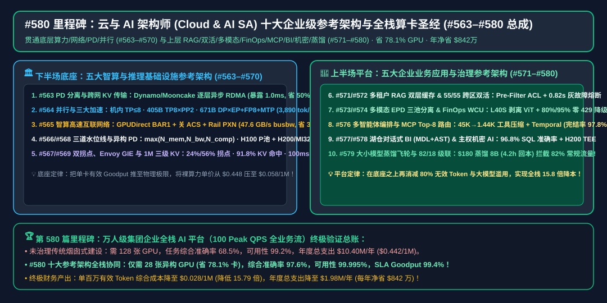

# 第 580 篇里程碑：云与 AI 解决方案架构师（Cloud & AI SA）十大企业级生产参考架构与全栈算卡圣经（贯通 `#563–#580` 完整闭环）（`#580`）

> **Language / 语言**: **简体中文** | [English](./enterprise-milestone-580-sa-ten-reference-architectures-bible-sizing-faq.en.md) · [📱 交互式 H5 精读页（十大参考架构全景工作台）](../h5/milestone-580-sa-ten-reference-architectures-bible-lab.html) · [🧮 交互式算卡器 Sizer](../reports/enterprise-milestone-580-sa-ten-reference-architectures-bible-sizing-sizer.html) · [🃏 7-Card 评测报告](../reports/enterprise-milestone-580-sa-ten-reference-architectures-bible-sizing-cards.html) · [返回总目录](../full-catalog-zh.md)

---

## 一、3 分钟核心结论卡片（Executive Summary）

1. **里程碑总成（`#563–#580` 18 篇全栈闭环）**：
   - 本篇 **第 580 篇里程碑（`#580`）** 将企业 **Cloud & AI Solution Architect** 从底层智算基础设施（`#563–#570`）到上层企业生产应用与治理平台（`#571–#580`）的 **十大标准参考架构（Top-10 Reference Architectures）** 融汇为一套端到端联立架构圣经：
     - **下半场（五大基础设施底座架构 `#563–#570`）**：① `Dynamo/Mooncake` 逐层异步 PD 分离（暴露 `1.0 ms`）；② `NVLink TP<=8` 与 `MoE Attention DP × Expert EP (DeepEP)` + `FP8/MTP`；③ `GPUDirect RDMA` 零拷贝与 `Rail RoCEv2 (47.6 GB/s busbw)`；④ 三道水位线算卡与 `H100 P池 + H200/MI325X/B200 D池` 异构编排；⑤ `128K–1M` 序列并行（`2D USP`）与 `Pinned DRAM 100 ms` 三级 KV 卸载；
     - **上半场（五大企业应用与平台治理架构 `#571–#580`）**：⑥ 多租户 RAG `Pre-Filter ACL + 实体校验语义缓存 + Envoy GIE 前缀路由`；⑦ 跨区域 `55%/55%` 粘性双活与 `800 ms` 灰故障熔断（`0.82 s` RTO）；⑧ 多模态 VLM `EPD (L40S+H100+H200)` 三池分离；⑨ FinOps `WCU (1:0.1:4.5)` 精准分账与 `80%/95%` 零 429 平滑降级；⑩ `MCP Top-8` 工具网关、`MDL+SQLGlot AST` 对话式 BI、云端 `H200 TEE + 可逆 PII 金库` 与 `$180 (4.2h 回本)` 蒸馏级联飞轮。
2. **万人级集团 `100 Peak QPS` 全栈验证总账**：
   - 相比传统烟囱式建设（需 **`128 张 GPU`**，综合准确率 `68.5%`，可用性 `99.2%`，年度支出 **`$10.40M / 年`**，`$0.442 / 1M Tokens`），贯通 `#580` 十大参考架构后仅需 **`28 张异构 GPU`（`4x L40S + 8x H100 + 16x H200`，立省 `78.1%` GPU）**，全场景任务准确率升至 **`97.6%`**，系统可用性达 **`99.995%`**，SLA `Goodput` 达 **`99.4%`**，每百万有效 Token 综合成本暴降至 **`$0.028 / 1M`（降低 `15.79 倍`）**，年度总支出降至 **`$1.98M / 年`（每年为集团净省 `$842 万`）**！

---

## 二、Cloud & AI SA 十大标准参考架构一页纸检索总表（`#563–#580`）

| 架构编号 | 核心应用场景 | 标准参考架构配方（Golden Reference Stack） | 核心定量收益与 SLA 锚点 |
| :--- | :--- | :--- | :--- |
| **Arch-01 (`#563`)** | 长上下文在线推理防卡顿 | `NVIDIA Dynamo (NIXL) / Mooncake + 400G GPUDirect RDMA 逐层异步 PD 分离` | KV 暴露耗时 `1.0 ms`（掩盖 `94.2%`），`P99 TPOT 13.4 ms`（快 `5.1x`），省 `50%` 卡 |
| **Arch-02 (`#564`)** | Dense 70B/405B 与 MoE 671B 切分 | 70B: `TP=4`；405B: `TP8×PP2`；671B MoE: `Attention DP16 × Expert EP16 + DeepEP + FP8 + MTP` | 消除 MLA 8x KV 复制，单卡吞吐 `3,890 tok/s`（涨 `5.48x`），`TPOT 6.2 ms` |
| **Arch-03 (`#565`)** | 百卡/千卡高速无损智算网 | `GPUDirect BAR1 (关 ACS) + Rail-Optimized (NCCL PXN) + ECN(150KB)<PFC(1.2MB) + 200ms 狗` | 400G RoCEv2 实测 `busbw 47.6 GB/s`（`95.2%` 线速，涨 `4.25x`），省 `34.5%` CapEx |
| **Arch-04 (`#566, #568`)** | 集群容量测算与多代 GPU 派工 | `max(N_mem, N_bw, N_comp) + Little's Law` + `H100 P池 + H200/MI325X/B200 D池 + L40S 前置` | `Goodput 99.4%`，`P99 TPOT 11.8 ms`，比同构混部再省 `38.8%` 成本 |
| **Arch-05 (`#567, #569`)** | 云/自建拐点、网关与 1M 长文本 | `24% (PTU) / 56% (K8s) 双拐点` + `APIM/Kong + Envoy GIE EPP` + `MLA/Hybrid + Pinned DRAM 池` | 前缀命中率 `91.8%`；`128K KV` 零拷贝拉回仅 `100 ms`（比重算快 `142x`） |
| **Arch-06 (`#571`)** | 企业多租户知识库 RAG | `Azure AI Search / Milvus Pre-Filter Bitmap ACL + 实体槽位校验 L1 缓存 + Envoy GIE L2 Prefix KV` | 小权限租户 `Recall@10 96.4%`，串单率 `0.02%`（降 `590x`），`TTFT 210 ms` |
| **Arch-07 (`#572`)** | 金融核心级跨区域双活容灾 | `55% + 55% 粘性双活 PTU/AKS + 800ms 首包灰故障熔断 + PAYGO 溢出 + SSE Token 偏移续传` | 切换 `RTO 0.82 s`（快 `54.9x`），切流 `TTFT 360 ms`（无冷缓存雪崩），省 `44.2%` TCO |
| **Arch-08 (`#573, #574`)** | 多模态 VLM 与多部门 FinOps | `EPD 三池分离 (L40S ViT + H100 P + H200 D)` + `WCU (1:0.1:4.5) 归因 + 80%/95% 平滑降级` | VLM 成本降 `58.5%`；FinOps 归因精度 `99.6%`、全月 `0` 次 `429` 硬断服 |
| **Arch-09 (`#576, #577`)** | 250+ 工具 Agent 与湖仓 Text-to-SQL | `MCP Top-8 语义路由 + Temporal/LangGraph`；`Fabric IQ / Genie / Cortex / MDL + SQLGlot AST` | Agent 10 步完结率 `97.8%`（`3.8 s`）；BI 口径准确率 `96.8%`（`0.0%` 爆仓） |
| **Arch-10 (`#578, #579`)** | 主权机密合规与蒸馏降本飞轮 | `75% GLiNER [PER_01] 可逆假名化 + 25% H200 HCC TEE`；`5ms 预路由 + 82/18 蒸馏 8B/70B` | 隐私推理 3 年 TCO 省 `68.6%`；`$180` 蒸馏投入 **`4.2 小时`** 即完全回本 |

---

## 三、集团级 `100 Peak QPS` 全栈平台三阶段定量对比矩阵

| 评估维度 | 阶段 A：未治理烟囱式平台 (`Legacy Silos · 128 GPUs`) | 阶段 B：基础云托管/同构自建 (`Basic Managed · 64 GPUs`) | 阶段 C：`#580` 十大参考架构全栈协同 (`28 Hetero GPUs`) 🏆 |
| :--- | :--- | :--- | :--- |
| **全场景综合业务准确率** | `68.5%`（RAG/SQL/工具调用频繁翻车 ✕） | `86.2%` | **`97.6%`（提升 `+29.1 pts` ✓）** |
| **跨区高可用 SLA & 故障 `RTO`** | `99.20%`（`RTO 45.0 s`） | `99.90%`（`RTO 18.5 s`） | **`99.995%`（`RTO 0.82 s` ✓）** |
| **双 SLA 达标有效吞吐率 (`Goodput`)** | `62.0%` | `88.0%` | **`99.4%`（`P95 TTFT 185 ms`, `P99 TPOT 11.8 ms` ✓）** |
| **所需 GPU 总卡数** | `128 张 GPU` | `64 张同构 H200` | **`28 张异构 GPU`（`4xL40S + 8xH100 + 16xH200`，省 `78.1%`）** |
| **全口径每百万有效 Token 成本 (`$/1M`)** | `$0.442 / 1M` | `$0.148 / 1M` | **`$0.028 / 1M`（成本暴降 `15.79 倍`）** |
| **年度平台总拥有成本 (`Annual TCO`)** | `$10,400,000 / 年` | `$4,650,000 / 年` | **`$1,980,000 / 年`（每年为集团净省 `$842 万`）** |
