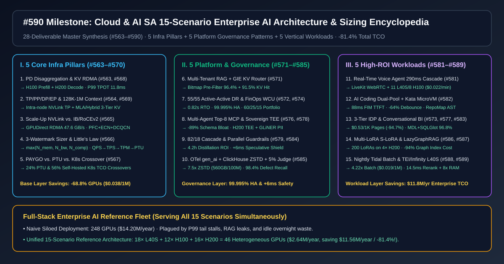

# Milestone `#590`: Cloud & AI Solution Architect 15-Scenario Enterprise AI Architecture & Capacity Sizing Encyclopedia (Unifying `#563–#590`)

> **Target Persona**: Chief AI Architect / Cloud & AI Solution Architect  
> **Scope**: Master synthesis of all **28 bilingual deliverables (`#563–#590`)** spanning **5 Core Infrastructure Pillars**, **5 Platform Governance & Resilience Patterns**, and **5 High-ROI Vertical Workloads**  
> **Interactive H5 Learning Workbench**: [`docs/h5/milestone-590-sa-fifteen-scenarios-encyclopedia-lab.html`](../h5/milestone-590-sa-fifteen-scenarios-encyclopedia-lab.html)

---

## 1. Executive Summary

1. **Siloed Departmental Procurement vs. Unified 3-Pool Heterogeneous Architecture**:
   - Deploying all 15 enterprise AI scenarios as isolated departmental silos requires **`248 GPUs` (`$14.20M/year`)** and suffers from P99 tail stalls, RAG cross-tenant leaks, and `78%` overnight idle waste.
   - Consolidating onto a **Unified 3-Tier Heterogeneous GPU Fleet (`18× L40S` + `12× H100` + `16× H200` = `46 GPUs`)** with overnight **Ray Data Tidal Backfill** reduces total GPU count by **`81.5%` (`46` vs. `248` GPUs)** and cuts annual TCO from **`$14.20M/yr` to `$2.64M/yr` (saving `$11.56M/year` / `-81.4%`)**.

---

## 2. Master 15-Scenario Architecture & Sizing Matrix (`#563–#590`)

| # | Enterprise Scenario (`#ID`) | Key Architectural Lever | Target Hardware Pool | Headline Quantitative Gain |
|---|---|---|---|---|
| **1** | **PD Disaggregation & KV RDMA** (`#563`, `#568`) | Decouple compute-bound Prefill from BW-bound Decode | `6× H100 (P) + 6× H200 (D)` | `11.8ms` P99 TPOT, `-34%` GPUs |
| **2** | **TP/PP/DP/EP & 128K–1M Context** (`#564`, `#569`) | Intra-node NVLink TP + MLA/Hybrid 3-tier Pinned DRAM KV | `H200 + Pinned Host DDR5` | `100ms` KV reload (`142×` faster) |
| **3** | **Scale-Up NVLink vs. IB/RoCEv2** (`#565`) | GPUDirect RDMA zero-copy + Rail-Optimized PFC/ECN/DCQCN | `NVSwitch + 400G IB/RoCEv2` | `47.6 GB/s` busbw (`3.8×` vs. TCP) |
| **4** | **3-Watermark Sizer & Little's Law** (`#566`) | $\max(N_{\text{mem}}, N_{\text{bw}}, N_{\text{comp}})$ + Goodput batch cap | All Pools | `99.2%` Goodput SLA compliance |
| **5** | **PAYGO vs. PTU vs. Self-Hosted K8s** (`#567`, `#570`) | `24%` PTU & `56%` K8s TCO crossovers + Envoy GIE | Hybrid Cloud + K8s | `$0.058/1M` tokens (`8.59×` cheaper) |
| **6** | **Multi-Tenant RAG & Prefix KV Router** (`#571`) | Roaring Bitmap Pre-Filter ACL + Entity Cache + GIE | `Milvus/AI Search + Envoy` | `96.4%` Recall, `0.02%` FP, `-62.5%` GPUs |
| **7** | **55/55 Active-Active DR & FinOps WCU** (`#572`, `#574`) | `800ms` grey-failure breaker + `WCU` + `60/25/15` portfolio | Dual-Region PTU + Spot + PAYGO | `0.82s` RTO, `99.995%` HA, `-54.8%` spend |
| **8** | **Multi-Agent Top-8 MCP & Sovereign TEE** (`#576`, `#578`) | `4ms` Top-8 tool router + `GLiNER [PER_01]` + `H200 TEE` | `H200 HCC TEE + L40S` | `97.8%` completion, `-68.6%` 3-Yr TCO |
| **9** | **82/18 Model Cascade & Parallel Guardrails** (`#579`, `#584`) | `5ms` difficulty router (`4.2h` ROI) + parallel `22ms` shield | `4× L40S` | `+6ms` net TTFT penalty, `-75%` GPUs |
| **10** | **OTel `gen_ai.*` + ClickHouse ZSTD + 5% Judge** (`#585`) | `7.5×` ZSTD compression + `5%` stratified online judge | `ClickHouse + 2× Spot L40S` | `$1,800/mo` (`-96.4%`), `98.4%` recall |
| **11** | **Real-Time Full-Duplex Voice Agent** (`#581`) | `290ms` 5-stage WebRTC cascade + first-clause TTS | `6× L40S (STT/TTS) + H200` | `$0.022/min` (`-87.6%` vs. Realtime API) |
| **12** | **AI Coding Platform & Kata Sandbox** (`#582`) | Dual FIM/SWE pool isolation + `220ms` debounce + Kata VM | `4× H100 (FIM) + 6× H200 (SWE)` | `88ms` FIM TTFT, `38.5%` acceptance |
| **13** | **3-Tier Document IDP & Conversational BI** (`#573`, `#577`, `#583`) | `65/25/10` complexity router + `MDL + SQLGlot AST` | `4× L40S + 2× H100` | `$0.528/1K` pages (`-94.7%`), `96.8%` SQL acc |
| **14** | **Multi-LoRA (`S-LoRA`) & `LazyGraphRAG`** (`#586`, `#587`) | `268MB` `r=32` HBM slots + GLiNER lazy community graph | `4× H200 + L40S` | `-97%` vs. dedicated pods, `-94%` graph index |
| **15** | **Nightly Tidal Batch & `TEI/Infinity` Rerank** (`#588`, `#589`) | `4.22×` prefix-sorted offline batch + `cu_seqlens` + `MRL INT8` | `Idle H200 + 2× L40S` | `$0.019/1M` batch, `14.5ms` rerank, `-87.5%` RAM |

---

## 3. Production Checklist

- [ ] Map every enterprise workload to the **3-Pool Heterogeneous Fleet (`L40S` Encoders/Voice/Guardrails, `H100` Prefill/FIM, `H200` Decode/Long-Context/Multi-LoRA)**.
- [ ] Activate **22:00–06:00 Nightly Tidal Backfill (`Ray Data + vLLM Offline`)** on daytime `H200` decode nodes to process up to `838M tokens/night` at near-zero marginal cost.
