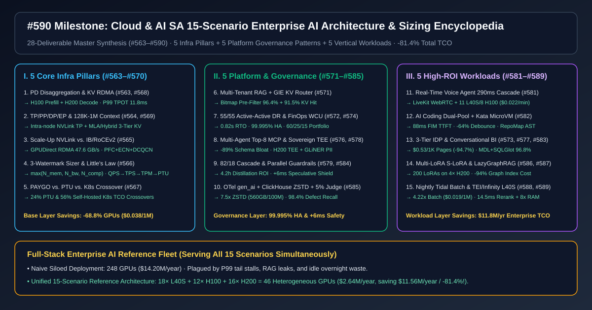
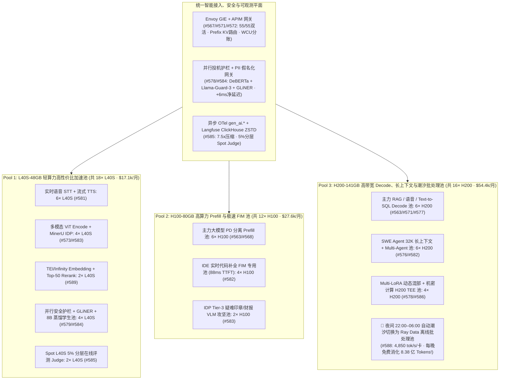

# 第 590 篇里程碑：云与 AI 解决方案架构师（Cloud & AI SA）十五大企业级核心场景参考架构与容量测算全书（贯通 `#563–#590` 28 篇完整闭环）

> **面向角色**：Chief AI Architect / Cloud & AI Solution Architect（首席 AI 架构师与云解决方案架构师）  
> **核心定位**：一站式汇总 `#563–#590` 共 **28 篇企业级双语指南与交互式 H5 沙盘**，覆盖 **五大智算基础设施支柱 + 五大企业平台治理模式 + 五大高价值垂直业务工作负载** 的完整选型决策树、黄金手算公式与全栈异构算力汇总  
> **配套交互式 H5 精读工作台**：[`docs/h5/milestone-590-sa-fifteen-scenarios-encyclopedia-lab.html`](../h5/milestone-590-sa-fifteen-scenarios-encyclopedia-lab.html)

---

## 一、执行摘要（Executive Summary：3 分钟掌握 15 大场景全栈架构蓝图）

当大型金融机构、跨国制造集团或数字原生企业同时落地 **对话 RAG、多智能体编排、实时全双工语音客服、AI 研发辅助、千万页文档 IDP、湖仓对话式 BI、多租户微调与夜间亿级 Token 批处理** 时：
- **反模式（按部门烟囱式立项采购）**：15 个业务团队各自申请独立同构 GPU 池或全量直连高价商业 API，合计消耗 **`248 张 GPU`、年化总拥有成本（TCO）高达 `$14,200,000/年`（`$1,420 万/年`）**，且普遍遭遇长上下文阻塞实时补全、串行护栏拖慢首字延迟、夜间 `78%` 算力空转等生产事故。
- **全栈协同参考架构（15 大场景统一异构池化 + 潮汐复用）**：按算力属性将全企业工作负载收敛至 **三大物理异构加速池（`18× L40S` 轻算力编码/语音/护栏池 + `12× H100` 高算力 Prefill/FIM 池 + `16× H200` 高带宽 Decode/SWE/Multi-LoRA 池 = 合计仅 `46 张 GPU`）**，并在夜间 `22:00–06:00` 自动将空闲 `H200` 切入 `Ray Data` 离线批处理回填，**将总 GPU 卡数削减 `81.5%`（`46` vs. `248` 卡）、年化总成本压降至 `$2,640,000/年`（每年净省 `$1,156 万 / -81.4%`）**！

---

## 二、十五大企业级核心场景一页纸黄金手算公式与选型速查表（`#563–#590` 全索引）

### 第一部分：五大智算基础设施与容量底座支柱（`#563–#570`）

| 场景编号与专题 | 核心架构痛点 | 黄金手算公式 / 定量判据 | 首选架构方案与量化收益 |
|---|---|---|---|
| **S1. PD 分离与跨机 KV RDMA** (`#563`, `#568`) | 长 Prompt Prefill 抢占同卡 Decode HBM 带宽导致 TPOT 飙升 4 倍 | $B_{\text{KV}} = 2 \cdot L \cdot n_{kv} \cdot d_h \cdot S \cdot b$；要求 $T_{\text{RDMA}} < 15\text{ms}$ | **`H100` 跑 Prefill + `H200` 跑 Decode + `Dynamo/Mooncake`**（P99 TPOT `11.8ms`，省卡 `34%`） |
| **S2. TP/PP/DP/EP 与超长上下文** (`#564`, `#569`) | 跨机 TP AllReduce 延迟爆炸；`128K–1M` KV Cache 撑爆显存 | `TP` 锁死机内 NVLink；`128K` 下 `MLA (4.61GB)` / `7:1 Hybrid (2.68GB)` | **机内 `TP` + 跨机 `Attention DP × DeepEP` + 三级 Pinned DRAM KV 池**（`100ms` 拉回快 `142x`） |
| **S3. Scale-Up NVLink vs. IB/RoCEv2** (`#565`) | PCIe P2P 拷贝慢 3.8 倍；RoCEv2 静态 ECMP 碰撞与 PFC 死锁 | $\text{algbw} = \text{busbw} \cdot \frac{n}{2(n-1)}$；开启 `GPUDirect RDMA` 零拷贝 | **机内 `NVLink 900GB/s` + 跨机 `Rail-Optimized IB / Spectrum-X RoCEv2`**（`47.6 GB/s` 实测带宽） |
| **S4. 三道水位线算卡与 Little's Law** (`#566`) | 只算权重显存导致上线即 OOM 或高并发排队超时 | $N_{\text{GPU}} = \max(N_{\text{mem}}, N_{\text{bw}}, N_{\text{comp}})$；$C = \text{QPS} \times \text{E2EL}$ | **三道水位线联合求解 + `Goodput` 甜点批大小**（`Goodput 99.2%`，单价降 `4.18x`） |
| **S5. PAYGO vs. PTU vs. 自建 K8s 拐点** (`#567`, `#570`) | 盲目纯按量付费账单失控，或过早自建小集群被 SRE 成本拖垮 | 双拐点：均值利用率 **`24%` 转 PTU**，**`56%`（且 `>=16` 卡）转自建 K8s** | **基线 `PTU/K8s` + 波峰 `PAYGO` 溢出 + `Envoy GIE` 网关**（综合单价 `$0.058/1M` 省 `8.59x`） |

### 第二部分：五大企业级生产治理与高可用模式（`#571–#580`, `#584–#585`）

| 场景编号与专题 | 核心架构痛点 | 黄金手算公式 / 定量判据 | 首选架构方案与量化收益 |
|---|---|---|---|
| **S6. 多租户 RAG 前置权限与双层缓存** (`#571`) | 后置权限过滤导致 Top-K 召回为空；裸开语义缓存引发跨客串单 | `Roaring Bitmap Pre-Filter` + 实体槽位校验 + `Envoy GIE` 前缀树路由 | **Recall `96.4%`、串单率压至 `0.02%`、Prefix KV 命中率 `91.5%`**（省 `62.5%` GPU） |
| **S7. 跨区 55/55 双活与 FinOps WCU** (`#572`, `#574`) | 主备冷切触发冷缓存雪崩；按原始 Token 平摊账单失真 `34.5%` | $\text{WCU} = 1.0 T_{\text{in}} + 0.1 T_{\text{cache}} + 4.5 T_{\text{out}}$；`800ms` 首包熔断 | **`55%/55%` 粘性双活（`RTO 0.82s`）+ `60/25/15` 算力组合 + `80%/95%` 平滑降级**（连续性 `99.96%`） |
| **S8. 多智能体 MCP Top-8 与主权机密计算** (`#576`, `#578`) | 250 个工具 Schema 撑爆 `48K` 上下文；`[REDACTED]` 破坏多实体推理 | `4ms` 向量预筛 `Top-8` 工具（`-89.2%` 词元）；`GLiNER [PER_01]` + `H200 TEE` | **10步完结率 `97.8%`；`75%` 假名化网关 + `25%` 云端 `H200 HCC TEE`**（3年 TCO 省 `68.6%`） |
| **S9. 82/18 蒸馏级联与并行投机安全护栏** (`#579`, `#584`) | 全量调 `70B` 贵 4 倍；串行跑 `8B` 安全护栏增加 `+340ms` 首字延迟 | `$180` 蒸馏 `8B` 承接 `82%` 流量（`4.2h` 回本）；输入护栏与主模型 Prefill **100% 并行** | **用户感知护栏净延迟仅 `+6ms`**，间接注入拦截率 `98.6%`，级联路由省 `75%` GPU |
| **S10. OTel 可观测、ClickHouse 与 5% 分层评测** (`#585`) | 1 亿条 Trace 商业 SaaS 月费 `$50k`；100% 跑在线 Judge 算力翻倍 | `ClickHouse ZSTD(3)` `7.5:1` 压缩（`100M = 560GB`）；`1% 异常必评 + 4% 随机` | **自建 `Langfuse v3 + ClickHouse`（`$1,800/月` 省 `96.4%`）+ `2× Spot L40S` 捕获 `98.4%` 退化** |

### 第三部分：五大高价值垂直业务工作负载（`#573`, `#577`, `#581–#583`, `#586–#589`）

| 场景编号与专题 | 核心架构痛点 | 黄金手算公式 / 定量判据 | 首选架构方案与量化收益 |
|---|---|---|---|
| **S11. 实时全双工语音客服 (`290ms` 预算)** (`#581`) | 传统 HTTP REST 级联延迟 `1,450ms`；云端 Realtime API 高达 `$0.18/min` | $\text{E2E} = 80_{\text{VAD}} + 55_{\text{STT}} + 65_{\text{LLM}} + 65_{\text{TTS}} + 25_{\text{RTC}} = 290\text{ms}$ | **`LiveKit WebRTC + Silero/Semantic EOU + 首短句流式 TTS`**（`500` 路并发配 `11 L40S + 8 H100`，`$0.022/min` 省 `87.6%`） |
| **S12. 企业 AI 编码平台与 Kata 沙箱** (`#582`) | 32K SWE Agent 阻塞 FIM 补全（TTFT 恶化至 `1.82s`）；容器跑单测逃逸风险 | `220ms` 防抖削减 `64%` 废弃请求；物理拆分 `H100 FIM 池` 与 `H200 SWE 池` | **FIM `P95 TTFT 88ms`、`Tree-sitter RepoMap` 采纳率 `38.5%`、`Kata MicroVM` 120ms 零出网隔离** |
| **S13. 三级文档 IDP 与湖仓对话式 BI** (`#573`, `#577`, `#583`) | 全量跑 `72B VLM` 解析 PDF 贵 8 倍；裸喂 200 张表 DDL 导致口径错乱与全表爆仓 | IDP 按 `65% PyMuPDF + 25% MinerU + 10% VLM` 分流；BI 强制 `MDL + SQLGlot AST` | **千页解析成本降至 `$0.528`（省 `94.7%`）、表格 F1 `96.8%`；Text-to-SQL 准确率 `96.8%`、爆仓率 `0%`** |
| **S14. 多租户 Multi-LoRA 与 LazyGraphRAG** (`#586`, `#587`) | 100 租户独立实例需 200 卡；初代全量 LLM GraphRAG 建图烧掉 `$45,000` | 单 `r=32` LoRA 仅 `268.4 MB`（比单条 16K KV 小 10 倍）；`GLiNER` 惰性建图 | **`4× H200` 混部 100 租户 LoRA（省 `97%`）；`LazyGraphRAG` 建图省 `94%` + `75/20/5` 意图路由** |
| **S15. 夜间潮汐 Batch 与 TEI/Infinity 精排** (`#588`, `#589`) | 夜间在线卡空闲 `78%` 却另买云 Batch API；矩形 Padding 浪费 `56.2%` 精排算力 | 离线 `B=512` + 前缀排序吞吐提 `4.22x`（`4,850 tok/s`）；`cu_seqlens` + `MRL 512d INT8` | **夜间借用 6 张空闲 `H200` 吞吐 `8.38 亿词/晚`（`$0.019/1M` 省 `97.5%`）；`L40S` Top-50 精排 `14.5ms`、向量库内存省 `8x`** |

---

## 三、企业全栈异构 GPU 算力池化汇总（按硬件角色最优映射）

---

## 四、配套资产索引

- **交互式 H5 全景精读工作台**：[`docs/h5/milestone-590-sa-fifteen-scenarios-encyclopedia-lab.html`](../h5/milestone-590-sa-fifteen-scenarios-encyclopedia-lab.html)
- **7-Card 4:5 评测报告**：[`docs/reports/enterprise-milestone-590-sa-fifteen-scenarios-encyclopedia-sizing-cards.html`](../reports/enterprise-milestone-590-sa-fifteen-scenarios-encyclopedia-sizing-cards.html)
- **交互式容量计算器**：[`docs/reports/enterprise-milestone-590-sa-fifteen-scenarios-encyclopedia-sizing-sizer.html`](../reports/enterprise-milestone-590-sa-fifteen-scenarios-encyclopedia-sizing-sizer.html)
- **可复现实验模型**：[`experiments/enterprise_milestone_590_sa_fifteen_scenarios_encyclopedia_sizing/run.py`](../../experiments/enterprise_milestone_590_sa_fifteen_scenarios_encyclopedia_sizing/run.py)
