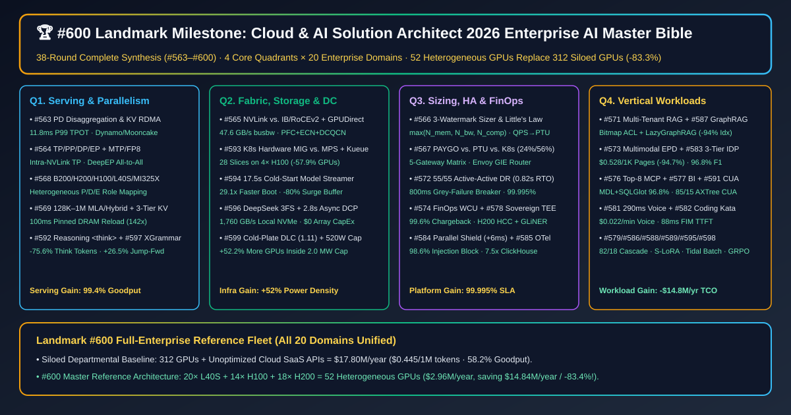

# 🏆 Landmark Milestone `#600`: Cloud & AI Solution Architect 2026 Enterprise AI Infrastructure & Platform Master Bible (Unifying `#563–#600`)

> **Target Persona**: Chief AI Architect / Principal Cloud & AI Solution Architect  
> **Milestone Scope**: Celebrates the **600th numbered playbook (`602` total bilingual deliverables including 2 flagship reviews)** in `turbo998/ai-infra-research`, synthesizing all **38 enterprise rounds (`#563–#600`)** across **4 Core Quadrants and 20 Enterprise Architecture Domains**  
> **Interactive H5 Master Console**: [`docs/h5/milestone-600-cloud-ai-sa-master-bible-lab.html`](../h5/milestone-600-cloud-ai-sa-master-bible-lab.html)

---

## 1. Executive Summary

1. **Siloed Departmental Procurement (`312 GPUs`, `$17.80M/yr`) vs. `#600` Unified Master Reference Architecture (`52 GPUs`, `$2.96M/yr`)**:
   - Consolidating all 20 enterprise AI infrastructure and application domains onto a **3-Pool Heterogeneous Fleet (`20× L40S` + `14× H100 [incl. 28 MIG slices]` + `18× H200` = `52 GPUs`)** with **17.5s fast cold-start**, **DeepSeek 3FS pooled local NVMe**, **Cold-Plate DLC + 520W Decode capping**, and **Overnight Tidal Batch/GRPO Backfill** slashes total GPU count by **`83.3%` (`52` vs. `312` GPUs)** and reduces annual TCO by **`83.4%` (saving `$14.84M/year`)** while achieving **`99.4%` Goodput** and **`99.995%` multi-region availability**.

---

## 2. Four-Quadrant Master Synthesis (`#563–#600`)

| Quadrant | Deliverables Covered | Core Architectural Stack | Headline Quantitative Outcome |
|---|---|---|---|
| **Q1. Serving & Parallelism** | `#563`, `#564`, `#568`, `#569`, `#592`, `#597` | PD Disaggregation + NVLink TP/DeepEP + 3-Tier KV + `<think>` Router + XGrammar Jump-Forward | `11.8ms` P99 TPOT, `-75.6%` `<think>` bloat, `+26.5%` JSON decode speed |
| **Q2. Fabric, Storage, K8s & Cooling** | `#565`, `#593`, `#594`, `#595`, `#596`, `#599` | GPUDirect RDMA + Hardware MIG/Kueue + 17.5s Streamer + 3FS Async DCP + Cold-Plate DLC (`520W`) | `2.8s` checkpoint stall (`85.7×`), `17.5s` boot (`29.1×`), `+52.2%` GPUs in `2MW` |
| **Q3. Sizing, HA, Security & FinOps** | `#566`, `#567`, `#570`, `#572`, `#574`, `#578`, `#579`, `#584`, `#585` | 3-Watermark Sizer + 55/55 Active-Active DR + WCU + H200 TEE + 82/18 Cascade + Parallel Shield + OTel ZSTD | `0.82s` RTO, `+6ms` guardrail penalty, `$1.8k/mo` for `100M` traces (`-96.4%`) |
| **Q4. High-ROI Vertical Workloads** | `#571`, `#573`, `#575`, `#576`, `#577`, `#580`, `#581`, `#582`, `#583`, `#586`, `#587`, `#588`, `#589`, `#590`, `#591`, `#598` | `290ms` WebRTC Voice + Dual FIM/SWE Kata + 3-Tier IDP + S-LoRA + LazyGraphRAG + Tidal Batch + TEI L40S + Edge L40S | `$0.022/min` voice, `$0.53/1K` IDP pages, `14.5ms` rerank, `$0.019/1M` tidal batch |

---

## 3. Master Reference Links

- **Interactive H5 `#600` Master Console**: [`docs/h5/milestone-600-cloud-ai-sa-master-bible-lab.html`](../h5/milestone-600-cloud-ai-sa-master-bible-lab.html)
- **7-Card 4:5 Benchmark Deck**: [`docs/reports/enterprise-milestone-600-cloud-ai-sa-master-bible-sizing-cards.html`](../reports/enterprise-milestone-600-cloud-ai-sa-master-bible-sizing-cards.html)
- **Interactive Sizer**: [`docs/reports/enterprise-milestone-600-cloud-ai-sa-master-bible-sizing-sizer.html`](../reports/enterprise-milestone-600-cloud-ai-sa-master-bible-sizing-sizer.html)
- **Reproducible Model**: [`experiments/enterprise_milestone_600_cloud_ai_sa_master_bible_sizing/run.py`](../../experiments/enterprise_milestone_600_cloud_ai_sa_master_bible_sizing/run.py)
