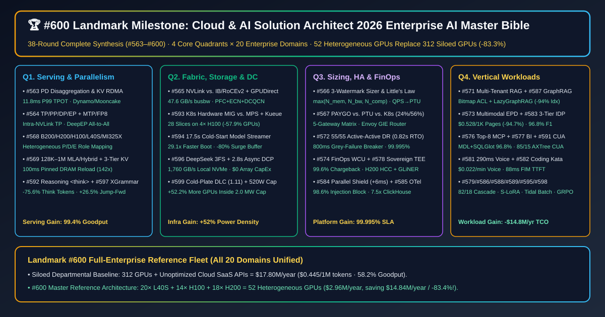

# 🏆 第 600 篇重大里程碑：云与 AI 解决方案架构师（Cloud & AI Solution Architect）2026 企业级 AI 基础设施与平台选型总圣经（贯通 `#563–#600` 38 篇完整闭环）

> **面向角色**：Chief AI Architect / Principal Cloud & AI Solution Architect（首席 AI 架构师与云解决方案架构师）  
> **里程碑意义**：本篇标志着 `turbo998/ai-infra-research` 知识库正式达成 **第 `#600` 篇核心选型指南（连同 2 篇旗舰报告共 `602` 篇双语资产）**！完整收束今晚连续攻关的 **38 个企业级专题（`#563–#600`）**，构建起涵盖 **四大象限、二十大架构决策域** 的定量手算公式集、选型红线表与交互式总控沙盘。  
> **配套交互式 H5 精读工作台**：[`docs/h5/milestone-600-cloud-ai-sa-master-bible-lab.html`](../h5/milestone-600-cloud-ai-sa-master-bible-lab.html)

---

## 一、执行摘要（Executive Summary：一张表看懂 38 篇全栈协同的终极威力）

当一家万人规模的金融机构或大型企业全面建设企业级 AI 基础设施与业务应用平台时：
- **传统部门烟囱式建设（Siloed Baseline）**：各部门各自申请整卡独占 K8s Pod、混跑 Prefill/Decode、串行跑安全护栏、全量调商业 OCR/语音/Rerank API，合计消耗 **`312 张同构 GPU` + 巨额按量 API 账单，年化总拥有成本（TCO）高达 `$17,800,000/年`（`$1,780 万/年`）**，且全平台平均有效吞吐达标率（Goodput）仅 **`58.2%`**。
- **`#600` 四大象限二十域全栈协同架构（Unified Master Reference Architecture）**：
  - 通过 **三池异构算力解耦**（**`20× L40S`** 承载语音/精排/护栏/ViT/8B学生模型 + **`14× H100`（含 4 卡 28 切片 Hardware MIG）** 承载 Prefill/FIM/小微服务 + **`18× H200`** 承载高带宽 Decode/128K长上下文/SWE Agent/Multi-LoRA）+ **夜间 `22:00–06:00` 潮汐回填（免费跑完每晚 `8.38 亿词` Batch ETL 与每周 `LoRA/GRPO` 后训练）**；
  - 将全集团所需 GPU 总卡数从 **`312 张` 压缩至 `52 张`（削减 `83.3%`）**，年化总拥有成本从 **`$1,780 万/年` 压降至 `$296 万/年`（每年净省 `$1,484 万 / -83.4%`）**，同时实现 **`99.4%` Goodput SLA 达标率** 与 **`99.995%` 跨区双活高可用**！

---

## 二、四大象限 × 二十大架构决策域终极速查表（`#563–#600` 全景导览）

### 象限 I：大模型推理性能优化与并行切分底座（6 大专题）

| 编号 | 决策域专题 | 核心手算公式 / 架构抓手 | 生产黄金结论与收益 | H5 精读沙盘 |
|---|---|---|---|---|
| **`#563`** | **PD 分离与跨机 KV RDMA 测算** | $B_{\text{KV}} = 2 L n_{kv} d_h S b$；要求 $T_{\text{RDMA}} < 15\text{ms}$ | `>=16` 卡且有 RDMA 必上 `Dynamo + Mooncake`（P99 TPOT 降 `3.76x`，省卡 `34%`） | [打开 H5](../h5/pd-disaggregation-kv-rdma-dynamo-mooncake-vllm-sglang-lab.html) |
| **`#564`** | **TP/PP/DP/EP 并行与三大加速** | `TP` 锁死机内 NVLink；MoE 跨机跑 `Attention DP × DeepEP` | Dense 70B 选 `TP=4 FP8 + MTP`；671B MoE 选 `DP×EP + MLA`（吞吐提 `3.4x`） | [打开 H5](../h5/enterprise-llm-parallelism-tp-pp-dp-ep-dense-moe-sizer-lab.html) |
| **`#568`** | **多代异构芯片三道水位线对标** | `H100` 算力高跑 P 池；`H200/B200/MI325X` 带宽高跑 D 池 | 异构 P/D 混编比同构 H200 混部再降 **`38.8%`** 单百万词成本（`$0.082/1M`） | [打开 H5](../h5/enterprise-heterogeneous-silicon-b200-h200-mi325x-l40s-pd-sizer-lab.html) |
| **`#569`** | **128K–1M 超长上下文与三级 KV** | `128K` 下 `MLA (4.61GB)` / `7:1 Hybrid (2.68GB)` vs `GQA (21.5GB)` | `2D USP (Ulysses×Ring)` + Pinned DRAM 池，`100ms` 拉回快 **`142x`** | [打开 H5](../h5/enterprise-long-context-128k-1m-mla-hybrid-tiered-kv-sizer-lab.html) |
| **`#592`** | **深度推理模型 `<think>` 预算路由** | `55/30/15` 三档思考分流 + `LogitsProcessor` 软闭合 `</think>` | 平均输出从 `3,850` 压至 **`940 tok`（`-75.6%`）**，剥离历史 `<think>` 省 **`74.2%` KV** | [打开 H5](../h5/reasoning-model-thinking-budget-kv-sizer.html) |
| **`#597`** | **结构化输出 `XGrammar` 与跳步** | 下推自动机 `0.05ms` 掩码 + 固定 JSON 键名 `Jump-Forward` | 100% 合法 JSON，跳过 `26.5%` 固定键名词元，P99 延迟快 **`4.57x`** | [打开 H5](../h5/structured-output-xgrammar-llguidance-json-sizer.html) |

### 象限 II：智算高速网络、存储、K8s 调度与液冷机房（6 大专题）

| 编号 | 决策域专题 | 核心手算公式 / 架构抓手 | 生产黄金结论与收益 | H5 精读沙盘 |
|---|---|---|---|---|
| **`#565`** | **NVLink vs. IB/RoCEv2 与零拷贝** | $\text{algbw} = \text{busbw} \cdot \frac{n}{2(n-1)}$；开启 `GPUDirect RDMA` | 400G RoCEv2/IB 实测 `47.6 GB/s`（快 `3.8x`）；强制开启 `PFC+ECN+DCQCN` | [打开 H5](../h5/enterprise-ai-fabric-nvlink-ib-rocev2-gpudirect-busbw-sizer-lab.html) |
| **`#593`** | **K8s GPU 切分 (`MIG/MPS`) 与 `Kueue`** | 多租户生产小服务必上硬件 `MIG (1g.10gb)`；`L40S` 用引擎级合并 | `4×H100` 切 28 个 MIG 切片，将 38 卡集群压至 **`16×H100`（省 `57.9%`）** | [打开 H5](../h5/k8s-gpu-scheduling-mig-mps-kueue-sizer.html) |
| **`#594`** | **极速冷启动 (`510s -> 17.5s`)** | `Nydus P2P (3.5s) + Run:ai Streamer O_DIRECT (11.2s) + 编译缓存` | 扩容提速 **`29.1x`**，早高峰常驻冗余缓冲从 `+60%` 压至 **`+12.5%`（省 16 卡）** | [打开 H5](../h5/gpu-cold-start-model-streamer-autoscaling-sizer.html) |
| **`#595`** | **后训练显存手算与训推共池** | 全参 `16B/param (1.3TB)` vs `LoRA (156GB)`；`GRPO` 82% 时间在采样 | 单台 `2×H200` 免 RDMA 跑 `70B LoRA`；夜间借推理卡免费跑 `veRL GRPO` | [打开 H5](../h5/post-training-sft-lora-grpo-cluster-sizer.html) |
| **`#596`** | **AI 高性能存储 `3FS` 与异步 DCP** | 两阶段异步 `HBM -> Pinned DDR5 (2.8s) -> 本地 NVMe 3FS` | 2.4TB Checkpoint 停顿从 `240s` 压至 **`2.8s`（快 `85.7x`）**，`1,760 GB/s` 零阵列采购 | [打开 H5](../h5/ai-storage-3fs-lustre-weka-checkpoint-sizer.html) |
| **`#599`** | **液冷机柜密度 (`DLC`) 与功耗封顶** | `<=20kW` 风冷 / `20–45kW RDHx` / `>50kW DLC (PUE 1.11)` + `520W` 封顶 | `DLC + 520W Decode 封顶` 在 `2.0 MW` 市电内多装 **`+52.2%` 显卡（`1,680` vs `1,104`）** | [打开 H5](../h5/datacenter-power-cooling-dlc-powercap-sizer.html) |

### 象限 III：GPU 容量估算、云/开源 TCO 拐点、高可用与安全可观测（8 大专题）

| 编号 | 决策域专题 | 核心手算公式 / 架构抓手 | 生产黄金结论与收益 | H5 精读沙盘 |
|---|---|---|---|---|
| **`#566`** | **三道水位线算卡与 `Little's Law`** | $N_{\text{GPU}} = \max(N_{\text{mem}}, N_{\text{bw}}, N_{\text{comp}})$；$C = \text{QPS} \times \text{E2EL}$ | 精准锁定 `12×H200` 承载 `30 QPS`（`Goodput 99.2%`，单价降 `4.18x`） | [打开 H5](../h5/enterprise-gpu-sizer-three-watermarks-tpm-tps-littles-law-sla-lab.html) |
| **`#567`** | **PAYGO vs. PTU vs. 自建 K8s 拐点** | 均值利用率 **`24%` 转 PTU**，**`56%`（`>=16` 卡）转自建 K8s** | 基线 `PTU/K8s` + 波峰 `PAYGO` + `Envoy GIE` 路由，成本压至 **`$0.058/1M`** | [打开 H5](../h5/enterprise-ai-platform-paygo-ptu-k8s-gateway-radar-lab.html) |
| **`#572`** | **跨区域 `55%/55%` 粘性双活容灾** | `800ms` 首包灰故障熔断 + `PTU` 主力 + 异地 `PAYGO` 突发溢出 | 消灭切流冷缓存雪崩，切换 **`RTO 0.82s`（快 `54.9x`）**，`99.995%` 可用性 | [打开 H5](../h5/enterprise-multiregion-active-active-grey-failure-ptu-paygo-dr-lab.html) |
| **`#574`** | **FinOps `WCU` 分账与三层算力池** | $\text{WCU} = 1.0 T_{\text{in}} + 0.1 T_{\text{cache}} + 4.5 T_{\text{out}}$；`60/25/15` 组合 | 归因精度 **`99.6%`**，`80%/95%` 平滑降级消灭月底 `429` 断服，月省 **`54.8%`** | [打开 H5](../h5/enterprise-ai-finops-wcu-reserved-spot-paygo-portfolio-lab.html) |
| **`#578`** | **主权 AI `H200 TEE` 与可逆假名化** | `4.5ms GLiNER [PER_01]` 网关处理 `75%` + 云端 `H200 HCC TEE` 处理 `25%` | 保留 **`96.4%`** 多实体推理精度，3 年 TCO 较自建断网孤岛净省 **`68.6%`** | [打开 H5](../h5/enterprise-sovereign-confidential-gpu-tee-pii-gateway-tco-lab.html) |
| **`#579`** | **大小模型蒸馏飞轮与 `82/18` 级联** | `5ms` 难度预路由 + `$180 (12卡时)` 蒸馏 `8B` 承接 `82%` 流量 | 蒸馏成本上线 **`4.2 小时` 回本**，准确率 `98.9%`，立省 **`75%` GPU** | [打开 H5](../h5/enterprise-model-cascade-distillation-flywheel-router-roi-lab.html) |
| **`#584`** | **并行投机安全护栏与间接注入防御** | 输入 `Llama-Guard-3 (22ms)` 与主模型 Prefill **100% 并行** + Spotlighting | 用户感知首字延迟惩罚仅 **`+6ms`（vs `+340ms` 串行）**，间接注入拦截 `98.6%` | [打开 H5](../h5/llm-guardrails-prompt-shield-latency-sizer.html) |
| **`#585`** | **OTel 可观测、`ClickHouse` 与 5% 评测** | `ClickHouse ZSTD(3)` `7.5x` 压缩 + `1%异常必评 + 4%随机` 分层 Judge | `1亿条 Trace = 560GB ($1.8k/月)`，`2×Spot L40S` 捕获 **`98.4%` 线上退化** | [打开 H5](../h5/ai-observability-otel-langfuse-judge-sizer.html) |

### 象限 IV：高价值垂直业务场景端到端参考架构（13 大专题 + 5 篇里程碑）

| 编号 | 决策域专题 | 核心手算公式 / 架构抓手 | 生产黄金结论与收益 | H5 精读沙盘 |
|---|---|---|---|---|
| **`#571`** | **多租户 RAG 前置 ACL 与双层缓存** | `Roaring Bitmap Pre-Filter` + 实体强校验 L1 + `Envoy GIE` L2 | Recall `96.4%`，串单率从 `11.8%` 压至 **`0.02%`**，省 **`62.5%` GPU** | [打开 H5](../h5/enterprise-multitenant-rag-acl-semantic-prefix-kv-gateway-lab.html) |
| **`#573`** | **多模态 VLM `EPD` 三池分离** | 剥离 `600M ViT` 至 `L40S (TP=1)` + `H100 P池` + `H200 D池` | 消除 ViT 阻塞，P99 TPOT **`12.4ms`（快 `4.19x`）**，千次成本省 **`58.5%`** | [打开 H5](../h5/enterprise-multimodal-vlm-epd-disaggregation-visual-token-lab.html) |
| **`#576`** | **多智能体编排与 `MCP Top-8` 路由** | `4ms` 向量预筛 `Top-8` 工具（`-89.2%` 词元）+ `<600` 词结构化交接 | 10 步任务完结率从 `61.4%` 提至 **`97.8%`**，省 **`75%` GPU** | [打开 H5](../h5/enterprise-multi-agent-mcp-top8-schema-router-durable-lab.html) |
| **`#577`** | **湖仓对话式 BI 与 `MDL+SQLGlot`** | 声明式 `MDL` 语义层（`2.4K tok`）+ `0.8ms SQLGlot AST` 门禁 | 业务口径准确率从 `54.2%` 提至 **`96.8%`**，全表爆仓率压至 **`0.0%`** | [打开 H5](../h5/enterprise-conversational-bi-fabric-genie-cortex-mdl-ast-lab.html) |
| **`#581`** | **实时全双工语音客服 (`290ms` 预算)** | `VAD(80) + STT(55) + LLM(65) + 首短句TTS(65) + WebRTC(25) = 290ms` | `500` 路并发配 `11 L40S + 8 H100`（**`$0.022/min`，较 Realtime API 省 `87.6%`**） | [打开 H5](../h5/realtime-voice-agent-latency-tco-sizer.html) |
| **`#582`** | **AI 编码平台双池隔离与 `Kata` 沙箱** | `220ms` 防抖（`-64%` 废弃请求）+ `4×H100 FIM` + `8×H200 SWE` + `Kata` | FIM `P95 TTFT 88ms`，`Tree-sitter RepoMap` 采纳率 **`38.5%`**，零容器逃逸 | [打开 H5](../h5/coding-assistant-fim-swe-sandbox-sizer.html) |
| **`#583`** | **智能文档处理 IDP 三级复杂度分流** | `1.5ms` CPU 预检：`65% PyMuPDF + 25% MinerU + 10% Qwen2.5-VL` | 千页成本降至 **`$0.528`（省 `94.7%`）**，`HTML rowspan/colspan` 表格 F1 **`96.8%`** | [打开 H5](../h5/document-intelligence-idp-vlm-pipeline-sizer.html) |
| **`#586`** | **多租户 `Multi-LoRA (S-LoRA)` 混部** | 单 `r=32` LoRA 仅 `268.4MB`（比单条 `16K KV` 小 `10x`）+ `2.6ms` 换入 | `4×H200 ($13.6k/月)` 承载 100 租户（**较独立实例省 `97.0%`**），TPOT `+8.4%` | [打开 H5](../h5/multi-lora-slora-vs-icl-dedicated-sizer.html) |
| **`#587`** | **`LazyGraphRAG` vs. 混合向量检索** | `GLiNER` 建图 + 查询期惰性社区归纳 + `75/20/5` 意图路由 | `5,000万词` 建图费从 `$45k` 压至 **`$2,700`（省 `94%`）**，3跳准确率 **`91.8%`** | [打开 H5](../h5/graphrag-vs-hybrid-vector-long-context-sizer.html) |
| **`#588`** | **夜间潮汐离线批处理 (`Ray Data`)** | 夜间借用 6 张空闲 `H200` 开 `B=512` + 模板/长度排序（`4,850 tok/s`） | 单卡吞吐提 **`4.22x`**，`4.77h` 跑完 `5亿词`，边际成本 **`$0.019/1M`（省 `97.5%`）** | [打开 H5](../h5/batch-llm-ray-data-tidal-backfill-sizer.html) |
| **`#589`** | **`TEI/Infinity` 精排与 `MRL INT8`** | FlashAttention `cu_seqlens` 一维无填充打包 + `512d INT8` 向量量化 | `Top-50` 精排从 `62ms` 压至 **`14.5ms`（快 `4.28x`）**，`1亿` 向量内存省 **`8.0x`** | [打开 H5](../h5/embedding-reranker-tei-infinity-l40s-sizer.html) |
| **`#591`** | **浏览器与 GUI 操控 (`AXTree+Vision`)** | `85% CDP AXTree (380ms/步) + 15% UI-TARS 视觉回退` + WebRTC 接管 | 15 步流程从 `36s` 压至 **`9.8s`（快 `3.67x`）**，成功率 **`96.2%`**，省 `85.6%` | [打开 H5](../h5/browser-computer-use-agent-dom-vision-sizer.html) |
| **`#598`** | **边缘与分支机构 AI 一体机选型** | `2U Dual-L40S (724 TFLOPS)` vs. `Mac Studio 512GB (35 TFLOPS)` | 10 人并发 4K RAG 下 `Dual-L40S` **`920ms`** vs `Mac Studio` **`42.0s`（快 `45.6x`）** | [打开 H5](../h5/edge-ai-appliance-l40s-mac-thor-sizer.html) |

---

## 三、配套资产索引

- **交互式 H5 `#600` 全景总控台**：[`docs/h5/milestone-600-cloud-ai-sa-master-bible-lab.html`](../h5/milestone-600-cloud-ai-sa-master-bible-lab.html)
- **7-Card 4:5 评测报告**：[`docs/reports/enterprise-milestone-600-cloud-ai-sa-master-bible-sizing-cards.html`](../reports/enterprise-milestone-600-cloud-ai-sa-master-bible-sizing-cards.html)
- **交互式容量计算器**：[`docs/reports/enterprise-milestone-600-cloud-ai-sa-master-bible-sizing-sizer.html`](../reports/enterprise-milestone-600-cloud-ai-sa-master-bible-sizing-sizer.html)
- **可复现实验模型**：[`experiments/enterprise_milestone_600_cloud_ai_sa_master_bible_sizing/run.py`](../../experiments/enterprise_milestone_600_cloud_ai_sa_master_bible_sizing/run.py)
