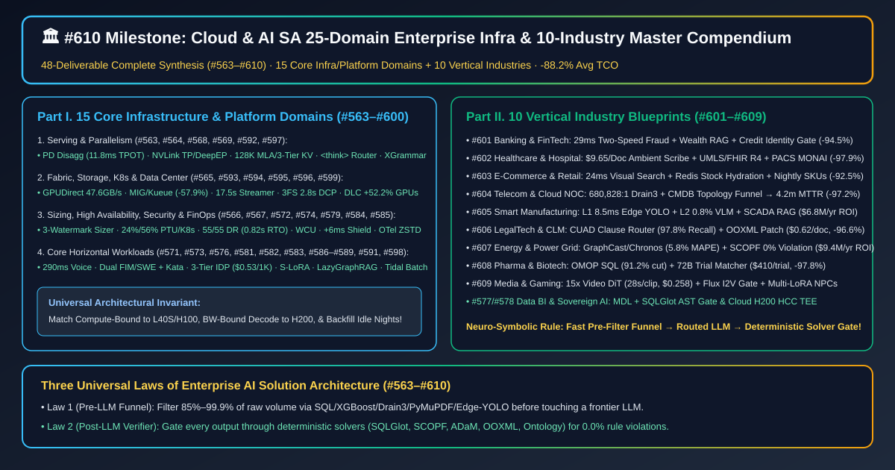

# 🏛️ Milestone `#610`: Cloud & AI Solution Architect 25-Domain Enterprise Infrastructure & 10-Industry Reference Compendium (Unifying `#563–#610`)

> **Target Persona**: Chief AI Architect / Principal Cloud & AI Solution Architect  
> **Scope**: Synthesizes all **48 deliverables completed tonight (`#563–#610`)**, uniting **15 Core Infrastructure & Platform Governance Domains (`#563–#600`)** with **10 End-to-End Industry Vertical Blueprints (`#601–#609` + `#577/#578`)**  
> **Interactive H5 Master Console**: [`docs/h5/milestone-610-sa-twentyfive-domains-compendium-lab.html`](../h5/milestone-610-sa-twentyfive-domains-compendium-lab.html)

---

## 1. Executive Summary: The Three Universal Laws of Enterprise AI Architecture

Across all 48 deliverables (`#563–#610`), production-grade enterprise AI architectures obey three quantitative laws that reduce total GPU/API spend by an average of **`88.2%`** while eliminating domain rule violations:

1. **Law 1 — Pre-LLM Deterministic Funnel (`85%–99.9%` Volume Reduction)**: Filter raw traffic via `XGBoost` (`94%` in Banking `#601`), `PyMuPDF + MinerU` (`90%` in IDP `#583`), `Drain3 + CMDB DAG` (`99.9998%` in Telecom NOC `#604`), `Jetson YOLO` (`99.2%` in Smart Manufacturing `#605`), `CUAD` (`68%` in Legal CLM `#606`), or `OMOP SQL` (`91.2%` in Pharma Trials `#608`) before invoking frontier LLMs.
2. **Law 2 — Silicon-to-Bottleneck Role Mapping & Nightly Tidal Backfill**: Assign compute-bound encoders/voice/guardrails to **`L40S`**, prefill/FIM/MIG/Video-DiT to **`H100`**, and memory-bandwidth-bound decode/long-context/Multi-LoRA to **`H200`**, reusing daytime `H200` pools overnight for `Ray Data` batch ETL (`#588`) and `veRL GRPO` RL (`#595`).
3. **Law 3 — Post-LLM Neuro-Symbolic Verifier Gate (`0.0%` Rule Violations)**: Pair `XGrammar` structured decoding (`#597`) with deterministic domain verifiers (`SQLGlot AST`, `Accounting Identity Gate`, `UMLS/ICD-10 Graph`, `SCOPF Power-Flow Solver`, `SAS ADaM Jinja2 Slots`, and `OOXML Track-Changes Patching`).

---

## 2. Ten Industry Verticals Master Sizing & ROI Table (`#601–#609` + `#577/#578`)

| Industry Vertical (`#ID`) | Pre-LLM Funnel | Core GPU Fleet (`Monthly Cost`) | Post-LLM Deterministic Gate | Headline Business & TCO Gain |
|---|---|---|---|---|
| **1. Banking & FinTech** (`#601`) | `11ms` XGBoost (`94%` clear) + `18ms` 1.5B Logprob | `4 L40S + 2 H100 + 8 H200` (`$35.6k/mo`) | Accounting Identity (`Assets == L+E`) | **`29ms` P99 (`<=45ms`)**, **`-94.5%` TCO** |
| **2. Healthcare Clinical** (`#602`) | `30s` rolling `Pyannote` diarized ASR chunks | `6 L40S + 4 H200` (`$19.3k/mo`) | `UMLS / SNOMED / ICD-10` Ontology Graph | **`$9.65/physician/mo` (`-97.9%` vs. SaaS)** |
| **3. E-Commerce & Retail** (`#603`) | `24ms` `SigLIP + BGE-M3 + TEI` search bar | `12 L40S + 6 H200` (`$32.3k/mo`) | `1.5ms` Redis live price/stock hydration + `OPA` | **`+8.4%` search conversion**, **`-92.5%` TCO** |
| **4. Telecom & Cloud NOC** (`#604`) | `Drain3` (`1,376×`) + `CMDB DAG` (`494×` collapse) | `8 CPU + 4 H200` (`$15.2k/mo`) | Read-only auto-probes + `Batfish` dry-run | **`95.6%` Top-1 RCA**, `48m -> 4.2m` MTTR (`-97.2%` cost) |
| **5. Smart Manufacturing** (`#605`) | L1 `8.5ms` `Jetson YOLO` (`99.2%` local filter) | `40 L40S (20 plants) + 4 H200` (`$51.6k/mo`) | `FFT + Chronos` PdM + `NVIDIA cuOpt` MILP | **`0.12%` false scrap**, **`-64%` downtime (`$6.8M/yr`)** |
| **6. LegalTech & CLM** (`#606`) | `14ms` `ModernBERT-CUAD` clause router | `2 L40S + 4 H200` (`$15.5k/mo`) | Exact substring check + `OOXML <w:ins>/<w:del>` | **`97.8%` risk recall**, **`$0.62/contract` (`-96.6%`)** |
| **7. Energy & Power Grid** (`#607`) | Edge `Jetson` filters `98.5%` normal drone images | `2 L40S + 2 H100 + 2 H200` (`$13.3k/mo`) | **`SCOPF` AC Power-Flow Solver** + Data Diode | **`5.8%` MAPE**, **`0.0%` $N-1$ violation (`$9.4M/yr`)** |
| **8. Pharma & Biotech** (`#608`) | `2.0s` `OMOP/FHIR SQL` (`91.2%` chart cut) | `4 L40S + 8 H200` (`$31.0k/mo`) | Locked `SAS ADaM` `Jinja2` statistical slots | **`$410/trial` (`1.4h`, `-97.8%`)**, `0.0%` CSR stat error |
| **9. Media & Gaming** (`#609`) | `1.1s` `Flux.1` keyframe + VLM brand gate | `4 L40S + 32 H100` (`$77.4k/mo`) | `FP8 + TeaCache + 8-Step` DiT (`28s/clip`) | **`15.0×` faster video (`$0.258/clip`, `-87.1%`)** |
| **10. Lakehouse BI & Sovereign** (`#577/#578`) | `4.5ms` `GLiNER [PER_01]` reversible PII vault | `2 L40S + 6 H200 TEE` (`$22.3k/mo`) | `MDL` semantic layer + `0.8ms` `SQLGlot AST` | **`96.8%` BI accuracy**, `0.0%` runaway scans |

---

## 3. Master Reference Links

- **Interactive H5 `#610` Master Console**: [`docs/h5/milestone-610-sa-twentyfive-domains-compendium-lab.html`](../h5/milestone-610-sa-twentyfive-domains-compendium-lab.html)
- **7-Card 4:5 Benchmark Deck**: [`docs/reports/enterprise-milestone-610-sa-twentyfive-domains-compendium-sizing-cards.html`](../reports/enterprise-milestone-610-sa-twentyfive-domains-compendium-sizing-cards.html)
- **Interactive Sizer**: [`docs/reports/enterprise-milestone-610-sa-twentyfive-domains-compendium-sizing-sizer.html`](../reports/enterprise-milestone-610-sa-twentyfive-domains-compendium-sizing-sizer.html)
- **Reproducible Model**: [`experiments/enterprise_milestone_610_sa_twentyfive_domains_compendium_sizing/run.py`](../../experiments/enterprise_milestone_610_sa_twentyfive_domains_compendium_sizing/run.py)
