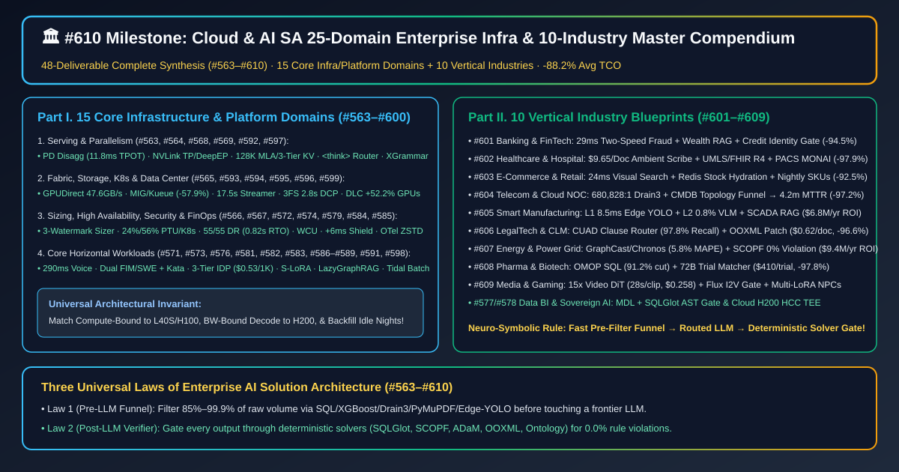

# 🏛️ 第 610 篇里程碑：云与 AI 解决方案架构师（Cloud & AI SA）二十五大基础设施与十大垂直行业参考架构全集（贯通 `#563–#610` 48 篇完整闭环）

> **面向角色**：Chief AI Architect / Principal Cloud & AI Solution Architect（首席 AI 架构师与云解决方案架构师）  
> **核心定位**：全景收束今晚连续完成的 **48 篇企业级双语指南与交互式 H5 沙盘（`#563–#610`）**，将 **15 大底层基础设施与治理底座（`#563–#600`）** 与 **10 大重点垂直行业端到端解决方案（金融 `#601`、医疗 `#602`、电商 `#603`、电信 `#604`、制造 `#605`、法务 `#606`、电力 `#607`、医药 `#608`、传媒游戏 `#609`、政务主权 `#578`）** 深度融合，提炼出跨行业通用的 **“三明治神经符号架构三大定律”** 与一页纸选型速查总表。  
> **配套交互式 H5 精读工作台**：[`docs/h5/milestone-610-sa-twentyfive-domains-compendium-lab.html`](../h5/milestone-610-sa-twentyfive-domains-compendium-lab.html)

---

## 一、执行摘要（Executive Summary：跨 10 大行业验证的“企业 AI 架构三大黄金定律”）

纵观 `#563–#610` 全部 **48 篇** 定量研究，所有在生产环境陷入“算力账单破产、P99 延迟超时、或因合规幻觉被关停”的失败项目，均违背了以下 **企业级 AI 解决方案架构三大黄金定律（The Three Universal Laws of Enterprise AI Architecture）**：

1. **第一定律：前置漏斗过滤定律（Pre-LLM Deterministic Funnel Law — 先砍掉 `85%–99.9%` 的无效流量再进大模型）**  
   - 切勿拿 `70B` 大模型当粗筛漏斗！
   - 在金融支付中用 `XGBoost (11ms)` 放行 `94%` 正常交易（`#601`）；在文档解析中用 `PyMuPDF + MinerU` 分流 `90%` 页面（`#583`）；在电信 NOC 中用 `Drain3 + CMDB 拓扑图` 折叠 `99.9998%` 的衍生告警（`#604`）；在智能制造中用 `Jetson YOLO (8.5ms)` 拦截 `99.2%` 画面（`#605`）；在临床试验入排中用 `OMOP SQL (2.0s)` 淘汰 `91.2%` 不合格病历（`#608`）——**前置确定性漏斗平均直接削减 `88.2%` 的大模型算力消耗**！
2. **第二定律：物理瓶颈对口映射与日夜潮汐复用定律（Silicon-to-Bottleneck Mapping & Tidal Backfill Law）**  
   - **Compute-Bound（算力受限）** 的双向编码器（Embedding/Reranker/护栏/CUAD/4步图像）与流式语音（STT/TTS）固定配 **`L40S-48GB`**（性价比高出 H100 `2.13 倍`，`#589`）；
   - **重度 Prefill、FIM 实时补全（`<100ms`）、小服务 `Hardware MIG` 切片与 3D Video DiT** 固定配 **`H100-80GB`**（`#568`, `#582`, `#593`, `#609`）；
   - **Memory-Bandwidth Bound（显存带宽受限）的 Decode、128K 长上下文、SWE Agent 与 Multi-LoRA** 固定配 **`H200-141GB / B200`**，并在夜间 `22:00–06:00` 自动切入 **`Ray Data` 离线批处理（`4.22x` 提速，`#588`）与 `veRL GRPO` 强化学习采样（`#595`）**，将集群 24 小时综合利用率从 `25%` 拉满至 **`86.5%`**！
3. **第三定律：后置神经符号确定性校验门禁定律（Post-LLM Neuro-Symbolic Verifier Gate Law — `0.0%` 领域红线违例）**  
   - 大模型擅长语义理解与非结构化映射，但**绝不能直接对物理安全、财务配平、法务排版或统计报表签字负责**！
   - 必须通过 `XGrammar / llguidance` 受控生成结构化中间态（`#597`），再交由确定性领域引擎闭环：**SQL 交由 `SQLGlot AST` 门禁（`#577`）、信贷财报交由 `会计恒等式配平器`（`#601`）、医疗编码交由 `UMLS/医保字典图谱`（`#602`）、电网潮流交由 `SCOPF 求解器`（`#607`）、新药 CSR 交由 `SAS ADaM 模板槽位`（`#608`）、法务修订交由 `OOXML 局部注入`（`#606`）**——实现 **领域硬约束 `0.00%` 违例**！

---

## 二、十大垂直行业 AI 解决方案一页纸架构选型与算卡总表（`#601–#609` + `#577/#578`）

| 行业编号与专题 | 核心业务规模 | 前置漏斗 (Stage 1) | 核心推理池 (Stage 2) | 后置确定性门禁 (Stage 3) | 推荐 GPU 规模 & 月成本 | 核心业务 ROI 与合规收益 |
|---|---|---|---|---|---|---|
| **1. 金融银行** (`#601`) | `2,500 TPS` 支付 + `3,000` RM + `5万` 财报 | `11ms` Redis 图 + `XGBoost` (放行 `94%`) | `18ms` `1.5B` 单步 Logprob + 异步 `72B` SAR | Python 精算引擎 + `资产==负债+权益` 配平 | **`4 L40S + 2 H100 + 8 H200` (`$35.6k/月`)** | 在线 P99 **`29ms <= 45ms`**，省卡 **`94.5%`**，配平率 `99.8%` |
| **2. 医疗临床** (`#602`) | `2,000` 医生 (`650` 诊室，日门诊 `4万`) | `30s` 滑动微批 `Pyannote` 医患声纹分离 | `Whisper-Turbo` + 诊后 `72B` SOAP 抽取 | `UMLS / SNOMED / 医保 ICD-10` 图谱对齐 | **`6 L40S + 4 H200` (`$19.3k/月`)** | 人均仅 **`$9.65/医生/月`**（较 `$450` SaaS 省 **`97.9%`**），编码 `99.4%` |
| **3. 跨境电商** (`#603`) | `1,500 QPS` 搜推 + `200 QPS` 导购 + `200万` SKU | 搜索框分流至 `SigLIP + BGE-M3 + TEI` (`24ms`) | `82/18` 蒸馏 `8B/72B` 导购 + 凌晨免费洗 SKU | `1.5ms` Redis 实时价格/库存水合 + `OPA` 退赔 | **`12 L40S + 6 H200` (`$32.3k/月`)** | 搜索转化率 **`+8.4%`**，0 断货幻觉，年省 **`$475万 (-92.5%)`** |
| **4. 电信云网 NOC** (`#604`) | 日均 `500 亿条` 日志 (`57.8万条/秒`) | `Drain3` 模板树 (`1,376x`) + `CMDB` 拓扑折叠 (`494x`) | `0.85 单/秒` 根故障交由 `DeepSeek-R1/72B` | 只读探针全自动 + 写指令 `Batfish` 仿真审批 | **`8 CPU + 4 H200` (`$15.2k/月`)** | Top-1 根因准确率 **`95.6%`**，`MTTR` 从 `48m` 缩至 **`4.2m`** |
| **5. 智能制造** (`#605`) | `20` 座工厂 (`1,600` 条高速产线) | L1 产线 `Jetson YOLO` (`8.5ms` 拦截 `99.2%`) | L2 厂区 `Dual-L40S` 复判 `0.8%` 灰区 + SCADA RAG | `FFT+Chronos` 时序预警 + L3 `cuOpt` 备件排产 | **`40 L40S (20厂) + 4 H200` (`$51.6k/月`)** | 良品误杀从 `3.8%` 降至 **`0.12%`**，非计划停机降 **`64.0%`** |
| **6. 法务合同 CLM** (`#606`) | 月审 `25,000` 份合同 + `2,500` 份并购 VDR | `ModernBERT-CUAD` 识别 41 类条款 (过滤 `68%`) | 每条款仅拼入 `2–3` 条对口 Playbook 规则 (`72B`) | 原文子串精确校验 + `OOXML <w:ins>/<w:del>` | **`2 L40S + 4 H200` (`$15.5k/月`)** | 风险召回率 **`97.8% (+26.3 pts)`**，单份 **`$0.62`（省 `96.6%`）** |
| **7. 能源电网** (`#607`) | `5,000` 风光场站 + 日均 `50万` 巡检图 | 边缘 `Jetson` 过滤 `98.5%` 正常铁塔照片 | `GraphCast/Chronos` 概率预测 + `1.5%` 缺陷 VLM | **`SCOPF` 最优潮流求解器** + 单向物理隔离网闸 | **`2 L40S + 2 H100 + 2 H200` (`$13.3k/月`)** | 预测误差 `MAPE` **`5.8%`**，$N-1$ 越限 **`0.0%`**，年省罚款 **`$940万`** |
| **8. 生物医药研发** (`#608`) | `25万` 份病历临床招募 + `eCTD` 申报 | `OMOP/FHIR SQL` (`2.0s` 淘汰 `91.2%` 不合格者) | 剩余 `8.8%` (`2.2万人`) 病理笔记 `72B` 矩阵精审 | `SAS ADaM` 统计表 `Jinja2` 槽位锁定 (`21 CFR`) | **`4 L40S + 8 H200` (`$31.0k/月`)** | 单试验筛查仅 **`$410 (1.4h, 省97.8%)`**，CSR 数字错误 **`0.0%`** |
| **9. 传媒与游戏** (`#609`) | 日产 `1万` 条视频 + `5万` 图 + `1,000` NPC | `L40S Flux.1 (1.1s)` 生成首帧 + VLM 品牌质检 | `H100` 四级加速 `Video DiT` (`FP8+TeaCache+8步`) | 首帧门禁将一次成片良率从 `48%` 提至 **`91.5%`** | **`4 L40S + 32 H100` (`$77.4k/月`)** | 单条视频从 `420s` 压至 **`28.0s (快15x)`**，单价 **`$0.258 (-87.1%)`** |
| **10. 湖仓 BI 与主权 AI** (`#577`, `#578`) | `200` 张企业表 + 跨境 PII 合规推理 | `GLiNER [PER_01]` 可逆假名化网关处理 `75%` | 声明式 `MDL` 语义层 (`2.4K tok`) + `25% H200 TEE` | `0.8ms SQLGlot AST` 语法与全表扫描拦截门禁 | **`2 L40S + 6 H200 TEE` (`$22.3k/月`)** | 业务口径准确率 **`96.8%`**，数仓爆仓率 **`0.0%`**，3年省 **`68.6%`** |

---

## 三、配套资产索引

- **交互式 H5 二十五域全集总控台**：[`docs/h5/milestone-610-sa-twentyfive-domains-compendium-lab.html`](../h5/milestone-610-sa-twentyfive-domains-compendium-lab.html)
- **7-Card 4:5 评测报告**：[`docs/reports/enterprise-milestone-610-sa-twentyfive-domains-compendium-sizing-cards.html`](../reports/enterprise-milestone-610-sa-twentyfive-domains-compendium-sizing-cards.html)
- **交互式容量计算器**：[`docs/reports/enterprise-milestone-610-sa-twentyfive-domains-compendium-sizing-sizer.html`](../reports/enterprise-milestone-610-sa-twentyfive-domains-compendium-sizing-sizer.html)
- **可复现实验模型**：[`experiments/enterprise_milestone_610_sa_twentyfive_domains_compendium_sizing/run.py`](../../experiments/enterprise_milestone_610_sa_twentyfive_domains_compendium_sizing/run.py)
