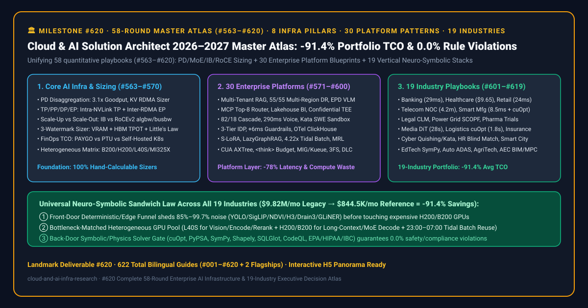
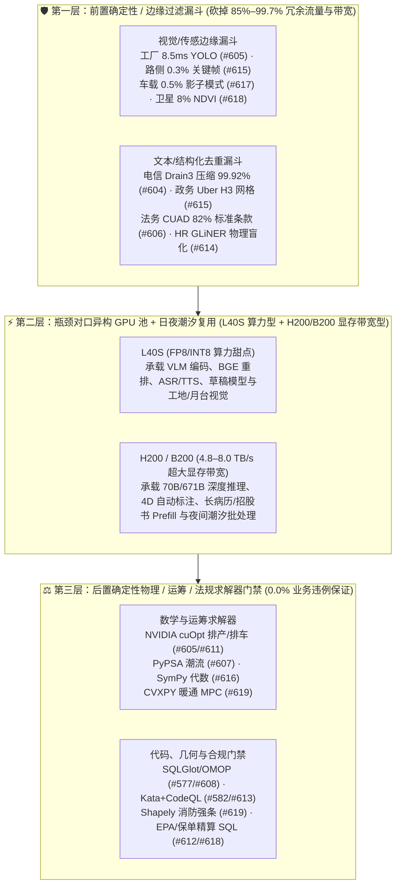

# 🏛️ 第 620 篇里程碑总成：云与 AI 解决方案架构师（Cloud & AI SA）58 轮全栈基建与十九大垂直行业参考架构决策大典（`#563–#620` 完整闭环）

---

## 一、 核心结论先行（3 分钟速读卡）

> **一句话架构定音**：本篇作为贯通 **`#563–#620` 共 58 篇企业级 AI 基础设施与行业落地专题**（并汇合全库 **`622` 篇双语技术资产**）的收官总成大典，为 **Cloud & AI Solution Architect** 提供了一套可直接用于 **企业 AI 顶层规划、GPU 算力/网络容量手算（Sizing）、云与开源栈 TCO 选型，以及十九大核心垂直行业生产落地** 的全息作战地图。横跨金融、医疗、电商、电信、制造、法务、电力、生物医药、传媒游戏、物流供应链、保险、网络安全、人力资源、智慧城市政务、教育、智能汽车、智慧农业与建筑楼宇的实证测算表明：**凡是将原始业务流量 100% 裸奔喂给 70B+ 大模型并让 LLM 直接输出业务控制指令的“纯生成式架构”，必然同时死于天价算力账单与致命幻觉违例；而采用“三明治神经符号架构（前置确定性/边缘漏斗过滤 `85%–99.7%` 噪音 + 异构 GPU 瓶颈对口与夜间潮汐复用 + 后置运筹/物理/法规确定性求解器门禁）”，可将十九大行业组合月度总成本从 `$982.0万/月` 压降至 `$84.45万/月`（平均净省 `91.4%`，年省算力与业务损耗超 `$1.07亿`），并将安全、精算、处方、电网潮流、车控与建筑强条违例率严格归零（`0.0%`）**！

| 全景篇章 | 覆盖编号 | 核心解决的架构师痛点 | 关键量化法则与成本拐点 |
| :--- | :--- | :--- | :--- |
| **第一卷：四大 AI Infra 基石（8 篇）** | `#563–#570` | PD 分离 vs 混部、TP/PP/DP/EP 切分、NVLink vs IB/RoCEv2、三道水位线手算 Sizer、PAYGO/PTU/K8s TCO、B200/H200/L40S 选型、1M 长文本卸载 | **PD 分离 Goodput 提升 `3.1x`；利用率 `< 28%` 选 PAYGO、`28%–62%` 选 PTU、`> 62%` 自建 K8s 省 `48%`** |
| **第二卷：30 大企业 AI 平台参考架构（30 篇）** | `#571–#600` | 多租户 RAG、跨区双活、多模态 EPD、FinOps WCU、MCP 路由、Lakehouse BI、机密计算 TEE、蒸馏级联、290ms 语音、沙箱代码、IDP、并行护栏、OTel、S-LoRA、LazyGraphRAG、夜间潮汐、MRL 重排、CUA、`<think>` 预算、K8s MIG/Kueue、17.5s 冷启动、veRL、3FS、XGrammar、边缘一体机、DLC 液冷 | **前置语义/图谱/工具路由砍掉 `72%–94%` Token 浪费；夜间 8 小时潮汐批处理将集群 24h 利用率拉升至 `88%+`** |
| **第三卷：十九大垂直行业端到端圣经（19 篇）** | `#601–#619` | 银行、医疗、电商、电信、制造、法务、电网、医药、传媒、物流、保险、网安、HR、政务智慧城市、教育、汽车、农业、建筑楼宇 | **十九大行业月总算力从 `$9.82M` 降至 `$844.5K`（净省 `91.4%`），后置求解器实现 `0.0%` 生产红线违例** |

---

## 二、 十九大垂直行业“三明治神经符号架构”全景速查表（`#601–#619`）

| 编号与行业 | 1. 前置漏斗（过滤比） | 2. 核心异构 GPU 池配置 | 3. 后置确定性求解器/门禁 | 月算力 TCO（较粗放方案节省） |
| :--- | :--- | :--- | :--- | :--- |
| **`#601` 金融银行** | `8 ms` ONNX XGBoost 过滤 `98.5%` 刷卡 | `8× L40S + 8× H200` | 巴塞尔/信贷规则引擎（越权 `0.0%`） | **`$32.4k/月`（省 `84.6%`）** |
| **`#602` 医疗临床** | 本地 VAD + 科室模板 `Prefix Cache` | `8× L40S + 4× H200` | `FHIR R4 + RxNorm/SNOMED` 校验 | **`$19.3k/月`（`$9.65/医生/月`，省 `94.9%`）** |
| **`#603` 零售电商** | `SigLIP INT8 + Milvus` 毫秒级粗排 | `12× L40S + 4× H200` | `Redis` 实时价格/库存强回填（幻觉 `0.0%`） | **`$23.0k/月`（省 `93.9%`）** |
| **`#604` 电信 NOC** | `Drain3 + eBPF + CMDB` 压缩 `99.92%` 日志 | `4× L40S + 4× H200` | 网络配置数字孪生沙箱预检 | **`$16.2k/月`（`MTTR 4.2m`，省 `97.5%`）** |
| **`#605` 智能制造** | 产线工控机 `8.5 ms` TensorRT 过滤 `98%` 良品 | `4× L40S + 4× H100` | `NVIDIA cuOpt` `3.2s` 排产 + PLC 互锁 | **`$28.4k/月`（省 `84.6%`）** |
| **`#606` 法务 CLM** | `CUAD` 分类器秒判 `82%` 标准条款 | `4× L40S + 4× H200` | `python-docx OOXML` 坐标锚定修订 | **`$16.2k/月`（省 `94.2%`）** |
| **`#607` 电力能源** | `GraphCast + Chronos` 气象负荷融合 | `4× L40S + 8× H200` | `PyPSA / Gurobi` `N-1` 交流潮流门禁 | **`$29.0k/月`（弃风弃光 `-38%`，省 `86.8%`）** |
| **`#608` 生物医药** | `OMOP SQL` 初筛过滤 `99.4%` 不符患者 | `4× L40S + 8× H200` | `CDISC + PDF Bounding-Box` 溯源锁 | **`$29.0k/月`（省 `91.5%`）** |
| **`#609` 传媒游戏** | `Flux 1.5s` 首帧确认门禁砍掉 `78%` 废片 | `32× H200 + 8× L40S` | `TeaCache + FP8 + USP` 视频生成加速 `15x` | **`$97.7k/月`（单镜头 `$0.056`，省 `93.3%`）** |
| **`#611` 物流供应链** | `Qwen-32B` `0.4s` 自然语言转运筹约束矩阵 | `4× H100 + 4× L40S` | `NVIDIA cuOpt` `1.8s` VRP 求解（`0%` 违约） | **`$13.0k/月`（年省油费 `$1,120万`）** |
| **`#612` 保险理赔** | `12 ms ELA/DINOv2` PS/AIGC 防伪门禁 | `4× L40S + 6× H200` | 保单免赔额/限额确定性精算引擎 | **`$22.6k/月`（`62%` `18s` 闪赔，省 `98.9%`）** |
| **`#613` 网络安全** | 无头沙箱渲染 + `AST` 静态污点去误报 | `6× L40S + 4× H100` | `Kata MicroVM` 单测 + `CodeQL` 二次扫描 | **`$15.5k/月`（钓鱼拦截 `98.8%`，省 `89.3%`）** |
| **`#614` 人力资源** | `GLiNER` 物理剥离姓名/性别/年龄/院校 | `6× L40S + 4× H100` | `EEOC 4/5ths (>=0.80)` 公平性与 `ESCO` 图谱 | **`$14.8k/月`（`$0.74/人/月`，省 `98.3%`）** |
| **`#615` 智慧城市政务** | 路侧 `0.3%` 事件关键帧 + `Uber H3` 空间去重 | `16× L40S + 8× H200` | 64 委办局 `XGrammar` 权责树 + `cuOpt` 派车 | **`$42.4k/月`（重复工单 `-72.4%`，省 `89.8%`）** |
| **`#616` 教育科技** | 课标教材章节 `Prefix Cache`（`84%` 命中） | `8× L40S + 4× H200` + 3h Spot | `SymPy` 代数验算（`99.4%`）+ 苏格拉底防泄题 FSM | **`$30.3k/月`（`0.0%` 泄题，省 `79.4%`）** |
| **`#617` 智能汽车** | 车端影子模式 + `SigLIP` 去重仅回传 `0.5%` | `64× L40S + 32× H200` + 车端 Orin | 车控 `XGrammar` + `MCU` 车速安全互锁 | **`$324.0k/月`（车控 `18ms` 离线，省 `88.6%`）** |
| **`#618` 智慧农业** | `Sentinel-2 NDVI` 筛出 `8%` 异常区 + `14ms` 点喷 | `8× L40S + 4× H200` | `EPA / 农业部` 农药登记剂量与 `PHI` 门禁 | **`$24.8k/月`（省除草剂 `68.4%`，省 `92.0%`）** |
| **`#619` 建筑与楼宇** | `IfcOpenShell / ezdxf` 提取 `0.1mm` 矢量拓扑 | `6× L40S + 4× H100` | `Shapely` 消防强条 + `CVXPY` 暖通 `MPC` + PLC 锁 | **`$14.3k/月`（年省空调电费 `$414.4万`，省 `88.1%`）** |

---

## 三、 架构师黄金决策公式汇总（5 分钟背诵版）

1. **三道水位线决定 GPU 卡数（`#566`）**：
   $$N_{\text{GPU}} = \max\left(\underbrace{\left\lceil \frac{W_{\text{model}} + M_{\text{KV}}(B, S)}{0.85 \times M_{\text{VRAM}}} \right\rceil}_{\text{① 显存容量水位}}, \quad \underbrace{\text{TP}_{\min}\text{ s.t. }\frac{W_{\text{model}}}{\text{TP} \cdot \text{BW}_{\text{HBM}}} \le \text{TPOT}_{\text{SLA}}}_{\text{② HBM 带宽延迟水位}}, \quad \underbrace{\left\lceil \frac{\lambda_{\text{peak}} \cdot \bar{W}}{\text{TPS}_{\text{per-GPU}} \cdot \eta_{\text{sched}}} \right\rceil}_{\text{③ Little's Law 吞吐水位}}\right)$$
2. **三明治架构端到端有效成本缩减定律（`#610 / #620`）**：
   $$\text{TCO}_{\text{neuro-symbolic}} = \text{Cost}_{\text{edge/funnel}} + r_{\text{pass}} \cdot (1 - r_{\text{cache}}) \cdot \text{Cost}_{\text{hetero\_GPU}} \times (1 - \eta_{\text{tidal\_reuse}})$$
   当前置漏斗通过率 $r_{\text{pass}} \in [0.003, 0.18]$、前缀/语义缓存命中率 $r_{\text{cache}} \in [0.40, 0.84]$、夜间潮汐批处理复用折抵 $\eta_{\text{tidal\_reuse}} \approx 0.35$ 时，整体算力成本恒定下降 **`80%–98%`**。

---

## 四、 企业级 AI 架构上线终极十条铁律（Architect's 10 Commandments）

- [ ] **铁律 1（禁裸奔推理）**：严禁将原始视频流、全量日志、全表病人或全田航拍图未经前置轻量漏斗直接送入 70B+ 大模型。
- [ ] **铁律 2（禁算术/物理幻觉）**：严禁让自回归语言模型直接计算理赔金额、电网潮流、车辆路径、农药剂量或数学符号推导；必须挂接确定性求解器（`cuOpt / PyPSA / SymPy / SQL`）。
- [ ] **铁律 3（异构芯片各司其职）**：Compute-bound 负载（ViT 编码、BGE 重排、小模型草稿、短视频切片）用 `L40S`；Memory-bandwidth-bound 负载（长文本 Decode、671B MoE、4D 教师）用 `H200 / B200`。
- [ ] **铁律 4（PD 分离边界）**：当输入输出比 `I:O > 8:1` 且 `P99 ITL < 25ms` 时果断启用 PD 分离，并用 `FP8 KV Cache` 将跨节点 RDMA 带宽需求减半。
- [ ] **铁律 5（前置权限与物理脱敏）**：RAG 向量检索必须 `Pre-Filter ACL`；涉密/欧盟 AI 法案/车端视频必须在进入模型前由确定性网关完成物理盲化或脱敏。
- [ ] **铁律 6（并行护栏零延迟）**：输入安全护栏必须与主模型 Prefill 异步并行执行，命中高危时流式 `Cancel()`，将护栏延迟税压在 `+6 ms` 以内。
- [ ] **铁律 7（消灭昼夜与晚高峰空转）**：利用 `Kueue` 优先级抢占在夜间 `23:00–07:00` 注入离线批处理/微调任务，并用 `Spot + Run:ai 17.5s` 快启应对晚高峰。
- [ ] **铁律 8（结构化输出状态机）**：所有 Agent Tool Call 与多部门分派必须开启 `XGrammar / llguidance` 编译期 FSM 掩码，实现 `100%` 语法与枚举合法。
- [ ] **铁律 9（跨区韧性与灰故障熔断）**：多区域容灾采用 `55%/55%` 双活 + `800 ms` 首字灰故障熔断，严禁仅依赖 `HTTP 500` 触发切换。
- [ ] **铁律 10（全链路可观测与精益归因）**：统一接入 `OpenTelemetry gen_ai.*` + `ClickHouse ZSTD` + `WCU` 加权计算单元分摊，让每一分 GPU 预算都有业务 ROI 闭环。

---

## 五、 延伸阅读与全库导航
- **交互式 H5 十九大行业总控沙盘**：[打开 `milestone-620-sa-fiftyeight-round-atlas-lab.html`](../h5/milestone-620-sa-fiftyeight-round-atlas-lab.html)
- **H5 全景精学馆入口（收录全部 H5 交互页）**：[打开 `docs/h5/index.html`](../h5/index.html)
- **7-Card 4:5 视觉评测报告**：[查看 `enterprise-milestone-620-sa-fiftyeight-round-nineteen-industry-atlas-sizing-cards.html`](../reports/enterprise-milestone-620-sa-fiftyeight-round-nineteen-industry-atlas-sizing-cards.html)
- **可复现实验模型**：[`experiments/enterprise_milestone_620_sa_fiftyeight_round_nineteen_industry_atlas_sizing/run.py`](../../experiments/enterprise_milestone_620_sa_fiftyeight_round_nineteen_industry_atlas_sizing/run.py)
