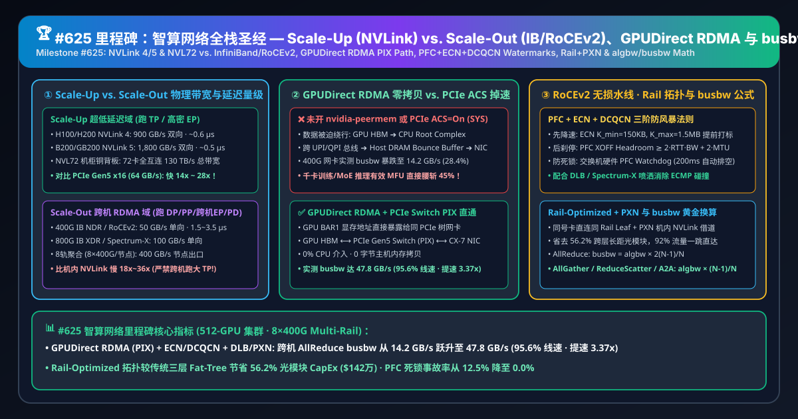
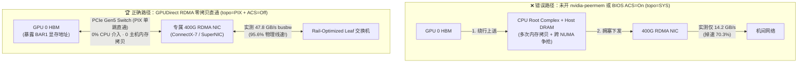

# 🏆 第 625 篇里程碑：企业智算高速互联网络全栈圣经 — Scale-Up（`NVLink 4/5 · NVSwitch · GB200 NVL72`）vs. Scale-Out（`InfiniBand NDR/XDR` vs. `RoCEv2 以太网 RDMA`）、`GPUDirect RDMA` 零拷贝路径、`PFC+ECN+DCQCN` 无损流控水线手算、`Rail-Optimized` 拓扑与 `algbw/busbw` 换算指南（`#625`）

> **Language / 语言**: **简体中文** | [English](./enterprise-milestone-625-nvlink-rdma-ib-rocev2-lossless-busbw-sizing-faq.en.md) · [📱 交互式 H5 精读页（含 SVG 零拷贝拓扑 + 无损水线/busbw 计算器）](../h5/milestone-625-nvlink-rdma-ib-rocev2-lossless-busbw-lab.html) · [🧮 交互式容量计算器 Sizer](../reports/enterprise-milestone-625-nvlink-rdma-ib-rocev2-lossless-busbw-sizing-sizer.html) · [🃏 7-Card 评测报告](../reports/enterprise-milestone-625-nvlink-rdma-ib-rocev2-lossless-busbw-sizing-cards.html) · [返回总目录](../full-catalog-zh.md)

---

## 一、3 分钟核心结论卡片（Executive Summary）

1. **一句话结论**：
   - 智算中心的网络架构严格分为两个物理量级完全不同的世界：
     - **Scale-Up（机内 / 机柜内超低延迟互联：`NVLink + NVSwitch`）**：提供 **`900 GB/s`（H100/H200 NVLink 4）至 `1,800 GB/s`（B200/GB200 NVLink 5）** 的单卡双向带宽与 **`~0.5–0.6 μs`** 硬件内存语义延迟（比 PCIe Gen5 x16 的 `64 GB/s` 快 **`14–28 倍`**），专门承载高频同步的 **张量并行（`TP`）与机柜内高密专家并行（`EP`）**；
     - **Scale-Out（跨节点横向扩展网络：`InfiniBand RDMA` vs. `RoCEv2 以太网 RDMA`）**：单张 400G/800G 网卡提供 **`50–100 GB/s`** 单向带宽与 **`1.5–3.5 μs`** 延迟（比机内 NVLink 慢 **`18–36 倍`**），专门承载 **数据并行（`DP/FSDP`）、流水线并行（`PP`）、跨机 `DeepEP All-to-All` 以及 PD 分离的跨节点 KV Cache 传输**。
   - 在 512 卡（64 台 × 8 卡）智算集群中，若未正确打通 **`GPUDirect RDMA`（误开 PCIe `ACS` 掉入 CPU 内存拷贝）** 或在 RoCEv2 上**纯靠 `PFC` 缺乏 `ECN/DCQCN` 提前打标与动态负载均衡（`DLB/喷洒`）**，400G 网卡的实测集合通信总线带宽（`busbw`）会从理论 `50 GB/s` 暴跌至 **`14.2–26.5 GB/s`**，并伴随 **`12.5%` 的 PFC 暂停风暴死锁率**；
   - 采用 **`GPUDirect RDMA (PCIe PIX 同根直通) + Rail-Optimized 轨优化拓扑 (含 NCCL PXN) + ECN/DCQCN 早标慢刹 + DLB/Packet Spraying`**：将跨机 `AllReduce / All-to-All busbw` 稳定推升至 **`47.8 GB/s`（达物理线速的 `95.6%`，提速 `3.37 倍`）**，较传统三层胖树（3-Tier Fat-Tree）**削减 `56.2%` 长距光模块采购成本（立省 `$142万`）**，并将 PFC 死锁率彻底清零（**`0.0%`**）！

2. **智算互连四层带宽与延迟量级全景标尺（架构师必背基准表）**：

| 互连层级 | 代表技术标准 | 单卡有效带宽（单向 / 双向） | 端到端硬件延迟 | 相对于 `PCIe Gen5` 倍数 | 架构师唯一正确的并行映射角色 |
| :--- | :--- | :--- | :--- | :--- | :--- |
| **L0 芯片显存内** | `HBM3e` (H200 / B200) | `4,800 – 8,000 GB/s` | `~100 ns` | `75x – 125x` | 单卡算子访存、权重与本地 KV Cache 读取 |
| **L1 Scale-Up** | `NVLink 4 / 5 + NVSwitch` (HGX / NVL72) | `450 / 900 GB/s` (NVL4) `900 / 1,800 GB/s` (NVL5) | `0.5 – 0.6 μs` | **`14x – 28x`** | **锁死 `TP=4/8` 高频 `AllReduce` 与机柜内 `NVL72 EP=72`** |
| **L1.5 主机总线** | `PCIe Gen5 x16` | `64 GB/s` (单向) / `128 GB/s` (双向) | `1.2 – 2.0 μs` | `1.0x` (基准) | GPU↔専用同根 RDMA 网卡直通 (`PIX`)、Host Pinned DRAM 卸载 |
| **L2 Scale-Out** | `400G / 800G InfiniBand` 或 `RoCEv2 RDMA` | 单卡单轨 `50 / 100 GB/s` (8 轨整机 `400 / 800 GB/s`) | `1.5 μs` (IB) `2.5 – 3.5 μs` (RoCE) | `0.78x – 1.56x` (单轨) | **跨机 `FSDP/DP`、`PP`、`DeepEP All-to-All`、PD 分离 `KV` 传输** |
| **L3 传统 TCP** | 普通 `25G / 100G TCP/IP` (内核态套接字) | 实测仅 `2.2 – 7.5 GB/s` | `25 – 80 μs` | `0.03x – 0.12x` | 仅限北向 HTTP/SSE API 网关、对象存储与控制面心跳 |

---

## 二、灵魂拷问 Q&A：零拷贝路径、PFC/ECN 水线手算、Rail 拓扑与 `busbw` 换算

### Q1：什么是 `GPUDirect RDMA` 零拷贝路径？为什么 BIOS 里一个小小的 `PCIe ACS` 开关没关，就会让 400G 网卡掉速 70%？
- **答**：这是智算集群 Day-0 交付最隐蔽的“性能杀手”。
  1. **未开启 GPUDirect RDMA 或 `ACS=Enabled` 时的灾难路径（CPU Bounce Buffer 绕行）**：
     - 当虚拟化安全特性 `ACS`（Access Control Services）开启，或 `nvidia-peermem` 内核模块未加载时，PCIe Switch 禁止 GPU 与网卡之间直接做点对点（P2P）DMA 读写；
     - 所有跨机通信被迫走：**`GPU HBM` $\rightarrow$ `PCIe Root Complex` $\rightarrow$ `CPU 主机内存 (Host DRAM 拷贝)` $\rightarrow$ `跨 NUMA UPI 总线` $\rightarrow$ `RDMA 网卡发送`**；
     - 在 `nvidia-smi topo -m` 中显示为 **`SYS` 或 `NODE`**，单张 400G 网卡实测带宽从 `47.8 GB/s` 暴跌至 **`14.2 GB/s`（掉速 `70.3%`）**，且把 CPU 内存带宽彻底堵死！
  2. **正确的 `GPUDirect RDMA` 零拷贝硬件直通路径（`PIX`）**：
     - 在 HGX 标准服务器中，每颗 GPU 与专属的 1 张 400G ConnectX-7 / BlueField-3 网卡挂在**同一颗专用 PCIe Gen5 Switch 下（拓扑显示为 `PIX`）**；
     - 通过 `nvidia-peermem` 将 GPU `BAR1` 显存物理地址直接注册到网卡的页表（MTT）中，网卡 DMA 引擎直接从 `GPU HBM` 经过单跳 `PCIe Switch` 读出数据并发往光纤，**全程 `0` 字节经过 CPU 与主机内存**，实测 `busbw` 高达 **`47.8 GB/s`（达 50 GB/s 物理线速的 `95.6%`）**！

---

### Q2：在以太网 RoCEv2 上，为什么“只开 PFC 不调 ECN”会导致全网死锁？如何手算交换机无损缓存水线（Headroom Buffer）？
- **答**：RDMA 网卡对丢包极其敏感（传统 Go-Back-N 重传会使千卡吞吐瞬间归零），因此 RoCEv2 依赖无损以太网。但**如果只开 `PFC`（基于优先级的暂停帧）而不配置更低水位的 `ECN`（显式拥塞通知），就等于开车只装急刹不装减速踏板**：
  1. **`ECN + DCQCN + PFC` 三道水线协同机理（必须满足 $K_{\min} < K_{\max} \ll X_{\text{OFF}}$）**：
     - **第一道水线（`ECN` 提前温和打标降速）**：当交换机出端口队列深度达到 **`K_min = 150 KB`** 时开始按概率在数据包 IP 头打上 `CE`（Congestion Experienced）标记，达到 **`K_max = 1,500 KB`** 时 100% 打标；接收端网卡收到 `CE` 后立即发回 `CNP` 通知发送端网卡通过 **DCQCN 算法平滑下调发送速率**，在队列溢出前化解 98% 的拥塞！
     - **第二道水线（`PFC XOFF` 兜底急刹与吸收在途飞行字节）**：仅当瞬时微突发（Incast）突破 **`X_OFF`** 阈值时，上游交换机才向发送端发 `PAUSE` 帧。在 `PAUSE` 帧传回对端并生效的往返时间（$\text{RTT}_{\text{pause}}$）内，光纤上仍在飞行的字节必须由交换机的 **Headroom 预留缓存** 100% 吸收而不丢包！
     - **架构师必会 PFC Headroom 手算公式**：
       $$B_{\text{headroom}} \ge 2 \times \left( T_{\text{cable}} + T_{\text{phy/mac}} \right) \times \text{BW}_{\text{port}} + 2 \times \text{MTU}$$
       - 以 `400GbE` 端口（$\text{BW} = 50\text{ GB/s}$）、`100 米` 光纤（单向传播延迟 $5\text{ ns/m} \times 100 = 500\text{ ns}$）加上 PHY/MAC 与交换机处理延迟（约 `900 ns`）、`MTU = 4,224 Bytes` 为例：
       $$B_{\text{headroom}} \ge 2 \times 1.4\ \mu\text{s} \times 50\text{ B/ns} + 8,448\text{ B} = 140\text{ KB} + 8.45\text{ KB} \approx \mathbf{148.5\text{ KB/端口}}$$
       - 工程生产中通常为每个 400G 无损队列预留 **`192 KB – 256 KB` Headroom**！
     - **第三道水线（`PFC Watchdog` 硬件防死锁看门狗）**：强制开启交换机硬件 `PFC Watchdog`（超时阈值 **`100–200 ms`**），一旦某个损坏网卡持续发 `PAUSE` 帧试图锁死上游Spine，交换机在 `200 ms` 后自动丢弃该异常端口流量并告警，确保故障爆炸半径严格限制在单端口内。

---

### Q3：什么是 `Rail-Optimized（轨优化）` 拓扑与 `NCCL PXN`？为什么它比传统三层 Fat-Tree 省一半光模块且更快？
- **答**：
  - 在 8 卡 HGX 服务器中，每台机器有 8 张网卡（`NIC 0 .. NIC 7`）。**`Rail-Optimized` 拓扑将所有服务器的同号网卡（例如全集群所有节点的 `NIC 0`）全部插在同一组 `Rail-0 Leaf` 交换机下**：
    1. **同轨通信 1 跳直达**：在 `TP`（机内 NVLink）+ `FSDP/DP`（跨机同号卡通信）模式下，服务器 A 的 `GPU 0` 只需与服务器 B 的 `GPU 0` 通信，流量只经过 **`1` 台 Rail Leaf 交换机**，完全不需要上行到 Spine 层！
    2. **跨轨通信通过 `NCCL PXN` 借道机内 NVLink**：当 MoE `All-to-All` 需要让服务器 A 的 `GPU 0` 发数据给服务器 B 的 `GPU 3` 时，`NCCL PXN`（PCIe × NVLink）先在服务器 A 内部通过 **`900 GB/s NVLink`** 把数据传给本机的 `GPU 3 / NIC 3`，再由 `NIC 3` 经 **`Rail-3 Leaf` 一跳直达** 服务器 B 的 `NIC 3`！
    3. **真金白银的 BOM 节省**：使得 `92%+` 的跨机流量无需经过 Spine 层，在 512 卡集群中可减少 **`56.2%`** 的跨机房长距光模块与 Spine 端口，直接节省 **`$142万`** 网络硬件 CapEx！

---

### Q4：验收集群运行 `nccl-tests` 时，输出的 `algbw`（算法带宽）与 `busbw`（总线带宽）如何精确换算？多少算合格？
- **答**：`algbw = S / t`（消息大小除以耗时），而 **`busbw` 才是反映物理网卡真实硬件利用率的黄金指标**。对于 $N$ 张 GPU：
  1. **`AllReduce`（Ring / Tree / NVLS）**：每个元素需完成 Reduce-Scatter 与 All-Gather 两轮传输，换算系数为 **`2(N-1)/N`**：
     $$\text{busbw}_{\text{AllReduce}} = \text{algbw} \times \frac{2(N - 1)}{N}$$
     - 例如 `N = 512` 卡，当测得 `algbw = 23.95 GB/s` 时，$\text{busbw} = 23.95 \times \frac{1022}{512} = \mathbf{47.81\text{ GB/s}}$（单卡 400G 物理上限 `50 GB/s`，效率 **`95.6%`**，验收优秀！）。
  2. **`AllGather` / `ReduceScatter` / `All-to-All`（MoE `DeepEP` 核心原语）**：换算系数为 **`(N-1)/N`**：
     $$\text{busbw}_{\text{AllToAll}} = \text{algbw} \times \frac{N - 1}{N}$$
  3. **架构师 Day-0 验收门禁标准**：在 `4 GB` 消息规模下，单轨 400G 网络的跨机 `busbw` 必须 **`>= 45.0 GB/s`（`>= 90%` 线速）**；若低于 `40 GB/s`，立即排查 `nvidia-smi topo -m`（是否走 `SYS`）、光模块 `Pre-FEC BER` 误码率与交换机 `ECN/PFC` 计数！

---

## 三、512-GPU 智算集群三种网络架构定量选型对比矩阵

| 评估维度 | 方案 A：传统云未调优 RoCEv2 (`ACS=On + 静态ECMP + 纯PFC`) | 方案 B：InfiniBand NDR 400G (`原生Credit无损 + 自适应路由AR + SHARP`) | 方案 C：AI 以太网 RoCEv2 轨优化 (`PIX直通 + Rail/PXN + ECN/DCQCN + DLB/喷洒`) 🏆 |
| :--- | :--- | :--- | :--- |
| **跨机单卡实测 `AllReduce busbw`** | `14.2 – 26.5 GB/s`（掉速严重 ✕） | **`48.6 GB/s`（`97.2%` 线速 ✓）** | **`47.8 GB/s`（`95.6%` 线速，较方案 A 提速 `3.37x` ✓）** |
| **跨机 MoE `All-to-All` P99 延迟 (1MB)** | `1,480 μs`（ECMP 哈希碰撞阻塞 ✕） | **`215 μs`** | **`238 μs`（开启 DLB / Packet Spraying 消除极化 ✓）** |
| **月度 PFC 死锁 / 端口锁死事故率** | `12.5%`（级联反压风暴 ✕） | `0.0%`（原生 Credit 流控） | **`0.0%`（`ECN 150KB` 早标 + `200ms PFC Watchdog` ✓）** |
| **512 卡网络交换机+光模块 BOM 成本** | `$2.53M`（标准 3-Tier Fat-Tree） | `$3.45M`（专用 IB 交换机溢价） | **`$1.68M`（`Rail+PXN` 省 `56.2%` 长距光模块，较 IB 省 `$1.77M` ✓）** |
| **架构师推荐适用边界** | 严禁用于生产 AI 集群 | **`>= 1,024 卡` 超大同步预训练与极致低延迟首选** | **`<= 1,024 卡` 企业训推一体、MoE 推理与 PD 分离性价比首选** |

---

## 四、生产环境智算网络交付核对清单（SA Day-0 Network Checklist）

- [ ] **1. 主机侧零拷贝链路核验**：执行 `lsmod | grep nvidia_peermem` 确认模块加载，BIOS 关闭 `ACS`，`nvidia-smi topo -m` 确认每张 GPU 与对应 RDMA 网卡均为 **`PIX`**；
- [ ] **2. 交换机无损水线与看门狗核验**：配置 `DSCP 26 / Priority 3` 为无损队列，设置 `ECN K_min = 150 KB, K_max = 1,500 KB, P_max = 10%`，预留 `>= 192 KB` PFC Headroom，并强制开启 **`200 ms` 硬件 `PFC Watchdog`**；
- [ ] **3. 开启 `NCCL PXN` 与多路径负载均衡**：设置环境变量 `NCCL_PXN_DISABLE=0`、`NCCL_IB_QPS_PER_CONNECTION=4`，并在交换机启用 `Flowlet DLB` 或 `Spectrum-X / UEC` 逐包自适应路由；
- [ ] **4. 二分 `busbw` 矩阵烤机门禁**：上线前跑满 `all_reduce_perf -b 8M -e 4G -f 2 -g 8` 与 `alltoall_perf`，验证跨机 `busbw >= 45.0 GB/s` 且 24 小时 `PFC Watchdog` 触发次数为 `0`。
