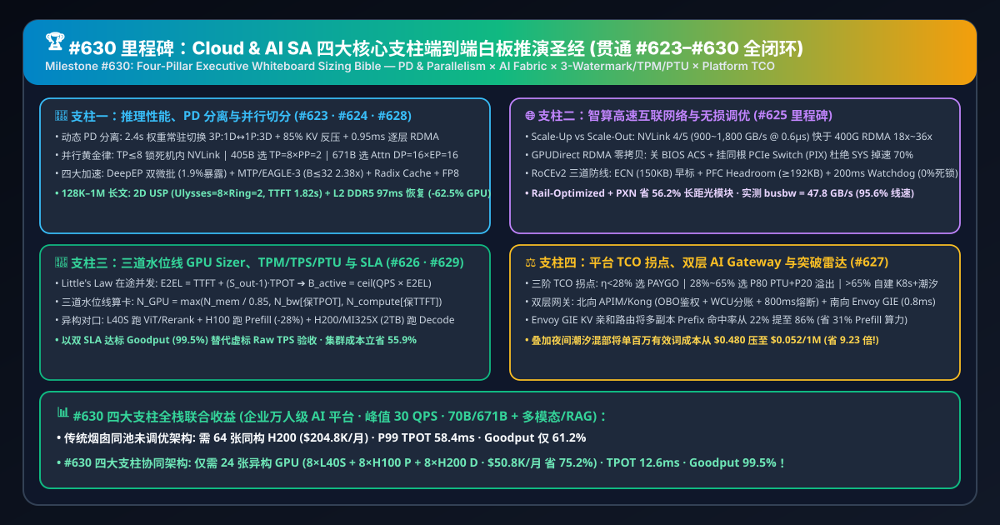

# 🏆 Milestone `#630`: Cloud & AI Solution Architect Four-Pillar End-to-End Whiteboarding & Sizing Master Bible (Unifying `#623–#630`: PD Disaggregation & Parallelism × AI High-Speed Fabrics × 3-Watermark/TPM/TPS/PTU Sizer × Platform TCO & AI Gateway) (`#630`)

> **Language / 语言**: [简体中文](./enterprise-milestone-630-sa-four-pillar-whiteboard-master-bible-faq.md) | **English** · [📱 Interactive H5 Full-Stack Whiteboard Console (All 4 Pillars Unified)](../h5/milestone-630-sa-four-pillar-whiteboard-master-bible-lab.html) · [🧮 Interactive Sizer](../reports/enterprise-milestone-630-sa-four-pillar-whiteboard-master-bible-sizer.html) · [🃏 7-Card Visual Report](../reports/enterprise-milestone-630-sa-four-pillar-whiteboard-master-bible-cards.html) · [Back to Catalog](../full-catalog-en.md)

---

## 1. 3-Minute Executive Summary

1. **Milestone Synthesis (`#623–#630` Eight-Round Full-Stack Closure)**:
   - Milestone `#630` unifies all four core Cloud & AI Solution Architect pillars into a deterministic **4-Step Executive Whiteboarding Methodology**:
     1. **🚀 Pillar 1 — Inference Optimization, Dynamic PD Disaggregation & Parallelism (`#623`, `#624`, `#628`)**: `2.4s` zero-reload `3P:1D ↔ 1P:3D` rebalancing, `85%` KV backpressure gate, `0.95ms` layer-wise RDMA, `Attention DP=16 × Expert EP=16 + DeepEP IBGDA + MTP`, and `2D Hybrid USP + 97ms L2 Pinned DDR5` KV tiering.
     2. **🌐 Pillar 2 — High-Speed AI Fabrics (`#625` Milestone)**: `Scale-Up NVLink 4/5 (900–1,800 GB/s)` vs. `Scale-Out IB/RoCEv2 (50–100 GB/s)`, `GPUDirect RDMA (PIX, ACS=Off)`, `ECN (150KB) + PFC Headroom + 200ms Watchdog`, `Rail-Optimized + PXN` (`-56.2%` optics), and `47.8 GB/s busbw (95.6%)`.
     3. **📐 Pillar 3 — Three-Watermark GPU Sizer, `TPM/TPS/PTU` & Heterogeneous Fleet (`#626`, `#629`)**: `Little's Law` ($B_{\text{active}} = \text{QPS} \times \text{E2EL}$), $N_{\text{GPU}} = \max(N_{\text{mem}}/0.85, N_{\text{bw}}, N_{\text{compute}})$, and bottleneck-matched `L40S (Encode/Rerank) + H100 (Prefill) + H200/MI325X/B200 (Decode)`.
     4. **⚖️ Pillar 4 — Platform TCO Inflection Points, Dual-Layer AI Gateway & Breakthrough Radar (`#627`)**: `28% / 65%` utilization crossovers, Northbound `APIM` + Southbound `Envoy GIE` (`86%` prefix hit rate at `0.8ms`), and nightly tidal GPU backfill (`$0.052/1M`, `9.23×` cheaper).
   - Across an enterprise platform serving `30 QPS` main LLM traffic + `2,400 QPS` multimodal/retrieval auxiliary traffic, unifying all four pillars cuts the cluster from a naive `64× H200` siloed setup (`$204.8K/mo`, `58.4ms` TPOT, `61.2%` Goodput) down to **`24 heterogeneous GPUs` (`8×L40S + 8×H100 P + 8×H200 D` at `$50.8K/mo`, `-75.2%` TCO, saving `$1.85M/yr`)** with **`12.6 ms` P99 TPOT** and **`99.5%` SLA Goodput**!

---

## 2. Complete Index of Tonight's 8 Core AI Infrastructure Deliverables (`#623–#630`)

| ID | Pillar | Title & Core Architectural Lever | Headline Quantitative Finding | Links |
| :--- | :--- | :--- | :--- | :--- |
| **`#623`** | 🚀 Pillar 1 | **Dynamic PD Disaggregation (`3P:1D ↔ 1P:3D`), `85%` KV Backpressure & 4-Stack Guide** | `2.4s` zero-reload switch, `0.95ms` RDMA, `12.8ms` P99 TPOT, `-50.0%` GPUs | [EN](./enterprise-pd-disaggregation-dynamic-pd-ratio-kv-backpressure-sizing-faq.en.md) · [H5](../h5/pd-disaggregation-dynamic-pd-ratio-kv-backpressure-lab.html) · [7-Card](../reports/enterprise-pd-disaggregation-dynamic-pd-ratio-kv-backpressure-sizing-cards.html) |
| **`#624`** | 🚀 Pillar 1 | **Parallelism (`TP/PP/Attention DP/Expert EP`) & 4-Pillar Acceleration Guide** | `DP=16 × EP=16 + DeepEP + MTP` yields `11.4ms` TPOT & `2,480 tok/s/GPU` (`4.77×`) | [EN](./enterprise-parallelism-tp-pp-dp-ep-dense-moe-acceleration-sizing-faq.en.md) · [H5](../h5/parallelism-tp-pp-dp-ep-dense-moe-acceleration-lab.html) · [7-Card](../reports/enterprise-parallelism-tp-pp-dp-ep-dense-moe-acceleration-sizing-cards.html) |
| **`#625` 🏆** | 🌐 Pillar 2 | **Milestone: `NVLink` vs. `IB/RoCEv2`, `GPUDirect RDMA (PIX)`, `PFC/ECN` & `busbw` Bible** | `47.8 GB/s busbw (95.6%)` (`3.37×` vs. `ACS=On`), `-56.2%` optics, `0.0%` deadlock | [EN](./enterprise-milestone-625-nvlink-rdma-ib-rocev2-lossless-busbw-sizing-faq.en.md) · [H5](../h5/milestone-625-nvlink-rdma-ib-rocev2-lossless-busbw-lab.html) · [7-Card](../reports/enterprise-milestone-625-nvlink-rdma-ib-rocev2-lossless-busbw-sizing-cards.html) |
| **`#626`** | 📐 Pillar 3 | **Three-Watermark GPU Sizer, `TPM/TPS/PTU` Conversion & `Little's Law` Playbook** | `B_active = 192` + `max(4,8,8) = 8× H200` at `13.6ms` TPOT & `99.4%` Goodput (`-42.9%`) | [EN](./enterprise-three-watermark-gpu-sizer-tpm-tps-ptu-littles-law-faq.en.md) · [H5](../h5/three-watermark-gpu-sizer-tpm-tps-ptu-littles-law-lab.html) · [7-Card](../reports/enterprise-three-watermark-gpu-sizer-tpm-tps-ptu-littles-law-cards.html) |
| **`#627`** | ⚖️ Pillar 4 | **`PAYGO vs. PTU vs. Self-Hosted K8s` TCO, 5 Gateways & 2026 Breakthrough Radar** | `28%/65%` crossovers + `Envoy GIE (86% hit)` + tidal backfill = `$0.052/1M` (`9.23×` cheaper) | [EN](./enterprise-paygo-ptu-k8s-tco-ai-gateway-breakthrough-radar-faq.en.md) · [H5](../h5/paygo-ptu-k8s-tco-ai-gateway-breakthrough-radar-lab.html) · [7-Card](../reports/enterprise-paygo-ptu-k8s-tco-ai-gateway-breakthrough-radar-cards.html) |
| **`#628`** | 🚀/📐 Pillar 1&3 | **`128K–1M` Long-Context `2D Hybrid USP`, 3-Tier KV Offload & `MLA` Sizer** | `1.82s` `256K` TTFT (`10.66×`), `97ms` L2 DDR5 restore (`99.0×`), `-62.5%` GPUs | [EN](./enterprise-long-context-128k-1m-usp-tiered-kv-mla-sizing-faq.en.md) · [H5](../h5/long-context-128k-1m-usp-tiered-kv-mla-lab.html) · [7-Card](../reports/enterprise-long-context-128k-1m-usp-tiered-kv-mla-sizing-cards.html) |
| **`#629`** | 📐/🚀 Pillar 3&1 | **Heterogeneous GPU Fleet (`B200/H200/H100/L40S/MI325X`) Role Assignment & Cross-SKU PD** | `8×L40S + 8×H100 P + 8×H200 D` saves `55.9%` (`-$2.32M/3yr`); `8×MI325X` fits `671B` + `1,055GB` KV | [EN](./enterprise-heterogeneous-gpu-b200-h200-h100-l40s-mi325x-role-sizing-faq.en.md) · [H5](../h5/heterogeneous-gpu-b200-h200-h100-l40s-mi325x-role-lab.html) · [7-Card](../reports/enterprise-heterogeneous-gpu-b200-h200-h100-l40s-mi325x-role-sizing-cards.html) |
| **`#630` 🏆** | 🏛️ All 4 Pillars | **Milestone: Four-Pillar Executive Whiteboard Master Bible & Unified Sizer** | Cuts enterprise platform from `64× H200 ($204.8K)` to `24 GPUs ($50.8K, -75.2%)` at `99.5%` Goodput | [EN](./enterprise-milestone-630-sa-four-pillar-whiteboard-master-bible-faq.en.md) · [H5](../h5/milestone-630-sa-four-pillar-whiteboard-master-bible-lab.html) · [7-Card](../reports/enterprise-milestone-630-sa-four-pillar-whiteboard-master-bible-cards.html) |
