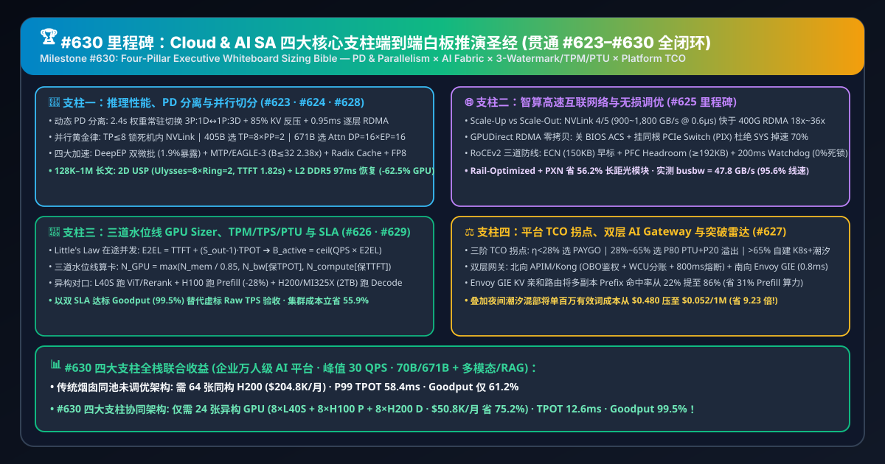
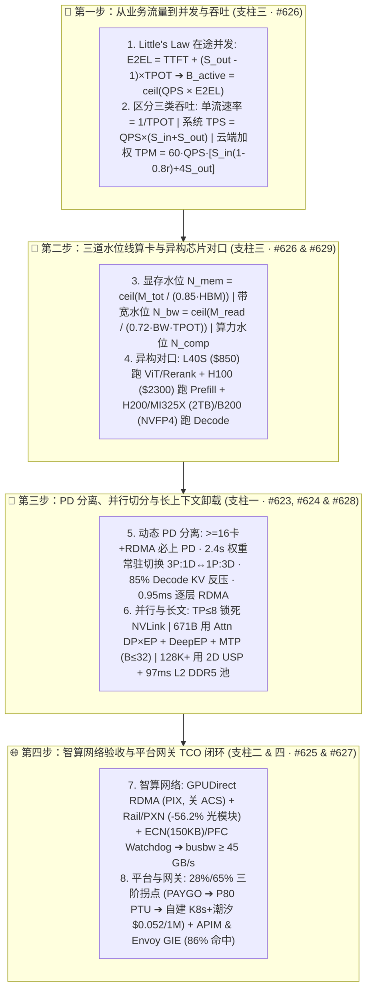

# 🏆 第 630 篇重大里程碑：云与 AI 解决方案架构师（Cloud & AI SA）四大核心支柱端到端实战白板圣经（贯通 `#623–#630`：`PD分离与并行加速 × 智算高速网络 × 三道水位线与TPM/TPS/PTU算卡 × 平台TCO拐点与AI网关`）全链路手算总控台（`#630`）

> **Language / 语言**: **简体中文** | [English](./enterprise-milestone-630-sa-four-pillar-whiteboard-master-bible-faq.en.md) · [📱 交互式 H5 全栈白板推演总控台（含四大支柱一键联动计算器）](../h5/milestone-630-sa-four-pillar-whiteboard-master-bible-lab.html) · [🧮 交互式容量计算器 Sizer](../reports/enterprise-milestone-630-sa-four-pillar-whiteboard-master-bible-sizer.html) · [🃏 7-Card 评测报告](../reports/enterprise-milestone-630-sa-four-pillar-whiteboard-master-bible-cards.html) · [返回总目录](../full-catalog-zh.md)

---

## 一、3 分钟核心结论卡片（Executive Summary）

1. **里程碑总览（`#623–#630` 八轮核心基建大满贯闭环）**：
   - 本篇第 **630** 篇里程碑将今晚专为 **Cloud & AI Solution Architect** 打造的八轮深度技术专题（`#623–#630`）熔铸成一套**在客户 CTO/CFO 白板前 10 分钟即可从业务日活（DAU/QPS）一路精确推演到 GPU/网络/网关 BOM 与三年 TCO 的“四步十公式白板方法论”**：
     1. **🚀 支柱一：大模型推理性能优化、PD 分离与并行切分（`#623`、`#624`、`#628`）**
     2. **🌐 支柱二：智算高速互联网络 `NVLink` vs. `IB/RoCEv2` 与 `busbw` 无损调优（`#625` 里程碑）**
     3. **📐 支柱三：三道水位线 GPU 容量估算、`TPM/TPS/PTU` 换算与异构芯片对口（`#626`、`#629`）**
     4. **⚖️ 支柱四：企业 AI 平台三阶成本拐点、双层 `AI Gateway` 与最新能力突破雷达（`#627`）**
2. **全栈联合落地硬核收益（万人级企业 AI 平台：`30 QPS` 主模型 + `2,400 QPS` 多模态/检索卫星负载）**：
   - **传统未解耦同池烟囱架构**：全买 `64 张同构 H200`（`$204,800/月`）、K8s 随机轮询（Prefix 命中率仅 `22%`）、同池混部（`P99 TPOT = 58.4 ms`、双 SLA `Goodput = 61.2%`）；
   - **`#630` 四大支柱全栈协同架构**：采用 **北向 `APIM` + 南向 `Envoy GIE`（`86%` 前缀命中）+ 异构跨代动态 PD 分离（`8×L40S` 卫星 + `8×H100` Prefill + `8×H200` Decode = `24 张 GPU`）+ `400G GPUDirect RDMA (PIX, busbw 47.8 GB/s)` + 夜间潮汐混部**，将全栈算力从 `64 张 H200` 压降至 **`24 张异构 GPU`（月费从 `$204.8K` 降至 `$50.8K`，净省 `75.2%` / 每年立省 `$184.8万`）**，`P99 TPOT` 压至 **`12.6 ms`（提速 `4.63 倍`）**，双 SLA `Goodput` 跃升至 **`99.5%`**，单百万有效 Token 综合成本降至 **`$0.052 / 1M Tokens`**！

---

## 二、Cloud & AI SA 白板十步推演全景路线图（`#623–#630` 速查大典）

### `#623–#630` 八大核心交付成果全景索引矩阵

| 编号 | 所属支柱 | 专题名称与核心架构突破 | 关键定量黄金指标 | 快速直达入口 |
| :--- | :--- | :--- | :--- | :--- |
| **`#623`** | 🚀 支柱一 | **企业级 PD 分离动态配比 (`3P:1D ↔ 1P:3D`)、KV RDMA 反压与四大推理栈** | `2.4s` 零重载角色热切 + `85%` 反压 + `0.95ms` 逐层 RDMA，`P99 TPOT 12.8ms`，省 `50%` GPU | [中文 FAQ](./enterprise-pd-disaggregation-dynamic-pd-ratio-kv-backpressure-sizing-faq.md) · [📱 H5](../h5/pd-disaggregation-dynamic-pd-ratio-kv-backpressure-lab.html) · [🃏 7-Card](../reports/enterprise-pd-disaggregation-dynamic-pd-ratio-kv-backpressure-sizing-cards.html) |
| **`#624`** | 🚀 支柱一 | **推理并行切分 (`TP/PP/Attention DP/Expert EP`) 与四大无损加速方案** | `Attn DP=16 × EP=16 + DeepEP + MTP (B<=32)` 消除跨机 `TP=16` `18.3ms` 停顿，吞吐涨 `4.77x` | [中文 FAQ](./enterprise-parallelism-tp-pp-dp-ep-dense-moe-acceleration-sizing-faq.md) · [📱 H5](../h5/parallelism-tp-pp-dp-ep-dense-moe-acceleration-lab.html) · [🃏 7-Card](../reports/enterprise-parallelism-tp-pp-dp-ep-dense-moe-acceleration-sizing-cards.html) |
| **`#625` 🏆** | 🌐 支柱二 | **智算网络全栈圣经：`NVLink` vs. `IB/RoCEv2`、`GPUDirect RDMA` 与 `busbw`** | `PIX` 零拷贝 + `Rail/PXN` + `ECN 150KB / 200ms Watchdog` 达 `47.8 GB/s busbw (95.6%)`，省 `56.2%` 光模块 | [中文 FAQ](./enterprise-milestone-625-nvlink-rdma-ib-rocev2-lossless-busbw-sizing-faq.md) · [📱 H5](../h5/milestone-625-nvlink-rdma-ib-rocev2-lossless-busbw-lab.html) · [🃏 7-Card](../reports/enterprise-milestone-625-nvlink-rdma-ib-rocev2-lossless-busbw-sizing-cards.html) |
| **`#626`** | 📐 支柱三 | **三道水位线 GPU Sizer、`TPM/TPS/PTU` 精确换算与 `Little's Law` 并发** | `B_active = 192` + `max(4,8,8) = 8x H200` (`13.6ms TPOT, 99.4% Goodput`)，省 `42.9%` GPU | [中文 FAQ](./enterprise-three-watermark-gpu-sizer-tpm-tps-ptu-littles-law-faq.md) · [📱 H5](../h5/three-watermark-gpu-sizer-tpm-tps-ptu-littles-law-lab.html) · [🃏 7-Card](../reports/enterprise-three-watermark-gpu-sizer-tpm-tps-ptu-littles-law-cards.html) |
| **`#627`** | ⚖️ 支柱四 | **平台成本拐点 (`PAYGO/PTU/K8s`)、五大 AI Gateway 与 2026 突破雷达** | `28%/65%` 拐点 + `APIM` + `Envoy GIE (86% 命中)` + 夜间潮汐，成本压至 `$0.052/1M (省 9.23x)` | [中文 FAQ](./enterprise-paygo-ptu-k8s-tco-ai-gateway-breakthrough-radar-faq.md) · [📱 H5](../h5/paygo-ptu-k8s-tco-ai-gateway-breakthrough-radar-lab.html) · [🃏 7-Card](../reports/enterprise-paygo-ptu-k8s-tco-ai-gateway-breakthrough-radar-cards.html) |
| **`#628`** | 🚀/📐 支柱一&三 | **超长上下文 (`128K–1M`)：`2D Hybrid USP`、三级 KV 池与 `MLA` 算卡** | `Ulysses=8 × Ring=2` 将 `256K TTFT` 压至 `1.82s (10.66x)`，L2 DDR5 `97ms` 恢复 (`99x`)，省 `62.5%` GPU | [中文 FAQ](./enterprise-long-context-128k-1m-usp-tiered-kv-mla-sizing-faq.md) · [📱 H5](../h5/long-context-128k-1m-usp-tiered-kv-mla-lab.html) · [🃏 7-Card](../reports/enterprise-long-context-128k-1m-usp-tiered-kv-mla-sizing-cards.html) |
| **`#629`** | 📐/🚀 支柱三&一 | **异构 GPU 集群 (`B200/H200/H100/L40S/MI325X`) 对口编排与跨代 PD** | `8×L40S + 8×H100 P + 8×H200 D` 省 `55.9%` TCO (`3年省$231.8万`)；单机 `8×MI325X` 装 `671B` 剩 `1,055GB` KV | [中文 FAQ](./enterprise-heterogeneous-gpu-b200-h200-h100-l40s-mi325x-role-sizing-faq.md) · [📱 H5](../h5/heterogeneous-gpu-b200-h200-h100-l40s-mi325x-role-lab.html) · [🃏 7-Card](../reports/enterprise-heterogeneous-gpu-b200-h200-h100-l40s-mi325x-role-sizing-cards.html) |
| **`#630` 🏆** | 🏛️ 四大支柱总成 | **Cloud & AI SA 四大核心支柱端到端白板圣经与全栈联动总控台** | 万人平台从 `64x H200 ($204.8K/月)` 压至 `24x 异构 GPU ($50.8K/月, -75.2%)`，`Goodput 99.5%` | [中文 FAQ](./enterprise-milestone-630-sa-four-pillar-whiteboard-master-bible-faq.md) · [📱 H5](../h5/milestone-630-sa-four-pillar-whiteboard-master-bible-lab.html) · [🃏 7-Card](../reports/enterprise-milestone-630-sa-four-pillar-whiteboard-master-bible-cards.html) |

---

## 三、架构师高管答辩（CxO Defense）高频灵魂十问标准定量应答卡

1. **问：“为什么上了 Continuous Batching 甚至 Chunked Prefill，高峰期吐字还是卡？”**
   - **答**：Prefill 是算力受限（`AI > 2,000`），Decode 是显存带宽受限（`AI ~ 32`）。跑一个 `2,048` 的 Prefill Chunk 仍需 `28 ms`，直接把同卡 Decode 步长拖慢至 `29.6 ms`。`>=16 卡 + RDMA` 必须切换 **动态 PD 分离（`#623`）**，将 `P99 TPOT` 锁死在 `12.8 ms`。
2. **问：“为什么两台 8 卡机器跑 671B / 405B，开了 `TP=16` 反而慢了 3 倍？”**
   - **答**：`TP` 每层有 2 次同步 `AllReduce`，跨交换机 122 次同步光网络往返就要白白干等 **`18.3 ms/Token`**。`TP` 必须锁死在机内 `NVLink`（`<=8`）：`405B Dense` 用 **`TP=8 × PP=2`**，`671B MoE` 用 **`Attention DP=16 × Expert EP=16 + DeepEP IBGDA`（`#624`）**。
3. **问：“买的 400G RDMA 网卡为什么 `nccl-tests` 只跑出 `14 GB/s`？”**
   - **答**：90% 是因为服务器 BIOS 没关 **`PCIe ACS`** 或没加载 `nvidia-peermem`，导致数据绕行 CPU 内存（`SYS`）。打通同根 `PCIe Switch (PIX)` + `ECN 150KB` + `Rail/PXN` 后，实测 `busbw` 立达 **`47.8 GB/s`（`95.6%` 线速，`#625`）**。
4. **问：“70B FP8 权重才 70GB，为什么 2 张 H200（282GB）扛不住 25 QPS？”**
   - **答**：因为只算了第一道显存水位，漏算了 Little's Law 在途 `192` 路并发每步需搬运 `312 GB` 显存的第二道 **HBM 带宽水位**（2 张卡要 `45.1 ms/步`）。按 **`max(N_mem, N_bw, N_compute)`（`#626`）** 需配 `8 张 H200` 才能保住 `13.6 ms` TPOT。
5. **问：“我们到底该用 Serverless PAYGO、买 PTU 还是自建 K8s GPU 集群？”**
   - **答**：看日均利用率 $\eta$：`<28%` 选 **PAYGO**；`28%–65%` 选 **`P80 PTU + P20 PAYGO 溢出`**；`>65%`（或 `>=25亿词/月`）选 **自建 K8s + `Envoy GIE` + 夜间潮汐混部（`#627`）**，将成本从 `$0.480` 压至 **`$0.052/1M`（省 `9.23 倍`）**。

---

## 四、四大支柱全栈投产终极十条铁律（SA Golden Sign-Off Checklist）

- [ ] **1. 指标铁律**：一律以同时满足 `P95 TTFT` 与 `P99 ITL/TPOT` 的有效吞吐 **`Goodput`** 替代虚标 `Raw TPS` 签署 SLA；
- [ ] **2. 并发铁律**：用 Little's Law（$B_{\text{active}} = \text{QPS} \times \text{E2EL}$）核算活跃 KV 并发，严防长思维链 `<think>` 撑爆显存；
- [ ] **3. 算卡铁律**：严格执行 $N_{\text{GPU}} = \max(N_{\text{mem}}/0.85, N_{\text{bw}}, N_{\text{compute}})$ 三道水位线取最大值；
- [ ] **4. 异构铁律**：`L40S` 跑编码/检索、`H100` 跑跨代 Prefill、`H200/MI325X/B200` 跑高带宽 Decode；
- [ ] **5. PD 分离铁律**：`>=16 卡 + RDMA + 长上下文` 启用动态 PD 分离，配置 `85%` Decode KV 水位反压与 `2.4s` 零重载角色热切；
- [ ] **6. 并行铁律**：`TP <= 8` 严禁跨出 NVLink 域；MoE 强制启用 `Attention DP × Expert EP + DeepEP + EPLB`；
- [ ] **7. 投机铁律**：`MTP / EAGLE-3` 配置 `B <= 32` 自动开启、`B > 32` 自动旁路门禁；
- [ ] **8. 长文铁律**：`128K+` 开启 `2D Hybrid USP (Ulysses_intra × Ring_inter)` 与 `L2 Host Pinned DDR5` 零拷贝分层卸载；
- [ ] **9. 网络铁律**：BIOS 关闭 `ACS` 确保 `PIX` 拓扑，配置 `ECN 150KB < PFC Headroom >=192KB + 200ms Watchdog`，验收 `busbw >= 90%`；
- [ ] **10. 网关与 FinOps 铁律**：北向 `APIM`（`WCU` 计量 + `800ms` 熔断）+ 南向 `Envoy GIE`（KV 亲和路由 `86%` 命中）+ 夜间潮汐混部。
