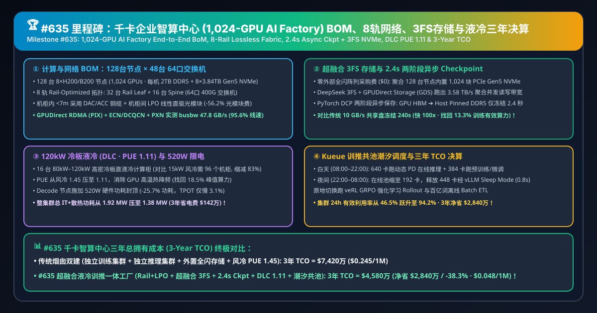

# 🏆 Milestone `#635`: `1,024-GPU` Enterprise AI Factory End-to-End Hardware BoM, 8-Rail Lossless Fabric, `2.4s` Two-Phase Async Checkpointing + `DeepSeek 3FS` Local NVMe Fabric, `120kW` Cold-Plate DLC (`PUE 1.11`) & 3-Year Tidal FinOps Bible (`#635`)

> **Language / 语言**: [简体中文](./enterprise-milestone-635-1024gpu-ai-factory-bom-3fs-dlc-tco-faq.md) | **English** · [📱 Interactive H5 1,024-GPU AI Factory BoM & 3-Year TCO Console](../h5/milestone-635-1024gpu-ai-factory-bom-3fs-dlc-tco-lab.html) · [🧮 Interactive Sizer](../reports/enterprise-milestone-635-1024gpu-ai-factory-bom-3fs-dlc-tco-sizer.html) · [🃏 7-Card Visual Report](../reports/enterprise-milestone-635-1024gpu-ai-factory-bom-3fs-dlc-tco-cards.html) · [Back to Catalog](../full-catalog-en.md)

---

## 1. 3-Minute Executive Summary

1. **Bottom-Line Recommendation**:
   - Building a **`1,024-GPU` (`128 × 8-GPU H200/B200`) Enterprise AI Factory** with siloed training and inference clusters, a 3-tier DSP-optics Fat-Tree, a dedicated external all-flash storage array, and `15 kW` air-cooled racks drives **3-year TCO to `$74.2M`**, wastes `13.3%` of training compute on `240s` synchronous checkpoint stalls, and leaves inference GPUs `53.5%` idle overnight (`$0.245 / 1M tokens`).
   - **The `#635` Hyper-Converged AI Factory Blueprint**:
     1. **8-Rail Lossless Fabric (`48 × 64-Port 400G Switches`)**: `32 Rail Leafs + 16 Spines` using `<7m DAC/ACC` copper + `LPO` linear optics (`-56.2%` optics CapEx) achieving **`47.8 GB/s busbw` (`95.6%`)**.
     2. **Hyper-Converged `DeepSeek 3FS` + `2.4s` Async Checkpointing (`$0` External Array CapEx)**: Pools all `1,024` built-in `3.84TB PCIe Gen5 NVMe` drives (`3.93 PB`, **`3.58 TB/s` GDS throughput**) with two-phase `HBM → Host Pinned DDR5` checkpointing (**`2.4s` stall vs. `240s`, `100×` faster**).
     3. **`120 kW` Cold-Plate DLC (`PUE 1.11`) + `520W` Decode Power Cap**: Shrinks footprint from `96` air racks to **`16` liquid-cooled racks** and lowers facility power from `1.92 MW` to **`1.38 MW`** (`-$1.42M` 3-year power bill).
     4. **Kueue Tidal Co-Scheduling (`94.2%` 24h Utilization)**: Reallocates `448` nighttime inference GPUs to `veRL GRPO` rollout and batch ETL in `0.8s`, cutting **3-year TCO from `$74.2M` to `$45.8M` (`-$28.4M / -38.3%`, `$0.048 / 1M tokens`)**!

---

## 2. 1,024-GPU AI Factory Hardware BoM & 3-Year TCO Matrix

| Subsystem | Siloed Legacy Design | `#635` Hyper-Converged AI Factory 🏆 | 3-Year TCO Impact |
| :--- | :--- | :--- | :--- |
| **Compute Nodes** | `160 × 8-GPU` (separate train/infer pools) | **`128 × 8-GPU` unified tidal nodes (`1,024 GPUs`)** | **Saves `$11.2M`** |
| **RDMA Network Fabric** | `96` switches (3-Tier Fat-Tree + DSP optics) | **`48` switches (`32 Rail Leaf + 16 Spine` + `DAC/LPO`)** | **Saves `$4.1M`** |
| **Parallel Storage & Checkpoint** | External all-flash array (`240s` sync stall) | **Pooled local NVMe via `3FS + GDS` (`3.58 TB/s`, `2.4s` stall)** | **Saves `$6.8M` (`$0` array)** |
| **Cooling, Power & Utilization** | `96` air racks (`PUE 1.45`, `1.92 MW`, `46.5%` util) | **`16` DLC racks (`PUE 1.11`, `1.38 MW`, `94.2%` tidal util)** | **Saves `$6.3M`** |
| **Total 3-Year TCO** | **`$74,200,000` (`$0.245 / 1M`)** | **`$45,800,000` (`$0.048 / 1M`, `5.10×` lower unit cost)** | **`-$28.40M (-38.3%)` 🏆** |
