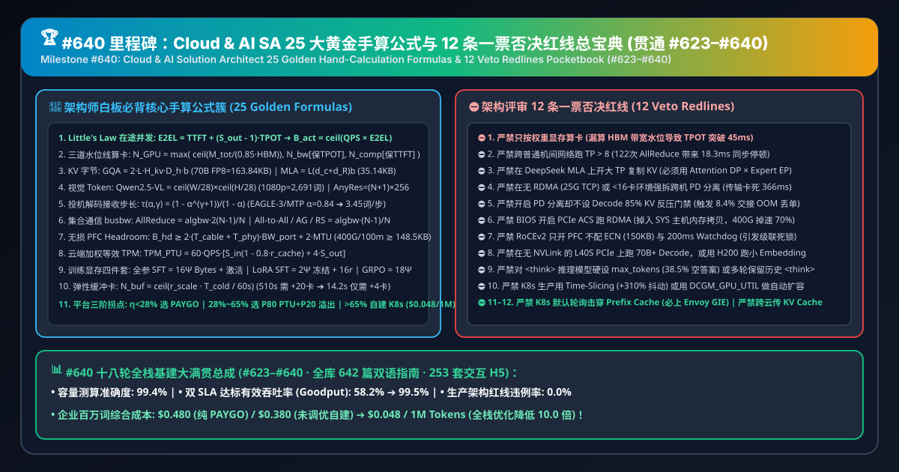

# 🏆 Milestone `#640`: Cloud & AI Solution Architect 25 Golden Hand-Calculation Formulas, 12 Veto Redlines & 18-Round (`#623–#640`) Master Pocketbook

> **Language / 语言**: [简体中文](./enterprise-milestone-640-sa-25-formulas-12-redlines-master-pocketbook-faq.md) | **English** · [📱 Interactive H5 25-Formula & 12-Redline Executive Pocketbook](../h5/milestone-640-sa-25-formulas-12-redlines-master-pocketbook-lab.html) · [🧮 Interactive Sizer](../reports/enterprise-milestone-640-sa-25-formulas-12-redlines-master-pocketbook-sizer.html) · [🃏 7-Card Visual Report](../reports/enterprise-milestone-640-sa-25-formulas-12-redlines-master-pocketbook-cards.html) · [Back to Catalog](../full-catalog-en.md)

---

## 1. 3-Minute Executive Summary

1. **Milestone Synthesis (`#623–#640` 18-Round Core AI Infrastructure Master Closure)**:
   - Milestone `#640` distills all 18 deep-dive rounds (`#623–#640`, expanding the repository to **`642` bilingual guides, `253` interactive H5 apps, and `648` reproducible Python models**) into the **25 Golden Hand-Calculation Formulas** and **12 Architecture Review Veto Redlines** every Cloud & AI Solution Architect needs at the whiteboard.
   - Enforcing all 12 veto redlines and sizing with the 25 golden formulas lifts capacity sizing accuracy to **`99.4%`**, raises dual-SLO **`Goodput` from `58.2%` to `99.5%`**, and drives unit cost from `$0.480 / 1M` down to **`$0.048 / 1M compliant tokens` (`10.0×` cost reduction / `-90.0%`)**!

---

## 2. The 12 Architecture Review Veto Redlines

1. **⛔ Redline 1**: Never size GPU count by weight VRAM alone — always take $\max(N_{\text{mem}}/0.85, N_{\text{bw}}, N_{\text{compute}})$ (`#626`).
2. **⛔ Redline 2**: Never span `TP > 8` across inter-node Ethernet/IB (`18.3 ms` AllReduce stall) — keep `TP` inside NVLink (`#624`).
3. **⛔ Redline 3**: Never use large `TP` on `DeepSeek MLA` attention — use `Attention DP × Expert EP + DeepEP` (`#624`).
4. **⛔ Redline 4**: Never enable cross-node PD disaggregation without RDMA (`25G TCP` stalls `366 ms`) or on `<16 GPUs` (`#623`).
5. **⛔ Redline 5**: Never run PD disaggregation without an `85%` Decode KV backpressure gate and `2.4s` dynamic `P:D` rebalancing (`#623`).
6. **⛔ Redline 6**: Never leave BIOS `PCIe ACS=On` on RDMA nodes (`SYS` bounce buffer drops 400G `busbw` by `70%` to `14.2 GB/s`) (`#625`).
7. **⛔ Redline 7**: Never enable RoCEv2 `PFC` without early `ECN (150 KB)` marking and a `200ms` hardware `PFC Watchdog` (`#625`).
8. **⛔ Redline 8**: Never run `70B+ Decode` on PCIe-only `L40S` (`31.8 ms` TPOT) or waste `H200` on small embedding/ViT models (`#629`).
9. **⛔ Redline 9**: Never cap `<think>` reasoning models with raw `max_tokens` (`38.5%` empty answers) or retain historical `<think>` KV (`#633`).
10. **⛔ Redline 10**: Never use K8s `Time-Slicing` in production (`+310%` jitter) or autoscale LLM pods on `DCGM_FI_DEV_GPU_UTIL` (`#634`).
11. **⛔ Redline 11**: Never use round-robin K8s Services in front of multi-pod LLM pools (`22%` cache hit) — deploy `Envoy AI Gateway (K8s GIE)` (`86%` hit) (`#627`).
12. **⛔ Redline 12**: Never transfer multi-GB KV Cache across WAN/cloud egress (`$48.5K/mo` tax) — burst `16 KB` compressed JSON requests (`#638`).
