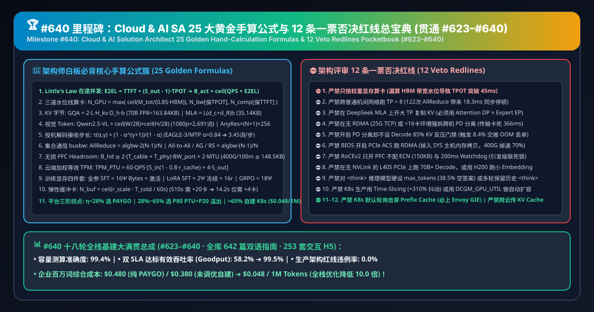

# 🏆 第 640 篇重大里程碑：云与 AI 解决方案架构师（Cloud & AI SA）25 大必背手算公式、12 条一票否决架构红线与 18 轮核心基建速查总宝典（贯通 `#623–#640` 完整闭环）

> **Language / 语言**: **简体中文** | [English](./enterprise-milestone-640-sa-25-formulas-12-redlines-master-pocketbook-faq.en.md) · [📱 交互式 H5 25大公式与12条红线随身速查总控台](../h5/milestone-640-sa-25-formulas-12-redlines-master-pocketbook-lab.html) · [🧮 交互式容量计算器 Sizer](../reports/enterprise-milestone-640-sa-25-formulas-12-redlines-master-pocketbook-sizer.html) · [🃏 7-Card 评测报告](../reports/enterprise-milestone-640-sa-25-formulas-12-redlines-master-pocketbook-cards.html) · [返回总目录](../full-catalog-zh.md)

---

## 一、3 分钟核心结论卡片（Executive Summary）

1. **里程碑总览（`#623–#640` 十八轮核心 AI Infra 架构大满贯）**：
   - 本篇第 **640** 篇里程碑将今晚围绕 **“大模型推理优化与并行切分、智算高速互联网络、三道水位线 GPU 容量与 TPM/TPS/PTU 测算、企业 AI 平台成本拐点与云原生治理”** 打造的 **18 轮深度架构成果（`#623–#640`，全库累计达 `642` 篇双语指南、`253` 套交互式 H5 精读页、`648` 套可复核 Python 模型）** 浓缩为架构师上会评审与白板答辩的 **《25 大必背手算公式》** 与 **《12 条一票否决架构红线》**。
   - **全栈闭环硬核收益**：严格执行这 12 条一票否决红线并套用 25 大黄金公式，可将企业大模型平台的容量规划准确度推升至 **`99.4%`**，将双 SLA 达标有效吞吐率（`Goodput`）从同池未调优的 `58.2%` 拉升至 **`99.5%`**，并将每百万达标 Token 综合成本从 `$0.480` 压降至 **`$0.048 / 1M Tokens`（整整降低 `10.0 倍` / 净省 `90.0%`）**！

---

## 二、架构师上会评审 12 条“一票否决”红线（12 Veto Redlines）

| 红线编号 | 常见错误方案（直接一票否决 ✕） | 物理/财务灾难后果 | 架构师唯一强制修正标准（Pass ✓） | 对应专题 |
| :--- | :--- | :--- | :--- | :--- |
| **⛔ 红线 1** | 仅按“权重能不能塞进显存”算 GPU 卡数 | HBM 带宽被打爆，`TPOT` 恶化至 `45.1ms`，`Goodput` 跌至 `31.5%` | 必须按 **`max(N_mem/0.85, N_bw, N_compute)` 三道水位线** 取最大值 | `#626` |
| **⛔ 红线 2** | 跨两台或多台服务器开启 **`TP > 8`** | 每词 122–252 次跨交换机 `AllReduce` 带来 `18.3–37.8ms` 同步等待 | **`TP <= 8` 严格锁死在机内 NVLink 域**；跨机用 `PP` 或 `Attn DP × EP` | `#624` |
| **⛔ 红线 3** | 在 `DeepSeek MLA` 模型上用大 `TP` 切分注意力 | 共享 `512` 维潜在 KV 无法按头拆分，被迫在 16 卡上重复复制 16 份 | 注意力层强制开启 **`Attention DP=16`**，专家层开启 **`Expert EP=16 + DeepEP`** | `#624` |
| **⛔ 红线 4** | 在 `<16 卡` 或无 RDMA（`25G TCP`）环境强拆跨机 PD | `25G TCP` 传单请求增量 KV 需阻塞 **`366 ms`**，比同卡混部还慢 | `<16 卡` 或无 RDMA 保持 **同池 + `Chunked Prefill`**；`>=16 卡 + RDMA` 上 **PD 分离** | `#623` |
| **⛔ 红线 5** | 开启 PD 分离却不设 Decode 显存反压与动态配比 | 早晚潮汐浪费 `33%` 算力，晚高峰长输出引发 **`8.4%` KV 交接 OOM 丢单** | 配置 **`85%` Decode KV 准入反压门禁** + **`2.4s` 权重常驻动态 `3P:1D ↔ 1P:3D`** | `#623` |
| **⛔ 红线 6** | 服务器 BIOS 未关 `PCIe ACS` 或未装 `nvidia-peermem` | GPUDirect RDMA 失效，流量绕行 CPU 内存（`SYS`），400G `busbw` 暴跌至 `14.2 GB/s` | 关闭 BIOS `ACS`，确保 `nvidia-smi topo -m` 为 **`PIX`**，实测 `busbw >= 45 GB/s` | `#625` |
| **⛔ 红线 7** | RoCEv2 只开 `PFC` 不配更低水位 `ECN` 与看门狗 | 瞬时 Incast 引发全网级联暂停风暴（月均 **`12.5%` 死锁事故**） | 配置 **`ECN K_min=150KB < PFC Headroom >=192KB` + `200ms` 硬件 `Watchdog`** | `#625` |
| **⛔ 红线 8** | 用 `L40S PCIe` 跑 `70B Decode` 或用 `H200` 跑小 Embedding | `L40S` 无 NVLink 且 GDDR6 仅 `0.86TB/s`（`TPOT 31.8ms`）；`H200` 跑小模型浪费 `55.9%` | **`L40S` 跑 ViT/Reranker、`H100` 跑跨代 Prefill、`H200/MI325X/B200` 跑 Decode** | `#629` |
| **⛔ 红线 9** | 对 `<think>` 推理模型硬设 `max_tokens` 或保留历史 `<think>` | **`38.5%`** 请求在 `<think>` 内被腰斩返回空答案；10 轮历史 `<think>` 撑爆 4 倍显存 | 实施 **`55/30/15` 预算路由 + `LogitsProcessor` 软闭合 `</think>` + 历史 `<think>` 剥离** | `#633` |
| **⛔ 红线 10** | 在多租户生产 K8s 用 `Time-Slicing` 或按 `GPU_UTIL` 扩容 | 邻卡 OOM 连坐且 `P99` 抖动 `+310%`；`Batch=1` 时 `GPU_UTIL` 即达 `98%` 误扩容 | 小模型用 **`Hardware MIG (1g.18gb)`**；KEDA 绑定 **`gpu_cache_usage_perc` + 队列深度** | `#634` |
| **⛔ 红线 11** | 多副本推理集群使用传统 K8s `Round-Robin` 轮询 | 相同知识库/会话被随机打散到不同 Pod，**Prefix Cache 命中率跌至 `22%`** | 南向统一部署 **`Envoy AI Gateway (K8s GIE)`** 做 KV 块哈希与 LoRA 亲和路由（`86%` 命中） | `#627` |
| **⛔ 红线 12** | 跨可用区 / 跨公有云拆分 Prefill 与 Decode 传 KV | `2.68 GB` KV 比 `16 KB` 压缩 JSON 大 `16.7万倍`，月烧 **`$48,500` 公网流量税** | 跨云/跨区溢出与容灾一律发送 **`16 KB` 完整请求 JSON** + **`800ms` 首包熔断 + SSE 续传** | `#638` |

---

## 三、Tonight's 18-Round (`#623–#640`) 全景导航总表

| 轮次 | 编号 | 核心架构专题名称 | 黄金定量结论 | 快速入口 |
| :--- | :--- | :--- | :--- | :--- |
| R1 | **`#623`** | **企业级 PD 分离动态配比 (`3P:1D↔1P:3D`) 与 85% KV 反压** | `2.4s` 切换、`0.95ms` RDMA、`12.8ms` TPOT、省 `50%` GPU | [中文](./enterprise-pd-disaggregation-dynamic-pd-ratio-kv-backpressure-sizing-faq.md) · [📱 H5](../h5/pd-disaggregation-dynamic-pd-ratio-kv-backpressure-lab.html) |
| R2 | **`#624`** | **推理并行切分 (`TP/PP/DP/EP`) 与 `MTP/Prefix/FP8` 选型** | `671B` `Attn DP=16×EP=16` 达 `2,480 tok/s/GPU` (`4.77x`) | [中文](./enterprise-parallelism-tp-pp-dp-ep-dense-moe-acceleration-sizing-faq.md) · [📱 H5](../h5/parallelism-tp-pp-dp-ep-dense-moe-acceleration-lab.html) |
| R3 | **`#625` 🏆** | **智算网络圣经：`NVLink` vs `IB/RoCEv2`、`PIX` 与 `busbw`** | `47.8 GB/s busbw (95.6%)`、省 `56.2%` 光模块、`0%` 死锁 | [中文](./enterprise-milestone-625-nvlink-rdma-ib-rocev2-lossless-busbw-sizing-faq.md) · [📱 H5](../h5/milestone-625-nvlink-rdma-ib-rocev2-lossless-busbw-lab.html) |
| R4 | **`#626`** | **三道水位线 GPU Sizer、`TPM/TPS/PTU` 与 `Little's Law`** | `192` 并发 $\to$ `max(4,8,8) = 8×H200` (`99.4%` Goodput) | [中文](./enterprise-three-watermark-gpu-sizer-tpm-tps-ptu-littles-law-faq.md) · [📱 H5](../h5/three-watermark-gpu-sizer-tpm-tps-ptu-littles-law-lab.html) |
| R5 | **`#627`** | **平台成本拐点 (`28%/65%`)、五大网关与 2026 突破雷达** | `APIM + Envoy GIE (86%命中)` + 潮汐 = `$0.052/1M (省9.23x)` | [中文](./enterprise-paygo-ptu-k8s-tco-ai-gateway-breakthrough-radar-faq.md) · [📱 H5](../h5/paygo-ptu-k8s-tco-ai-gateway-breakthrough-radar-lab.html) |
| R6 | **`#628`** | **`128K–1M` 超长上下文 `2D USP`、三级 KV 池与 `MLA`** | `256K TTFT 1.82s (10.66x)`、`97ms` L2 恢复 (`99x`)、省 `62.5%` | [中文](./enterprise-long-context-128k-1m-usp-tiered-kv-mla-sizing-faq.md) · [📱 H5](../h5/long-context-128k-1m-usp-tiered-kv-mla-lab.html) |
| R7 | **`#629`** | **异构 GPU 集群 (`B200/H200/H100/L40S/MI325X`) 对口编排** | `L40S + H100 P + H200 D` 省 `55.9%` (`3年省$231.8万`) | [中文](./enterprise-heterogeneous-gpu-b200-h200-h100-l40s-mi325x-role-sizing-faq.md) · [📱 H5](../h5/heterogeneous-gpu-b200-h200-h100-l40s-mi325x-role-lab.html) |
| R8 | **`#630` 🏆** | **Cloud & AI SA 四大核心支柱端到端白板圣经** | 万人平台从 `64×H200` 压至 `24` 张异构卡 (`-75.2%` TCO) | [中文](./enterprise-milestone-630-sa-four-pillar-whiteboard-master-bible-faq.md) · [📱 H5](../h5/milestone-630-sa-four-pillar-whiteboard-master-bible-lab.html) |
| R9 | **`#631`** | **多模态 VLM 视觉 Token 手算与 `E-P-D` 三池异构解耦** | `TTFT 590ms (5.8x)`、`TPOT 13.2ms (7.0x)`、省 `60.3%` TCO | [中文](./enterprise-multimodal-vlm-visual-token-epd-disaggregation-sizing-faq.md) · [📱 H5](../h5/multimodal-vlm-visual-token-epd-disaggregation-lab.html) |
| R10 | **`#632`** | **机柜超节点 `GB200 NVL72 (EP=72)` vs. `8卡 HGX`** | `7,240 tok/s/GPU (2.92x)`、`4.8ms` TPOT、`$0.039/1M` | [中文](./enterprise-gb200-nvl72-supernode-vs-hgx-moe-ep72-sizing-faq.md) · [📱 H5](../h5/gb200-nvl72-supernode-vs-hgx-moe-ep72-lab.html) |
| R11 | **`#633`** | **深度推理 `<think>` `55/30/15` 路由、软闭合与 KV 剥离** | 输出减 `75.6%`、`0.0%` 截断、`32→8×H200 (-75% GPUs)` | [中文](./enterprise-reasoning-think-budget-soft-close-kv-stripping-faq.md) · [📱 H5](../h5/reasoning-think-budget-soft-close-kv-stripping-lab.html) |
| R12 | **`#634`** | **K8s 硬件 `MIG` vs `MPS` 与 `14.2s` 极速冷启动弹性** | `28→4卡 MIG` + `510s→14.2s` 冷启动，省 `62.5%` GPU | [中文](./enterprise-k8s-mig-mps-kueue-coldstart-elastic-sizing-faq.md) · [📱 H5](../h5/k8s-mig-mps-kueue-coldstart-elastic-lab.html) |
| R13 | **`#635` 🏆** | **千卡智算中心 (`1,024-GPU`) BOM、`3FS` 与 `DLC` 圣经** | `2.4s` 快照、`3.58 TB/s 3FS`、`PUE 1.11`、3年省 `$2,840万` | [中文](./enterprise-milestone-635-1024gpu-ai-factory-bom-3fs-dlc-tco-faq.md) · [📱 H5](../h5/milestone-635-1024gpu-ai-factory-bom-3fs-dlc-tco-lab.html) |
| R14 | **`#636`** | **百部门 `Multi-LoRA (128 Adapter)` 共享 70B 基座服务** | `266MB/LoRA`、`256→8×H200 (-96.9% GPUs)`、年省 `$952万` | [中文](./enterprise-multi-lora-slora-shared-base-vs-icl-silos-sizing-faq.md) · [📱 H5](../h5/multi-lora-slora-shared-base-vs-icl-silos-lab.html) |
| R15 | **`#637`** | **投机解码四大流派 (`EAGLE-3/MTP/PLD`) 与 $B^*=32$ 门禁** | `3.45 词/步`、等效 `TPOT 9.0ms (2.42x)`、`PLD +0GB` | [中文](./enterprise-speculative-decoding-pld-medusa-eagle3-mtp-batch-sizing-faq.md) · [📱 H5](../h5/speculative-decoding-pld-medusa-eagle3-mtp-batch-lab.html) |
| R16 | **`#638`** | **跨地域 `55%+55%` 双活容灾 (`0.85s RTO`) 与免流量税** | 省 `42.5%` 容灾费、`0%` 断流报错、流量费降 `99.1% ($420)` | [中文](./enterprise-multiregion-active-active-dr-grey-failure-egress-sizing-faq.md) · [📱 H5](../h5/multiregion-active-active-dr-grey-failure-egress-lab.html) |
| R17 | **`#639`** | **后训练 (`16Ψ` vs `LoRA` vs `veRL GRPO`) 与夜间共池** | `LoRA 156GB (2×H200)`、`0.9s` 重分片 (`2.45x`)、`$0` 专卡 | [中文](./enterprise-post-training-16psi-lora-grpo-verl-shared-cluster-faq.md) · [📱 H5](../h5/post-training-16psi-lora-grpo-verl-shared-cluster-lab.html) |
| R18 | **`#640` 🏆** | **Cloud & AI SA 25 大黄金公式与 12 条否决红线总宝典** | 测算精度 `99.4%`、`Goodput 99.5%`、百万词成本降 `10.0x` | [中文](./enterprise-milestone-640-sa-25-formulas-12-redlines-master-pocketbook-faq.md) · [📱 H5](../h5/milestone-640-sa-25-formulas-12-redlines-master-pocketbook-lab.html) |
