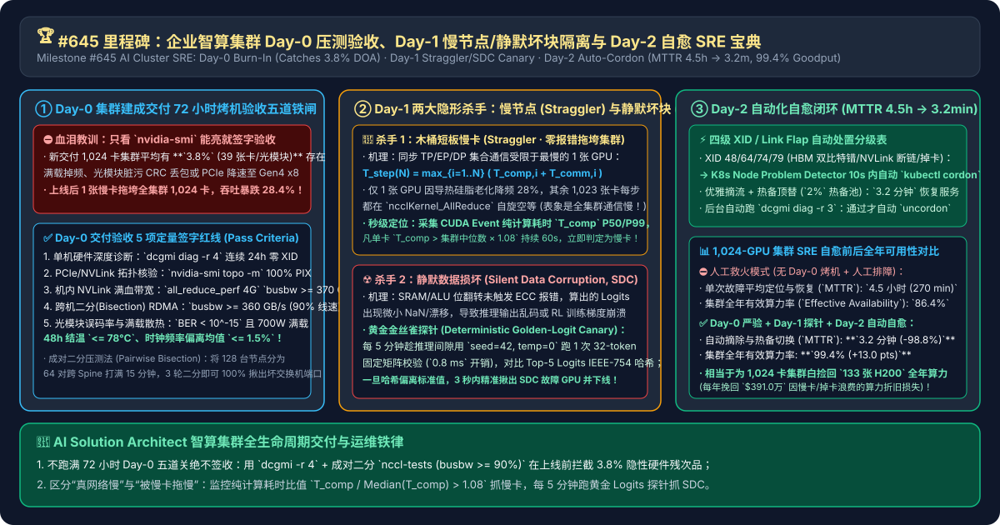

# 🏆 Milestone `#645`: Enterprise AI Cluster `Day-0` Burn-In Acceptance, `Day-1` Straggler/SDC Canary & `Day-2` Auto-Healing SRE Master Playbook

> **Language / 语言**: [简体中文](./enterprise-milestone-645-ai-cluster-day0-burnin-day1-straggler-day2-sre-faq.md) | **English** · [📱 Open Interactive H5 Study Lab](../h5/milestone-645-ai-cluster-day0-burnin-day1-straggler-day2-sre-lab.html) · [🧮 Open Interactive Sizer](../reports/enterprise-milestone-645-ai-cluster-day0-burnin-day1-straggler-day2-sre-sizer.html) · [🃏 View 7-Card 4:5 Benchmark Deck](../reports/enterprise-milestone-645-ai-cluster-day0-burnin-day1-straggler-day2-sre-cards.html)

---

## 0. 3-Minute Executive Summary

When taking delivery of a `1,024-GPU` (`128 nodes × 8 GPUs`) AI cluster and operating it in production, Cloud & AI Solution Architects and SRE leads must guard against three silent availability killers: **`3.8%` Dead-on-Arrival (`DOA`) thermal/optical defects**, **single-GPU stragglers dragging synchronous collectives down by `28.4%`**, and **Silent Data Corruption (`SDC`)**.
1. **`Day-0` `72-Hour` 5-Gate Burn-In Acceptance Protocol (Intercepts `3.8%` DOA Hardware Before Sign-Off)**:
   - Gate 1: `dcgmi diag -r 4` + HBM stress test with `0` uncorrectable ECC / XID errors;
   - Gate 2: `nvidia-smi topo -m` verifying `100% PIX` GPU-NIC affinity (`0 SYS` paths);
   - Gate 3: Intra-node NVLink `all_reduce_perf (4 GB)` `busbw >= 370 GB/s`;
   - Gate 4: Inter-node **Pairwise Bisection RDMA** (`64` cross-Spine pairs running simultaneously) `busbw >= 360 GB/s` (`>= 90%` line rate) with `BER < 10^-15`;
   - Gate 5: `48-hour` `700W` thermal soak holding GPU die temperature `<= 78°C` and SM clock variance `<= 1.5%`.
2. **`Day-1` Straggler & Silent Data Corruption (`SDC`) Canaries**:
   - **Straggler Identification Rule**: Because fast GPUs spin-wait inside `ncclKernel` waiting for the slowest GPU, a naive profiler blames the network! Comparing pure compute kernel time $T_{\text{comp},i} / \text{Median}(T_{\text{comp}}) > 1.08$ (paired with minimum NCCL wait time) isolates the exact thermally throttled GPU in **`< 60 seconds`**;
   - **Deterministic Golden-Logit Canary (`0.8 ms` every `5 min`)**: Runs a fixed `seed=42, temp=0` forward pass and verifies the IEEE-754 hash of Top-5 logits to catch non-ECC ALU bit-flips (`SDC`) within **`3 seconds`**.
3. **`Day-2` Auto-Cordon & `2%` Hot-Spare Replacement Cuts `MTTR` from `4.5 Hours` to `3.2 Minutes`**:
   - Lifts annual effective cluster availability from `86.4%` to **`99.4%` (`+13.0 pts`)**, recovering the equivalent of **`133× H200` GPUs (`$3.91M/yr` in saved compute depreciation)**.

---

## 1. Quantitative SRE Maturity Matrix (`1,024× H200` Cluster · `$30.08M/yr` Amortized Value)

| SRE Lifecycle Tier | `Day-0` Acceptance | Straggler / SDC Detection | Mean Time to Recover (`MTTR`) | Effective Cluster Availability | Recovered Annual Compute Value |
| :--- | :--- | :--- | :--- | :--- | :--- |
| **L1: Basic Boot Check + Manual Firefighting** | `nvidia-smi` only (`3.8%` DOA leaked) | Days (user complaints) | `270.0 min` (`4.5 hr`) | `86.4%` | Baseline (`$4.09M/yr` lost) · ⛔ |
| **L2: Spot NCCL Check + PagerDuty XID Tickets** | `10%` sample test | `150.0 min` (manual binary search) | `65.0 min` | `93.2%` | `+$2.05M/yr` · ⚠️ |
| **L3: Full 5-Gate Burn-In + XID Auto-Cordon** | `100%` 5-Gate sign-off | `45.0 min` (no SDC canary) | `12.0 min` | `97.5%` | `+$3.34M/yr` · ✅ |
| **L4: 5-Gate Burn-In + Straggler/SDC Canary + `3.2m` Auto-Heal** | **`72h` 5-Gate (`0` DOA leak)** | **`< 1.0 min` automated** | **`3.2 min` (`-98.8%`)** | **`99.4%` (`+13.0 pts`)** | **`+$3.91M/yr` (`133× H200` saved)** 🏆 |
