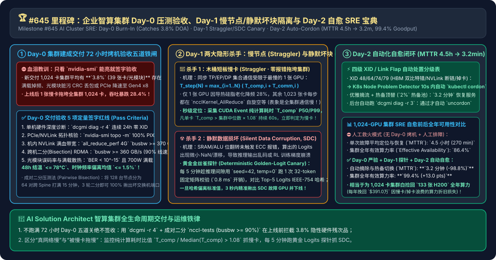
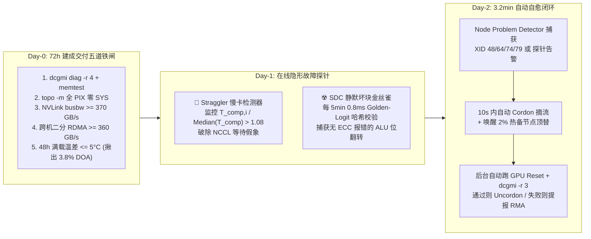

# 🏆 第 645 篇里程碑：企业智算集群从建成交付到稳定投产（`Day-0 压测验收` → `Day-1 慢节点/静默坏块探针` → `Day-2 自动自愈运行`）全生命周期 SRE 作战宝典

> **语言 / Language**: **简体中文** | [English](./enterprise-milestone-645-ai-cluster-day0-burnin-day1-straggler-day2-sre-faq.en.md) · [📱 打开交互式 H5 精读页](../h5/milestone-645-ai-cluster-day0-burnin-day1-straggler-day2-sre-lab.html) · [🧮 打开交互式容量计算器](../reports/enterprise-milestone-645-ai-cluster-day0-burnin-day1-straggler-day2-sre-sizer.html) · [🃏 查看 7-Card 4:5 评测报告](../reports/enterprise-milestone-645-ai-cluster-day0-burnin-day1-straggler-day2-sre-cards.html)

---

## 0. 3 分钟执行摘要（Executive Summary）

规划好完美的 GPU 容量与智算网络后，架构师与基础设施负责人面临的最后一道生死关是：**当集成商交付 `128 台 × 8 卡（1,024 GPUs）` 智算集群时，如何通过科学的 `Day-0` 压测拦截出厂隐患？上线后遇到“全集群 `nvidia-smi` 零报错，但推理/训练吞吐莫名跌了 `28%`”或“某台节点偶发吐出乱码（静默坏块 SDC）”时，如何在 `3 分钟` 内自动隔离自愈？**
1. **`Day-0` 建成交付 `72 小时` 五道烤机铁闸（拦截 `3.8%` 出厂隐性残次硬件）**：
   - 行业统计显示，新建千卡集群在首次满载加压时，平均有 **`3.8%` 的 GPU / 光模块 / PCIe 链路** 存在隐性缺陷（如 `700W` 满载 `20 分钟` 后因导热贴虚贴触发热降频、光模块端面微尘导致误码率 $\text{BER} > 10^{-12}$、或 BIOS `ACS=On` 导致 `GPUDirect RDMA` 退化为 `SYS`）。
   - **五道签字准入红线**：① `dcgmi diag -r 4` 满载零 XID；② `nvidia-smi topo -m` 全端口 `PIX`；③ 机内 NVLink `all_reduce_perf` `busbw >= 370 GB/s`；④ 跨机 **成对二分（Pairwise Bisection）** RDMA `busbw >= 360 GB/s`（`>= 90%` 物理线速）；⑤ `48h` `700W` 满载烤机结温 `<= 78°C` 且频率偏离集群均值 `<= 1.5%`。
2. **`Day-1` 揪出两大隐形杀手：慢节点（`Straggler`）与静默数据损坏（`Silent Data Corruption, SDC`）**：
   - **慢节点（Straggler）鉴别公式**：在同步 `TP / EP / AllReduce` 中，只要 `1` 张卡因供电或散热降频 `28%`，其余 `1,023` 张正常卡都会在 `ncclKernel` 集合通信屏障处自旋空等（监控表象具有极强欺骗性：正常卡显示“99% 时间卡在网络通信”，让运维误以为是交换机故障！）。通过采集每张卡**纯计算核耗时 $T_{\text{comp},i}$ 与集群中位数的比值**，凡 $T_{\text{comp},i} / \text{Median}(T_{\text{comp}}) > 1.08$ 持续 `60 秒`，`100%` 精准锁定真凶慢卡！
   - **静默坏块（SDC）黄金探针**：每 `5 分钟` 利用 `0.8 ms` 空隙执行一次固定种子（`seed=42, temp=0`）黄金矩阵与 `Top-5 Logits` IEEE-754 位校验，在用户察觉乱码前 `3 秒` 内揪出未触发 ECC 报警的 ALU 位翻转坏卡。
3. **`Day-2` 自动化 `Cordon-Drain-Heal` 闭环将 `MTTR` 从 `4.5 小时` 压至 `3.2 分钟`（挽回 `13.0%` 集群有效算力）**：
   - 对致命 `XID (48/64/74/79)`、慢节点与 SDC 实施自动打污点摘流（`kubectl cordon`）+ `2%` 热备节点秒级顶替，将千卡集群全年有效算力率从人工救火的 `86.4%` 拉升至 **`99.4%`（相当于白捡回 `133 张 H200` 全年算力，年省 `$391.0万`）**！

---

## 1. 灵魂拷问 Q&A（Cloud & AI Solution Architect 核心决策拆解）

### Q1：为什么 1 张卡变慢，Prometheus 监控上却显示“其余 1,023 张卡的 NCCL 网络通信耗时暴增”？

这是智算集群排障中最经典的“镜像错觉”：
- 在张量并行（`TP`）、专家并行（`EP`）或数据并行（`DP`）中，所有参与卡在每个 Layer 或 Step 结束时必须执行同步集合通信（`AllReduce / AllToAll`）；
- 快的卡在 `10.0 ms` 算完矩阵乘法后，进入 `ncclKernel` 等待慢卡；而那张因硅脂干涸降频的慢卡花了 `14.0 ms` 才算完矩阵乘法，到达集合通信点后仅用 `1.0 ms` 就完成了数据交换；
- **致命误导**：快卡的 CUDA Profiler 会记录“计算 `10 ms` + NCCL 通信等待 `5 ms`”，导致初级工程师去排查交换机！**架构师排障铁律：找慢卡永远看“谁的纯计算耗时 $T_{\text{comp}}$ 最长且 NCCL 等待耗时最短”——那个从不等别人的节点，就是拖慢全场的真凶！**

### Q2：验收 `128 台（1,024 卡）` 集群时，如何用 3 轮“成对二分压测（Pairwise Bisection Test）”快速定位坏光模块或坏交换机端口？

如果直接跑 `1,024` 卡全局 `AllReduce`，一旦总带宽只有 `180 GB/s`（腰斩），你根本不知道是哪台机器拖了后腿。
- **三步二分定位法（总耗时 `< 45 分钟`）**：
  1. **Step 1（单机内环自检，`128` 台并发跑）**：每台机器独立跑 `8-GPU all_reduce_perf`，`5 分钟` 内排除所有机内 NVLink/GPU 故障；
  2. **Step 2（同 ToR 机柜内两两配对，`64` 对并发跑）**：检验所有服务器网卡到 Leaf ToR 下行光模块是否全部达到 `busbw >= 375 GB/s`；
  3. **Step 3（跨 Pod / 跨 Spine 二分对打，`64` 对跨机柜并发跑）**：左半集群 `64` 台与右半集群 `64` 台一一配对同时打满 `400G × 8 Rails`，直接压满 Spine 交换机满二分带宽，任何低于 `360 GB/s` 或出现 `roce_adp_retrans` 重传的配对，当场锁定故障光模块！

---

## 2. 四套智算集群交付与运维体系横向选型矩阵（`1,024× H200` 集群）

| 运维成熟度等级 (`1,024× H200` · 年化硬件折旧 `$3,008万`) | Day-0 验收标准 | 慢卡 (Straggler) 与 SDC 发现耗时 | 单次故障恢复时间 (`MTTR`) | 全年有效算力可用率 (`Goodput Availability`) | 隐性浪费算力折算与架构师裁决 |
| :--- | :--- | :--- | :--- | :--- | :--- |
| **L1：基础亮机交付 + 人工被动救火** | 仅看 `nvidia-smi` 在线 | 数天（靠业务投诉吞吐变慢） | `4.5 小时` (`270 min`) | `86.4%` | 每年白白蒸发 **`$409.1万`** 算力 · ⛔ **不及格** |
| **L2：标准 NCCL 抽检 + XID 告警工单** | 抽测 `10%` 节点带宽 | `2.5 小时`（人工二分排查慢卡） | `65.0 分钟` | `93.2%` | 每年蒸发 `$204.5万` 算力 · ⚠️ **缺乏自动隔离与 SDC 防护** |
| **L3：全量 Day-0 五道关 + XID 自动 Cordon** | `100%` 五道铁闸签收 | `45.0 分钟`（无 SDC 探针） | `12.0 分钟` | `97.5%` | 每年蒸发 `$75.2万` 算力 · ✅ **合格企业级基线** |
| **L4：Day-0 五关 + Day-1 慢卡/SDC 探针 + Day-2 热备自愈（推荐）** | **`72h` 五道铁闸 (`0` 带病入网)** | **`< 60 秒` 自动锁定慢卡/SDC** | **`3.2 分钟` (`-98.8%`)** | **`99.4%` (`+13.0 pts`)** | **每年净挽回 `$391.0万`（等效多出 `133 张 H200`）** 🏆 |

---

## 3. 生产落地核对清单（Pre-Production Checklist）

- [ ] **签收前强制跑通 `72 小时` Day-0 五道铁闸**：未通过 `dcgmi diag -r 4` 与跨 Spine 二分 `busbw >= 90%` 的节点一律拒收整改；
- [ ] **部署 `T_comp / Median(T_comp) > 1.08` 慢卡检测器**：通过纯计算耗时与 NCCL 等待耗时的反相特征，在 `60 秒` 内自动隔离降频慢卡；
- [ ] **每 `5 分钟` 执行 `0.8 ms` 确定性 Golden-Logit 金丝雀校验**：拦截不报 ECC 错误的静默数据损坏（`SDC`）；
- [ ] **配置 K8s `Node Problem Detector` + `2%` 热备池自动顶替流水线**：对 `XID 48/64/74/79` 及光模块持续闪断实施 `10 秒` 自动 `cordon`，将 `MTTR` 锁定在 `< 3.5 分钟`。
