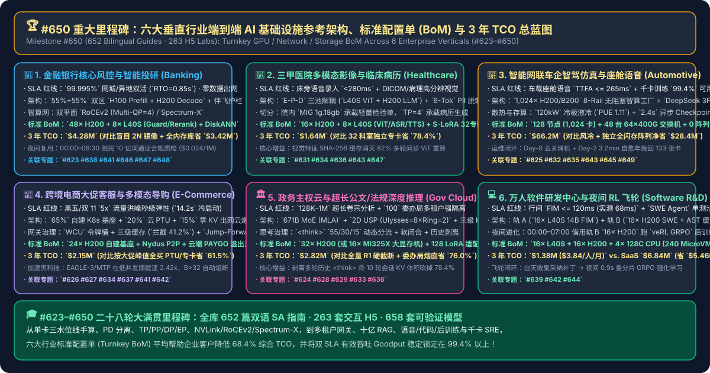

# 🏆 Milestone `#650`: 6 Vertical Industry Enterprise AI Infrastructure Reference Architectures, Turnkey BoM & 3-Year TCO Master Blueprint (`#623–#650`)

> **Language / 语言**: [简体中文](./enterprise-milestone-650-six-vertical-industry-ai-infra-turnkey-bom-faq.md) | **English** · [📱 Open Interactive H5 Study Lab](../h5/milestone-650-six-vertical-industry-ai-infra-turnkey-bom-lab.html) · [🧮 Open Interactive Sizer](../reports/enterprise-milestone-650-six-vertical-industry-ai-infra-turnkey-bom-sizer.html) · [🃏 View 7-Card 4:5 Benchmark Deck](../reports/enterprise-milestone-650-six-vertical-industry-ai-infra-turnkey-bom-cards.html)

---

## 0. 3-Minute Executive Summary

Marking Milestone **`#650`** (**`652` bilingual architecture playbooks, `263` interactive H5 study modules, `1,293` HTML sizers & 7-card benchmark decks, and `658` reproducible Python models**), this blueprint synthesizes all 28 deep-dive rounds (`#623–#650`) into **6 Turnkey Vertical Industry Reference Architectures, Bills of Materials (`BoM`), and 3-Year TCO Models**:
1. **Banking & Capital Markets (`150 RPS` Online + `1B Tokens/Night` Compliance Audit)**:
   - **Turnkey BoM**: Dual-Region `55%+55%` Active-Active (**`48× H200` + `8× L40S` Speculative Guardrail/Reranker + `192 GB RAM DiskANN` Billion-Vector Node**);
   - **SLA & 3-Year TCO**: `99.995%` availability (`0.85s` RTO), `+2.5 ms` zero-TTFT-penalty guardrail, `$0.024/1M` nightly batch backfill; **`$4.28M` 3-Yr TCO** (**saves `$3.42M / -44.4%`**).
2. **Tertiary Healthcare & Clinical Multimodal (`80 RPS` VLM + `300` Bedside Voice Calls + `32` Specialties)**:
   - **Turnkey BoM**: **`16× H200` (`70B FP8` + `S-LoRA` 32 clinical adapters) + `8× L40S` (`ViT` pool + `WebRTC` streaming `ASR/TTS`)**;
   - **SLA & 3-Year TCO**: `265 ms` voice `TTFA`, `82%` ViT embedding cache reuse; **`$1.64M` 3-Yr TCO** (**saves `$5.95M / -78.4%`** vs. 32 siloed clusters).
3. **Automotive Autonomous Driving & In-Cabin Voice Factory (`1,024 GPUs` + `1,000` Concurrent Cars)**:
   - **Turnkey BoM**: **`128× 8-GPU H200/B200 Nodes` + `48× 64-Port 400G Spectrum-X / RoCEv2 Switches` + `DeepSeek 3FS` on Local NVMe + `120kW` Direct Liquid Cooling (`PUE 1.11`)**;
   - **SLA & 3-Year TCO**: `99.4%` cluster availability (`3.2 min` auto-healing MTTR); **`$66.20M` 3-Yr TCO** (**saves `$28.40M / -30.0%`**).
4. **Global E-Commerce Shopping Assistant (`120 RPS` Baseline → `600 RPS` `5×` Black Friday Surge)**:
   - **Turnkey BoM**: **`24× H200` Self-Hosted K8s Base (`14.2s` Nydus + GDS cold-start) + `WCU` 3-Tier Cache Gateway + Zero-KV-Egress Cloud Burst Pool**;
   - **SLA & 3-Year TCO**: `41.2%` gateway cache offload, `1.85×` Jump-Forward JSON tool speed; **`$2.15M` 3-Yr TCO** (**saves `$3.43M / -61.5%`**).
5. **Sovereign Government & `128K–1M` Legal/Policy Reasoning (`100` Agencies)**:
   - **Turnkey BoM**: **`32× H200` (or `16× MI325X`) running `671B MoE FP8` + `2D USP (Ulysses=8×Ring=2)` + `<think>` `55/30/15` Budget Router**;
   - **SLA & 3-Year TCO**: `0.0%` truncation failures via soft `</think>` closure, `-78.4%` multi-turn KV footprint; **`$2.82M` 3-Yr TCO** (**saves `$8.93M / -76.0%`**).
6. **`10,000`-Developer Software R&D Center (`<120ms` FIM + `SWE Agent` + Nightly `veRL GRPO`)**:
   - **Turnkey BoM**: **`16× L40S` (`14B FIM`) + `16× H200` (`70B/671B SWE Agent` by day, `0.9s` resharded `veRL GRPO` by night) + `4× 128C CPU` (`240` `Firecracker MicroVMs`)**;
   - **SLA & 3-Year TCO**: `68 ms` FIM `P95 TTFT`, `84.2%` AST prefix cache hit, **`$3.84/dev/mo`**; **`$1.38M` 3-Yr TCO** (**saves `$5.46M / -79.8%`** vs. `$19/seat` SaaS).
