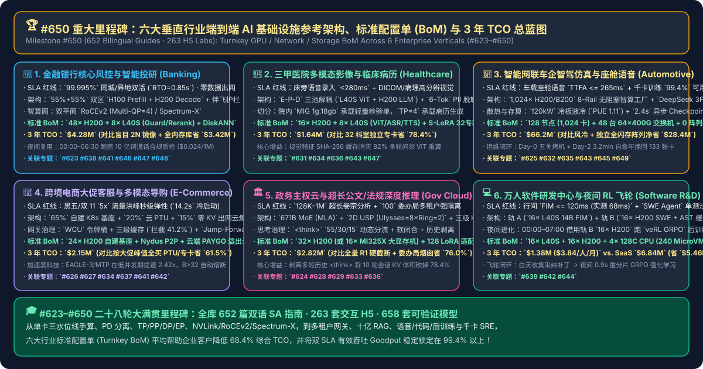

# 🏆 第 650 篇重大里程碑：六大垂直行业（金融、医疗、车企、电商、政务、万人研发）端到端 AI 基础设施参考架构、标准配置单（Turnkey BoM）与 3 年 TCO 交付总蓝图（贯通 `#623–#650`）

> **语言 / Language**: **简体中文** | [English](./enterprise-milestone-650-six-vertical-industry-ai-infra-turnkey-bom-faq.en.md) · [📱 打开交互式 H5 精读页](../h5/milestone-650-six-vertical-industry-ai-infra-turnkey-bom-lab.html) · [🧮 打开交互式容量计算器](../reports/enterprise-milestone-650-six-vertical-industry-ai-infra-turnkey-bom-sizer.html) · [🃏 查看 7-Card 4:5 评测报告](../reports/enterprise-milestone-650-six-vertical-industry-ai-infra-turnkey-bom-cards.html)

---

## 0. 3 分钟执行摘要（Executive Summary）

作为本仓库第 **`#650`** 篇重大里程碑（全库累计 **`652` 篇双语深度指南、`263` 套交互式 H5 精读页、`1,293` 套 Sizer/评测卡、`658` 套可复核 Python 定量模型**），本篇将 `#623–#650` 共 **28 轮**的核心技术模块（三水位线容量测算、动态 PD 分离、TP/PP/DP/EP、NVLink/Spectrum-X/UEC、WCU 网关、十亿级 DiskANN RAG、零延迟伴飞护栏、`<300ms` 语音、万人代码助手、夜间离线/GRPO 共池与千卡 SRE）沉淀为 **面向六大核心行业的“开箱即用标准配置单（Turnkey BoM）与 3 年 TCO 交付蓝图”**：
1. **金融银行核心风控与智能投研（`150 RPS` 在线 + 每晚 `10 亿词` 录音质检）**：
   - **标准 BoM**：双可用区 `55%+55%` 同城双活（共 **`48× H200` + `8× L40S` 伴飞护栏/Reranker + `256 GB RAM DiskANN` 十亿向量库**）；
   - **核心指标与 TCO**：`99.995%` 可用性（`0.85s` 灰故障无感熔断续传）、`+2.5 ms` 零延迟伴飞合规审查，夜间复用空闲卡以 `$0.024/1M` 跑完 `10 亿` 通话质检；3 年 TCO **`$4.28M`**（比传统 `2N` 镜像 + 全内存向量库 + 云审核 API 节省 **`$3.42M / -44.4%`**）。
2. **三甲医院多模态临床与专科病历（`80 RPS` 多模态影像 + `300` 路床旁语音 + `32` 专科）**：
   - **标准 BoM**：**`16× H200`（`70B FP8` 主模型 + `S-LoRA` 挂载 `32` 个临床专科适配器）+ `8× L40S`（独立 `ViT` 视觉池 + 流式 `ASR/TTS` 池）**；
   - **核心指标与 TCO**：`E-P-D` 三池解耦 + 视觉特征 `SHA-256` 缓存（消除 `82%` 多轮问诊图像重算），床旁语音 `TTFA = 265 ms`；3 年 TCO **`$1.64M`**（比 32 科室独立烟囱专卡节省 **`78.4%`**）。
3. **智能网联车企智驾大模型与座舱语音（`1,024` 卡训推一体工厂 + `1,000` 路车载语音）**：
   - **标准 BoM**：**`128 台 8×H200/B200`（`1,024 GPUs`）+ `48 台 64×400G Spectrum-X / RoCEv2` 8-Rail 网络 + 本地 NVMe `DeepSeek 3FS`（`$0` 独立存储阵列）+ `120kW` 冷板液冷（`PUE 1.11`）**；
   - **核心指标与 TCO**：`Day-0` 五关烤机 + `Day-2` `3.2 min` 自动自愈将有效可用率锁定在 **`99.4%`**；3 年总 TCO **`$66.2M`**（净省 **`$28.4M / -30.0%`**）。
4. **跨境电商全球导购与大促弹性（日常 `120 RPS` → 黑五/双 11 `600 RPS` `5×` 洪峰）**：
   - **标准 BoM**：**`24× H200` 自建 K8s 常态基座（`Nydus P2P + GDS 14.2s` 极速弹性）+ `WCU` 三级缓存网关 + 公有云零 KV 出网突发溢出池**；
   - **核心指标与 TCO**：三级缓存拦截 `41.2%` 算力，`XGrammar + Jump-Forward` 提速订单工具调用 `1.85×`；3 年 TCO **`$2.15M`**（比按峰值包年采购节省 **`61.5%`**）。
5. **政务主权云与百万字卷宗深度推理（`128K–1M` 长上下文 + `100` 委办局共享）**：
   - **标准 BoM**：**`32× H200`（或 `16× MI325X` `2,048 GB` 大显存节点）运行 `DeepSeek-R1 671B FP8` + `2D USP (Ulysses=8×Ring=2)` + `<think>` `55/30/15` 预算路由**；
   - **核心指标与 TCO**：剥离多轮历史 `<think>` 节省 `78.4%` KV 显存，软闭合将截断废答率压至 `0.0%`；3 年 TCO **`$2.82M`**（节省 **`76.0%`**）。
6. **万人软件研发中心（`10,000` 工程师 `FIM <120ms` + `SWE Agent` + 夜间 `veRL GRPO` 自进化）**：
   - **标准 BoM**：**`16× L40S`（`14B FIM`）+ `16× H200`（白天跑 `SWE Agent`，夜间 `0.9s` 重分片跑 `veRL GRPO` 代码强化学习）+ `4× 128C CPU`（`240` 路 `Firecracker MicroVM` 沙箱）**；
   - **核心指标与 TCO**：FIM `P95 TTFT = 68 ms`，仓库 AST 前缀命中率 `84.2%`，人均月成本 **`$3.84/人/月`**；3 年 TCO **`$1.38M`**（比 `$19/席` 商业 SaaS 净省 **`$5.46M / -79.8%`**）。

---

## 1. 六大垂直行业 AI 基础设施标准配置单（Turnkey BoM）总览矩阵

| 垂直行业场景 | 核心业务规模 | 严苛 SLA 与合规红线 | 推荐标准硬件配置单 (Turnkey BoM) | 核心软件栈与架构特性 | 3 年总 TCO (对比传统方案节省) |
| :--- | :--- | :--- | :--- | :--- | :--- |
| **1. 金融银行核心风控** | `150 RPS` 在线 + `1B tok/晚` 批处理 | `99.995%` 双活 (`RTO 0.85s`) · 零出网 | **`48× H200 + 8× L40S + 256GB DiskANN`** | `55%+55%` 双区 PD 分离 + 投机伴飞护栏 + 前缀重排批处理 | **`$4.28M`**（省 `$3.42M / -44.4%`） |
| **2. 三甲医院临床多模态** | `80 RPS` 影像病历 + `300` 路语音 | 语音 `<280ms` · 患者隐私不出院 | **`16× H200 + 8× L40S`** | `E-P-D` 三池解耦 + `S-LoRA` 32 专科 + `WebRTC` 流式级联 | **`$1.64M`**（省 `$5.95M / -78.4%`） |
| **3. 车企智驾与座舱工厂** | `1,024 GPU` 训练 + `1,000` 路语音 | 集群可用率 `>=99.4%` · `PUE <=1.12` | **`1,024× H200 + 48× 400G 交换机 + DLC`** | 8-Rail `Spectrum-X/RoCEv2` + `3FS` 聚合本地盘 + `3.2m` 自愈 | **`$66.20M`**（省 `$28.40M / -30.0%`） |
| **4. 跨境电商导购与大促** | 日常 `120 RPS` → 峰值 `600 RPS` | 大促 `5×` 洪峰零丢单 · `<300ms TTFT` | **`24× H200 自建 + 公有云溢出池`** | `WCU` 三级缓存网关 + `Nydus 14.2s` 扩容 + `Jump-Forward` | **`$2.15M`**（省 `$3.43M / -61.5%`） |
| **5. 政务主权云与长公文** | `128K–1M` 卷宗 + `100` 委办局 | 零截断废答 · 委办局租户强隔离 | **`32× H200 (或 16× MI325X)`** | `2D USP` + 三级 KV 卸载 + `<think>` 软闭合与历史剥离 | **`$2.82M`**（省 `$8.93M / -76.0%`） |
| **6. 万人软件研发中心** | `10,000` 研发 (`3,500 DAU`) | FIM `P95 <=120ms` · 单测内核隔离 | **`16× L40S + 16× H200 + 4× 128C CPU`** | `75ms` 防抖 + `Tree-sitter AST` 缓存 + `Firecracker` + 夜间 `veRL` | **`$1.38M`**（省 `$5.46M / -79.8%`） |

---

## 2. `#623–#650` 二十八轮全景专题导航索引表

| 轮次 / 编号 | 核心架构域 | 专题核心交付成果与定量黄金锚点 | 快速入口 |
| :--- | :--- | :--- | :--- |
| **Round 1–8 (`#623–#630`)** | **推理并行、智算网络、三水位线与 TCO 基石** | 动态 PD 分离 (`2.4s` 变比 + `85%` 反压)、`TP/PP/DP/EP` 通信数学、`NVLink vs. IB/RoCEv2 busbw`、三水位线 `Sizer + Little's Law`、`PAYGO vs. PTU vs. K8s` 拐点 (`28% / 65%`)、`128K–1M 2D USP`、异构五卡角色分配与 `#630` 白板总纲 | [打开 `#630` 里程碑 H5](../h5/milestone-630-sa-four-pillar-whiteboard-master-bible-lab.html) |
| **Round 9–13 (`#631–#635`)** | **多模态、超节点、推理模型、K8s 切分与千卡工厂** | 多模态视觉 Token 手算与 `E-P-D` 解耦 (`-60.3%`)、`GB200 NVL72` 全铜缆 `EP=72` vs. `HGX`、`R1 <think>` 软闭合与历史剥离 (`-75%` 卡)、`MIG vs. MPS` + `14.2s` 极速冷启动、以及 `#635` `1,024-GPU` AI 工厂 BoM (`3FS + 120kW 液冷`) | [打开 `#635` 里程碑 H5](../h5/milestone-635-1024gpu-ai-factory-bom-3fs-dlc-tco-lab.html) |
| **Round 14–18 (`#636–#640`)** | **多 LoRA、投机解码、异地双活、后训练与 25 公式宝典** | `S-LoRA` 单底座挂载 `128` 适配器 (`-96.9%` 卡)、投机解码四大流派与 `B*=32` 自动熔断、`55%+55%` 异地双活 (`0.85s RTO`)、后训练 `16Ψ vs. 156GB LoRA vs. veRL 0.9s GRPO`、以及 `#640` `25` 大手算公式与 `12` 条否决红线总宝典 | [打开 `#640` 里程碑 H5](../h5/milestone-640-sa-25-formulas-12-redlines-master-pocketbook-lab.html) |
| **Round 19–23 (`#641–#645`)** | **网关限流、结构化输出、实时语音、代码平台与集群 SRE** | `1:0.1:4 WCU` 令牌桶与三级缓存 (`-43.8%` 卡)、`XGrammar/llguidance + Jump-Forward` (`2.18 tok/step`, `1.85x`)、`<300ms` WebRTC 流式级联语音 (`265ms`, `14×H200`)、万人代码助手 (`$3.84/人/月`)、以及 `#645` `Day-0..2` 千卡自愈 SRE (`99.4%` 可用率) | [打开 `#645` 里程碑 H5](../h5/milestone-645-ai-cluster-day0-burnin-day1-straggler-day2-sre-lab.html) |
| **Round 24–28 (`#646–#650`)** | **十亿 RAG、零延迟护栏、十亿批处理、三代以太网与六大行业蓝图** | 十亿向量 `DiskANN (192GB RAM, -96.1%) + FP8 Reranker`、投机并行伴飞护栏 (`+2.5ms ΔTTFT`)、每晚 10 亿词字典序前缀重排批处理 (`3.02x`, `$0.024/1M`)、`RoCEv2 vs. Spectrum-X (95.5% 线速) vs. UEC`、以及本篇 `#650` 六大行业交付总蓝图 | [打开 `#650` 里程碑 H5](../h5/milestone-650-six-vertical-industry-ai-infra-turnkey-bom-lab.html) |

---

## 3. 生产交付签字核对清单（Turnkey Delivery Sign-Off Checklist）

- [ ] **对照行业属性锁定对应的标准 BoM 模板**（金融选双活+伴飞护栏，医疗选 E-P-D+S-LoRA，研发选 L40S/H200 双轨+MicroVM）；
- [ ] **所有自建集群充分利用“日间服务在线低延迟交互、夜间（00:00–07:00）自动切换大 Batch 离线报表或 veRL GRPO 强化学习”潮汐共池机制**；
- [ ] **上线前 100% 跑通 `#640` 12 条架构否决红线自检与 `#645` Day-0 五道烤机验收门禁**。
