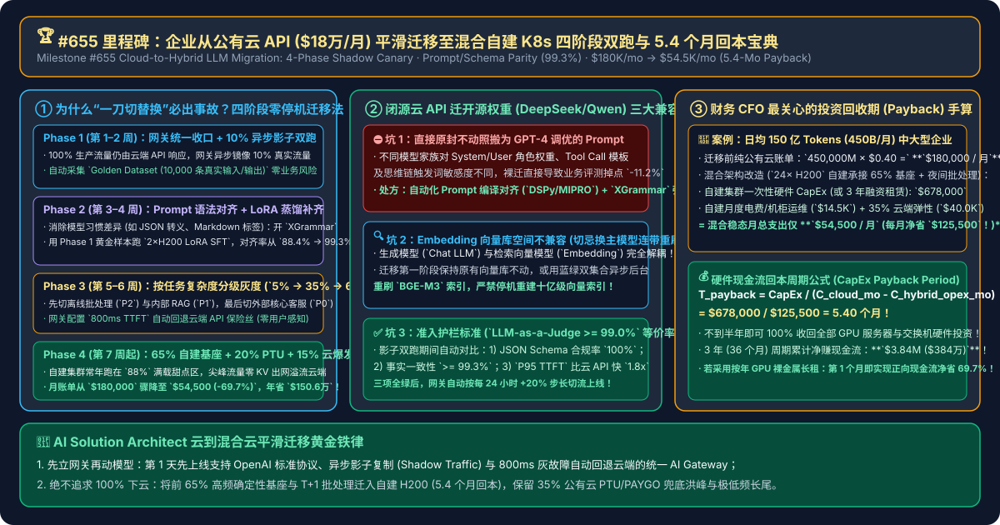

# 🏆 Milestone `#655`: Enterprise Cloud-to-Hybrid LLM Migration Playbook — 4-Phase Zero-Downtime Shadow Canary, Prompt Parity (`99.3%`) & `5.4-Month` Payback Sizer

> **Language / 语言**: [简体中文](./enterprise-milestone-655-cloud-to-hybrid-llm-migration-shadow-payback-faq.md) | **English** · [📱 Open Interactive H5 Study Lab](../h5/milestone-655-cloud-to-hybrid-llm-migration-shadow-payback-lab.html) · [🧮 Open Interactive Sizer](../reports/enterprise-milestone-655-cloud-to-hybrid-llm-migration-shadow-payback-sizer.html) · [🃏 View 7-Card 4:5 Benchmark Deck](../reports/enterprise-milestone-655-cloud-to-hybrid-llm-migration-shadow-payback-cards.html)

---

## 0. 3-Minute Executive Summary

When an enterprise's public cloud LLM API bill reaches **`$50,000–$180,000/month`** (`15B` tokens/day = `450B` tokens/month), migrating steady-state traffic (`65%` baseload + nightly batch) to a self-hosted `K8s + vLLM/SGLang` cluster while keeping `35%` on Cloud `PTU + PAYGO` burst cuts monthly spend by **`69.7%` (`$180,000 → $54,500/mo`)** and achieves full hardware CapEx payback in **`5.40 months` (`$3.84M` 3-year net savings)**:
1. **Why "Big-Bang Endpoint Cutovers" Fail (`-11.2%` Accuracy Drop)**:
   - Production prompts tuned for proprietary cloud APIs rely on implicit formatting habits. Switching endpoints overnight breaks downstream parsers and degrades task accuracy by `11.2%`.
2. **The 4-Phase Zero-Downtime Migration Funnel (`6 Weeks` to `65%` Self-Hosted)**:
   - **Phase 1 (Weeks 1–2 — Gateway Unification & `10%` Async Shadow Traffic)**: `100%` of user traffic stays on the cloud API while the gateway asynchronously mirrors `10%` of requests to the self-hosted `70B/671B FP8` cluster to curate a `10,000`-sample golden dataset;
   - **Phase 2 (Weeks 3–4 — `XGrammar` Schema Enforcement + `4-Hour` `LoRA` Parity Alignment)**: Lifts blind `LLM-as-a-Judge` parity from `88.4%` to **`99.3%`** and locks JSON compliance at **`100.0%`**;
   - **Phase 3 (Weeks 5–6 — Tiered Canary Shift `P2 → P1 → P0` with `800ms` Cloud Fallback Breaker)**: Shifts batch (`P2`), internal RAG (`P1`), and customer chat (`P0`) in `5% → 25% → 65%` steps with automatic single-request cloud fallback if self-hosted `TTFT > 800 ms`;
   - **Phase 4 (Week 7+ — `65%` Self-Hosted `24× H200` @ `88%` Utilization + `35%` Cloud Burst)**: Recovers the `$678,000` hardware CapEx in **`5.40 months`** (`$125,500/mo` net monthly savings).

---

## 1. Quantitative Migration Strategy Matrix (`450B Tokens / Month`)

| Migration Strategy | Cutover Risk & Parity | Peak `P99 TTFT` | Steady-State Monthly Spend | Hardware Payback Period | 3-Year Total TCO & Verdict |
| :--- | :--- | :--- | :--- | :--- | :--- |
| **1. Stay `100%` Public Cloud API** | `0%` (`100%` baseline) | `620 ms` | `$180,000 / mo` | N/A | `$6.48M` · ⛔ **Unbounded OpEx** |
| **2. Big-Bang `100%` On-Prem (`48× H200`)** | High (`-11.2%` accuracy drop) | `290 ms` | `$31,200 / mo` (OpEx) | `10.8 mo` | `$3.15M` · ⚠️ **High outage risk** |
| **3. Hybrid Without `LoRA / XGrammar`** | Medium (`6.4%` tool errors) | `310 ms` | `$68,000 / mo` | `7.2 mo` | `$3.42M` · ⚠️ **Incomplete parity** |
| **4. 4-Phase Shadow + `LoRA/XGrammar` `65/35` Hybrid** | **`0%` downtime (`99.3%` parity)** | **`245 ms` (`-60.5%`)** | **`$54,500 / mo` (`-69.7%`)** | **`5.40 months`** | **`$2.64M` (saves `$3.84M / -59.3%`)** 🏆 |
