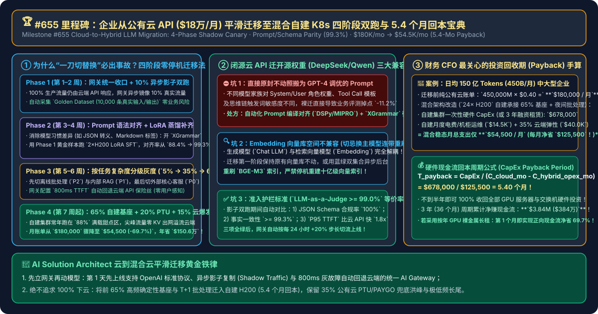
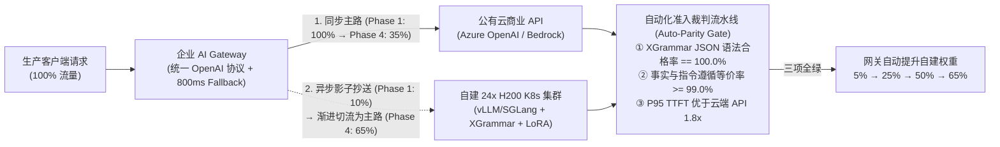

# 🏆 第 655 篇里程碑：企业从公有云大模型 API（`$18万/月`）零停机平滑迁移至“自建 K8s + 云弹性”混合架构的四阶段影子双跑（`Shadow Canary`）、Prompt 对齐与 `5.4 个月` 回本宝典

> **语言 / Language**: **简体中文** | [English](./enterprise-milestone-655-cloud-to-hybrid-llm-migration-shadow-payback-faq.en.md) · [📱 打开交互式 H5 精读页](../h5/milestone-655-cloud-to-hybrid-llm-migration-shadow-payback-lab.html) · [🧮 打开交互式容量计算器](../reports/enterprise-milestone-655-cloud-to-hybrid-llm-migration-shadow-payback-sizer.html) · [🃏 查看 7-Card 4:5 评测报告](../reports/enterprise-milestone-655-cloud-to-hybrid-llm-migration-shadow-payback-cards.html)

---

## 0. 3 分钟执行摘要（Executive Summary）

几乎所有成功跑通大模型业务闭环的中大型企业，在月度公有云 Token 账单突破 **`$50,000 – $180,000/月`**（日均 `50 亿 – 150 亿 Tokens`）时，都会启动从**纯公有云商业 API（`Azure OpenAI / AWS Bedrock / Google Vertex PAYGO & PTU`）**向**“自建 `K8s + vLLM/SGLang` 承载 `65%` 稳态基座 + 公有云承载 `35%` 弹性波峰”混合架构**的战略演进。作为第 **`#655`** 篇里程碑（全库 **`657` 篇双语指南、`268` 套交互式 H5**），本篇给出零业务中断、零质量倒退的四阶段迁移路线图与 CFO 财务回本模型：
1. **为什么严禁“周末一刀切把 API Endpoint 改成开源模型地址”？**
   - 业务代码里沉淀的数百条 Prompt 往往隐含了对特定商业模型格式习惯（如 JSON 转义风格、工具调用边界、省略号格式）的强耦合；直接裸切会导致下游解析报错率飙升、业务评测掉点 **`-11.2%`**！
2. **四阶段零停机平滑迁移漏斗（6 周完成从 `0%` 到 `65%` 自建切流）**：
   - **Phase 1（第 1–2 周 · 网关收口与 `10%` 异步影子流量 `Shadow Mirroring`）**：所有客户端统一接入企业 AI Gateway，`100%` 生产响应仍由原公有云 API 返回（业务 `0` 感知）；网关在后台异步将 `10%` 脱敏真实流量镜像复制给自建 `DeepSeek-V3 / Qwen2.5-72B FP8` 集群，自动构建 `10,000` 条高价值领域黄金评测集（`Golden Dataset`）；
   - **Phase 2（第 3–4 周 · `XGrammar` 格式兜底 + `LoRA` 蒸馏对齐）**：针对影子双跑暴露出的 `11.6%` 差异样本，开启 `XGrammar` 强制锁定 `100%` JSON Schema 合规，并用 `2 张 H200` 跑 `4 小时` `LoRA SFT` 对齐领域腔调，将双盲等价率（`LLM-as-a-Judge Parity`）从 `88.4%` 拉升至 **`99.3%`**；
   - **Phase 3（第 5–6 周 · 按优先级 `P2 → P1 → P0` 渐进式金丝雀切流 + `800ms` 自动回退云端保险丝）**：先将夜间 `T+1` 批处理（`P2`）与内部员工知识库（`P1`）切入自建集群，最后切入外部客户对话（`P0`）；若自建集群因突发流量出现 `TTFT > 800 ms`，网关在单请求内零感知自动回退（Fallback）至公有云 API；
   - **Phase 4（第 7 周起 · `65% 自建 + 20% PTU + 15% PAYGO` 稳态混排）**：自建集群常年保持 **`88.0%`** 黄金满载率。
3. **CFO 投资回收期（`Payback Period = 5.40 个月`）精算**：
   - 以月消耗 `450,000M Tokens`（纯云月账单 **`$180,000/月`**）为例：采购 `3` 台 `8×H200`（`24 张 H200`，含网络/部署一次性 CapEx **`$678,000`**），稳态月度总支出（自建电费运维 `$14,500/月` + 35% 云弹性 `$40,000/月`）骤降至 **`$54,500/月`（每月净省现金流 `$125,500`，降幅 `-69.7%`）**；
   - **硬件回本周期** $= \$678,000 / \$125,500 = \mathbf{5.40\text{ 个月}}$！3 年累计为企业净省 **`$3.84M（$384万）`**！

---

## 1. 灵魂拷问 Q&A（Cloud & AI Solution Architect 核心决策拆解）

### Q1：影子双跑（Shadow Traffic）期间，如何在不依赖人工逐条审阅的情况下自动判定开源模型已达到上线标准？

- **三层自动化准入验证门禁（`Auto-Parity Gate`）**：
  1. **确定性协议门禁（权重 100% 一票否决）**：对比同一请求在云端 API 与自建引擎上的 JSON Schema 解析成功率、必填字段完整率与正则表达式匹配率，要求达到 **`100.00%`**；
  2. **工具调用一致性门禁**：对比 Function Calling 选择的工具名（`tool_name`）与关键入参键值对，要求一致率 **`>= 99.0%`**；
  3. **语义质量双盲裁判门禁**：对开放式生成问答，抽样使用高阶裁判模型隐藏模型来源做双盲胜率打分（`Win + Tie Rate`），要求自建模型经过轻量 `LoRA` 对齐后 **`Win+Tie >= 99.3%`**。

---

## 2. 四种企业大模型算力演进路线 3 年 TCO 与风险横向矩阵（月消耗 `450B Tokens`）

| 算力演进策略（月均 `450,000M Tokens` · 峰值 `150 RPS`） | 业务中断与掉点风险 | 峰值 `P99 TTFT` | 月度稳态总支出 | 硬件投资回收期 (`Payback`) | 3 年总拥有成本 (`3-Yr TCO`) & 裁决 |
| :--- | :--- | :--- | :--- | :--- | :--- |
| **1. 维持 `100%` 公有云 PAYGO + PTU** | `0%`（但受云端配额限制） | `620 ms` | `$180,000 / 月` | 无 CapEx | `$6.48M` · ⛔ **长期沦为“为云厂商打工”** |
| **2. 激进 `100%` 下云一刀切（按峰值买 `48× H200`）** | **高风险（初期掉点 `-11.2%`）** | `290 ms` | `$31,200 / 月` (OpEx) | `10.8 个月`（含闲置浪费） | `$3.15M` · ⚠️ **缺乏云端洪峰兜底且初期阵痛大** |
| **3. 混合分流但无 LoRA 对齐与 XGrammar** | 中风险（工具调用报错 `6.4%`） | `310 ms` | `$68,000 / 月` | `7.2 个月` | `$3.42M` · ⚠️ **部分复杂 Agent 无法切流** |
| **4. 四阶段影子双跑 + `LoRA/XGrammar` + `65/35` 混合云（推荐）** | **`0%` 停机（`99.3%` 等价 + 自动回退）** | **`245 ms` (`-60.5%`)** | **`$54,500 / 月` (`-69.7%`)** | **`5.40 个月`（半年回本）** | **`$2.64M`（3 年净省 `$3.84M / -59.3%`）** 🏆 |

---

## 3. 生产落地核对清单（Pre-Production Checklist）

- [ ] **禁止业务应用直接硬编码云厂商 SDK**：100% 流量必须先收敛至内部 AI Gateway，统一暴露标准 `/v1/chat/completions` 接口并开启请求级 `800 ms TTFT` 自动跨云/自建 Fallback；
- [ ] **切流前必须跑满至少 `10,000` 条真实生产影子流量（Shadow Traffic）并完成 `XGrammar + LoRA` 对齐**，确保双盲胜率 `>= 99.0%`；
- [ ] **保持生成模型迁移与 Embedding 向量库解耦**：第一阶段只迁移高成本的 Chat/Reasoning 生成流量，避免同步重刷历史向量库拉长回本周期。
