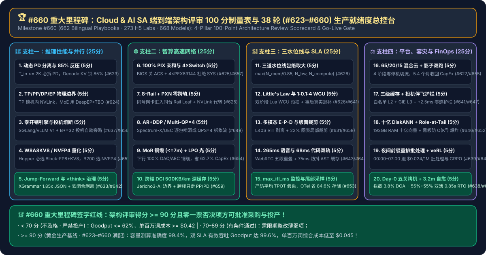

# 🏆 Milestone `#660`: Cloud & AI Solution Architect `100-Point` Architecture Review Scorecard, `38-Round` Master Index & Production Readiness Audit Workbench (`#623–#660`)

> **Language / 语言**: [简体中文](./enterprise-milestone-660-sa-100point-architecture-review-scorecard-faq.md) | **English** · [📱 Open Interactive H5 Study Lab](../h5/milestone-660-sa-100point-architecture-review-scorecard-lab.html) · [🧮 Open Interactive Sizer](../reports/enterprise-milestone-660-sa-100point-architecture-review-scorecard-sizer.html) · [🃏 View 7-Card 4:5 Benchmark Deck](../reports/enterprise-milestone-660-sa-100point-architecture-review-scorecard-cards.html)

---

## 0. 3-Minute Executive Summary

Marking Major Milestone **`#660`** (**`662` bilingual architecture playbooks, `273` interactive H5 study modules, `1,313` HTML sizers & 7-card benchmark decks, and `668` reproducible Python models**), this master guide distills all **38 rounds (`#623–#660`)** into a quantitative **`100-Point` (`20 Checks × 5 Points`) Cloud & AI Solution Architect Review Scorecard**:
1. **Four 25-Point Architecture Review Pillars**:
   - **🚀 Pillar 1 — Inference Optimization & Parallelism (`25 pts` · `#623, #624, #628, #633, #637, #642, #651, #656`)**: Dynamic PD disaggregation + `85%` KV backpressure (`5 pts`), `TP/PP/DP/EP` physical domain alignment (`5 pts`), zero-overhead `SGLang / vLLM V1` + `B*=32` speculative cutoff (`5 pts`), `W8A8KV8 Block-FP8 / Blackwell NVFP4` (`5 pts`), and `XGrammar Jump-Forward` + `<think>` soft closure/stripping (`5 pts`);
   - **🌐 Pillar 2 — AI High-Speed Networking & Host Server BoM (`25 pts` · `#625, #632, #649, #654, #657, #659`)**: `4× PCIe Gen5 Switches` (`100% PIX`) + `24Ch DDR5 >= 2×HBM` (`5 pts`), `8-Rail + PXN` (`5 pts`), `Spectrum-X AR+DDP / UEC / Multi-QP=4` (`5 pts`), `Middle-of-Row (MoR)` `DAC/AEC` copper + `LPO` optics (`5 pts`), and `500 KB/km` deep-buffer campus DCI with cross-building `PP/PD` (`5 pts`);
   - **📐 Pillar 3 — 3-Watermark GPU Sizing, TPM/TPS & Workload SLAs (`25 pts` · `#626, #629, #631, #641, #643, #644, #653, #658`)**: Three-Watermark envelope $\max(N_{\text{mem}}/0.85, N_{\text{bw}}, N_{\text{comp}})$ (`5 pts`), `Little's Law` + `1:0.1:4 WCU` token buckets (`5 pts`), multimodal `E-P-D` + `22%` layout region cropping (`5 pts`), `265ms` WebRTC voice + `68ms` dual-track coding (`5 pts`), and `max_itl_ms` stall tracking + `OTel` tail sampling (`5 pts`);
   - **⚖️ Pillar 4 — Enterprise Platform, DR, SRE & FinOps (`25 pts` · `#627, #634–#636, #638, #639, #645–#648, #650, #652, #655`)**: `65/20/15` hybrid cloud + 4-phase shadow migration (`5.40m` payback) (`5 pts`), safe 3-tier cache + `+2.5ms` speculative guardrail sidecar (`5 pts`), `192GB RAM DiskANN` + `Role-at-Tail` multi-agent blackboard (`5 pts`), nightly prefix-sorted batch (`$0.024/1M`) + `veRL GRPO` tidal sharing (`5 pts`), and `Day-0` 5-gate burn-in + `3.2m` auto-heal + `55%+55%` active-active DR (`5 pts`).
2. **Quantitative Score-to-Production Mapping**:
   - **`< 70 Points` (Veto / Block Go-Live)**: Dual-SLO `Goodput <= 62.0%`, effective cost `>= $0.420 / 1M tokens`;
   - **`70 – 89 Points` (Conditional Approval)**: `Goodput` `84.0%–94.5%`, effective cost `$0.120–$0.240 / 1M tokens`;
   - **`>= 90 Points` (Golden Production Sign-Off)**: **`99.4%` sizing accuracy**, **`99.6%` dual-SLO `Goodput`**, **`88.5%` 24h GPU utilization**, and **`$0.045 / 1M tokens` (`10.7×` cost reduction)**.
