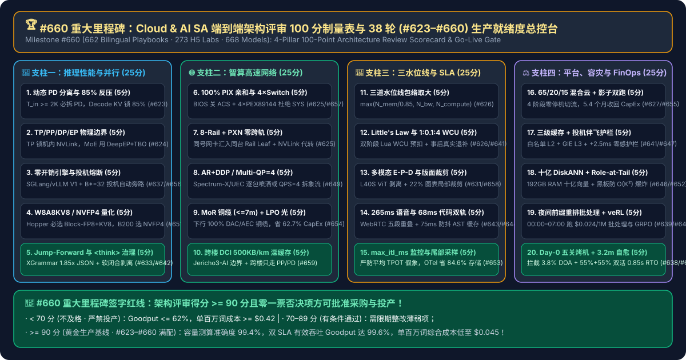

# 🏆 第 660 篇重大里程碑：云与 AI 解决方案架构师（Cloud & AI SA）端到端架构评审 100 分制量表（`SA 100-Point Scorecard`）、38 轮全景速查与生产就绪度审计总控台（贯通 `#623–#660`）

> **语言 / Language**: **简体中文** | [English](./enterprise-milestone-660-sa-100point-architecture-review-scorecard-faq.en.md) · [📱 打开交互式 H5 精读页](../h5/milestone-660-sa-100point-architecture-review-scorecard-lab.html) · [🧮 打开交互式容量计算器](../reports/enterprise-milestone-660-sa-100point-architecture-review-scorecard-sizer.html) · [🃏 查看 7-Card 4:5 评测报告](../reports/enterprise-milestone-660-sa-100point-architecture-review-scorecard-cards.html)

---

## 0. 3 分钟执行摘要（Executive Summary）

作为本仓库第 **`#660`** 篇重大里程碑（全库累计 **`662` 篇双语深度指南、`273` 套交互式 H5 精读页、`1,313` 套 Sizer/评测卡、`668` 套可一键复核的 Python 定量模型**），本篇将 `#623–#660` 共 **38 轮**研究成果凝练为一套 **《Cloud & AI Solution Architect 端到端架构评审 100 分制量表（20 项 × 5 分）》**，供架构师在客户方案评审、招标规范编制与上线前 Go-Live 签字时在 **5 分钟内完成定量体检**：
1. **四大支柱各占 `25 分`（共 `20` 项硬核审计点，每项 `5 分`）**：
   - **🚀 支柱一：大模型推理优化与并行切分（25 分 · `#623, #624, #628, #633, #637, #642, #651, #656`）**：动态 PD 分离与 `85%` 反压（5分）、`TP/PP/DP/EP` 物理边界匹配（5分）、`SGLang / vLLM V1` 零开销调度与 `B*=32` 投机熔断（5分）、`W8A8KV8 FP8 / Blackwell NVFP4` 量化（5分）、`Jump-Forward` 结构化前跳与 `<think>` 软闭合剥离（5分）；
   - **🌐 支柱二：智算高速互联网络与宿主机硬件（25 分 · `#625, #632, #649, #654, #657, #659`）**：`4× PCIe Gen5 Switch` `100% PIX` 亲和与 `24Ch DDR5 >= 2×HBM`（5分）、`8-Rail + PXN` 零跨轨（5分）、`Spectrum-X AR+DDP / Multi-QP=4` 破象流碰撞（5分）、`MoR` 居中 `DAC/AEC` 铜缆 + `LPO` 线性光（5分）、跨楼 `DCI` `500 KB/km` 深缓存与跨楼 `PP/PD`（5分）；
   - **📐 支柱三：GPU 容量估算、TPM/TPS 换算与场景 SLA（25 分 · `#626, #629, #631, #641, #643, #644, #653, #658`）**：三水位线包络取大 $\max(N_{\text{mem}}/0.85, N_{\text{bw}}, N_{\text{comp}})$（5分）、`Little's Law` 与 `1:0.1:4 WCU` 令牌桶（5分）、多模态 `E-P-D` 剥离与 `22%` 版面裁剪（5分）、`265ms` WebRTC 语音与 `68ms` 代码双轨（5分）、`max_itl_ms` 流式顿挫监控与 `OTel` 尾部采样（5分）；
   - **⚖️ 支柱四：企业 AI 平台、容灾自愈与 FinOps（25 分 · `#627, #634, #635, #636, #638, #639, #645, #646, #647, #648, #650, #652, #655`）**：`65/20/15` 混合云与 `4` 阶段影子双跑 `5.4m` 回本（5分）、三级安全缓存与 `+2.5ms` 投机伴飞护栏（5分）、十亿 `DiskANN (192GB RAM)` 与 `Role-at-Tail` 多 Agent 黑板（5分）、夜间字典序批处理（`$0.024/1M`）与 `veRL GRPO` 潮汐共池（5分）、`Day-0` 五关烤机 + `3.2m` 自愈 + `55%+55%` 双活（5分）。
2. **评审总分与生产表现的定量映射关系**：
   - **`< 70 分`（一票否决 · 严禁上线）**：双 SLA 达标率 `Goodput <= 62.0%`，单百万达标 Token 综合成本 `>= $0.420/1M`；
   - **`70 – 89 分`（有条件通过 · 需限期闭环扣分项）**：`Goodput` 约 `84.0% – 94.5%`，单百万词成本 `$0.120 – $0.240/1M`；
   - **`>= 90 分`（黄金生产基线）**：容量规划准确度 **`99.4%`**，`Goodput` 锁定 **`99.6%`**，24 小时物理 GPU 有效利用率 **`88.5%`**，单百万达标 Token 综合成本压降至 **`$0.045 / 1M Tokens`（降低 `10.7 倍`）**！

---

## 1. Cloud & AI SA 架构评审 20 项 100 分制量表与对应修复宝典索引

| 审计编号 | 评审检查项（每项达标得 `5 分`，未达标 `0 分`） | 未达标典型症状与事故代价 | 对应修复指南编号与核心公式/阈值 |
| :--- | :--- | :--- | :--- |
| **#01** | 长输入场景（$T_{\text{in}} \ge 2,048$）实施动态 PD 分离 + `85%` KV 反压 | Prefill 阻塞 Decode，ITL 飙破 `180ms` | [`#623`](./enterprise-pd-disaggregation-dynamic-pd-ratio-kv-backpressure-sizing-faq.md) · `2.4s` 角色翻转 + `85%` 水位闸门 |
| **#02** | `TP` 严格限制在机内 NVLink，MoE 开启 `DeepEP + TBO` | 跨机 TP 让 TPOT 恶化 `3.8x` | [`#624`](./enterprise-parallelism-tp-pp-dp-ep-dense-moe-acceleration-sizing-faq.md) · Dense `TP=8`，MoE `EP=32/72` |
| **#03** | 升级 `SGLang / vLLM V1` 零开销调度 + `B*=32` 投机自动熔断 | 旧版 `vLLM v0` 损失 `38%` CPU 空泡 | [`#637`](./enterprise-speculative-decoding-pld-medusa-eagle3-mtp-batch-sizing-faq.md) / [`#656`](./enterprise-inference-engine-vllm-v1-sglang-trtllm-dynamo-matrix-faq.md) · `0.08ms` CPU 开销 |
| **#04** | Hopper 采用 `W8A8KV8 Block-FP8`，Blackwell 采用 `Hybrid NVFP4` | 高并发下 `W4A16 AWQ` 慢 `32%` 且数学掉点 `-3.15%` | [`#651`](./enterprise-llm-quantization-bf16-fp8-int4-awq-nvfp4-kv-sizer-faq.md) · 反转点 `B*=24`，`2.28x–3.85x` 提速 |
| **#05** | 结构化输出启用 `XGrammar/llguidance Jump-Forward` + `<think>` 软闭合 | 5 步 Agent 裸 Prompt 合格率仅 `63.8%` | [`#633`](./enterprise-reasoning-think-budget-soft-close-kv-stripping-faq.md) / [`#642`](./enterprise-structured-output-xgrammar-llguidance-jumpforward-faq.md) · `2.18 tok/step` (`1.85x`) |
| **#06** | 宿主机配齐 `4× PCIe Gen5 Switch (100% PIX)` + `24Ch DDR5 >= 2×HBM` | 无 Switch `SYS` 让 RDMA 暴跌 `64.4%` 且易 OOM | [`#625`](./enterprise-milestone-625-nvlink-rdma-ib-rocev2-lossless-busbw-sizing-faq.md) / [`#657`](./enterprise-gpu-host-server-bom-numa-pcie-switch-ddr5-nvme-faq.md) · `914 GB/s` DDR5，`382 GB/s` RDMA |
| **#07** | Scale-Out 采用 `8-Rail Optimized` 拓扑并开启 `PXN` 避免跨轨 | 传统混合 ToR 绕行 Spine 延迟高 `2.6x` | [`#625`](./enterprise-milestone-625-nvlink-rdma-ib-rocev2-lossless-busbw-sizing-faq.md) · `algbw -> busbw` 换算铁律 |
| **#08** | 以太网开启 `Spectrum-X AR+DDP`、`UEC` 或存量 `Multi-QP=4` 拆流 | 默认五元组 ECMP 多租户 `busbw` 跌至 `53.8%` | [`#649`](./enterprise-ai-ethernet-rocev2-ecmp-vs-spectrumx-ar-vs-uec-faq.md) · `215 -> 382 GB/s` (`95.5%` 线速) |
| **#09** | 机柜采用 `Middle-of-Row (MoR)` 居中排布：下行 `DAC/AEC` 铜缆 + 上行 `LPO` | `EoR` 全光 DSP 贵 `$2.12M` 且占 `64%` 闪断故障 | [`#654`](./enterprise-ai-cluster-optics-dac-aec-lpo-vs-dsp-mor-tco-faq.md) · 省 `62.7%` CapEx，闪断降 `78.6%` |
| **#10** | 跨楼 `DCI (>600m)` 配 `500 KB/km` 深缓存边界交换机，跨楼只跑 `PP/PD` | 浅缓存跨楼 `5km` 直接触发 PFC 溢出丢包 (`18.5%`) | [`#659`](./enterprise-scale-across-campus-dci-bdp-buffer-pp-sizer-faq.md) · `Jericho3-AI` 保持 `94.2%` 效率 |
| **#11** | GPU 容量测算严格执行三水位线包络取大 $\max(N_{\text{mem}}/0.85, N_{\text{bw}}, N_{\text{comp}})$ | 仅按权重显存买卡导致上线后 TPOT/TTFT 违约 | [`#626`](./enterprise-three-watermark-gpu-sizer-tpm-tps-ptu-littles-law-faq.md) / [`#629`](./enterprise-heterogeneous-gpu-b200-h200-h100-l40s-mi325x-role-sizing-faq.md) · 三水位线手算沙盘 |
| **#12** | 网关废除 RPM 限流，上线 `1:0.1:4 WCU` 双阶段预扣令牌桶 + `P0–P2` 队列 | 1 个长文本批处理租户打崩全集群 P0 客服 | [`#641`](./enterprise-ai-gateway-wcu-ratelimit-3tier-cache-priority-queue-faq.md) · `P0 P99 TTFT` `9.4s -> 285ms` |
| **#13** | 多模态实施 `E-P-D` 视觉剥离 + 文档入库实施 `DocLayout-YOLO` `22%` 局部裁剪 | ViT 阻塞 LLM 或整页 VLM 浪费 `78%` 抄写算力 | [`#631`](./enterprise-multimodal-vlm-visual-token-epd-disaggregation-sizing-faq.md) / [`#658`](./enterprise-million-page-pdf-ocr-vlm-ingestion-sizer-faq.md) · 提速 `6.79x`，`$0.14/千页` |
| **#14** | 实时语音采用 `265ms WebRTC` 流式级联，万人研发采用 `L40S FIM + H200 SWE` | HTTP 语音延迟 `1.4s`；混跑 70B FIM 延迟 `385ms` | [`#643`](./enterprise-realtime-voice-agent-300ms-cascaded-vs-native-s2s-faq.md) / [`#644`](./enterprise-coding-copilot-fim-swe-agent-sandbox-sizer-faq.md) · `$3.84/人/月` 省 `79.8%` |
| **#15** | 可观测性采集单请求 `max_itl_ms` 紧凑数组并开启 `OTel` 尾部采样 | 平均 `TPOT=14ms` 掩盖 `825ms` 卡顿；全量日志日增 `4.8TB` | [`#653`](./enterprise-llm-observability-otel-dcgm-itl-stall-tree-faq.md) · `15s` 定界根因，省 `84.6%` 存储 |
| **#16** | 采用 `65% 自建 + 20% PTU + 15% PAYGO` 混合云，经 `4` 阶段影子双跑切流 | 纯云 API 账单失控，或粗暴裸切掉点 `-11.2%` | [`#627`](./enterprise-paygo-ptu-k8s-tco-ai-gateway-breakthrough-radar-faq.md) / [`#655`](./enterprise-milestone-655-cloud-to-hybrid-llm-migration-shadow-payback-faq.md) · `99.3%` 等价，`5.40m` 回本 |
| **#17** | 网关启用白名单三级缓存（禁数字/工具进 L2）+ `+2.5ms` 投机并行伴飞护栏 | 串行护栏增加 `+145ms` TTFT；无保护 L2 发生跨年串味 | [`#641`](./enterprise-ai-gateway-wcu-ratelimit-3tier-cache-priority-queue-faq.md) / [`#647`](./enterprise-zero-ttft-ai-guardrail-speculative-sidecar-pii-faq.md) · `6-Token` 滑动 PII 零泄露 |
| **#18** | 十亿级 RAG 采用 `DiskANN NVMe + FP8 Reranker`，多 Agent 采用 `Role-at-Tail` 黑板 | `FP32 HNSW` 吃 `4.92TB` 内存；6 步 Agent $O(K^2)$ 爆炸 | [`#646`](./enterprise-billion-scale-hybrid-rag-hnsw-diskann-cuvs-reranker-faq.md) / [`#652`](./enterprise-multi-agent-dag-context-explosion-shared-kv-blackboard-faq.md) · 内存省 `96.1%`，延迟降 `75%` |
| **#19** | 夜间 `00:00–07:00` 复用在线推理卡跑字典序前缀重排批处理与 `veRL GRPO` | 夜间 `62%` 算力空转，且另买训练/批处理专卡 | [`#639`](./enterprise-post-training-16psi-lora-grpo-verl-shared-cluster-faq.md) / [`#648`](./enterprise-billion-token-offline-batch-inference-prefix-sort-tco-faq.md) · `3.02x` 吞吐，`$0.024/1M` |
| **#20** | 严格执行 `72h Day-0` 五关烤机、`Day-1` 慢卡/SDC 探针、`3.2m` 自愈与 `55%+55%` 双活 | `3.8%` 出厂坏卡带病上线，1 卡降频拖慢千卡 `-28.4%` | [`#635`](./enterprise-milestone-635-1024gpu-ai-factory-bom-3fs-dlc-tco-faq.md) / [`#638`](./enterprise-multiregion-active-active-dr-grey-failure-egress-sizing-faq.md) / [`#645`](./enterprise-milestone-645-ai-cluster-day0-burnin-day1-straggler-day2-sre-faq.md) · `99.4%` 可用率 |

---

## 2. 生产投产签字核对清单（Final Go-Live Sign-Off Checklist）

- [ ] **使用本篇配套的 [交互式 100 分制架构评审总控台 H5](../h5/milestone-660-sa-100point-architecture-review-scorecard-lab.html) 对目标方案逐项打分，确保总分 `>= 90 分` 且无任何核心红线违例**；
- [ ] **将全库 `662` 篇双语选型指南与 `273` 套交互式 H5 挂载至团队知识中心，作为容量估算、招标评审与 SRE 值班的唯一事实基准（Single Source of Truth）**。
