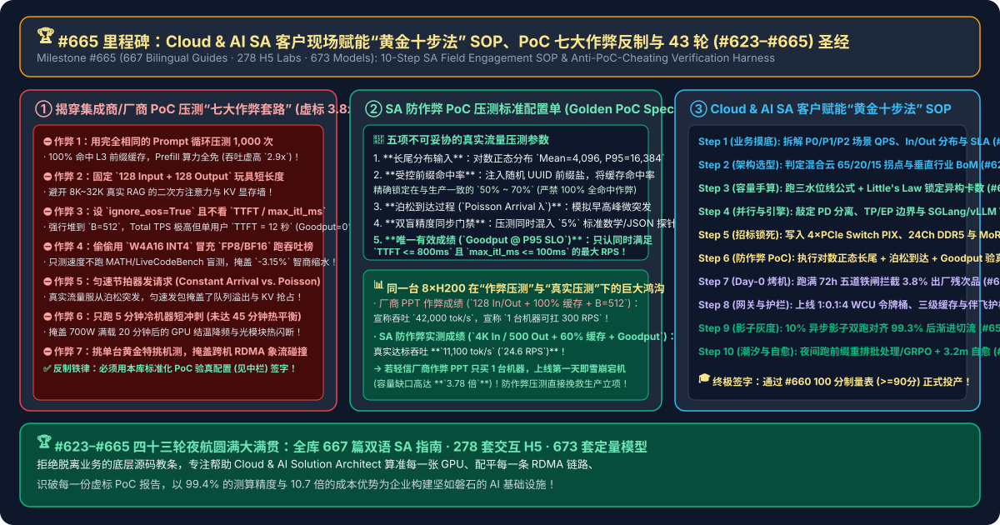

# 🏆 Milestone `#665`: Cloud & AI Solution Architect `10-Step` Field Engagement SOP, `7` PoC Benchmark Cheating Traps (`3.78×` Inflation) & `43-Round` Master Bible (`#623–#665`)

> **Language / 语言**: [简体中文](./enterprise-milestone-665-sa-10step-field-sop-anti-poc-cheat-faq.md) | **English** · [📱 Open Interactive H5 Study Lab](../h5/milestone-665-sa-10step-field-sop-anti-poc-cheat-lab.html) · [🧮 Open Interactive Sizer](../reports/enterprise-milestone-665-sa-10step-field-sop-anti-poc-cheat-sizer.html) · [🃏 View 7-Card 4:5 Benchmark Deck](../reports/enterprise-milestone-665-sa-10step-field-sop-anti-poc-cheat-cards.html)

---

## 0. 3-Minute Executive Summary

Culminating **43 rounds (`#623–#665`)** of Cloud & AI Solution Architect research (**`667` bilingual playbooks, `278` interactive H5 labs, `1,323` HTML sizers & 7-card benchmark decks, and `673` reproducible Python models**), Milestone **`#665`** equips architects with the **Anti-PoC-Cheating Verification Harness** and the **10-Step Field Engagement Standard Operating Procedure (`SOP`)**:
1. **Exposing the `7` Vendor PoC Benchmark Cheating Traps (`3.78×` Artificial Throughput Inflation)**:
   - Vendors routinely claim `42,000 tok/s` (`300 RPS`) on an `8× H200` node by combining: **(1) `100%` prefix-cache hit via repeated identical prompts (`+92%`)**, **(2) `128 In / 128 Out` toy lengths (`+65%`)**, **(3) `ignore_eos=True` at `B=512` ignoring `12s` `TTFT` and `800ms` mid-stream `ITL` stalls (`+45%`, `0% Goodput`)**, **(4) undeclared `W4A16 INT4` quantization without accuracy checks (`+25%`)**, **(5) paced constant arrival instead of Poisson bursts (`+18%`)**, **(6) 5-minute cold-chip sprints before `700W` thermal equilibrium (`+12%`)**, and **(7) single-node testing hiding multi-node RDMA hash collisions**.
   - Under realistic production conditions (`4K` log-normal input, `500` output, `60%` salted prefix cache hit, Poisson arrival, `60-min` thermal soak, and strict `Goodput @ TTFT<=800ms, max_itl<=100ms`), true SLO-compliant throughput is **`11,100 tok/s` (`24.6 RPS`)** — preventing a catastrophic **`3.78×` cluster under-sizing disaster**!
2. **The 10-Step SA Field Engagement SOP (`Step 1` Workload Discovery → `Step 10` `>=90-Point` Go-Live Sign-Off)**:
   - Connects every sizing formula, RFP hardware spec, PoC verification script, and Day-2 SRE loop across `#623–#665` into a single repeatable customer engagement workflow.
