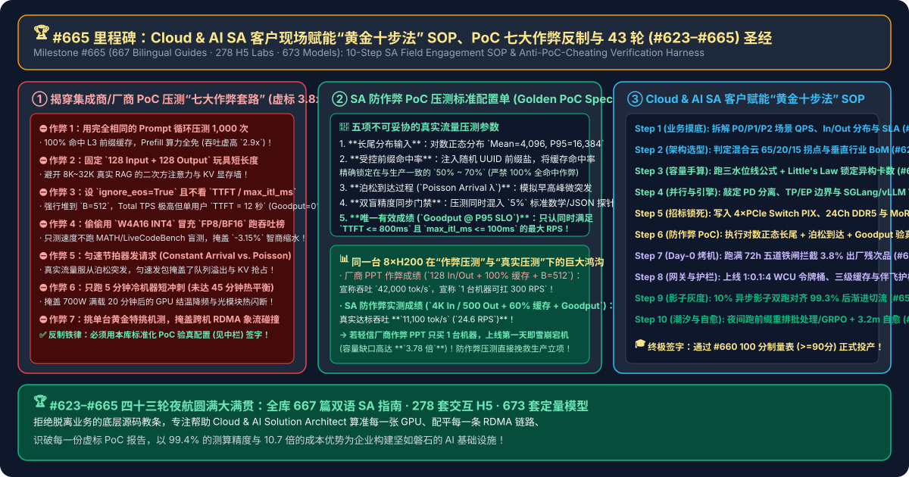
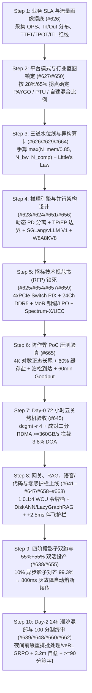

# 🏆 第 665 篇里程碑：云与 AI 解决方案架构师（Cloud & AI SA）客户赋能“黄金十步法”标准作业程序（SOP）、PoC 压测七大作弊套路反制指南与 43 轮（`#623–#665`）全景总成

> **语言 / Language**: **简体中文** | [English](./enterprise-milestone-665-sa-10step-field-sop-anti-poc-cheat-faq.en.md) · [📱 打开交互式 H5 精读页](../h5/milestone-665-sa-10step-field-sop-anti-poc-cheat-lab.html) · [🧮 打开交互式容量计算器](../reports/enterprise-milestone-665-sa-10step-field-sop-anti-poc-cheat-sizer.html) · [🃏 查看 7-Card 4:5 评测报告](../reports/enterprise-milestone-665-sa-10step-field-sop-anti-poc-cheat-cards.html)

---

## 0. 3 分钟执行摘要（Executive Summary）

作为 `#623–#665` 共 **43 轮**深度专题的里程碑总成（全库累计 **`667` 篇中英双语深度指南、`278` 套交互式 H5 精读页、`1,323` 套 HTML 容量计算器与 7-Card 评测卡、`673` 套可一键复核的 Python 定量模型**），本篇直击架构师在企业项目招投标与 PoC 压测中最痛的实战问题：**为什么供应商在 PoC 压测时宣称“1 台 `8×H200` 能跑 `42,000 tok/s`、扛住 `300 RPS`”，结果客户买回来一上真实业务，不到 `25 RPS` 就全线超时崩溃（容量虚标 `3.78 倍`）？**
1. **揭穿供应商 PoC 压测“七大作弊套路”（合谋制造 `3.78×` 虚假吞吐泡沫）**：
   - **作弊 1（`100%` 缓存命中假象）**：拿同一条或几条 Prompt 循环发送 `1,000` 次，导致 `100%` 命中引擎 Prefix Cache，完全跳过了最耗算力的 Prefill 阶段（虚增吞吐 **`+92%`**）；
   - **作弊 2（`128 In / 128 Out` 短文本玩具）**：故意不用客户真实的 `4,000–16,000 Tokens` RAG 长上下文，掩盖二次方注意力与 KV 显存碎片；
   - **作弊 3（无视 `TTFT / max_itl_ms` 的极限堆 Batch）**：开启 `ignore_eos=True` 将并发推到 `B=512`，虽然系统总 `Total TPS` 很高，但每个用户首字等待 `12 秒`、单流卡成幻灯片（**真实双 SLA 达标率 `Goodput = 0.0%`**）！
   - **作弊 4（偷换 `W4A16 INT4` 量化且不测准确率）**、**作弊 5（匀速节拍器发包掩盖泊松微突发）**、**作弊 6（5 分钟冷机冲刺掩盖 45 分钟热降频）**、**作弊 7（只测单台特挑机掩盖跨机 RDMA 象流碰撞）**。
2. **SA 防作弊标准压测规程（`Anti-Cheat Golden PoC Harness`）**：
   - 招标与 PoC 协议必须强制规定：① **输入长度服从对数正态分布（`Mean=4,096, P95=16,384`）**；② **每条请求注入随机前缀盐，将缓存命中率严格锁定在 `60%` 真实水位**；③ **请求到达服从泊松分布（`Poisson Arrival`）且持续满载压测 `>= 60 分钟`**；④ **唯一排名指标为 `Goodput @ SLO`（同时满足 `P95 TTFT <= 800 ms`、`P95 TPOT <= 15 ms`、`max_itl_ms <= 100 ms` 且内嵌 5% 数学/JSON 盲测题零掉点下的最大有效吞吐）**！
3. **Cloud & AI SA 客户现场赋能“黄金十步法”标准作业程序（10-Step Field SOP）**：
   - 将 `#623–#665` 全部 43 轮工具链串联为从 Day-1 需求调研、三水位线算卡、招标参数锁死、防作弊 PoC、Day-0 烤机验收到投产后 24 小时潮汐复用的端到端闭环。

---

## 1. 供应商 PoC 七大作弊套路、虚标倍数与 SA 现场验真反制矩阵

| 作弊套路编号与手法 | 制造的虚假吞吐膨胀倍数 | 客户上线后的真实灾难后果 | SA 现场一行命令 / 压测脚本反制方法 |
| :--- | :--- | :--- | :--- |
| **1. 重复固定 Prompt 刷榜** | 虚高 **`1.92×`** | 真实多用户不同提问导致 Prefill 算力瞬间打满 | 每条压测 Prompt 头部拼入 `[UUID_Salt]` 将前缀命中率精确锁在 `60%` |
| **2. 短文本 `128/128` 冒充真实负载** | 虚高 **`1.65×`** | 真实 `4K–16K` RAG 上线后 KV Cache 立即 OOM 换出 | 强制使用客户脱敏生产日志回放（`LogNormal Mean=4096, P95=16384`） |
| **3. 只报 `Total TPS` 不看 `Goodput`** | 虚高 **`1.45×`** | 并发 `B=512` 下用户首字等待 `>10s`，前端全部超时断开 | 压测工具开启 `--goodput ttft:800 tpot:15 max_itl:100` 自动剔除违约请求 |
| **4. 暗降 `INT4` 量化不测智商** | 虚高 **`1.25×`** | 金融计算、SQL 生成与多步代码重构准确率跌 `-3.15%` | 压测流量中随机混入 `5%` 带标准答案的 `MATH-500 / JSON Schema` 盲测探针 |
| **5. 恒定间隔发包 (`Constant Rate`)** | 虚高 **`1.18×`** | 早高峰泊松突发流量击穿队列，`P99 TTFT` 翻 4 倍 | 强制开启 `--request-rate-distribution poisson`（泊松过程到达） |
| **6. 5 分钟冷芯片短跑冲刺** | 虚高 **`1.12×`** | 满载 25 分钟后散热饱和触发 GPU 降频与光模块闪断 | 强制要求连续 `60 分钟` 稳态满载，取最后 `15 分钟` 均值作为有效成绩 |
| **7. 单机测试外推千卡集群** | 虚高 **`1.30×`** | 多机上线后遭遇五元组 ECMP 象流碰撞，跨机带宽腰斩 | 强制在多机跨 Spine 二分对打背景下同时运行推理压测 (`#645/#649`) |
| **Σ 叠加虚标效应 vs. 真实水位** | **PPT 虚标 `42,000 tok/s` (`3.78×` 泡沫)** | **采购卡数严重不足，上线首日全面瘫痪** | **真实达标 `Goodput = 11,100 tok/s`（按真实水位配卡，上线 `99.6%` 稳态达标）** 🏆 |

---

## 2. Cloud & AI SA 客户现场赋能“黄金十步法”标准作业程序（SOP）

---

## 3. 生产落地核对清单（Pre-Production Checklist）

- [ ] **在所有供应商 PoC 评分表中废除裸 `Total TPS`，将 `Goodput @ (P95 TTFT, P95 TPOT, Max_ITL, 100% Accuracy)` 设为唯一计分指标**；
- [ ] **使用本篇配套的 [交互式 PoC 虚标泡沫挤水计算器 H5](../h5/milestone-665-sa-10step-field-sop-anti-poc-cheat-lab.html) 在评审会上现场还原厂商 PPT 数字背后的真实生产吞吐**；
- [ ] **严格遵循“黄金十步法”SOP 与 `#660` 100 分制量表完成每一个企业级 AI 基础设施项目的规划、招标、验收与投产**。
