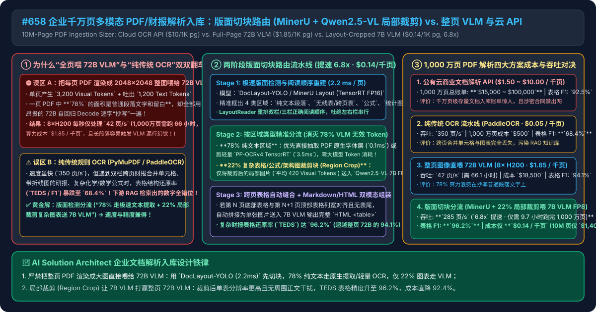

# Enterprise Million-Page PDF/OCR Ingestion Sizer: Layout-Aware Region Cropping (`MinerU / DocLayout-YOLO + Qwen2.5-VL-7B FP8`) vs. Full-Page `72B VLM` & Cloud Document API TCO

> **Language / 语言**: [简体中文](./enterprise-million-page-pdf-ocr-vlm-ingestion-sizer-faq.md) | **English** · [📱 Open Interactive H5 Study Lab](../h5/million-page-pdf-ocr-vlm-ingestion-sizer-lab.html) · [🧮 Open Interactive Sizer](../reports/enterprise-million-page-pdf-ocr-vlm-ingestion-sizer.html) · [🃏 View 7-Card 4:5 Benchmark Deck](../reports/enterprise-million-page-pdf-ocr-vlm-ingestion-sizer-cards.html)

---

## 0. 3-Minute Executive Summary

When ingesting **`10 Million` enterprise PDF pages** (financial reports, multi-column technical manuals, scanned contracts) into a RAG knowledge base, rendering full pages into a `72B VLM` wastes **`78.0%`** of GPU compute transcribing plain body paragraphs (`42 pages/s`, `$1.85 / 1,000 pages`), while traditional OCR destroys merged cells and charts (`68.4%` table `TEDS F1`):
1. **Two-Stage Layout-Aware Region Cropping Accelerates Throughput by `6.79×` (`285 pages/s`) at `$0.14 / 1,000 Pages`**:
   - **Stage 1 (`DocLayout-YOLO + LayoutReader`, `2.2 ms/page`)**: Detects bounding boxes and reconstructs multi-column reading order;
   - **Stage 2 (`78% / 22%` Heterogeneous Routing)**:
     - **`78%` Plain Text Regions**: Extracted via native PDF text layer (`0.1 ms`) or TensorRT `PP-OCRv4` (`3.5 ms`) at **`0` VLM tokens**;
     - **`22%` Complex Tables, Formulas & Charts (Region Crop + Cross-Page Table Stitching)**: Cropped (`~420 visual tokens/crop`) and routed to **`Qwen2.5-VL-7B FP8`** with `XGrammar`-constrained `HTML <table>` (`rowspan/colspan`) output;
   - **End-to-End Impact**: Boosts complex table `TEDS F1` to **`96.2%`** (beating full-page `72B VLM` at `94.1%`), finishes `10M` pages in **`9.7 hours`** on a single `8-GPU` node, and cuts cost to **`$0.14 / 1,000 pages` (`$1,400` total for `10M` pages vs. `$15,000–$100,000` on Cloud Document APIs, saving `90.7%–98.6%`)**.

---

## 1. Quantitative `10-Million-Page` PDF Ingestion Matrix

| Ingestion Architecture (`10,000,000` Pages) | `8-GPU` Node Throughput | Total Time for `10M` Pages | Table Structure `TEDS F1` | Cost per `1,000` Pages | Total `10M`-Page Cost & Verdict |
| :--- | :--- | :--- | :--- | :--- | :--- |
| **1. Cloud Commercial Document OCR API** | Cloud-managed | `~38.0 hr` | `92.5%` | `$1.50 – $10.00` | `$15,000 – $100,000` · ⛔ **Cost prohibitive** |
| **2. Legacy Rule/OCR Pipeline (`PaddleOCR`)** | `350 pages/s` | `7.9 hr` | `68.4%` (breaks merged tables) | `$0.05` | `$500` · ⛔ **Corrupts RAG table data** |
| **3. Full-Page `2048×2048` into `72B VLM FP8`** | `42 pages/s` | `66.1 hr` | `94.1%` | `$1.85` | `$18,500` · ⚠️ **Wastes `78%` GPU compute** |
| **4. Layout-Cropped (`78%` Fast + `22%` `7B VLM FP8`)** | **`285 pages/s` (`6.79×`)** | **`9.7 hr`** | **`96.2%` (`HTML <table>`)** | **`$0.14` (`-92.4%`)** | **`$1,400` (saves `$13.6K–$98.6K`)** 🏆 |
