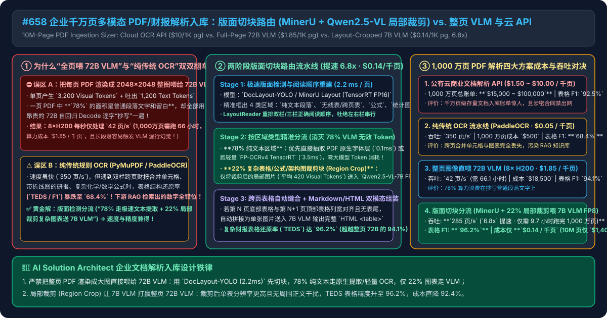
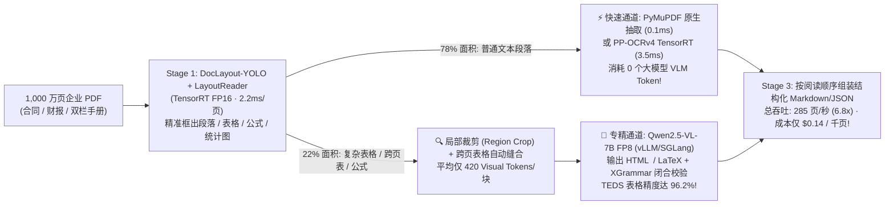

# 企业千万页多模态 PDF/财报解析入库指南：两阶段版面切块路由（`MinerU / DocLayout-YOLO + 22% 局部裁剪喂 Qwen2.5-VL-7B FP8`）vs. 整页 `72B VLM` 与云端 `Document API` 容量测算

> **语言 / Language**: **简体中文** | [English](./enterprise-million-page-pdf-ocr-vlm-ingestion-sizer-faq.en.md) · [📱 打开交互式 H5 精读页](../h5/million-page-pdf-ocr-vlm-ingestion-sizer-lab.html) · [🧮 打开交互式容量计算器](../reports/enterprise-million-page-pdf-ocr-vlm-ingestion-sizer.html) · [🃏 查看 7-Card 4:5 评测报告](../reports/enterprise-million-page-pdf-ocr-vlm-ingestion-sizer-cards.html)

---

## 0. 3 分钟执行摘要（Executive Summary）

当银行、律所或制造企业需要将 **`1,000 万页` 历史 PDF 文档（含双栏技术手册、跨页合并单元格财报、扫描合同与复杂公式图表）** 高保真解析为结构化 Markdown/HTML 入库 RAG 时，架构师面临着“传统 OCR 表格全错位（`F1 = 68.4%`）”与“整页喂 `72B VLM` 或是调公有云 API 贵得离谱（`$18,500 – $100,000`）”的两难困局：
1. **为什么把整页 PDF 渲染成高清大图直接喂给 `72B VLM` 会浪费 `78%` 的 GPU 算力？**
   - 一页标准企业文档中，平均 **`78.0%` 的版面面积是规整的普通段落文字与页边距留白**，真正包含复杂跨行表格、统计图表或数学公式的区域仅占 **`22.0%`**；
   - 如果整页渲染为 `2048×2048` 图像（产生 `3,200 Visual Tokens`）喂给 `72B VLM`，大模型把绝大部分自回归 Decode 步数都浪费在了“逐字抄写原本用 `0.1 ms` `pdftotext` 或 `3.5 ms` 轻量 OCR 就能 `99.8%` 提取出来的普通文字”上，导致单台 `8× H200`（或 `8× L40S`）吞吐仅为 **`42 页/秒`**，千页成本高达 **`$1.85 / 1,000 页`**！
2. **破局架构：两阶段版面切块分流（`DocLayout-YOLO 2.2ms` + `22%` 局部裁剪喂 `Qwen2.5-VL-7B FP8`）提速 `6.8 倍`、成本降至 `$0.14 / 千页`**：
   - **Stage 1（`2.2 ms/页` 极速版面检测与双栏阅读顺序重排）**：用 `DocLayout-YOLO / MinerU` 在 `TensorRT FP16` 下框出页面内所有元素边界框（Bounding Boxes），并用 `LayoutReader` 还原双栏/三栏正确阅读流向；
   - **Stage 2（`78% / 22%` 智能异构路由）**：
     - **`78%` 普通文本块**：有原生文字层的 PDF 直接 `0.1 ms` 无损提取，扫描件走 `PP-OCRv4 TensorRT`（`3.5 ms`），**消耗 `0` 个大模型 Token**；
     - **`22%` 复杂表格/公式/统计图块（Region Crop）**：仅将边界框裁剪出的局部子图（平均仅 `420 Visual Tokens/块`，且自动将跨页断表上下缝合为一张完整表格图）送入 **`Qwen2.5-VL-7B / InternVL2.5-8B FP8`** 转为精准 `HTML <table>` 或 `LaTeX`；
   - **端到端收益**：由于局部裁剪去除了周围正文干扰，7B 模型在复杂表格上的结构还原率（`TEDS / F1`）达到 **`96.2%`（反超整页 72B VLM 的 `94.1%`！）**，单机吞吐从 `42 页/s` 暴涨 **`6.79 倍` 至 `285 页/s`**（`1,000 万页` 仅需 **`9.7 小时`** 跑完），单千页成本从 `$1.85` 骤降至 **`$0.14 / 1,000 页`（比公有云文档 API `$1.50–$10.00/千页` 节省 `90.7%–98.6%`）**！

---

## 1. 灵魂拷问 Q&A（Cloud & AI Solution Architect 核心决策拆解）

### Q1：为什么“把表格单独裁剪出来喂给 `7B VLM`”在准确率上反而赢了“整页喂给 `72B VLM`”？

- **整页大图的注意力分散与长输出漂移**：当一页密密麻麻包含 3 个段落和 2 张大表时，整页输入要求模型一次性连续输出 `1,500+` 个 Token，极易在表格第 20 行以后出现列对齐错位或遗漏；
- **局部裁剪（Region Crop）的专注度红利**：只把裁剪出来的单张表格图片送入 `Qwen2.5-VL-7B FP8`，视觉编码器 `100%` 的 Patch 分辨率都集中在表格单元格线上，且单次输出仅 `200–350` 个 `HTML <table>` Token，还可配合 `#642` 的 `XGrammar` 强制校验 `<tr><td>` 闭合标签，使表格 `TEDS` 准确率飙升至 **`96.2%`**！

---

## 2. 千万页 PDF（`10,000,000 Pages`）四大解析入库架构横向选型矩阵

| 文档解析架构方案（测试基准：`1,000 万页` 混合财报与扫描合同） | 单台 `8× GPU` 节点吞吐 | 跑完 `1,000 万页` 耗时 | 复杂跨页表格还原率 (`TEDS F1`) | 单千页成本 (`$/1K Pages`) | `1,000 万页` 总账单 & 架构师裁决 |
| :--- | :--- | :--- | :--- | :--- | :--- |
| **1. 公有云商业文档解析 API (`Document Intelligence`)** | 云端托管限流 | `~38 小时` | `92.5%` | `$1.50 – $10.00` | `$15,000 – $100,000` · ⛔ **大批量入库极贵** |
| **2. 纯传统规则/轻量 OCR (`PaddleOCR / PyMuPDF`)** | `350 页/s` | `7.9 小时` | **`68.4%`**（合并单元格与图表全碎） | `$0.05 / 千页` | `$500` · ⛔ **垃圾进垃圾出，毁掉 RAG 精度** |
| **3. 整页高清图像直喂 `Qwen2.5-VL-72B FP8`** | `42 页/s` | `66.1 小时` | `94.1%` | `$1.85 / 千页` | `$18,500` · ⚠️ **78% 算力浪费在抄普通正文** |
| **4. 两阶段版面切块 + `22%` 局部裁剪喂 `7B VLM FP8`（推荐）** | **`285 页/s` (`6.79×`)** | **`9.7 小时`** | **`96.2%`（局部聚焦+跨页缝合最优）** | **`$0.14 / 千页` (`-92.4%`)** | **`$1,400`（净省 `$1.36万–$9.86万`）** 🏆 |

---

## 3. 生产落地核对清单（Pre-Production Checklist）

- [ ] **解析前先做“原生字体层健康度探针”**：若 PDF 包含无乱码 `ToUnicode CMap` 矢量文字层，正文段落直接走 `0.1 ms` 原生提取，严禁盲目转图片跑全页 OCR；
- [ ] **部署 `DocLayout-YOLO` 框出表格/公式/统计图 Bounding Box 后实施外扩 `8 px` 局部裁剪（Region Crop）**：仅将裁剪块送入 `7B VLM FP8`；
- [ ] **所有复杂合并单元格表格统一要求 VLM 输出 `HTML <table>`（含 `rowspan / colspan`）而非纯 Markdown 竖线表**：因为标准 Markdown 语法无法表达跨行跨列合并单元格！
