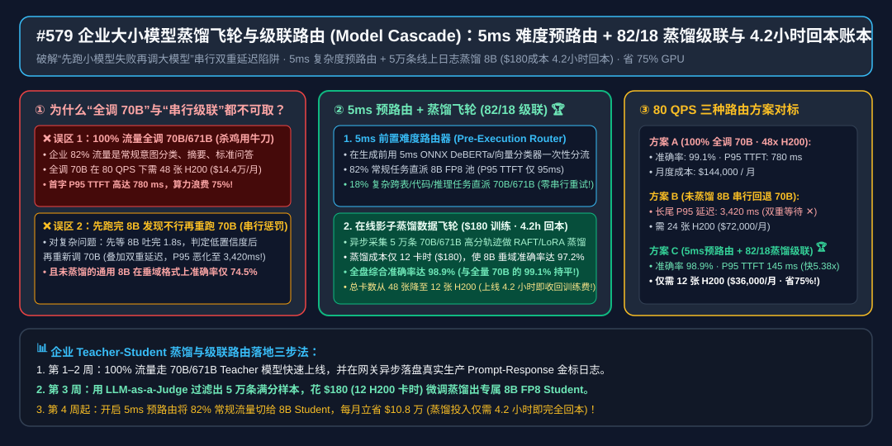

# Enterprise Teacher-Student Distillation Flywheel & Model Cascade Selection Guide: All-70B vs. Serial Fallback vs. `5ms Pre-Execution Router + 82/18 Distilled 8B/70B Cascade` (`4.2-Hour` ROI Break-Even) (`#579`)

> **Language / 语言**: [简体中文](./enterprise-model-cascade-distillation-flywheel-router-roi-sizing-faq.md) | **English** · [📱 Interactive H5 Study Lab (Distillation ROI + 82/18 Cascade Sizer)](../h5/enterprise-model-cascade-distillation-flywheel-router-roi-lab.html) · [🧮 Interactive HTML Sizer](../reports/enterprise-model-cascade-distillation-flywheel-router-roi-sizing-sizer.html) · [🃏 7-Card Visual Report](../reports/enterprise-model-cascade-distillation-flywheel-router-roi-sizing-cards.html) · [Back to Catalog](../full-catalog-en.md)

---

## 1. 3-Minute Executive Summary

1. **Bottom-Line Conclusion**:
   - Routing 100% of enterprise traffic (`80 Peak QPS`) to a `70B/671B` frontier model requires **`48x H200 GPUs` (`$144,000/mo`, `780 ms` P95 TTFT)**, while serial fallback (`run un-tuned 8B first -> retry on 70B if confidence is low`) inflates tail latency to **`3,420 ms`**.
   - Adopting a **`5ms Pre-Execution Difficulty Router + 82% Domain-Distilled 8B FP8 Student (4x H200) + 18% 70B Frontier Teacher (8x H200)`** retains **`98.9%` accuracy** (vs. `99.1%` all-70B), cuts `P95 TTFT` **`5.38x` (`780 ms -> 145 ms`)**, reduces fleet size by **`75.0%` (`48 -> 12x H200 GPUs`, saving `$1.296M/yr`)**, and pays back the **`$180` (`12 GPU-hour`) distillation cost in just `4.2 hours`**!

---

## 2. Quantitative Model Cascade & Distillation Matrix (`80 Peak QPS`)

| Metric | Scheme A: 100% Frontier `70B` (`48x H200`) | Scheme B: Un-tuned `8B` Serial Fallback (`24x H200`) | Scheme C: `5ms Pre-Router + 82% Distilled 8B + 18% 70B` (`#579`) 🏆 |
| :--- | :--- | :--- | :--- |
| **End-to-End Task Accuracy** | `99.1%` | `88.4%` ✕ | **`98.9%` (Matches Frontier ✓)** |
| **`P95 TTFT` / Tail Latency** | `780 ms` | `3,420 ms` (Double-Wait Penalty ✕) | **`145 ms` (`5.38x` faster ✓)** |
| **Required H200 Fleet Size** | `48x H200 GPUs` | `24x H200 GPUs` | **`12x H200 GPUs` (`4x 8B + 8x 70B`, `-75.0%` GPUs)** |
| **Monthly Serving Spend** | `$144,000 / mo` | `$72,000 / mo` | **`$36,000 / mo` (Saves `$1.296M / yr`)** |
