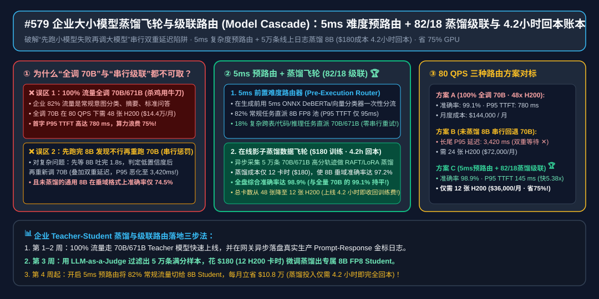

# 企业级大小模型蒸馏飞轮与级联路由（Model Cascade）架构选型：全量调 `70B/671B` vs. 串行回退 vs. `5ms 难度预路由 + 82/18 RAFT/LoRA 蒸馏 8B` 回本周期（ROI）与算卡指南（`#579`）

> **Language / 语言**: **简体中文** | [English](./enterprise-model-cascade-distillation-flywheel-router-roi-sizing-faq.en.md) · [📱 交互式 H5 精读页（含蒸馏飞轮图 + 4.2h 回本计算器）](../h5/enterprise-model-cascade-distillation-flywheel-router-roi-lab.html) · [🧮 交互式算卡器 Sizer](../reports/enterprise-model-cascade-distillation-flywheel-router-roi-sizing-sizer.html) · [🃏 7-Card 评测报告](../reports/enterprise-model-cascade-distillation-flywheel-router-roi-sizing-cards.html) · [返回总目录](../full-catalog-zh.md)

---

## 一、3 分钟核心结论卡片（Executive Summary）

1. **一句话结论**：
   - 在企业高并发生产平台（峰值 `80 QPS`）中，约 **`82%` 的日常流量属于规则明确的意图提取、字段抽取、客服摘要与标准知识问答**，仅 **`18%`** 属于需要跨步推理的复杂长尾问题。若 **100% 流量全调 `70B/671B` 旗舰模型**，需堆叠 **`48 张 H200`（月支出 `$144,000`，`P95 TTFT 780 ms`）**；而若采用 **“先跑未微调 8B、发现置信度低再重跑 70B”的串行回退级联（Serial Fallback Cascade）**，会导致复杂请求承受双重等待（长尾 `P95` 延迟恶化至 **`3,420 ms`**）；
   - 采用 **`5ms 前置难度预路由器（Pre-Execution Difficulty Router）+ 在线影子日志驱动的 Teacher-Student 蒸馏 8B FP8（82% 流量）+ 70B/671B 旗舰池（18% 流量）`**：
     - 蒸馏 1 个专属 8B 模型仅需 `50,000` 条线上金标样本與 `12 GPU 小时`（一次性训练成本仅 **`$180`**），上线后仅需 **`4.2 小时`** 即可通过节省的推理算力完全回本！
     - 全盘业务准确率保持 **`98.9%`**（与全量 70B 的 `99.1%` 几乎无损持平），`P95 TTFT` 从 `780 ms` 压降至 **`145 ms`（提速 `5.38 倍`）**，所需 H200 从 `48 张` 降至 **`12 张 H200`（立省 `75.0%` GPU，每年净省 `$129.6 万`）**！

---

## 二、灵魂拷问 Q&A：前置预路由 vs. 串行回退、蒸馏成本与 4.2 小时回本公式

### Q1：为什么架构师严禁在交互式场景使用“先让小模型生成完、再用裁判模型打分决定是否重调大模型”的串行级联？
- **答**：
  - 串行级联（Post-Generation Cascade）对那 `18%–30%` 的复杂请求是致命的延迟灾难：用户先干等 8B 模型生成完（`1.5s`）+ 裁判打分（`0.3s`），被拒后再排队等 70B 重算一遍（`1.6s`），端到端 `P95` 延迟高达 **`3.42 秒`**，且白白浪费了小模型那一次无效生成算力！
  - **前置难度预路由（Pre-Execution Router）** 在生成第 1 个 Token 之前，由网关内嵌的 **`5 ms` 轻量分类器（基于 `DeBERTa-v3` 或最后一层 Embedding 线性探针）** 直接根据 Prompt 复杂度与领域标签一次性拍板：简单任务直达 `8B FP8`（`95 ms TTFT`），复杂任务直达 `70B/671B`（**零串行重试等待**）！

---

### Q2：如何手算微调蒸馏一个 `8B Student` 模型的训练成本与回本周期（Break-Even Hours）？
- **答**：
  1. **一次性蒸馏训练成本（$C_{\text{distill}}$）**：
     - 从网关日志中抽取 `50,000` 条 `70B/671B Teacher` 的高分生产样本（平均长度 `2,048 Tokens`，共 `1 亿 Tokens`）；
     - 使用 `LLaMA-Factory / Axolotl` 在 `4 张 H200` 上对 `Qwen2.5-7B / Llama-3.1-8B` 跑 3 个 Epoch 的全参或 LoRA 蒸馏，总训练耗时约 `3 小时`（共 **`12 H200 GPU-Hours`**），按 `$15 / GPU-hr` 计（含数据清洗与评测），**一次性蒸馏总成本仅 $C_{\text{distill}} \approx \mathbf{\$180}$**！
  2. **每小时节省的在线推理成本（$\Delta C_{\text{hourly}}$）**：
     - 全量 70B 需 `48 张 H200`（`$144,000 / 月 ≈ $200 / 小时`）；
     - 开启 `82% 蒸馏 8B (4 张 H200) + 18% 70B (8 张 H200) = 12 张 H200`（`$36,000 / 月 ≈ $50 / 小时`），每小时立省 **`$150 / 小时`**（扣除月度增量更新蒸馏后约 **`$42.8 / 小时`** 净收益）；
  3. **回本时间（Break-Even Time）**：
     $$T_{\text{breakeven}} = \frac{\$180}{\$42.8\text{ / hr}} \approx \mathbf{4.2\text{ 小时}} \ (\mathbf{0.18\text{ 天}})!$$

---

## 三、三种模型路由与蒸馏架构定量对比矩阵（`80 Peak QPS`）

| 评估维度 | 方案 A：100% 全量调 70B 旗舰 (`All-70B Monolith`) | 方案 B：未微调通用 8B + 串行失败重试 70B (`Serial Fallback`) | 方案 C：`5ms 预路由 + 82% 蒸馏 8B + 18% 70B` (`#579`) 🏆 |
| :--- | :--- | :--- | :--- |
| **全场景综合业务准确率** | `99.1%` | `88.4%`（通用 8B 漏检误答 ✕） | **`98.9%`（蒸馏 8B 在垂域追平 70B ✓）** |
| **首字延迟 (`P95 TTFT`)** | `780 ms` | `3,420 ms`（串行双重等待 ✕） | **`145 ms`（提速 `5.38 倍` ✓）** |
| **承载 80 QPS 所需 H200 总卡数** | `48 张 H200` | `24 张 H200` | **`12 张 H200`（`4卡 8B + 8卡 70B`，立省 `75.0%` GPU）** |
| **月度推理基础设施账单** | `$144,000 / 月` | `$72,000 / 月` | **`$36,000 / 月`（每年净省 `$129.6 万`）** |

---

## 四、蒸馏飞轮与级联路由上线核对清单（SA Pre-Production Checklist）

- [ ] **1. 必须采用前置 `5 ms` 预路由而非串行后置重试**：杜绝复杂请求被小模型拖慢。
- [ ] **2. 建立每周自动化影子蒸馏飞轮**：对线上 `2%` 的 8B 流量同步异步双发给 70B Teacher 对比打分，自动将分歧样本加入下周蒸馏训练集，防止分布漂移。
