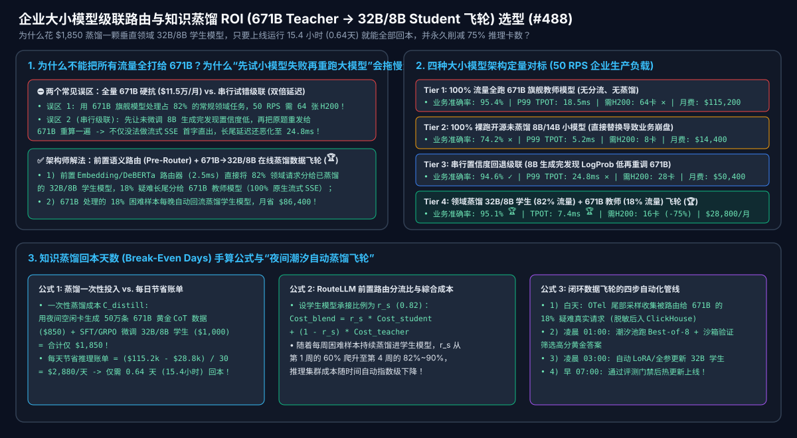

# Enterprise Teacher-Student Model Distillation ROI & Pre-Routed Cascade (`671B Teacher -> 32B/8B Distilled Student + RouteLLM`) Selection Guide (#488)

> **Executive Summary**:
> Serving 100% of production traffic on a frontier `671B` model at `50 RPS` requires **`64 H200 GPUs` (`$115,200/mo`)**, whereas swapping in an un-distilled `8B/14B` model drops domain accuracy from `95.4%` to `74.2%`. For **Cloud & AI Solution Architects**, the highest-ROI pattern is a **Continuous Teacher-Student Distillation Flywheel + Pre-Generation Semantic Router (`RouteLLM`, `2.5ms`)**: spend **`$1,850` once** during nighttime tidal hours to distill `500k` `671B` teacher traces into a `32B/8B` student model that serves **82% of production traffic**, while routing only the **18% hardest queries** to the `671B` teacher. This retains **`95.1%` domain accuracy**, accelerates weighted `P99 TPOT` to **`7.4ms` ($2.5\times$)**, cuts GPU fleet size by **75% (`16 H200 GPUs`, `$28,800/mo`)**, and **pays back the entire distillation training cost in just `0.64 days (15.4 hours)`**.
>
> **⚡ Interactive H5 Study Lab**: [**Open the Teacher-Student Distillation ROI & Break-Even Calculator (`docs/h5/model-cascade-distillation-roi-routing-sizer-lab.html`)**](../h5/model-cascade-distillation-roi-routing-sizer-lab.html)

---

## 1. Core Q&A: Hand-Calculating Distillation Break-Even Days vs. Sequential Cascades

### Q1: How do we hand-calculate the exact break-even time of domain distillation?
$$T_{\text{breakeven\_days}} = \frac{C_{\text{distill\_train}}}{\text{Daily\_Serving\_Savings}} = \frac{\$1,850}{(\$115,200 - \$28,800)/30} = \mathbf{0.64\text{ Days (15.4 Hours)}}$$
Unlike sequential retry cascades (which break streaming SSE when a low-confidence student response must be discarded and re-generated on the teacher), a `2.5ms` pre-router preserves 100% native SSE streaming on both paths.

---

## 2. Quantitative Decision Matrix (`50 RPS Enterprise Workload`)

| Model Serving & Cascade Tier | Domain Accuracy (%) | Weighted `P99 TPOT` | H200 GPUs (50 RPS) | Monthly Serving Cost ($/mo) |
| :--- | :--- | :--- | :--- | :--- |
| **Tier 1: 100% Frontier `671B` Teacher Model Serving** | `95.4%` | `18.5 ms` | `64 GPUs` ✕ | `$115,200` ✕ |
| **Tier 2: Un-Distilled Off-the-Shelf `8B/14B` Only** | `74.2%` ✕ | `5.2 ms` | `8 GPUs` | `$14,400` |
| **Tier 3: Sequential Retry Cascade (`8B -> 671B` on Low Conf)** | `94.6%` ✓ | `24.8 ms` ✕ | `28 GPUs` | `$50,400` |
| **Tier 4: Distilled `32B/8B` Student (`82%`) + `671B` Teacher (`18%`) 🏆** | **`95.1%` 🏆** | **`7.4 ms` (2.5x 🏆)** | **`16 GPUs` (-75% 🏆)** | **`$28,800` (0.64d ROI 🏆)** |
