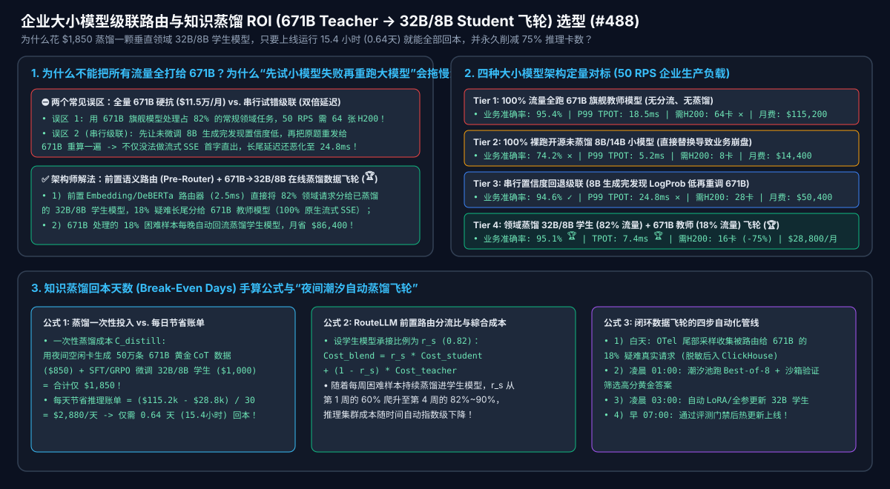
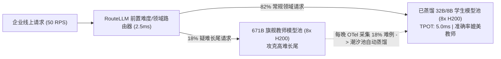

# 企业大小模型级联路由与知识蒸馏 ROI（`671B Teacher -> 32B/8B Student 飞轮 + RouteLLM`）选型与回本周期手算指南 (#488)

> **核心观点（Executive Summary）**：
> 在企业大模型进入日均千万级调用的深水区后，**把 100% 生产流量一直打在 `DeepSeek-R1 671B / Llama-405B` 巨型旗舰模型上（`50 RPS` 需 `64 张 H200`，月烧 `$115,200`）是最大的 FinOps 懒政**！反之，如果直接换成未经蒸馏的开源 `8B/14B` 小模型，垂直业务准确率会从 `95.4%` 暴跌至 `74.2%`。作为 **Cloud & AI Solution Architect**，最具商业 ROI 的架构是建立 **“前置语义路由（`RouteLLM`，`2.5ms`）+ 领域知识蒸馏闭环飞轮（`671B Teacher -> 32B/8B Distilled Student`）”**：利用夜间潮汐空闲算力花 **`$1,850` 一次性蒸馏成本** 训练出垂直领域 `32B/8B` 学生模型，承接线上 **`82%` 的常规领域流量**，仅将 **`18%` 的疑难长尾流量** 路由给 `671B` 教师模型，并将教师模型的回答每晚持续回流精调学生模型。在保住 **`95.1%` 业务准确率** 并支持 100% 原生流式 SSE 的同时，将加权 `P99 TPOT` 从 `18.5ms` 压至 **`7.4ms`（提速 $2.5\times$）**，所需 H200 从 `64 卡` 直降至 **`16 卡`（月省 `$86,400`，一次性蒸馏投入仅需 `0.64 天 / 15.4 小时` 即可全部回本！）**。
>
> **⚡ 配套交互式 H5 精读沙盘**：[**打开大小模型级联路由与知识蒸馏回本天数 (Break-Even ROI) 计算器 (`docs/h5/model-cascade-distillation-roi-routing-sizer-lab.html`)**](../h5/model-cascade-distillation-roi-routing-sizer-lab.html)

---

## 一、 灵魂拷问：为什么“前置路由 + 领域蒸馏”全面优于“先跑小模型、不自信再重跑大模型”的串行级联？

### Q1：为什么学术界常提的“串行试错级联（Sequential Retry Cascade）”在企业流式 SSE 场景中水土不服？
1. **串行级联破坏流式 SSE 首字体验**：
   - 在串行级联（Tier 3）中，请求先发给 `8B` 小模型生成；只有等小模型生成了几十个 Token 甚至整段话后，计算平均对数概率（LogProb Confidence）发现低于阈值，才掐断重头调用 `671B` 大模型；
   - 如果你在 `8B` 生成时就已经通过 SSE 把前 20 个字推给了用户屏幕，一旦发现 `8B` 胡说八道，**已经吐到用户屏幕上的字根本无法撤回**！如果等 `8B` 整句跑完不推流，首字延迟又会暴涨 `1.5 秒+`！
2. **前置语义路由（Pre-Generation Router，`RouteLLM`）的零等待优势**：
   - 在 AI Gateway 嵌入一颗基于历史对话难度训练的 `DeBERTa-v3 / BGE` 路由分类器（耗时仅 **`2.5ms`**），在生成第 1 个字之前就一步到位拍板：简单/标准领域任务（82%）直通 **已蒸馏 `32B/8B` 学生池**，跨领域疑难任务（18%）直通 **`671B` 教师池**，两边均享受 100% 丝滑流式直出！

### Q2：怎样手算“知识蒸馏一次性训练投入”需要多少天能从省下的推理电费里赚回来？
1. **一次性离线蒸馏成本 $C_{\text{distill}}$ 手算**：
   - **Step 1（合成黄金教师数据）**：利用第 `#474` 篇的 **夜间字典序重排批处理（`$0.028/1M`）**，让 `671B` 教师模型针对 50 万条脱敏历史业务 Query 生成带思维链的高质量回答（约 `5 亿 Tokens`，结合 `Best-of-4` 沙箱/规则过滤，总成本约 **`$850`**）；
   - **Step 2（微调学生模型）**：在 8 张 H200 上用 `LoRA / 全参 SFT + GRPO` 微调 `Qwen2.5-32B / Llama-3.1-8B` 约 8 小时（成本约 **`$1,000`**）；
   - **总一次性投入**：$C_{\text{distill}} = 850 + 1000 = \mathbf{\$1,850}$。
2. **回本天数（Break-Even Days）公式**：
   $$T_{\text{breakeven\_days}} = \frac{C_{\text{distill}}}{\text{Daily\_Serving\_Savings}} = \frac{\$1,850}{(\$115,200 - \$28,800) / 30} = \frac{\$1,850}{\$2,880 / \text{day}} = \mathbf{0.64\text{ Days (15.4 小时！)}}$$
   - **不到 16 个小时就能赚回全部蒸馏训练成本**，此后每个月净省 **`$86,400`**！

---

## 二、 四种大小模型架构选型决策矩阵（`50 RPS 生产负载`）

| 大小模型服务与路由方案（`50 RPS`） | 垂直业务准确率 (%) | 加权 `P99 TPOT` (ms) | 所需 H200 卡数 | 月度推理算力账单 ($/mo) |
| :--- | :--- | :--- | :--- | :--- |
| **Tier 1: 100% 流量全跑 `671B` 旗舰教师模型（无分流）** | `95.4%` | `18.5 ms` | `64 卡` ✕ | `$115,200` ✕ |
| **Tier 2: 100% 裸跑开源未蒸馏 `8B/14B` 小模型** | `74.2%`（业务不可用 ✕） | `5.2 ms` | `8 卡` | `$14,400` |
| **Tier 3: 串行试错回退级联（`8B` 低置信度再重跑 `671B`）** | `94.6%` ✓ | `24.8 ms`（重试拖慢 ✕） | `28 卡` | `$50,400` |
| **Tier 4: 领域蒸馏 `32B/8B` 学生 (`82%`) + `671B` 教师 (`18%`) 飞轮（推荐 🏆）** | **`95.1%` 🏆** | **`7.4 ms` (2.5x 🏆)** | **`16 卡` (-75% 🏆)** | **`$28,800` (0.64天回本 🏆)** |

---

## 三、 生产落地核对清单（SA Production Checklist）

- [ ] **先用 671B 跑通 MVP 并攒够 5 万条日志，第 2 周即刻启动蒸馏**：新业务上线首周直接用 `671B` 快速验证效果并开启 OTel 采样收集真实 Prompt；一旦积累 5~10 万条真实样本，立即启动夜间蒸馏将 80% 流量切至 `32B/8B` 学生模型。
- [ ] **蒸馏学生模型采用 `Multi-LoRA` 共池托管**：多个业务线各自蒸馏出的 `8B/32B` 学生适配器，统一托管在共享基座池中（结合 `#468` S-LoRA），实现零额外底座显卡开销。
- [ ] **保持 1% 随机黄金哨兵流量（Canary Shadowing）**：在路由给学生模型的 82% 流量中，随机抽样 1% 异步复制给 `671B` 教师模型做暗网比对打分，一旦某类新问题学生模型得分下降，自动调整路由器阈值将其切回教师模型。

---

## 四、 延伸阅读与配套工具

- **交互式 H5 精学沙盘**：[docs/h5/model-cascade-distillation-roi-routing-sizer-lab.html](../h5/model-cascade-distillation-roi-routing-sizer-lab.html)
- **7-Card 4:5 视觉评测卡片**：[docs/reports/enterprise-model-cascade-distillation-roi-teacher-student-routing-selection-cards.html](../reports/enterprise-model-cascade-distillation-roi-teacher-student-routing-selection-cards.html)
- **交互式 Sizer 测算器**：[docs/reports/enterprise-model-cascade-distillation-roi-teacher-student-routing-selection-sizer.html](../reports/enterprise-model-cascade-distillation-roi-teacher-student-routing-selection-sizer.html)
- **可复现实验模型**：[`experiments/enterprise_model_cascade_distillation_roi_teacher_student_routing_selection/run.py`](../../experiments/enterprise_model_cascade_distillation_roi_teacher_student_routing_selection/run.py)
