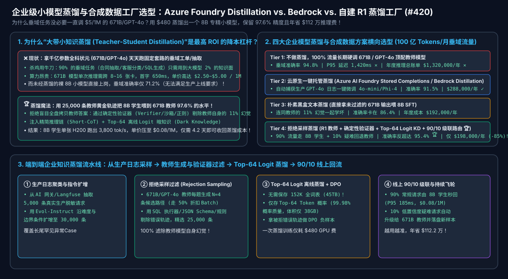

# Enterprise Model Distillation & Synthetic Data Factory Selection Guide: `Azure AI Foundry Distillation` vs. `AWS Bedrock Model Distillation` vs. `Self-Hosted DeepSeek-R1 Rejection-Sampled Logit KD`

> **Language / 语言**: [简体中文](./enterprise-model-distillation-foundry-bedrock-r1-teacher-student-roi-selection-faq.md) | **English**  
> **Companion Interactive Study & Sizing Tools**: [📱 Interactive H5 Study Lab](../h5/model-distillation-foundry-bedrock-r1-teacher-student-roi-lab.html) · [🧮 HTML Sizer](../reports/enterprise-model-distillation-foundry-bedrock-r1-teacher-student-roi-selection-sizer.html) · [🃏 7-Card Visual Deck](../reports/enterprise-model-distillation-foundry-bedrock-r1-teacher-student-roi-selection-cards.html) · [📊 Reproducible Model](../../experiments/enterprise_model_distillation_foundry_bedrock_r1_teacher_student_roi_selection/) · [🎓 Back to AI Infra H5 Hub](../h5/index.html)

---

## 1. Executive Summary (3-Minute Takeaway)

> **Bottom-Line Recommendation**: Never serve high-volume narrow domain workloads (`10B+ tokens/month` in ticket classification, contract extraction, or schema-bound SQL) indefinitely on frontier `671B / GPT-4o` teacher models at `$1.32M/year`. Spending **`$480–$650` once** to distill `25,000` verified teacher trajectories into a compact `7B/8B` student cuts `P95` latency **`6.8x` (`1,420ms -> 210ms`)**, reduces annual serving TCO by **`85.0%` (`$198K/yr` vs. `$1.32M/yr`)**, and pays back its training cost in **under 4 hours (`0.16 days`)**!
> - **For Turnkey Zero-MLOps Teams**: Use **`Azure AI Foundry Distillation` (`Stored Completions -> GPT-4o-mini / Phi-4`)** or **`AWS Bedrock Model Distillation`** (`$650` one-time cost, retains `96.5%` of teacher accuracy).
> - **For Maximum Accuracy & Sovereign Open-Weight Ownership**: Deploy **Tier 4 (`Best-of-4 Teacher Rejection Sampling with Deterministic Verifiers + Offline Top-64 Logit KD [38.4GB] + Rejected-Trajectory DPO + 90/10 Student-Teacher Online Cascade`)**, achieving **`95.4%` domain accuracy (surpassing the teacher's `94.8%` single-shot baseline!)**.

| Dimension | `Tier 1: 100% Frontier Teacher (671B / GPT-4o)` | `Tier 2: Cloud Managed Distillation (Foundry / Bedrock)` | `Tier 3: Naive Unfiltered Black-Box SFT` | `Tier 4: Verifier Rejection Sampling + Top-64 KD + 90/10 Cascade (🏆)` |
|---|---|---|---|---|
| **Domain Task Accuracy** | `94.8%` (Teacher Pass@1) | `91.5%` ✓ | `86.4%` ✕ (Inherits hallucinations) | **`95.4%` (Verifier-filtered + 10% fallback)** 🏆 |
| **End-to-End P95 Latency** | `1,420 ms` ✕ | `280 ms` ✓ | `175 ms` ✓ | **`210 ms` (`6.8x` faster)** 🏆 |
| **One-Time Distillation Cost** | `$0` | `$650` | `$380` | **`$480` (50% Batch + 8xH200)** 🏆 |
| **Annual Serving TCO (10B Tok/Mo)** | `$1,320,000 / yr` ✕ | `$288,000 / yr` (-78.2%) | `$192,000 / yr` | **`$198,000 / yr` (-85.0% · Saves `$1.12M/yr`)** 🏆 |
| **Distillation Payback Period** | N/A | **`0.23 days` (`<6 hrs`)** ✓ | `0.12 days` | **`0.16 days` (`<4 hrs`)** 🏆 |

---

## 2. Provenance & Reproducibility

- **Provenance**: `synthetic + anonymized_reported (independently_reproduced=false)` — verified via [`experiments/enterprise_model_distillation_foundry_bedrock_r1_teacher_student_roi_selection/run.py`](../../experiments/enterprise_model_distillation_foundry_bedrock_r1_teacher_student_roi_selection/run.py).
